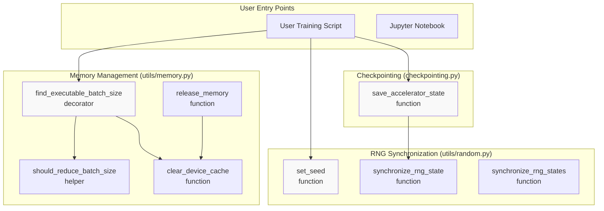
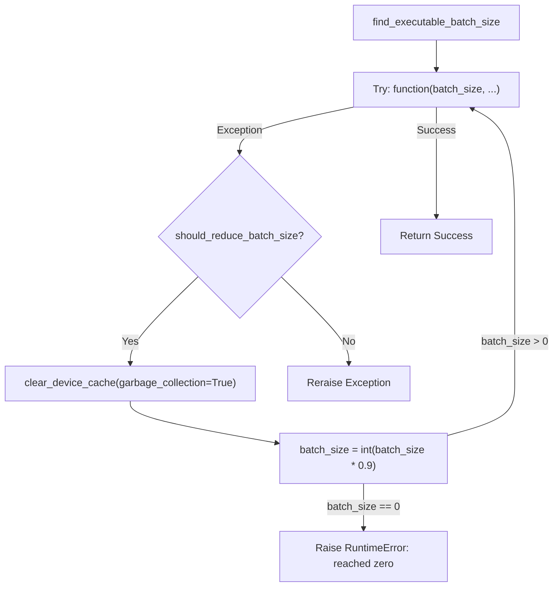
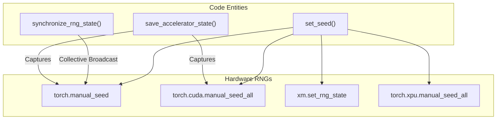

<!-- source: DeepWiki mcp.deepwiki.com · repo huggingface/accelerate · page 13 Memory and System Utilities · fetched 2026-10-21 -->

# Memory and System Utilities

Relevant source files

The following files were used as context for generating this wiki page:

- [src/accelerate/checkpointing.py](src/accelerate/checkpointing.py)
- [src/accelerate/commands/env.py](src/accelerate/commands/env.py)
- [src/accelerate/memory_utils.py](src/accelerate/memory_utils.py)
- [src/accelerate/utils/memory.py](src/accelerate/utils/memory.py)
- [src/accelerate/utils/random.py](src/accelerate/utils/random.py)
- [tests/test_memory_utils.py](tests/test_memory_utils.py)
- [tests/test_state_checkpointing.py](tests/test_state_checkpointing.py)

This page documents the low-level memory management, random number generator (RNG) synchronization, and system detection utilities provided by Accelerate. These utilities enable robust distributed training by handling out-of-memory errors, ensuring reproducibility across processes, and detecting hardware capabilities without premature device initialization.

For information about big model memory management (device mapping, offloading), see [Big Model Support](#5). For information about data loading and batch processing, see [Data Loading and Processing](#4).

## Overview

Accelerate provides three categories of system utilities:

| Category | Purpose | Key Use Cases |
|----------|---------|---------------|
| **Memory Management** | Handle OOM errors, clear device cache, release tensors | Automatic batch size reduction, memory cleanup between experiments |
| **RNG Synchronization** | Ensure reproducible behavior across distributed processes | Synchronized data augmentation, reproducible training runs |
| **Environment Detection** | Detect hardware and configuration without device initialization | Fork-based multiprocessing, hardware capability queries |

These utilities are primarily used internally by the `Accelerator` class but are also exposed as public APIs for advanced use cases.

For details, see [Memory Management](#13.1), [RNG Synchronization](#13.2), and [Environment Detection and System Configuration](#13.3).

Sources: [src/accelerate/utils/memory.py:15-18](), [src/accelerate/utils/random.py:1-33](), [src/accelerate/checkpointing.py:63-178]()

---

## System Architecture

**System Architecture**: The memory and system utilities operate at multiple levels: (1) Memory utilities handle OOM exceptions and device cache management, (2) RNG utilities ensure reproducibility by synchronizing random states across distributed processes, and (3) Checkpointing utilities persist these states to disk.

Sources: [src/accelerate/utils/memory.py:1-188](), [src/accelerate/utils/random.py:1-165](), [src/accelerate/checkpointing.py:63-178]()

---

## Memory Management (#13.1)

The memory management utilities handle out-of-memory (OOM) errors gracefully and provide functions to clear device caches. The primary utility is `find_executable_batch_size`, a decorator that automatically reduces batch size when OOM errors occur by catching specific `RuntimeError` messages.

**Memory Management Flow**: The `find_executable_batch_size` decorator wraps a training function, starting with a specified batch size. If `should_reduce_batch_size` identifies a memory-related failure, it clears the cache and retries with a reduced batch size until success or reaching zero.

For details, see [Memory Management](#13.1).

Sources: [src/accelerate/utils/memory.py:40-188](), [tests/test_memory_utils.py:53-127]()

---

## RNG Synchronization (#13.2)

RNG synchronization ensures reproducible behavior across distributed training processes. Without synchronization, each process would use different random states for stochastic operations, leading to divergent training behavior. Accelerate provides `set_seed` for initialization and `synchronize_rng_states` for collective synchronization across processes.

**RNG Logic**: `set_seed` propagates a seed to all available backends (CUDA, XLA, XPU, NPU, etc.). During checkpointing, `save_accelerator_state` captures these states into a dictionary for persistence, including Python's `random`, `numpy`, and backend-specific PyTorch seeds.

For details, see [RNG Synchronization](#13.2).

Sources: [src/accelerate/utils/random.py:39-165](), [src/accelerate/checkpointing.py:154-178]()

---

## Environment Detection and System Configuration (#13.3)

Environment detection utilities provide information about the hardware and software environment without initializing devices. This includes checking for hardware availability (e.g., `is_cuda_available`, `is_xpu_available`) and determining the `DistributedType` (e.g., `MULTI_GPU`, `XLA`, `DEEPSPEED`). These checks are crucial for the `Accelerator` to configure the correct communication backend (NCCL, GLOO, etc.) and mixed precision settings.

For details, see [Environment Detection and System Configuration](#13.3).

Sources: [src/accelerate/commands/env.py:54-132](), [src/accelerate/checkpointing.py:23-45](), [src/accelerate/utils/random.py:21-33]()

---

## Summary of Utilities

| Feature | Code Entity | File Reference |
|---------|-------------|----------------|
| **OOM Handling** | `find_executable_batch_size` | [src/accelerate/utils/memory.py:119-188]() |
| **Cache Cleanup** | `clear_device_cache` | [src/accelerate/utils/memory.py:40-69]() |
| **Manual Seeding** | `set_seed` | [src/accelerate/utils/random.py:39-79]() |
| **RNG Sync** | `synchronize_rng_states` | [src/accelerate/utils/random.py:163-165]() |
| **State Saving** | `save_accelerator_state` | [src/accelerate/checkpointing.py:63-178]() |
| **Env Info** | `env_command` | [src/accelerate/commands/env.py:54-132]() |

Sources: [src/accelerate/utils/memory.py:1-188](), [src/accelerate/utils/random.py:1-165](), [src/accelerate/checkpointing.py:1-178](), [src/accelerate/commands/env.py:1-143]()

---

