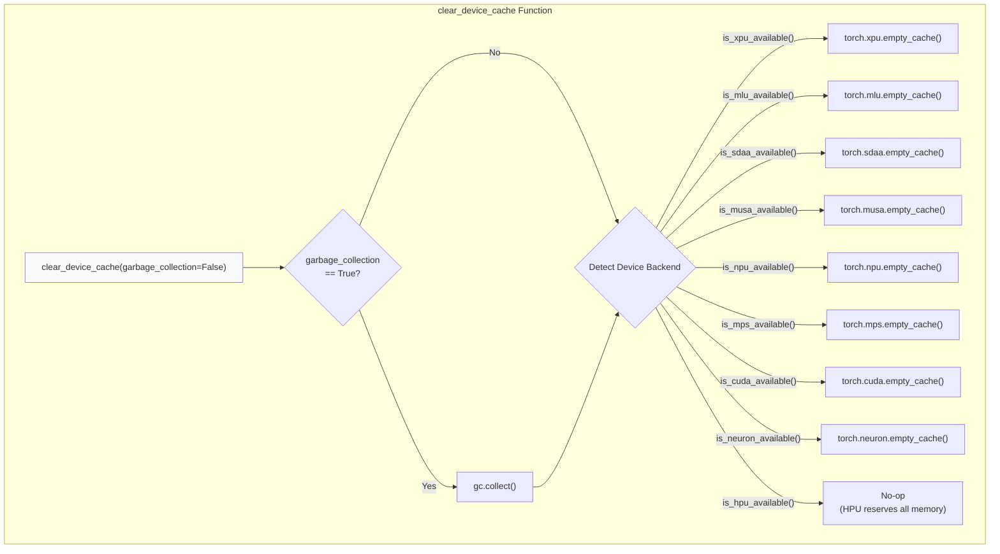
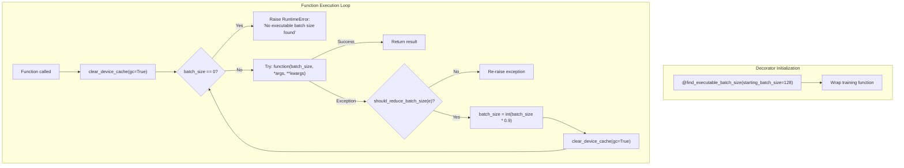
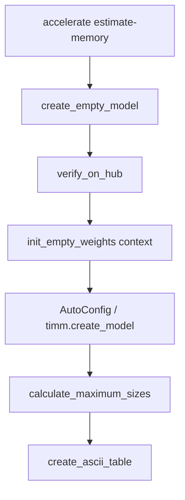

<!-- source: DeepWiki mcp.deepwiki.com · repo huggingface/accelerate · page 13.1 Memory Management · fetched 2026-10-21 -->

# Memory Management

<details>
<summary>Relevant source files</summary>

The following files were used as context for generating this wiki page:

- [docs/source/usage_guides/model_size_estimator.md](docs/source/usage_guides/model_size_estimator.md)
- [src/accelerate/checkpointing.py](src/accelerate/checkpointing.py)
- [src/accelerate/commands/env.py](src/accelerate/commands/env.py)
- [src/accelerate/commands/estimate.py](src/accelerate/commands/estimate.py)
- [src/accelerate/memory_utils.py](src/accelerate/memory_utils.py)
- [src/accelerate/utils/memory.py](src/accelerate/utils/memory.py)
- [src/accelerate/utils/random.py](src/accelerate/utils/random.py)
- [tests/test_cli.py](tests/test_cli.py)
- [tests/test_memory_utils.py](tests/test_memory_utils.py)
- [tests/test_state_checkpointing.py](tests/test_state_checkpointing.py)

</details>


This document covers utilities for managing device memory during training and inference, including automatic batch size finding, memory release functions, and out-of-memory (OOM) error detection. These utilities help prevent training crashes due to memory constraints and enable robust training workflows.

For information about loading models that exceed single-device memory capacity through device mapping and offloading strategies, see [Big Model Support](#5).

---

## Overview

The memory management utilities in `accelerate` provide three primary capabilities:

1. **Automatic batch size adjustment** - `find_executable_batch_size` decorator that automatically reduces batch size when OOM errors occur.
2. **Explicit memory release** - Functions to clear device caches and free memory from Python objects.
3. **OOM detection** - Logic to identify memory-related errors across different hardware backends.
4. **Memory Estimation** - CLI and utility functions to estimate the footprint of models before loading.

These utilities operate at the training loop level and are orthogonal to distributed training strategies. They work with all supported hardware backends including CUDA, XPU, NPU, MLU, SDAA, MUSA, HPU, and MPS.

**Sources:** [src/accelerate/utils/memory.py:15-37](), [src/accelerate/commands/estimate.py:66-143]()

---

## Memory Clearing Functions

### Device Cache Clearing

The `clear_device_cache` function empties the memory allocator cache for the current device backend. This releases cached memory back to the system without deallocating actively used tensors.



**Implementation Details:**

The function checks hardware availability in a specific order and calls the appropriate backend's `empty_cache()` method. The `garbage_collection` parameter triggers Python's garbage collector before clearing the cache, which is more thorough but significantly slower.

| Backend | Cache Clear Method | Notes |
|---------|-------------------|-------|
| XPU | `torch.xpu.empty_cache()` | Intel Data Center GPU |
| MLU | `torch.mlu.empty_cache()` | Cambricon Machine Learning Unit |
| SDAA | `torch.sdaa.empty_cache()` | Software Defined Accelerator Architecture |
| MUSA | `torch.musa.empty_cache()` | Moore Threads Unified System Architecture |
| NPU | `torch.npu.empty_cache()` | Huawei Neural Processing Unit |
| MPS | `torch.mps.empty_cache()` | Apple Metal Performance Shaders (PyTorch ≥2.0) |
| CUDA | `torch.cuda.empty_cache()` | NVIDIA GPUs |
| Neuron | `torch.neuron.empty_cache()` | AWS Trainium/Inferentia |
| HPU | No operation | Habana reserves all memory at process start |

**Warning:** Setting `garbage_collection=True` adds significant overhead and should be used sparingly, typically only when debugging memory issues or in conjunction with `release_memory`.

**Sources:** [src/accelerate/utils/memory.py:40-69]()

---

### Object Memory Release

The `release_memory` function deallocates Python objects and clears device memory in a single operation.

```python
# Typical usage pattern
model, optimizer = release_memory(model, optimizer)
# model and optimizer are now None, memory is freed
```

**Execution Flow:**


The function performs three operations:
1. Sets all input objects to `None` (breaking Python references) [src/accelerate/utils/memory.py:94-95]()
2. Calls `gc.collect()` to run garbage collection via `clear_device_cache` [src/accelerate/utils/memory.py:96]()
3. Calls backend-specific `empty_cache()` to release device memory [src/accelerate/utils/memory.py:96]()

**Important:** The returned `None` values must be reassigned to the original variables to complete the memory release:

```python
# Correct usage
a, b = release_memory(a, b)

# Incorrect - original references still exist
release_memory(a, b)  # Memory not fully released!
```

**Sources:** [src/accelerate/utils/memory.py:70-98]()

---

## Automatic Batch Size Finding

### The `find_executable_batch_size` Decorator

The `find_executable_batch_size` decorator automatically reduces batch size when out-of-memory errors occur, enabling robust training without manual intervention.



**Algorithm Details:**

1. **Initialization:** Decorator receives `starting_batch_size` (default: 128) and optional `reduce_batch_size_fn` [src/accelerate/utils/memory.py:119-123]().
2. **Memory clearing:** Before each attempt, clear device cache with garbage collection [src/accelerate/utils/memory.py:167]().
3. **Execution attempt:** Call wrapped function with current batch size [src/accelerate/utils/memory.py:180]().
4. **Error handling:** If OOM occurs, reduce batch size by 10% (multiply by 0.9) [src/accelerate/utils/memory.py:162]().
5. **Termination:** Stop when batch size reaches 0 or function succeeds [src/accelerate/utils/memory.py:177]().

**Sources:** [src/accelerate/utils/memory.py:119-188]()

---

## Memory Estimation Utilities

Accelerate provides utilities to estimate the memory required to load models from the Hugging Face Hub without downloading the full weights, by utilizing the `meta` device.

### Memory Estimation Logic



**Key Entities:**
- `create_empty_model`: Initializes a model on the `meta` device using `init_empty_weights` to avoid RAM usage [src/accelerate/commands/estimate.py:66-143]().
- `calculate_maximum_sizes`: Computes the size of the largest layer and the total model size across different dtypes (float32, float16, int8, int4) [src/accelerate/commands/estimate.py:25]().
- `estimate_command`: The entry point for the CLI tool [src/accelerate/commands/estimate.py:24]().

**Sources:** [src/accelerate/commands/estimate.py:1-143](), [docs/source/usage_guides/model_size_estimator.md:16-137]()

---

## Out-of-Memory Detection

### The `should_reduce_batch_size` Function

This function determines whether an exception indicates a memory-related failure across different hardware backends.

**Detected Error Patterns:**

| Pattern | Description | Hardware |
|---------|-------------|----------|
| `" out of memory."` | Generic OOM error | CUDA, HIP (AMD), XPU |
| `"cuDNN error: CUDNN_STATUS_NOT_SUPPORTED."` | cuDNN operation failure | CUDA |
| `"DefaultCPUAllocator: can't allocate memory"` | CPU memory exhaustion | CPU |
| `"FATAL ERROR :: MODULE:PT_DEVMEM Allocation failed"` | Device memory allocation failure | HPU (Habana) |

**Sources:** [src/accelerate/utils/memory.py:100-117]()

---

## Usage Examples

### Using `find_executable_batch_size`

```python
from accelerate.utils import find_executable_batch_size

@find_executable_batch_size(starting_batch_size=128)
def train(batch_size, model, optimizer):
    # batch_size is injected by the decorator
    ...

# Call without the batch_size argument
train(model, optimizer)
```
**Sources:** [src/accelerate/utils/memory.py:143-153]()

### Using `release_memory`

```python
import torch
from accelerate.utils import release_memory

a = torch.ones(1000, 1000).cuda()
b = torch.ones(1000, 1000).cuda()
# Objects are set to None and cache is cleared
a, b = release_memory(a, b)
```
**Sources:** [src/accelerate/utils/memory.py:83-90]()

### CLI Memory Estimation

```bash
accelerate estimate-memory bert-base-cased --dtypes float32 float16
```
**Sources:** [docs/source/usage_guides/model_size_estimator.md:120-129]()

---

## Testing Memory Utilities

The test suite in `tests/test_memory_utils.py` validates the batch size reduction logic and memory release behavior.

- `test_memory_implicit`: Verifies that the batch size sequence follows the 0.9 reduction rule [tests/test_memory_utils.py:53-88]().
- `test_verbose_guard`: Ensures a `TypeError` is raised if the user manually passes a batch size to a decorated function [tests/test_memory_utils.py:149-158]().
- `test_release_memory`: Confirms that `release_memory` successfully reduces `memory_allocated()` to starting levels [tests/test_memory_utils.py:171-184]().

**Sources:** [tests/test_memory_utils.py:1-184]()

---

