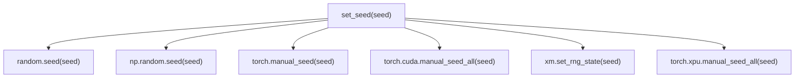
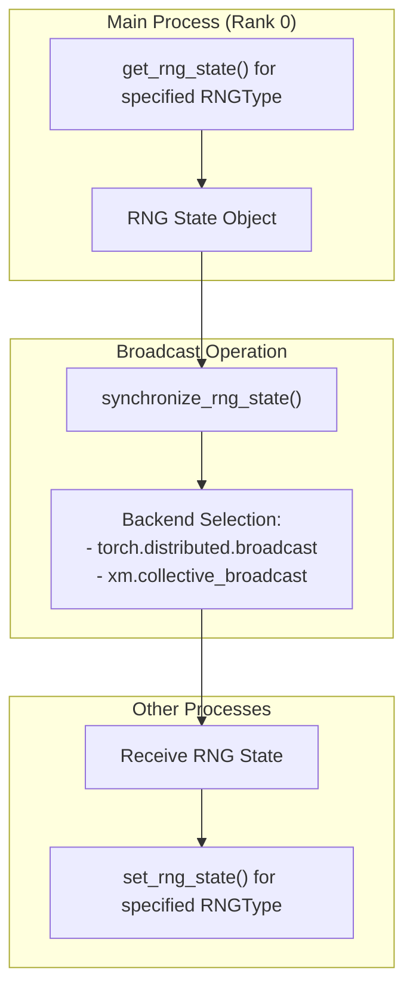

<!-- source: DeepWiki mcp.deepwiki.com · repo huggingface/accelerate · page 13.2 RNG Synchronization · fetched 2026-10-21 -->

# RNG Synchronization

<details>
<summary>Relevant source files</summary>

The following files were used as context for generating this wiki page:

- [src/accelerate/checkpointing.py](src/accelerate/checkpointing.py)
- [src/accelerate/commands/env.py](src/accelerate/commands/env.py)
- [src/accelerate/data_loader.py](src/accelerate/data_loader.py)
- [src/accelerate/test_utils/scripts/external_deps/test_peak_memory_usage.py](src/accelerate/test_utils/scripts/external_deps/test_peak_memory_usage.py)
- [src/accelerate/test_utils/scripts/test_distributed_data_loop.py](src/accelerate/test_utils/scripts/test_distributed_data_loop.py)
- [src/accelerate/test_utils/scripts/test_script.py](src/accelerate/test_utils/scripts/test_script.py)
- [src/accelerate/test_utils/scripts/test_sync.py](src/accelerate/test_utils/scripts/test_sync.py)
- [src/accelerate/utils/memory.py](src/accelerate/utils/memory.py)
- [src/accelerate/utils/random.py](src/accelerate/utils/random.py)
- [tests/test_data_loader.py](tests/test_data_loader.py)
- [tests/test_state_checkpointing.py](tests/test_state_checkpointing.py)

</details>


## Purpose and Scope

This page documents the random number generator (RNG) synchronization system in Accelerate. This system ensures reproducibility in distributed training by setting consistent random seeds across all processes, synchronizing RNG states during training, and preserving RNG states during checkpointing.

For information about saving and loading complete training state including RNG states, see [Saving and Loading State](#7.1). For distributed communication primitives used in synchronization, see [Collective Operations](#9.1).

## Core Concepts

### Why RNG Synchronization Matters

In distributed training, each process maintains independent random number generator states for:
- Python's `random` module [src/accelerate/checkpointing.py:158]()
- NumPy's random state [src/accelerate/checkpointing.py:159]()
- PyTorch's CPU RNG state [src/accelerate/checkpointing.py:160]()
- PyTorch's CUDA RNG state (per device) [src/accelerate/checkpointing.py:173-174]()
- Device-specific RNG states (XLA, XPU, MLU, HPU, etc.) [src/accelerate/checkpointing.py:161-176]()

Without proper synchronization, each process generates different random values, leading to inconsistent initialization and divergent data processing. RNG synchronization ensures all processes use identical random sequences when needed, while also supporting per-process randomness when desired (e.g., for data augmentation) [src/accelerate/utils/random.py:47-53]().

## Main Functions

### `set_seed(seed, device_specific=False, deterministic=False)`

Sets the seed for all random number generators across all processes. This is the primary method for ensuring reproducibility [src/accelerate/utils/random.py:40-79]().


**Diagram: set_seed() Operation Flow**

**Typical Usage:**
```python
from accelerate.utils import set_seed
set_seed(42)  # All processes now have synchronized RNG states
```
Sources: [src/accelerate/utils/random.py:40-79]()

### `synchronize_rng_states(rng_types, generator=None)`

Synchronizes RNG states across all processes by broadcasting the main process's state to all other processes [src/accelerate/utils/random.py:163-165]().

**When Synchronization Occurs:**
- During `Accelerator` initialization.
- After calling `set_seed()`.
- During state loading via `load_accelerator_state` [src/accelerate/checkpointing.py:284-307]().

Sources: [src/accelerate/utils/random.py:81-161](), [src/accelerate/checkpointing.py:284-307]()

## RNG State Structure

RNG states are captured in a structured dictionary during checkpointing:

| Generator | State Key | Method |
|-----------|-----------|--------|
| Python | `random_state` | `random.getstate()` |
| NumPy | `numpy_random_seed` | `np.random.get_state()` |
| PyTorch CPU | `torch_manual_seed` | `torch.get_rng_state()` |
| PyTorch CUDA | `torch_cuda_manual_seed` | `torch.cuda.get_rng_state_all()` |
| XLA | `xm_seed` | `xm.get_rng_state()` |

Sources: [src/accelerate/checkpointing.py:155-177]()

## Synchronization Process

The synchronization mechanism relies on the `PartialState` (or `AcceleratorState`) to identify the distributed backend and broadcast the RNG state from process 0 [src/accelerate/utils/random.py:116-137]().


**Diagram: RNG State Synchronization Flow**

Sources: [src/accelerate/utils/random.py:81-161]()

## SeedableRandomSampler

Accelerate provides `SeedableRandomSampler` to ensure that random sampling in distributed DataLoaders is fully reproducible across multiple iterations [src/accelerate/data_loader.py:73-82]().

**Implementation Details:**
- It extends PyTorch's `RandomSampler` [src/accelerate/data_loader.py:73]().
- It uses an `initial_seed` (defaults to `torch.random.initial_seed()`) [src/accelerate/data_loader.py:88]().
- In `__iter__`, it sets the generator seed to `initial_seed + epoch`, ensuring a unique but deterministic sequence for every epoch [src/accelerate/data_loader.py:91-103]().

Sources: [src/accelerate/data_loader.py:73-109]()

## Integration with Checkpointing

RNG states are saved into process-specific files during `save_accelerator_state` [src/accelerate/checkpointing.py:154-180]().

**File Naming Convention:**
- Each process saves its RNG state as `random_states_{process_index}.pkl` [src/accelerate/checkpointing.py:156]().
- The file contains the current training `step`, Python random state, NumPy state, and all relevant PyTorch device states [src/accelerate/checkpointing.py:157-177]().

During `load_accelerator_state`, each process loads its specific state file to resume exactly where it left off [src/accelerate/checkpointing.py:284-307]().

Sources: [src/accelerate/checkpointing.py:154-180](), [src/accelerate/checkpointing.py:284-307]()

## Reproducibility Verification

The test suite includes checks to ensure RNG states are identical across processes after synchronization [src/accelerate/test_utils/scripts/test_script.py:169-185]().

```python
# From rng_sync_check in test_script.py
state = AcceleratorState()
synchronize_rng_states(["torch"])
assert are_the_same_tensors(torch.get_rng_state()), "RNG states improperly synchronized on CPU."
if state.distributed_type == DistributedType.MULTI_GPU:
    synchronize_rng_states(["cuda"])
    assert are_the_same_tensors(torch.cuda.get_rng_state()), "RNG states improperly synchronized on GPU."
```

Sources: [src/accelerate/test_utils/scripts/test_script.py:169-185]()

## Common Issues and Solutions

| Problem | Solution |
| :--- | :--- |
| **Divergent Data Shuffling** | Use `SeedableRandomSampler` or `accelerator.prepare(dataloader)` which handles sampler sharding and seeding [src/accelerate/data_loader.py:73-109](). |
| **Non-deterministic OOM Recovery** | `find_executable_batch_size` clears the device cache but preserves RNG state for the next attempt [src/accelerate/utils/memory.py:119-188](). |
| **Inconsistent XLA Seeds** | Accelerate uses `xm.set_rng_state` and `xm.collective_broadcast` to sync TPU seeds [src/accelerate/utils/random.py:74-75, 117-121](). |

Sources: [src/accelerate/data_loader.py:73-109](), [src/accelerate/utils/memory.py:119-188](), [src/accelerate/utils/random.py:74-121]()

---

