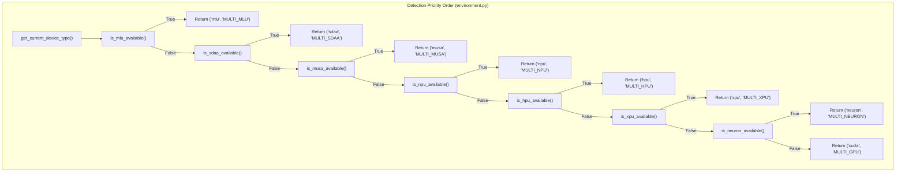
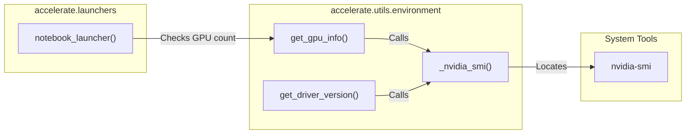
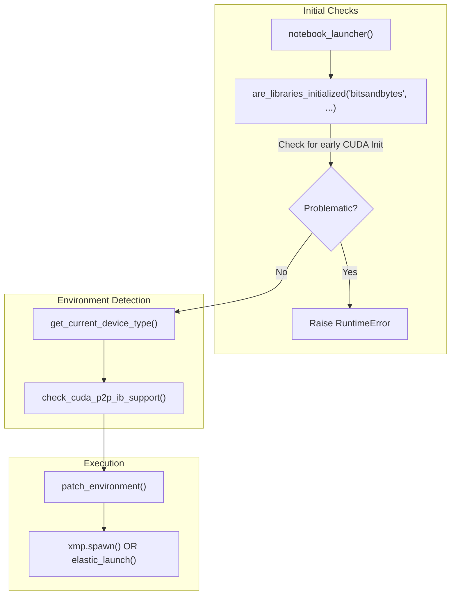

<!-- source: DeepWiki mcp.deepwiki.com · repo huggingface/accelerate · page 13.3 Environment Detection and System Configuration · fetched 2026-10-21 -->

# Environment Detection and System Configuration

<details>
<summary>Relevant source files</summary>

The following files were used as context for generating this wiki page:

- [src/accelerate/launchers.py](src/accelerate/launchers.py)
- [src/accelerate/test_utils/scripts/test_notebook.py](src/accelerate/test_utils/scripts/test_notebook.py)
- [src/accelerate/utils/__init__.py](src/accelerate/utils/__init__.py)
- [src/accelerate/utils/environment.py](src/accelerate/utils/environment.py)
- [src/accelerate/utils/imports.py](src/accelerate/utils/imports.py)

</details>


This page documents utilities for detecting hardware capabilities, configuring the distributed training environment, and managing system-level settings without prematurely initializing devices. These functions are critical for ensuring that Accelerate can correctly identify available hardware and configure distributed backends before training begins.

For memory-related utilities, see [13.1](). For RNG synchronization, see [13.2](). For CLI environment setup, see [6.4]().

## Overview

Accelerate provides several utilities to detect and configure the training environment:

| Category | Purpose | Key Functions |
|----------|---------|---------------|
| Device Detection | Identify available hardware without initialization | `get_current_device_type()` |
| Hardware Imports | Check for package/hardware availability | `is_cuda_available()`, `is_torch_xla_available()` |
| GPU Capabilities | Query GPU information and driver versions | `get_gpu_info()`, `check_cuda_p2p_ib_support()` |
| CPU Configuration | Detect distributed CPU environment | `get_cpu_distributed_information()` |
| NUMA Affinity | Optimize CPU core assignment | `set_numa_affinity()` |
| Environment Management | Control environment variables | `patch_environment()`, `clear_environment()` |

Sources: [src/accelerate/utils/environment.py:1-472](), [src/accelerate/utils/imports.py:1-158]()

## Device Type Detection

### Device Detection Without Initialization

The `get_current_device_type()` function determines the current device type and corresponding distributed type **without initializing any device**. This is critical for fork-based multiprocessing, where device initialization before forking causes errors (e.g., "Cannot re-initialize CUDA in forked subprocess").

Title: Device Detection Flow


**Detection Order**

The detection follows a strict priority defined in `get_current_device_type` [src/accelerate/utils/environment.py:101-149]():

1. MLU (Machine Learning Unit)
2. SDAA (Semi-custom Deep-learning Accelerator Architecture)
3. MUSA (Multi-core Unified System Architecture)
4. NPU (Neural Processing Unit)
5. HPU (Habana Processing Unit)
6. XPU (Intel Data Center GPU)
7. Neuron (AWS Neuron)
8. Default to CUDA (for GPU or CPU-only fallback)

**Usage in notebook_launcher**

The function is used in `notebook_launcher` to determine the device type before yielding to logic that spawns processes:

[src/accelerate/launchers.py:206-208]()

```python
device_type, distributed_type = get_current_device_type()
```

Sources: [src/accelerate/utils/environment.py:101-149](), [src/accelerate/launchers.py:206-226]()

## Hardware Availability Checks

Accelerate provides a comprehensive suite of "is available" checks in `src/accelerate/utils/imports.py`. Many of these are cached using `@lru_cache` to avoid repeated expensive lookups or FFI calls.

| Function | Logic / Dependency |
|----------|--------------------|
| `is_cuda_available()` | Checks `torch.cuda.is_available()` inside a `PYTORCH_NVML_BASED_CUDA_CHECK` context to avoid driver initialization [src/accelerate/utils/imports.py:119-127](). |
| `is_torch_xla_available()` | Checks for `torch_xla`. Can specifically check for `TPU` or `GPU/CUDA` runtime types [src/accelerate/utils/imports.py:131-145](). |
| `is_bf16_available()` | Checks hardware support across TPU, CUDA, MLU, XPU, and MPS (macOS 14.0+) [src/accelerate/utils/imports.py:164-177](). |
| `is_fp8_available()` | Checks for `msamp`, `transformer_engine`, or `torchao` [src/accelerate/utils/imports.py:187-189](). |
| `is_deepspeed_available()` | Checks if the `deepspeed` package is installed [src/accelerate/utils/imports.py:156-157](). |

Sources: [src/accelerate/utils/imports.py:30-230]()

## GPU Information and Capabilities

### Querying GPU Information Without CUDA Initialization

Accelerate uses `nvidia-smi` (or NVML via `pynvml` in some contexts) instead of `torch.cuda` to query GPU information, preventing premature driver binding.

Title: GPU Info Code Mapping


**Key Functions**

| Function | Purpose | Returns |
|----------|---------|---------|
| `get_gpu_info()` | Get GPU count and names via subprocess call to `nvidia-smi` [src/accelerate/utils/environment.py:166-181](). | `(gpu_names, gpu_count)` |
| `get_driver_version()` | Get NVIDIA driver version for compatibility checks [src/accelerate/utils/environment.py:184-195](). | `str` |
| `check_cuda_fp8_capability()` | Checks if GPU compute capability is >= 8.9 (Ada/Hopper+) [src/accelerate/utils/environment.py:225-244](). | `bool` |

### CUDA P2P and InfiniBand Support Detection

The `check_cuda_p2p_ib_support()` function detects if GPUs have known issues with Peer-to-Peer (P2P) and InfiniBand (IB) communications, specifically targeting consumer hardware like the RTX 40-series.

[src/accelerate/utils/environment.py:197-223]()

If the driver version is below `550.40.07` on these devices, Accelerate recommends or automatically sets `NCCL_P2P_DISABLE=1` and `NCCL_IB_DISABLE=1` to prevent hangs [src/accelerate/launchers.py:198-201]().

Sources: [src/accelerate/utils/environment.py:197-223](), [src/accelerate/launchers.py:198-201]()

## CPU Distributed Configuration

### CPU Distributed Information

The `get_cpu_distributed_information()` function extracts distributed training parameters from environment variables set by various MPI implementations (Intel MPI, OpenMPI, MVAPICH2).

[src/accelerate/utils/environment.py:263-280]()

**CPUInformation Dataclass**

| Field | Description |
|-------|-------------|
| `rank` | Global process rank (`RANK`, `PMI_RANK`, `OMPI_COMM_WORLD_RANK`, etc.) |
| `world_size` | Total processes (`WORLD_SIZE`, `PMI_SIZE`, `OMPI_COMM_WORLD_SIZE`, etc.) |
| `local_rank` | Rank on node (`LOCAL_RANK`, `MPI_LOCALRANKID`, `OMPI_COMM_WORLD_LOCAL_RANK`, etc.) |
| `local_world_size` | Processes on node (`LOCAL_WORLD_SIZE`, `MPI_LOCALNRANKS`, etc.) |

Sources: [src/accelerate/utils/environment.py:247-280]()

## NUMA Affinity Management

### Setting CPU Affinity for GPU Processes

NUMA (Non-Uniform Memory Access) affinity optimization ensures each GPU process runs on CPU cores physically close to the GPU it controls, reducing bus contention.

**Implementation Details**

- **Function**: `set_numa_affinity(local_process_index, verbose=False)` [src/accelerate/utils/environment.py:322-338]().
- **Dependency**: Requires `pynvml`.
- **Logic**: 
    1. Grabs the device handle for the specified `local_process_index`.
    2. Calls `nvmlDeviceGetCpuAffinity`.
    3. Converts the resulting bitmask into a list of core IDs.
    4. Applies the affinity using `os.sched_setaffinity(0, cores)`.

Sources: [src/accelerate/utils/environment.py:283-338]()

## Environment Variable Management

Accelerate uses context managers to manage environment variables safely, ensuring they are restored after use.

### Context Managers

- `patch_environment(**kwargs)`: Temporarily sets environment variables. Keys are automatically uppercased [src/accelerate/utils/environment.py:375-410]().
- `clear_environment()`: Temporarily clears all environment variables, restoring them on exit [src/accelerate/utils/environment.py:340-373]().

### Parsing Utilities

| Function | Description |
|----------|-------------|
| `str_to_bool(value)` | Converts strings like "yes", "1", "true" to `True` / `1` [src/accelerate/utils/environment.py:59-71](). |
| `parse_flag_from_env(key)` | Retrieves a boolean flag from the environment [src/accelerate/utils/environment.py:83-86](). |
| `get_int_from_env(keys, default)` | Searches multiple keys for the first valid positive integer [src/accelerate/utils/environment.py:74-80](). |
| `convert_dict_to_env_variables(dict)`| Validates keys/values against forbidden characters (`;`, `\n`, etc.) for shell safety [src/accelerate/utils/environment.py:34-56](). |

### Purging Environment

The `@purge_accelerate_environment` decorator is used in testing to ensure that any `ACCELERATE_*` environment variables set during a test do not leak into subsequent tests [src/accelerate/utils/environment.py:412-471]().

Sources: [src/accelerate/utils/environment.py:34-471]()

## Integration with Launch Systems

The `notebook_launcher` is the primary consumer of these detection utilities in an interactive context.

Title: Notebook Launcher Lifecycle


**Problematic Import Detection**

`are_libraries_initialized` [src/accelerate/utils/environment.py:94-98]() checks `sys.modules` to see if libraries like `bitsandbytes` have been imported. If they have, a `RuntimeError` is raised [src/accelerate/launchers.py:179-187]() because these libraries often initialize the CUDA context upon import, which breaks subsequent forking.

Sources: [src/accelerate/launchers.py:43-187](), [src/accelerate/utils/environment.py:94-149]()

---

