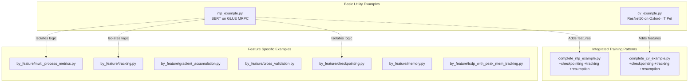
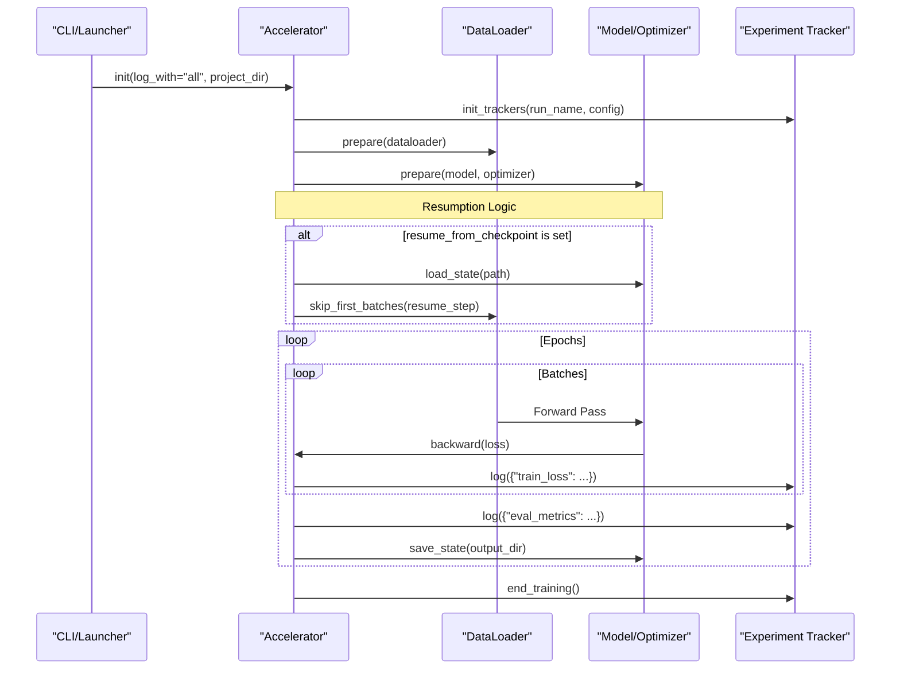

<!-- source: DeepWiki mcp.deepwiki.com · repo huggingface/accelerate · page 14 Example Scripts and Training Patterns · fetched 2026-10-21 -->

# Example Scripts and Training Patterns

Relevant source files

The following files were used as context for generating this wiki page:

- [examples/by_feature/checkpointing.py](examples/by_feature/checkpointing.py)
- [examples/by_feature/fsdp_with_peak_mem_tracking.py](examples/by_feature/fsdp_with_peak_mem_tracking.py)
- [examples/by_feature/multi_process_metrics.py](examples/by_feature/multi_process_metrics.py)
- [examples/by_feature/tracking.py](examples/by_feature/tracking.py)
- [examples/complete_cv_example.py](examples/complete_cv_example.py)
- [examples/complete_nlp_example.py](examples/complete_nlp_example.py)
- [examples/cv_example.py](examples/cv_example.py)
- [examples/nlp_example.py](examples/nlp_example.py)

This document describes the example scripts provided in the `examples/` directory, which demonstrate best practices and training patterns for using Accelerate. These examples serve as complete, working reference implementations for common training scenarios and feature integrations.

For information about the core `Accelerator` class API, see [The Accelerator Class](#2). For details on specific distributed training backends, see [Distributed Training Backends](#3).

---

## Overview of Example Structure

The examples directory is organized into three levels of complexity:

1.  **Basic Examples** (`examples/*.py`) - Minimal working examples demonstrating core functionality.
2.  **Feature Examples** (`examples/by_feature/*.py`) - Focused demonstrations of specific Accelerate capabilities.
3.  **Complete Examples** (`examples/complete_*.py`) - Full-featured examples integrating multiple patterns like checkpointing, tracking, and resumption.

### Architecture Mapping: Natural Language to Code Entity

The following diagram bridges system features to their corresponding implementation files.

Training Scenarios and Implementations

**Sources:** [examples/nlp_example.py:1-40](), [examples/cv_example.py:30-44](), [examples/complete_nlp_example.py:27-43](), [examples/complete_cv_example.py:30-44]()

---

## Basic Training Examples

These scripts show minimal integration (roughly 5-line changes) required for standard training loops. For details, see [Basic Training Examples](#14.1).

### NLP Example: BERT Fine-tuning
`nlp_example.py` uses `transformers` to fine-tune a BERT model. It demonstrates the use of `accelerator.main_process_first()` for tokenization and `accelerator.prepare()` for wrapping objects.
*   **Key Source:** [examples/nlp_example.py:113-189]()

### Computer Vision Example: ResNet Fine-tuning
`cv_example.py` uses `timm` for a ResNet50 model. It illustrates handling custom `Dataset` classes and image transforms within a distributed context.
*   **Key Source:** [examples/cv_example.py:74-189]()

---

## Feature Integration Examples

These scripts isolate individual features to show their specific implementation details. For details, see [Feature Integration Examples](#14.2).

| Feature | File Path | Key Accelerator API Used |
| :--- | :--- | :--- |
| **Checkpointing** | `by_feature/checkpointing.py` | `save_state()`, `load_state()` |
| **Tracking** | `by_feature/tracking.py` | `init_trackers()`, `log()` |
| **Grad Accumulation** | `by_feature/gradient_accumulation.py` | `accumulate()` context manager |
| **Metrics** | `by_feature/multi_process_metrics.py` | `gather_for_metrics()` |
| **Memory Opt** | `by_feature/memory.py` | `@find_executable_batch_size` |
| **FSDP Profiling** | `by_feature/fsdp_with_peak_mem_tracking.py` | `FullyShardedDataParallelPlugin` |

**Sources:** [examples/by_feature/checkpointing.py:124-210](), [examples/by_feature/tracking.py:123-239](), [examples/by_feature/multi_process_metrics.py:125-220]()

---

## Advanced Training Patterns

Advanced patterns combine multiple features into production-ready scripts. For details, see [Advanced Training Patterns](#14.3).

### Training Loop Lifecycle

The following diagram tracks how an advanced script like `complete_nlp_example.py` manages the full training lifecycle, including state resumption and tracking.

Accelerate Advanced Training Pattern

**Sources:** [examples/complete_nlp_example.py:50-269](), [examples/complete_cv_example.py:74-279]()

### Key Integrated Features
*   **Stateful DataLoaders**: Managed via `DataLoaderConfiguration(use_stateful_dataloader=...)` [examples/complete_nlp_example.py:52]().
*   **Dynamic Batch Skipping**: Using `accelerator.skip_first_batches()` if stateful loaders aren't used [examples/complete_nlp_example.py:204-207]().
*   **Peak Memory Tracking**: Custom context manager `TorchTracemalloc` to monitor GPU and CPU RSS memory peaks [examples/by_feature/fsdp_with_peak_mem_tracking.py:68-131]().

---

## Summary Table: Pattern Comparisons

| Pattern | Basic Examples | Complete Examples | Feature Examples |
| :--- | :---: | :---: | :---: |
| Distributed Prep | Yes | Yes | Yes |
| Mixed Precision | Yes | Yes | Yes |
| Checkpointing | No | Yes | Yes |
| Tracking | No | Yes | Yes |
| Resumption Logic | No | Yes | Partial |
| OOM Recovery | No | No | Yes |

**Sources:** [examples/nlp_example.py:149-155](), [examples/complete_nlp_example.py:166-180](), [examples/by_feature/memory.py:142-148]()

---

