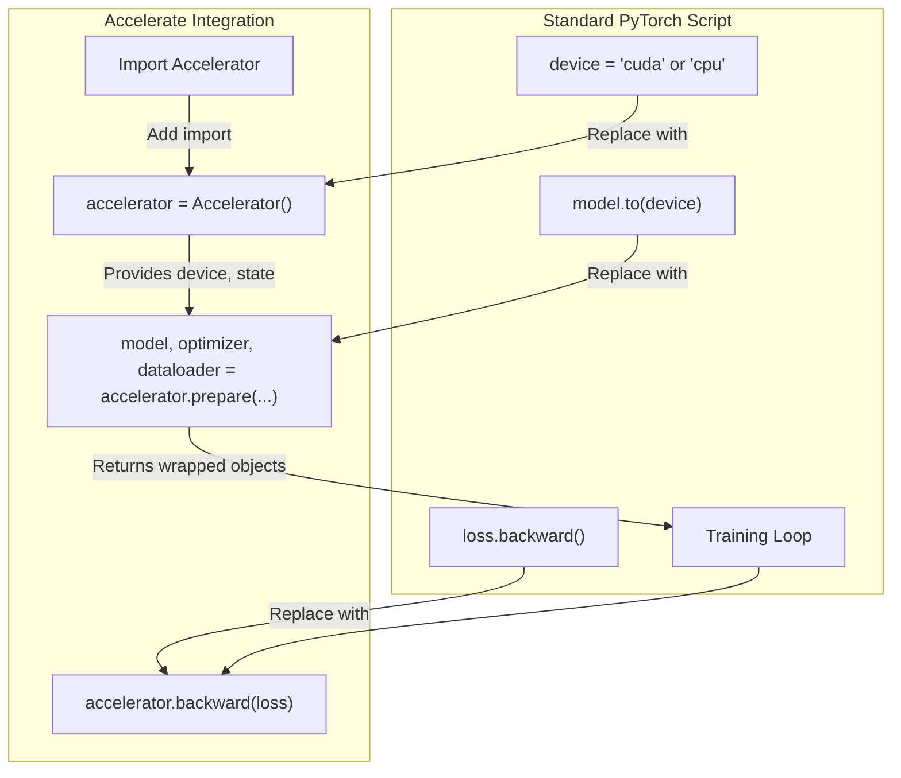
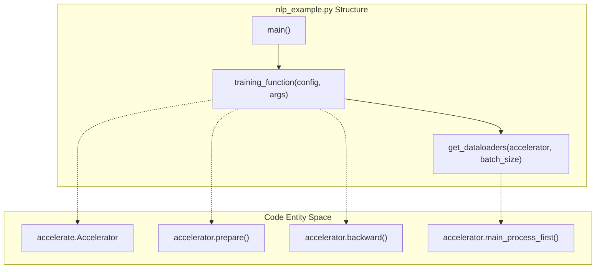
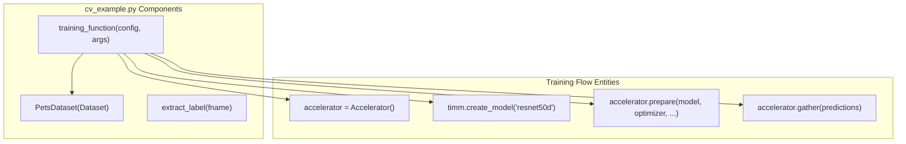

<!-- source: DeepWiki mcp.deepwiki.com · repo huggingface/accelerate · page 14.1 Basic Training Examples · fetched 2026-10-21 -->

# Basic Training Examples

<details>
<summary>Relevant source files</summary>

The following files were used as context for generating this wiki page:

- [examples/cv_example.py](examples/cv_example.py)
- [examples/nlp_example.py](examples/nlp_example.py)

</details>


This document covers the base training examples (`nlp_example.py` and `cv_example.py`) that demonstrate minimal Accelerate integration with standard PyTorch training loops. These scripts showcase the core "5-line integration" pattern that enables distributed training across any hardware configuration without modifying the training logic.

For examples that demonstrate individual features like checkpointing or gradient accumulation, see [Feature Integration Examples](#14.2). For advanced patterns combining multiple features, see [Advanced Training Patterns](#14.3).

## Purpose and Scope

The basic training examples serve as canonical templates showing how to convert a standard PyTorch training script to use Accelerate with minimal code changes. They demonstrate:

- The core `Accelerator` API and `prepare()` wrapper pattern.
- Automatic device placement and distributed state management.
- The minimal integration required to run on CPU, GPU, multi-GPU, TPU, or distributed nodes.
- How the same script runs unchanged across different hardware configurations.

These examples are designed to be starting points for new users and reference implementations for testing.

**Sources:** [examples/nlp_example.py:26-40](), [examples/cv_example.py:30-44]()

## The Minimal Integration Pattern

The fundamental pattern for integrating Accelerate into a PyTorch training script requires only five changes:



### Integration Steps

The five required changes as implemented in the examples:

| Step | Original Code | Accelerate Code | File Reference |
|------|--------------|-----------------|----------------|
| 1 | `import torch` | `from accelerate import Accelerator` | [examples/nlp_example.py:23]() |
| 2 | `device = 'cpu'` | `accelerator = Accelerator()` | [examples/nlp_example.py:115]() |
| 3 | `model.to(device)` | `model.to(accelerator.device)` | [examples/nlp_example.py:138]() |
| 4 | N/A | `model, optimizer, ... = accelerator.prepare(...)` | [examples/nlp_example.py:153-155]() |
| 5 | `loss.backward()` | `accelerator.backward(loss)` | [examples/nlp_example.py:166]() |

**Sources:** [examples/nlp_example.py:113-171](), [examples/cv_example.py:74-161]()

## Base Example Scripts

### nlp_example.py

The NLP example demonstrates Accelerate integration for text classification tasks using the GLUE MRPC dataset. It serves as the canonical base script from which all feature examples are derived.



**Key characteristics:**
- **Data Handling**: Uses `accelerator.main_process_first()` to ensure only one process downloads/preprocesses the dataset [examples/nlp_example.py:68]().
- **TPU Optimization**: Pads sequences to a fixed length (128) if `accelerator.distributed_type == DistributedType.XLA` to avoid frequent recompilations [examples/nlp_example.py:81]().
- **Mixed Precision**: Adjusts padding to multiples of 8 or 16 depending on whether `fp8` or other mixed precision is used [examples/nlp_example.py:83-88]().
- **Gradient Accumulation**: Manually calculates `gradient_accumulation_steps` if the requested batch size exceeds `MAX_GPU_BATCH_SIZE` [examples/nlp_example.py:125-129]().

**Sources:** [examples/nlp_example.py:47-110](), [examples/nlp_example.py:113-171]()

### cv_example.py

The computer vision example demonstrates Accelerate integration for image classification using the Oxford-IIT Pet Dataset.



**Key characteristics:**
- **Model Source**: Uses `timm.create_model` to instantiate a ResNet50d [examples/cv_example.py:119]().
- **Device Placement**: Manually moves normalization constants (`mean`, `std`) to `accelerator.device` [examples/cv_example.py:133-134]().
- **Distributed Evaluation**: Uses `accelerator.gather()` to collect predictions and labels from all processes to calculate global accuracy [examples/cv_example.py:177-178]().

**Sources:** [examples/cv_example.py:53-71](), [examples/cv_example.py:74-188]()

## Training Function Structure

Both base examples follow a consistent structure within their `training_function`:

| Phase | Description | Code Reference |
|-------|-------------|----------------|
| **Init** | Instantiate `Accelerator` with `mixed_precision` and `cpu` flags. | [examples/nlp_example.py:115]() |
| **Data** | Create DataLoaders; NLP uses `main_process_first()` for mapping. | [examples/nlp_example.py:68]() |
| **Model** | Instantiate model and move to `accelerator.device`. | [examples/nlp_example.py:133-138]() |
| **Prepare** | Pass model, optimizer, and dataloaders to `accelerator.prepare()`. | [examples/nlp_example.py:153-155]() |
| **Train** | Use `accelerator.backward(loss)` instead of `loss.backward()`. | [examples/nlp_example.py:166]() |
| **Eval** | Use `accelerator.gather()` for distributed metric calculation. | [examples/cv_example.py:177-178]() |

**Sources:** [examples/nlp_example.py:113-188](), [examples/cv_example.py:74-188]()

## Running the Examples

The examples are designed to be launched via the `accelerate` CLI to handle distributed environments automatically.

### Basic Execution
```bash
# Using the CLI launcher
accelerate launch examples/nlp_example.py --mixed_precision fp16
```

### Manual Configuration
If not using `accelerate config`, users can pass flags directly:
```bash
# Multi-GPU (2 GPUs)
accelerate launch --multi_gpu --num_processes 2 examples/cv_example.py
```

**Sources:** [examples/nlp_example.py:26-40](), [examples/cv_example.py:30-44]()

## Implementation Details

### Data Dispatching
In `nlp_example.py`, the `collate_fn` is dynamically adjusted based on the `accelerator.distributed_type` and `accelerator.mixed_precision` state to optimize for the specific backend (e.g., padding to multiples of 8 for Tensor Cores) [examples/nlp_example.py:81-96]().

### Metric Gathering
In `cv_example.py`, evaluation requires gathering tensors from multiple GPUs. The script uses:
```python
predictions, references = accelerator.gather((predictions, batch["label"]))
```
This ensures that the final accuracy calculation accounts for the entire validation set across all distributed processes [examples/cv_example.py:177-178]().

**Sources:** [examples/nlp_example.py:81-96](), [examples/cv_example.py:177-188]()

---

