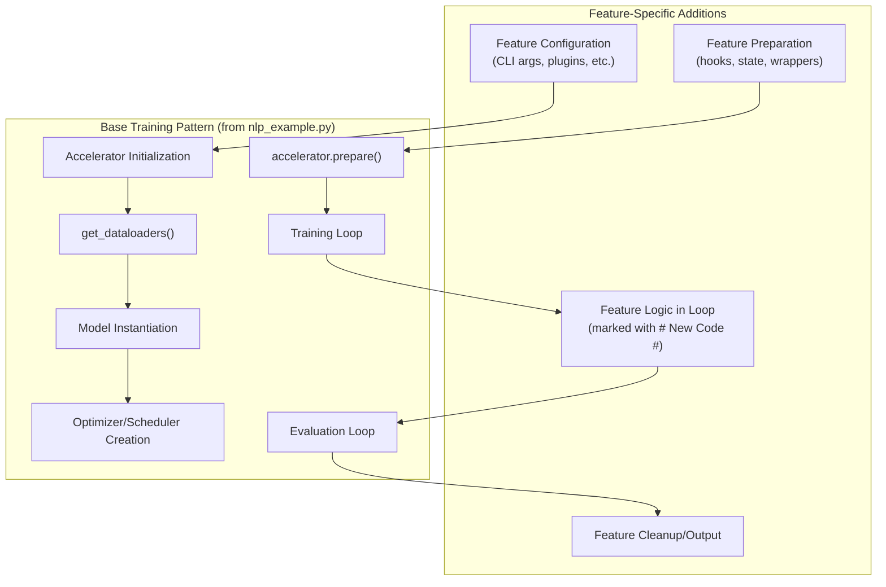
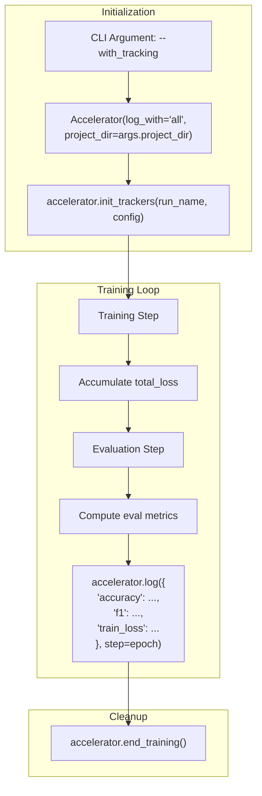
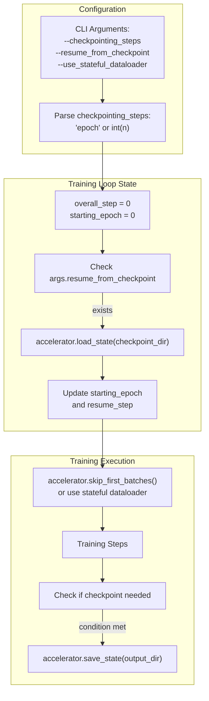
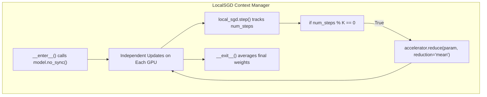

<!-- source: DeepWiki mcp.deepwiki.com · repo huggingface/accelerate · page 14.2 Feature Integration Examples · fetched 2026-10-21 -->

# Feature Integration Examples

<details>
<summary>Relevant source files</summary>

The following files were used as context for generating this wiki page:

- [examples/by_feature/checkpointing.py](examples/by_feature/checkpointing.py)
- [examples/by_feature/cross_validation.py](examples/by_feature/cross_validation.py)
- [examples/by_feature/early_stopping.py](examples/by_feature/early_stopping.py)
- [examples/by_feature/fsdp_with_peak_mem_tracking.py](examples/by_feature/fsdp_with_peak_mem_tracking.py)
- [examples/by_feature/gradient_accumulation.py](examples/by_feature/gradient_accumulation.py)
- [examples/by_feature/local_sgd.py](examples/by_feature/local_sgd.py)
- [examples/by_feature/memory.py](examples/by_feature/memory.py)
- [examples/by_feature/multi_process_metrics.py](examples/by_feature/multi_process_metrics.py)
- [examples/by_feature/tracking.py](examples/by_feature/tracking.py)
- [examples/complete_cv_example.py](examples/complete_cv_example.py)
- [examples/complete_nlp_example.py](examples/complete_nlp_example.py)
- [src/accelerate/local_sgd.py](src/accelerate/local_sgd.py)

</details>


## Purpose and Scope

This document covers the example scripts in the `examples/by_feature/` directory that demonstrate individual Accelerate features. Each example builds upon the basic training pattern (see [Basic Training Examples](#14.1)) by adding a specific capability such as checkpointing, experiment tracking, gradient accumulation, local SGD, or memory management. For complete examples that combine multiple features, see [Advanced Training Patterns](#14.3).

All examples in this section follow a consistent pattern: they start with the basic NLP training script structure and add feature-specific code marked with `# New Code #` comments to highlight the differences.

## Common Structure of Feature Examples

Each by_feature example follows this architectural pattern:



**Sources:** [examples/by_feature/tracking.py:1-48](), [examples/by_feature/checkpointing.py:1-49](), [examples/by_feature/gradient_accumulation.py:1-42]()

## Experiment Tracking

**Example:** [examples/by_feature/tracking.py]()

This example demonstrates integration with experiment tracking tools (WandB, TensorBoard, MLflow, CometML, ClearML, etc.).

### Key Components

| Component | Code Reference | Purpose |
|-----------|---------------|---------|
| Tracker Initialization | `log_with="all"` in `Accelerator.__init__` | Enables all available trackers |
| Tracker Setup | `accelerator.init_trackers()` | Initializes trackers with project name and config |
| Logging Metrics | `accelerator.log()` | Logs metrics during training |
| Cleanup | `accelerator.end_training()` | Finalizes tracker sessions |

### Implementation Pattern



### Feature-Specific Code Changes

**Accelerator Initialization** [examples/by_feature/tracking.py:133-138]():
```python
if args.with_tracking:
    accelerator = Accelerator(
        cpu=args.cpu, mixed_precision=args.mixed_precision, 
        log_with="all", project_dir=args.project_dir
    )
```

**Tracker Initialization** [examples/by_feature/tracking.py:182-186]():
```python
if args.with_tracking:
    run = os.path.split(__file__)[-1].split(".")[0]
    accelerator.init_trackers(run, config)
```

**Metric Logging** [examples/by_feature/tracking.py:228-237]():
```python
if args.with_tracking:
    accelerator.log(
        {
            "accuracy": eval_metric["accuracy"],
            "f1": eval_metric["f1"],
            "train_loss": total_loss.item() / len(train_dataloader),
            "epoch": epoch,
        },
        step=epoch,
    )
```

**Sources:** [examples/by_feature/tracking.py:1-271]()

## Checkpointing and Resumption

**Example:** [examples/by_feature/checkpointing.py]()

This example demonstrates saving and loading complete training state for resumption after interruptions.

### Checkpointing Flow



### Implementation Details

**Loading Checkpoint** [examples/by_feature/checkpointing.py:196-215]():
```python
if args.resume_from_checkpoint:
    accelerator.load_state(args.resume_from_checkpoint)
    path = os.path.basename(args.resume_from_checkpoint)
    training_difference = os.path.splitext(path)[0]
    
    if "epoch" in training_difference:
        starting_epoch = int(training_difference.replace("epoch_", "")) + 1
        resume_step = None
    else:
        resume_step = int(training_difference.replace("step_", ""))
        starting_epoch = resume_step // len(train_dataloader)
        resume_step -= starting_epoch * len(train_dataloader)
```

**Step-based Checkpointing** [examples/by_feature/checkpointing.py:250-255]():
```python
if isinstance(checkpointing_steps, int):
    output_dir = f"step_{overall_step}"
    if overall_step % checkpointing_steps == 0:
        if args.output_dir is not None:
            output_dir = os.path.join(args.output_dir, output_dir)
        accelerator.save_state(output_dir)
```

**Sources:** [examples/by_feature/checkpointing.py:1-326]()

## Gradient Accumulation

**Example:** [examples/by_feature/gradient_accumulation.py]()

This example demonstrates accumulating gradients over multiple mini-batches to simulate larger effective batch sizes.

### Key Implementation

**Accelerator Initialization** [examples/by_feature/gradient_accumulation.py:125-127]():
```python
accelerator = Accelerator(
    cpu=args.cpu, mixed_precision=args.mixed_precision, gradient_accumulation_steps=gradient_accumulation_steps
)
```

**Accumulation Context** [examples/by_feature/gradient_accumulation.py:176-182]():
```python
with accelerator.accumulate(model):
    output = model(**batch)
    loss = output.loss
    accelerator.backward(loss)
    optimizer.step()
    lr_scheduler.step()
    optimizer.zero_grad()
```

**Sources:** [examples/by_feature/gradient_accumulation.py:1-228]()

## Local SGD

**Example:** [examples/by_feature/local_sgd.py]()

Local SGD (also known as Parallel SGD) runs multiple updates independently on each device and averages weights every $K$ synchronization steps.

### Architecture



### Key Components

| Component | Code Reference | Purpose |
|-----------|---------------|---------|
| `LocalSGD` Class | [src/accelerate/local_sgd.py:19-39]() | Helper for independent updates and periodic averaging |
| Initialization | [src/accelerate/local_sgd.py:54-87]() | Configures `local_sgd_steps` and verifies backend compatibility |
| Parameter Averaging | [src/accelerate/local_sgd.py:99-107]() | Uses `accelerator.reduce` with `reduction="mean"` |

**Sources:** [src/accelerate/local_sgd.py:1-107](), [examples/by_feature/local_sgd.py:1-220]()

## Memory Management and OOM Recovery

**Example:** [examples/by_feature/memory.py]()

This example demonstrates automatic batch size finding to prevent out-of-memory (OOM) errors.

### Implementation

**Decorator Usage** [examples/by_feature/memory.py:142-143]():
```python
@find_executable_batch_size(starting_batch_size=batch_size)
def inner_training_loop(batch_size):
```

**Memory Cleanup** [examples/by_feature/memory.py:148]():
```python
accelerator.free_memory()
```

This ensures that if a trial fails due to OOM, all references to the model, optimizer, and gradients are cleared before retrying with a smaller batch size.

**Sources:** [examples/by_feature/memory.py:1-234]()

## Cross Validation

**Example:** [examples/by_feature/cross_validation.py]()

This example demonstrates K-fold cross validation in distributed training environments.

### Implementation Details

**Fold Creation** [examples/by_feature/cross_validation.py:145-166]():
```python
kfold = StratifiedKFold(n_splits=int(args.num_folds))
folds = kfold.split(np.zeros(datasets["train"].num_rows), datasets["train"]["label"])
```

**Memory Cleanup Between Folds** [examples/by_feature/cross_validation.py:250]():
```python
model, optimizer = accelerator.free_memory(model, optimizer)
```

**Sources:** [examples/by_feature/cross_validation.py:1-280]()

## FSDP with Memory Tracking

**Example:** [examples/by_feature/fsdp_with_peak_mem_tracking.py]()

This example demonstrates FSDP training with detailed GPU and CPU memory tracking using a custom context manager `TorchTracemalloc` [examples/by_feature/fsdp_with_peak_mem_tracking.py:68-131]().

### Memory Metrics Table

| Metric | Description | Code Reference |
|--------|-------------|----------------|
| `begin` | Memory at context entry | [examples/by_feature/fsdp_with_peak_mem_tracking.py:74]() |
| `peak` | Peak allocated during context | [examples/by_feature/fsdp_with_peak_mem_tracking.py:115]() |
| `cpu_peaked` | Peak CPU delta | [examples/by_feature/fsdp_with_peak_mem_tracking.py:129]() |

**Sources:** [examples/by_feature/fsdp_with_peak_mem_tracking.py:1-458]()

---

