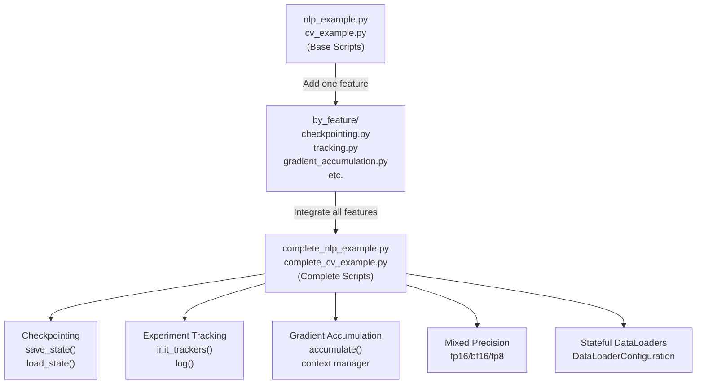
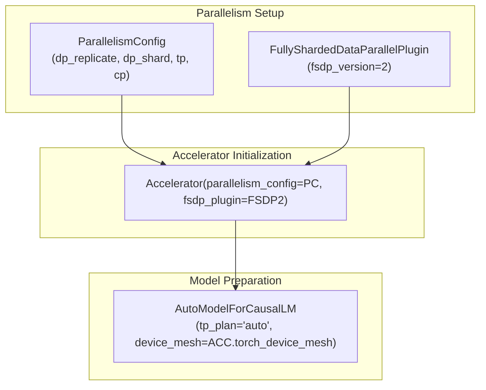
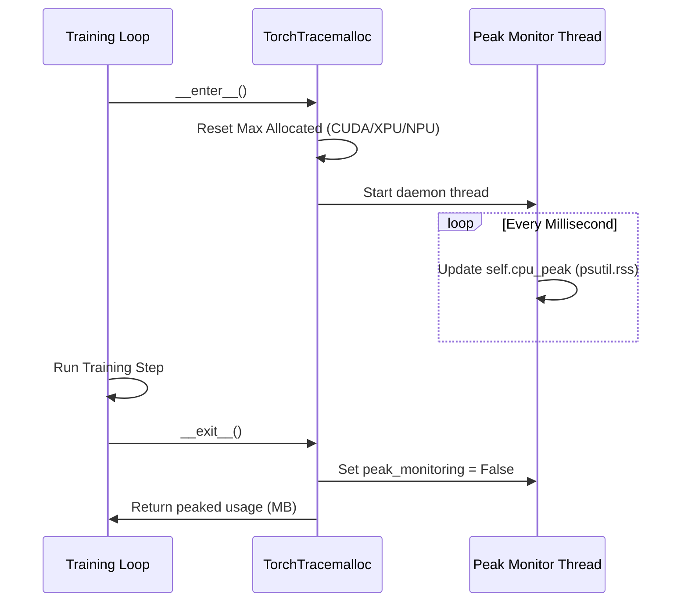

<!-- source: DeepWiki mcp.deepwiki.com · repo huggingface/accelerate · page 14.3 Advanced Training Patterns · fetched 2026-10-21 -->

# Advanced Training Patterns

<details>
<summary>Relevant source files</summary>

The following files were used as context for generating this wiki page:

- [examples/by_feature/checkpointing.py](examples/by_feature/checkpointing.py)
- [examples/by_feature/fsdp_with_peak_mem_tracking.py](examples/by_feature/fsdp_with_peak_mem_tracking.py)
- [examples/by_feature/multi_process_metrics.py](examples/by_feature/multi_process_metrics.py)
- [examples/by_feature/tracking.py](examples/by_feature/tracking.py)
- [examples/complete_cv_example.py](examples/complete_cv_example.py)
- [examples/complete_nlp_example.py](examples/complete_nlp_example.py)
- [examples/slurm/submit_multicpu.sh](examples/slurm/submit_multicpu.sh)
- [examples/slurm/submit_multigpu.sh](examples/slurm/submit_multigpu.sh)
- [examples/slurm/submit_multinode.sh](examples/slurm/submit_multinode.sh)
- [examples/torch_native_parallelism/README.md](examples/torch_native_parallelism/README.md)
- [examples/torch_native_parallelism/configs/cp.yaml](examples/torch_native_parallelism/configs/cp.yaml)
- [examples/torch_native_parallelism/configs/tp_hsdp.yaml](examples/torch_native_parallelism/configs/tp_hsdp.yaml)
- [examples/torch_native_parallelism/fsdp2_fp8.py](examples/torch_native_parallelism/fsdp2_fp8.py)
- [examples/torch_native_parallelism/nd_parallel.py](examples/torch_native_parallelism/nd_parallel.py)
- [examples/torch_native_parallelism/nd_parallel_trainer.py](examples/torch_native_parallelism/nd_parallel_trainer.py)
- [examples/torch_native_parallelism/utils.py](examples/torch_native_parallelism/utils.py)

</details>


## Purpose and Scope

This page documents advanced training patterns that combine multiple Accelerate features into comprehensive training scripts. It covers the complete example scripts (`complete_nlp_example.py`, `complete_cv_example.py`) that integrate checkpointing, tracking, gradient accumulation, and other features. Additionally, it details advanced patterns such as multi-dimensional (ND) parallelism using `ParallelismConfig`, regional compilation with `torch.compile()`, and SLURM multi-node setups.

---

## Complete Training Examples Architecture

The complete examples represent production-ready training scripts that integrate multiple Accelerate features simultaneously. These scripts serve as canonical references for building full-featured training pipelines.

### Complete Example Structure



Sources: [examples/complete_nlp_example.py:51-64](), [examples/complete_cv_example.py:75-88]()

### Feature Integration in Practice

The complete scripts utilize the `Accelerator` object to orchestrate complex lifecycles. For instance, in `complete_nlp_example.py`, the script handles:
- **Stateful DataLoaders**: Configured via `DataLoaderConfiguration(use_stateful_dataloader=args.use_stateful_dataloader)` [examples/complete_nlp_example.py:52-52]().
- **Main Process Coordination**: Data preprocessing is wrapped in `accelerator.main_process_first()` to ensure tokenization happens once per node [examples/complete_nlp_example.py:99-104]().
- **Dynamic Gradient Accumulation**: Calculation based on `MAX_GPU_BATCH_SIZE` and distributed type [examples/complete_nlp_example.py:112-115]().
- **Precision-Aware Padding**: Adjusting `pad_to_multiple_of` based on whether `fp8` or other mixed precision is used [examples/complete_nlp_example.py:119-125]().

Sources: [examples/complete_nlp_example.py:51-168]()

---

## Multi-Dimensional (ND) Parallelism

Accelerate provides a `ParallelismConfig` abstraction to compose multiple native PyTorch parallelism strategies, such as Data Parallelism (DP), Tensor Parallelism (TP), and Context Parallelism (CP).

### Parallelism Dimensions

The `nd_parallel.py` example demonstrates configuring 4 dimensions:
1. **dp_replicate_size**: Standard DDP-style replication [examples/torch_native_parallelism/README.md:11-11]().
2. **dp_shard_size**: FSDP2-based sharding across devices [examples/torch_native_parallelism/README.md:12-12]().
3. **tp_size**: Tensor parallelism utilizing `transformers` sharding [examples/torch_native_parallelism/README.md:13-13]().
4. **cp_size**: Context parallelism for long sequences, also utilizing FSDP2 [examples/torch_native_parallelism/README.md:14-15]().

### Implementation Pattern



In the training loop, context parallelism requires a specific context manager:
`accelerator.maybe_context_parallel(buffers=..., buffer_seq_dims=...)` [examples/torch_native_parallelism/nd_parallel.py:62-64]().

Sources: [examples/torch_native_parallelism/nd_parallel.py:84-123](), [examples/torch_native_parallelism/README.md:1-29]()

---

## Regional Compilation and Low-Bit Training

Regional compilation is used to optimize performance when using `torchao` for FP8 training. This is particularly effective for large models like Llama 3.1.

### FP8 with FSDP2

The `fsdp2_fp8.py` pattern uses `AORecipeKwargs` to replace standard linear layers with `Float8Linear` [examples/torch_native_parallelism/README.md:46-47](). Because `torchao` relies on compilation for performance, `TorchDynamoPlugin` is used alongside regional compilation to compile repeated transformer blocks [examples/torch_native_parallelism/README.md:47-49]().

### Performance Gains
Training an 8B model with FP8 on H100 GPUs can yield a ~25% increase in throughput (Tokens Per Second) compared to BF16 [examples/torch_native_parallelism/README.md:53-53]().

Sources: [examples/torch_native_parallelism/README.md:44-75]()

---

## SLURM Multi-Node Setups

For large-scale clusters, Accelerate can be launched via SLURM scripts. The key is to correctly identify the head node IP and configure the `rdzv_backend`.

### Multi-Node Launch Pattern

```bash
# Get the head node IP from SLURM environment
head_node_ip=$(scontrol show hostnames $SLURM_JOB_NODELIST | head -n 1)

# Configure the launcher
export LAUNCHER="accelerate launch \
    --num_processes $((SLURM_NNODES * GPUS_PER_NODE)) \
    --num_machines $SLURM_NNODES \
    --rdzv_backend c10d \
    --main_process_ip $head_node_ip \
    --main_process_port 29500"

# Execute via srun
srun $LAUNCHER $SCRIPT $SCRIPT_ARGS
```

Sources: [examples/slurm/submit_multinode.sh:23-42]()

---

## Advanced Monitoring: Peak Memory Tracking

For FSDP and large model training, monitoring peak memory is critical. The `fsdp_with_peak_mem_tracking.py` example implements a `TorchTracemalloc` context manager that tracks both GPU and CPU (RSS) memory peaks [examples/by_feature/fsdp_with_peak_mem_tracking.py:68-132]().

### Memory Tracking Lifecycle



Sources: [examples/by_feature/fsdp_with_peak_mem_tracking.py:68-132]()

---

## Summary of Advanced Patterns

| Pattern | Key Components | Primary Use Case |
|:---|:---|:---|
| **Complete Examples** | `Accelerator`, `DataLoaderConfiguration`, `init_trackers` | Production-ready full-pipeline training |
| **ND Parallelism** | `ParallelismConfig`, `DeviceMesh`, `FSDP2` | Scaling models across massive GPU clusters |
| **Regional Compilation** | `torch.compile`, `TorchDynamoPlugin`, `torchao` | FP8 training optimization |
| **SLURM Integration** | `srun`, `rdzv_backend c10d`, `main_process_ip` | Multi-node HPC environments |
| **Peak Tracking** | `psutil`, `torch.cuda.max_memory_allocated` | Debugging OOM and optimizing sharding |

Sources: [examples/complete_nlp_example.py:1-200](), [examples/torch_native_parallelism/README.md:1-75](), [examples/slurm/submit_multinode.sh:1-42](), [examples/by_feature/fsdp_with_peak_mem_tracking.py:68-132]()

---

