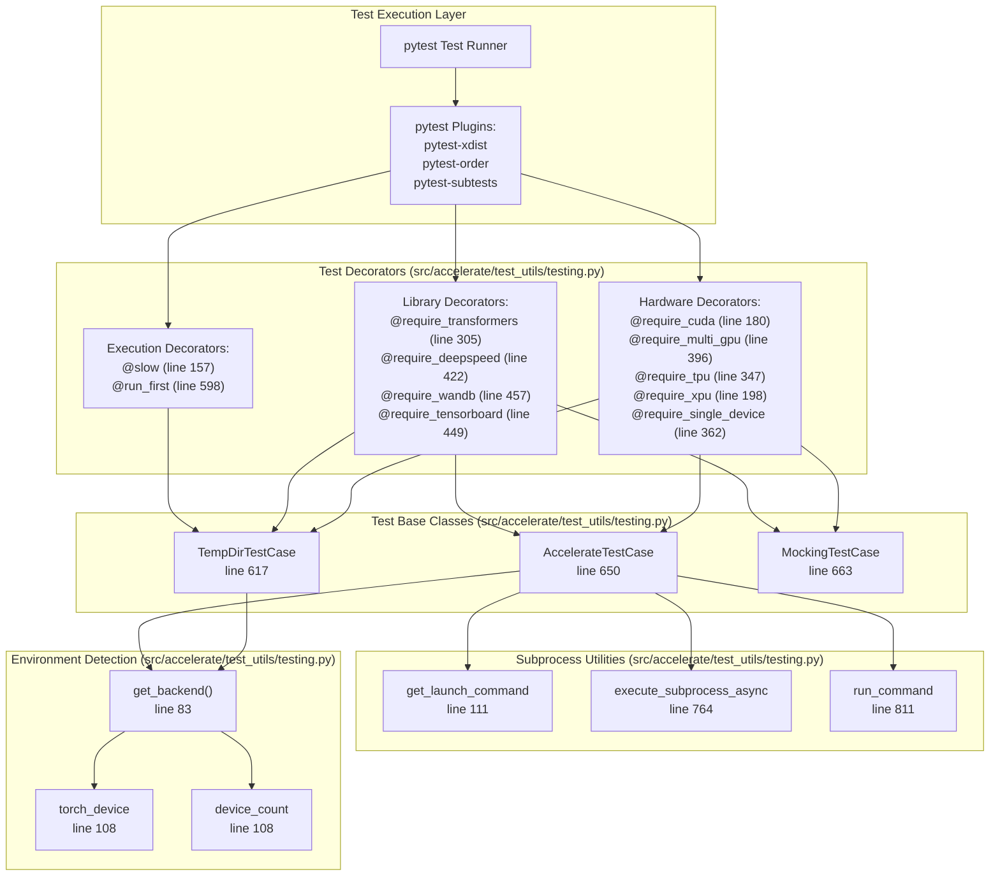
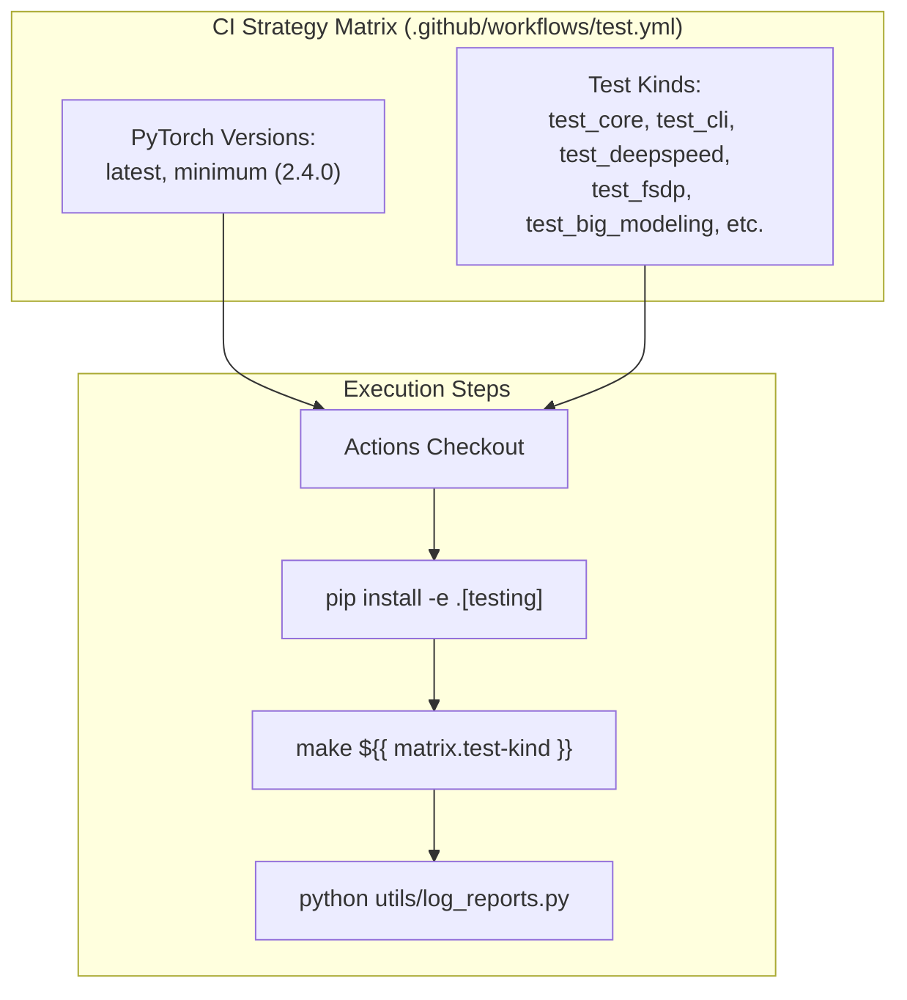

<!-- source: DeepWiki mcp.deepwiki.com · repo huggingface/accelerate · page 15 Developer Guide · fetched 2026-10-21 -->

# Developer Guide

<details>
<summary>Relevant source files</summary>

The following files were used as context for generating this wiki page:

- [.devcontainer/devcontainer.json](.devcontainer/devcontainer.json)
- [.github/workflows/test.yml](.github/workflows/test.yml)
- [.pre-commit-config.yaml](.pre-commit-config.yaml)
- [CONTRIBUTING.md](CONTRIBUTING.md)
- [Makefile](Makefile)
- [pyproject.toml](pyproject.toml)

</details>


This document provides information for contributors and developers working on the `accelerate` library codebase itself. It covers the testing infrastructure, continuous integration setup, code quality standards, and release procedures. 

For information about using the `accelerate` library in your projects, see the main documentation starting at [Overview](#1). For specific subsystem details covered in this guide, see [Testing Framework](#15.1), [Running Tests](#15.2), and [Code Quality and Contributing](#15.3).

## Development Environment Setup

The `accelerate` library uses a standard Python package structure with development dependencies defined in `setup.py`. The package requires Python 3.10+ and PyTorch 2.4.0+ as minimum versions for current testing cycles.

### Installation for Development

Install the package with development dependencies:

```bash
# Core development (testing + code quality)
pip install -e ".[dev]"

# Or install specific dependency groups
pip install -e ".[testing]"  # All test dependencies
pip install -e ".[quality]"  # Code quality tools only
```

The package defines several extras for development:

| Extra Group | Purpose | Key Dependencies |
|------------|---------|------------------|
| `quality` | Code quality tools | `ruff == 0.13.1` |
| `test_prod` | Core testing framework | `pytest>=7.2.0`, `pytest-xdist`, `pytest-subtests`, `parameterized`, `pytest-order` |
| `test_dev` | Integration test dependencies | `datasets`, `transformers`, `diffusers`, `evaluate`, `torchdata`, `torchpippy`, `scipy`, `scikit-learn`, `tqdm`, `bitsandbytes`, `timm` |
| `testing` | All test dependencies | `test_prod` + `test_dev` |
| `test_fp8` | FP8 testing | `torchao` |
| `test_trackers` | Experiment tracking tests | `wandb`, `comet-ml`, `tensorboard`, `dvclive`, `matplotlib`, `swanlab[dashboard]`, `trackio` |
| `dev` | Complete development environment | `quality` + `testing` + `rich` |

Sources: [setup.py:18-77]()

## Testing Infrastructure Architecture

The testing infrastructure is organized around a modular system of decorators, base classes, and utilities that enable comprehensive testing across diverse hardware configurations and optional dependencies.

### Test Infrastructure Component Diagram



Sources: [src/accelerate/test_utils/testing.py:1-882]()

For detailed documentation on these utilities and how to use them, see [Testing Framework](#15.1).

## Running Tests and CI/CD

Accelerate uses a complex test matrix to ensure compatibility across PyTorch versions and hardware backends. Tests are primarily driven by `pytest` and orchestrated via a `Makefile`.

### Makefile Test Targets

The `Makefile` defines specific targets for sharding the test suite:

| Target | Command | Purpose |
|--------|---------|---------|
| `test_core` | `pytest ./tests/ --ignore=...` | Core library logic, excluding heavy integrations |
| `test_cli` | `pytest ./tests/test_cli.py` | Command line interface validation |
| `test_deepspeed` | `pytest ./tests/deepspeed` | DeepSpeed integration suite |
| `test_fsdp` | `pytest ./tests/fsdp` | FSDP v1/v2 integration suite |
| `test_big_modeling` | `pytest ./tests/test_big_modeling.py ...` | Large model support and hooks |

Sources: [Makefile:18-42]()

### CI Pipeline

The GitHub Actions workflow `.github/workflows/test.yml` executes these targets across a matrix of `latest` and `minimum` PyTorch versions.



Sources: [.github/workflows/test.yml:19-70]()

For more details on running tests locally and understanding the CI matrix, see [Running Tests](#15.2).

## Code Quality and Contributing

Accelerate maintains high code quality through automated linting, strict import organization, and a standardized contribution workflow.

### Code Quality Tools

The project uses `ruff` for both linting and formatting. The configuration is managed in `pyproject.toml`.

```mermaid
graph LR
    subgraph "Quality Enforcement (Makefile)"
        style["make style"]
        quality["make quality"]
    end

    subgraph "Ruff Actions (pyproject.toml)"
        lint["ruff check --fix"]
        format["ruff format"]
        isort["Import Sorting"]
    end

    style --> lint
    style --> format
    quality --> lint
    lint --> isort
```

Sources: [Makefile:8-15](), [pyproject.toml:1-46]()

### Contribution Process

1. **Fork & Clone**: Create a fork and install in editable mode `pip install -e ".[dev]"`.
2. **Feature Branch**: Always work on a descriptive branch, never `main`.
3. **Quality Checks**: Run `make style` and `make quality` before committing.
4. **Testing**: Ensure `make test` or specific sub-targets pass.
5. **PR**: Open a Pull Request; CI will validate the matrix.

For the full contribution guide including release management and specific `ruff` rules, see [Code Quality and Contributing](#15.3).

Sources: [CONTRIBUTING.md:78-171]()

---

