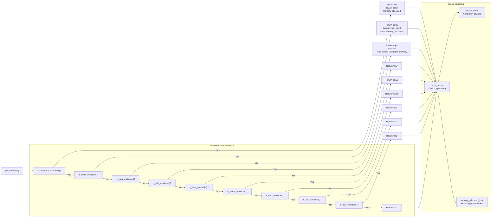
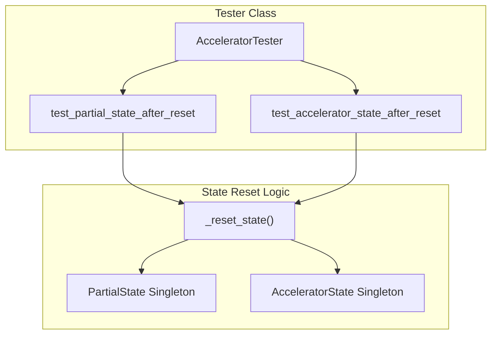

<!-- source: DeepWiki mcp.deepwiki.com · repo huggingface/accelerate · page 15.1 Testing Framework · fetched 2026-10-21 -->

# Testing Framework

<details>
<summary>Relevant source files</summary>

The following files were used as context for generating this wiki page:

- [src/accelerate/test_utils/__init__.py](src/accelerate/test_utils/__init__.py)
- [src/accelerate/test_utils/testing.py](src/accelerate/test_utils/testing.py)
- [src/accelerate/utils/bnb.py](src/accelerate/utils/bnb.py)
- [tests/test_accelerator.py](tests/test_accelerator.py)
- [tests/test_quantization.py](tests/test_quantization.py)

</details>


The Accelerate testing framework provides infrastructure for writing hardware-agnostic tests, conditionally executing tests based on available resources, managing test state, and validating distributed training scenarios. This framework enables the test suite to run across diverse hardware configurations (CPU, GPU, TPU, XPU, NPU, HPU, MLU, MUSA, SDAA) while automatically skipping tests that require unavailable resources.

For information about running the test suite and test organization, see [Running Tests](#15.2). For code quality standards and contribution guidelines, see [Code Quality and Contributing](#15.3).

## Testing Infrastructure Architecture

```mermaid
graph TB
    subgraph "Test Decorators"
        HardwareDecorators["Hardware Decorators<br/>@require_cuda<br/>@require_tpu<br/>@require_multi_gpu"]
        LibraryDecorators["Library Decorators<br/>@require_transformers<br/>@require_deepspeed<br/>@require_trackers"]
        SpecialDecorators["Special Decorators<br/>@slow<br/>@skip<br/>@run_first"]
    end
    
    subgraph "Base Test Classes"
        TempDirTestCase["TempDirTestCase<br/>Temporary directory management"]
        AccelerateTestCase["AccelerateTestCase<br/>State reset per test"]
        MockingTestCase["MockingTestCase<br/>Dynamic mock setup"]
    end
    
    subgraph "Subprocess Utilities"
        ExecuteSubprocess["execute_subprocess_async()<br/>Async command execution"]
        RunCommand["run_command()<br/>Sync command execution"]
        GetLaunchCommand["get_launch_command()<br/>Build launch args"]
    end
    
    subgraph "Testing Utilities"
        AreTheSame["are_the_same_tensors()<br/>Distributed equality check"]
        AssertException["assert_exception()<br/>Exception verification"]
        PathInPackage["path_in_accelerate_package()<br/>Package path resolution"]
        GetPort["get_torch_dist_unique_port()<br/>pytest-xdist port allocation"]
    end
    
    subgraph "Example Testing"
        ExampleDiff["ExampleDifferenceTests<br/>Script comparison validation"]
        FeatureExamples["FeatureExamplesTests<br/>Execution validation"]
        CompareAgainst["compare_against_test()<br/>AST-based comparison"]
    end
    
    subgraph "Test Files"
        TestCore["tests/test_*.py"]
        TestExamples["tests/test_examples.py"]
        TestTracking["tests/test_tracking.py"]
    end
    
    HardwareDecorators --> TestCore
    LibraryDecorators --> TestCore
    SpecialDecorators --> TestCore
    
    TempDirTestCase --> TestExamples
    TempDirTestCase --> TestTracking
    AccelerateTestCase --> TestCore
    MockingTestCase --> TestTracking
    
    ExecuteSubprocess --> TestExamples
    RunCommand --> TestExamples
    GetLaunchCommand --> TestExamples
    
    AreTheSame --> TestCore
    AssertException --> TestCore
    
    ExampleDiff --> TestExamples
    FeatureExamples --> TestExamples
    CompareAgainst --> ExampleDiff
    
    TestCore -.uses.-> ExecuteSubprocess
    TestCore -.uses.-> AreTheSame
```



**Testing Infrastructure Overview**: The testing framework consists of four main subsystems: conditional execution decorators that skip tests based on hardware/software availability, base test case classes that manage test state and resources, subprocess utilities for launching distributed tests, and specialized example testing infrastructure. All test files inherit from these base components to ensure consistent behavior.

Sources: `[src/accelerate/test_utils/testing.py:1-880]()`

## Hardware Backend Detection

The testing framework automatically detects available hardware backends and configures test execution accordingly:



**Backend Detection**: The `get_backend()` function probes for available hardware in priority order (XLA/TPU first, then CUDA, then alternative accelerators, finally CPU) and returns device type, count, and memory allocation function `[src/accelerate/test_utils/testing.py:84-109]()`. These values are stored in global variables `torch_device`, `device_count`, and `memory_allocated_func` that are used throughout the testing framework `[src/accelerate/test_utils/testing.py:111-112]()`.

Sources: `[src/accelerate/test_utils/testing.py:84-112]()`

## Hardware-Conditional Test Decorators

The framework provides decorators to conditionally execute tests based on hardware availability:

| Decorator | Purpose | Implementation Source |
|-----------|---------|-----------------------|
| `@require_cpu` | CPU-only tests | `[src/accelerate/test_utils/testing.py:168-172]()` |
| `@require_non_cpu` | Hardware accelerator tests | `[src/accelerate/test_utils/testing.py:175-180]()` |
| `@require_cuda` | CUDA GPU tests | `[src/accelerate/test_utils/testing.py:183-188]()` |
| `@require_cuda_or_hpu` | CUDA or HPU tests | `[src/accelerate/test_utils/testing.py:191-198]()` |
| `@require_xpu` | Intel XPU tests | `[src/accelerate/test_utils/testing.py:201-205]()` |
| `@require_cuda_or_xpu` | CUDA or XPU tests | `[src/accelerate/test_utils/testing.py:208-215]()` |
| `@require_non_xpu` | Non-XPU tests | `[src/accelerate/test_utils/testing.py:218-222]()` |
| `@require_non_hpu` | Non-HPU tests | `[src/accelerate/test_utils/testing.py:225-229]()` |
| `@require_fp16` | FP16 capability tests | `[src/accelerate/test_utils/testing.py:265-269]()` |
| `@require_fp8` | FP8 capability tests | `[src/accelerate/test_utils/testing.py:272-277]()` |
| `@require_mlu` | Cambricon MLU tests | `[src/accelerate/test_utils/testing.py:232-236]()` |
| `@require_sdaa` | SDAA tests | `[src/accelerate/test_utils/testing.py:239-243]()` |
| `@require_musa` | MUSA tests | `[src/accelerate/test_utils/testing.py:246-250]()` |
| `@require_npu` | Ascend NPU tests | `[src/accelerate/test_utils/testing.py:253-257]()` |
| `@require_mps` | Apple MPS tests | `[src/accelerate/test_utils/testing.py:260-262]()` |
| `@require_tpu` | TPU tests | `[src/accelerate/test_utils/testing.py:280-282]()` |
| `@require_non_torch_xla` | Non-XLA tests | `[src/accelerate/test_utils/testing.py:285-287]()` |
| `@require_multi_device` | Multi-device tests | `[src/accelerate/test_utils/testing.py:382-386]()` |
| `@require_multi_gpu` | Multi-GPU tests | `[src/accelerate/test_utils/testing.py:389-395]()` |

Sources: `[src/accelerate/test_utils/testing.py:168-420]()`

## Library-Conditional Test Decorators

Tests can also be skipped based on library availability:

| Decorator | Purpose | Implementation Source |
|-----------|---------|-----------------------|
| `@require_bnb` | bitsandbytes tests | `[src/accelerate/test_utils/testing.py:322-324]()` |
| `@require_deepspeed` | DeepSpeed tests | `[src/accelerate/test_utils/testing.py:327-329]()` |
| `@require_transformers` | Transformers tests | `[src/accelerate/test_utils/testing.py:302-304]()` |
| `@require_timm` | timm tests | `[src/accelerate/test_utils/testing.py:307-309]()` |
| `@require_torchvision` | torchvision tests | `[src/accelerate/test_utils/testing.py:312-314]()` |
| `@require_triton` | Triton tests | `[src/accelerate/test_utils/testing.py:317-319]()` |
| `@require_pippy` | PiPPy tests | `[src/accelerate/test_utils/testing.py:469-474]()` |
| `@require_transformer_engine` | Transformer Engine tests | `[src/accelerate/test_utils/testing.py:482-484]()` |
| `@require_torchao` | torchao tests | `[src/accelerate/test_utils/testing.py:492-494]()` |
| `@require_trackers` | Tracker tests | `[src/accelerate/test_utils/testing.py:566-586]()` |
| `@require_torchdata_stateful_dataloader` | Stateful dataloader tests | `[src/accelerate/test_utils/testing.py:589-595]()` |

Sources: `[src/accelerate/test_utils/testing.py:295-595]()`

## Special Test Decorators

Additional decorators control test execution behavior:

```python
# Skip slow tests unless RUN_SLOW=1 environment variable is set
@slow
def test_expensive_operation(self):
    ...

# Unconditionally skip test
@skip
def test_broken_feature(self):
    ...

# Run test first when pytest-order plugin is installed
@run_first
def test_multiprocess_training(self):
    ...
```

The `@slow` decorator `[src/accelerate/test_utils/testing.py:160-165]()` checks the `RUN_SLOW` environment variable parsed via `parse_flag_from_env()` `[src/accelerate/test_utils/testing.py:136-152]()`. The `@run_first` decorator `[src/accelerate/test_utils/testing.py:608-614]()` integrates with `pytest-order` to prioritize specific tests.

Sources: `[src/accelerate/test_utils/testing.py:136-165](), [src/accelerate/test_utils/testing.py:608-614]()`

## Base Test Case Classes

The framework provides three base test case classes for common testing patterns:

### TempDirTestCase

**TempDirTestCase** `[src/accelerate/test_utils/testing.py:617-648]()` creates a single `tempfile.TemporaryDirectory` that persists for the entire test class. The `setUp()` method optionally clears directory contents between tests, controlled by the `clear_on_setup` attribute `[src/accelerate/test_utils/testing.py:633-637]()`.

### AccelerateTestCase

**AccelerateTestCase** `[src/accelerate/test_utils/testing.py:650-661]()` resets the `AcceleratorState` singleton after each test via `tearDown()`. This prevents state leakage between tests when multiple tests initialize the `Accelerator` class `[src/accelerate/test_utils/testing.py:657-661]()`.

### MockingTestCase

**MockingTestCase** `[src/accelerate/test_utils/testing.py:663-694]()` enables dynamic mock setup. The `add_mocks()` method `[src/accelerate/test_utils/testing.py:681-694]()` accepts mock objects, starts them, and registers cleanup handlers using `addCleanup(mock.stop)` `[src/accelerate/test_utils/testing.py:692]()`.

Sources: `[src/accelerate/test_utils/testing.py:617-694]()`

## Subprocess Execution Utilities

The framework provides utilities for launching distributed tests in subprocesses:

### Launch Command Builder

The `get_launch_command()` function constructs `accelerate launch` commands with specified parameters `[src/accelerate/test_utils/testing.py:114-130]()`:

```python
# Returns: ['accelerate', 'launch', '--num_processes=2', '--mixed_precision=fp16']
get_launch_command(num_processes=2, mixed_precision='fp16')
```

The `DEFAULT_LAUNCH_COMMAND` constant is pre-built with `num_processes=device_count` and `monitor_interval=0.1` `[src/accelerate/test_utils/testing.py:133]()`.

### Async Execution

The `execute_subprocess_async()` function `[src/accelerate/test_utils/testing.py:739-780]()` launches commands asynchronously and streams stdout/stderr in real-time. It raises `RuntimeError` if the process returns a non-zero exit code `[src/accelerate/test_utils/testing.py:777-780]()`.

### pytest-xdist Port Allocation

The `get_torch_dist_unique_port()` function `[src/accelerate/test_utils/testing.py:796-803]()` allocates unique ports for distributed tests when using pytest-xdist parallel execution by adding the worker ID to the base port 29500 `[src/accelerate/test_utils/testing.py:801-803]()`.

Sources: `[src/accelerate/test_utils/testing.py:114-133](), [src/accelerate/test_utils/testing.py:739-803]()`

## Testing Utilities

### Distributed Tensor Equality

`are_the_same_tensors()` `[src/accelerate/test_utils/testing.py:696-705]()` verifies that a tensor has identical values across all distributed processes. It uses `gather()` `[src/accelerate/test_utils/testing.py:702]()` to collect copies and compares them element-wise.

### Exception Verification

The `assert_exception()` context manager `[src/accelerate/test_utils/testing.py:847-864]()` verifies that code raises the expected exception type and optionally checks the error message `[src/accelerate/test_utils/testing.py:861-864]()`.

### Package Path Resolution

`path_in_accelerate_package()` `[src/accelerate/test_utils/testing.py:832-845]()` constructs absolute paths to files within the installed `accelerate` package.

Sources: `[src/accelerate/test_utils/testing.py:696-864]()`

## Accelerator State Testing

The framework includes specific tests for verifying the singleton state of `PartialState` and `AcceleratorState`.



In `tests/test_accelerator.py`, the `AcceleratorTester` class validates that attributes are inaccessible after a state reset `[tests/test_accelerator.py:134-176]()`. Specifically, `test_partial_state_after_reset` `[tests/test_accelerator.py:135-155]()` and `test_accelerator_state_after_reset` `[tests/test_accelerator.py:156-176]()` ensure that `AttributeError` is raised with a specific hint about `_reset_state()` when trying to access cleared properties.

Sources: `[tests/test_accelerator.py:134-176]()`

## Quantization Testing Infrastructure

Testing quantization requires specific hardware and library combinations, managed via `MixedInt8EmptyModelTest` `[tests/test_quantization.py:47-180]()`.

| Test Component | Role | Code Pointer |
|----------------|------|--------------|
| `setUp` | Loads FP16 model and 8-bit quantized version | `[tests/test_quantization.py:62-91]()` |
| `tearDown` | Clears device cache and deletes model objects | `[tests/test_quantization.py:93-101]()` |
| `test_memory_footprint` | Validates relative memory savings of 8-bit vs FP16 | `[tests/test_quantization.py:103-115]()` |
| `test_linear_are_8bit` | Iterates modules to verify `torch.int8` dtype | `[tests/test_quantization.py:116-132]()` |
| `test_llm_skip` | Verifies that `skip_modules` keeps layers in full precision | `[tests/test_quantization.py:133-160]()` |

Sources: `[tests/test_quantization.py:47-180]()`

---

