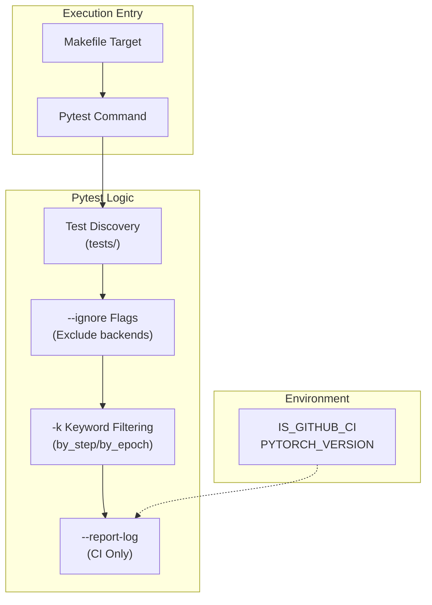
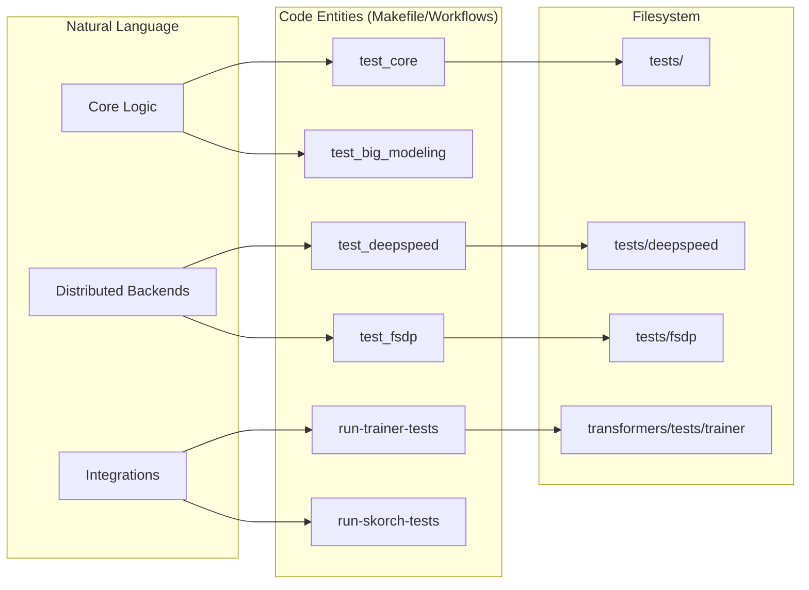

<!-- source: DeepWiki mcp.deepwiki.com · repo huggingface/accelerate · page 15.2 Running Tests · fetched 2026-10-21 -->

# Running Tests

<details>
<summary>Relevant source files</summary>

The following files were used as context for generating this wiki page:

- [.github/workflows/integration_tests.yml](.github/workflows/integration_tests.yml)
- [.github/workflows/self_hosted_integration_tests.yml](.github/workflows/self_hosted_integration_tests.yml)
- [.github/workflows/test.yml](.github/workflows/test.yml)
- [Makefile](Makefile)
- [pyproject.toml](pyproject.toml)

</details>


This page documents how to execute the Accelerate test suite, including core library tests, CLI tests, and specialized backend tests for DeepSpeed and FSDP. It covers the organization of the test matrix, Makefile targets, and the CI/CD pipeline configuration.

## Overview

The Accelerate test suite is categorized into several functional areas to ensure compatibility across different hardware configurations and distributed backends. The project uses `pytest` as the primary test runner, wrapped by a `Makefile` for standardized execution and a GitHub Actions workflow for automated CI.

### Test Matrix Organization

The test suite is organized into distinct "kinds" that are executed in parallel in CI to reduce total runtime.

| Test Kind | Description | Makefile Target |
|:---|:---|:---|
| **Core** | Fundamental library logic, excluding heavy modeling and backends | `test_core` |
| **CLI** | Commands like `accelerate launch`, `config`, and `estimate-memory` | `test_cli` |
| **Big Modeling** | Large model support, `init_empty_weights`, and device mapping | `test_big_modeling` |
| **DeepSpeed** | Integration tests specifically for DeepSpeed ZeRO stages | `test_deepspeed` |
| **FSDP** | Integration tests for PyTorch Fully Sharded Data Parallel | `test_fsdp` |
| **Examples** | Verification of scripts in the `examples/` directory | `test_examples` |

**Sources:** [.github/workflows/test.yml:29-40](), [Makefile:18-71]()

## Makefile Targets

The `Makefile` serves as the entry point for running tests locally and in CI. It manages directory exclusions and environment-specific flags.

### Core and CLI Tests
The `test_core` target runs the majority of tests while explicitly ignoring specialized modeling and backend directories to prevent redundant execution.

```bash
# Run core tests
make test_core
```

The `test_cli` target focuses exclusively on the command-line interface logic.
```bash
# Run CLI tests
make test_cli
```

**Sources:** [Makefile:18-30]()

### Backend Integration Tests
Accelerate includes dedicated targets for distributed backends. These tests often require specific environments (e.g., multiple GPUs) and are isolated in their own directories.

*   **DeepSpeed**: `make test_deepspeed` runs tests in `tests/deepspeed`. [Makefile:35-36]()
*   **FSDP**: `make test_fsdp` runs tests in `tests/fsdp`. [Makefile:38-39]()
*   **Tensor Parallel (TP)**: `make test_tp` runs tests in `tests/tp`. [Makefile:41-42]()

### Example Sharding
To optimize CI, example tests are sharded into three targets:
1.  `test_example_differences`: Checks for discrepancies in example scripts. [Makefile:57-58]()
2.  `test_checkpoint_epoch`: Runs feature examples filtered by the "by_epoch" keyword. [Makefile:60-61]()
3.  `test_checkpoint_step`: Runs feature examples filtered by the "by_step" keyword. [Makefile:63-64]()

## Pytest Usage Patterns

Accelerate uses standard `pytest` patterns with custom flags for CI reporting and hardware isolation.

### Implementation Flow


**Sources:** [Makefile:18-71](), [.github/workflows/test.yml:61-66]()

### CI Reporting
In GitHub Actions, tests are run with the `--report-log` flag. This generates a log file named after the PyTorch version and test kind (e.g., `latest_core.log`), which is later processed by `utils/log_reports.py` to generate a summary for the PR.

**Sources:** [Makefile:27](), [.github/workflows/test.yml:67-70]()

## CI/CD Infrastructure

The Accelerate repository maintains several workflows to ensure cross-platform and cross-library compatibility.

### Main Test Suite (`test.yml`)
Runs on every pull request. It uses a matrix strategy to test against multiple PyTorch versions:
*   **Latest**: The current stable release.
*   **Minimum**: The lowest supported PyTorch version (e.g., 2.4.0).

**Sources:** [.github/workflows/test.yml:22-28](), [.github/workflows/test.yml:54]()

### Integration Tests
Accelerate is a foundational library for the Hugging Face ecosystem, so integration tests are critical.

1.  **Transformers Integration**: Ensures that `transformers.Trainer` works correctly with the current Accelerate source. [/.github/workflows/integration_tests.yml:24-58]()
2.  **Self-Hosted GPU Tests**: Uses AWS G6 instances (`aws-g6-12xlarge-plus`) and the `huggingface/accelerate:gpu-deepspeed-nightly` Docker image to run hardware-dependent tests (DeepSpeed, Multi-GPU Trainer). [/.github/workflows/self_hosted_integration_tests.yml:24-69]()
3.  **Skorch Integration**: Verifies compatibility with the `skorch` library on GPU. [/.github/workflows/self_hosted_integration_tests.yml:70-107]()

### Code Entity Space Mapping


**Sources:** [Makefile:18-42](), [.github/workflows/self_hosted_integration_tests.yml:61-107]()

## Quality Standards

Before running tests, the codebase must pass quality and style checks. Accelerate uses `ruff` for both linting and formatting.

*   **Quality**: `make quality` runs `ruff check` and `ruff format --check`. [Makefile:8-10]()
*   **Style**: `make style` runs `ruff check --fix` and `ruff format`. [Makefile:13-15]()

The `ruff` configuration is defined in `pyproject.toml`, targeting Python 3.10 and enforcing rules like import sorting (`I`), bugbear (`B`), and pyupgrade (`UP`).

**Sources:** [Makefile:5-15](), [pyproject.toml:1-17]()

---

