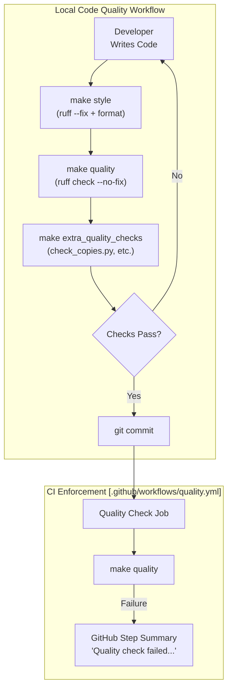
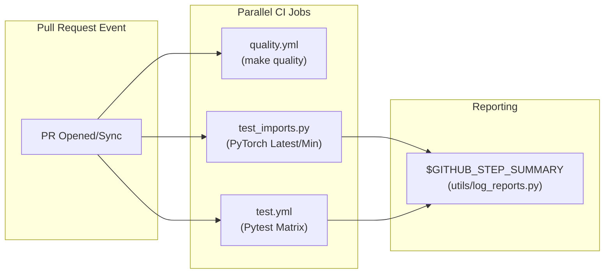

<!-- source: DeepWiki mcp.deepwiki.com · repo huggingface/accelerate · page 15.3 Code Quality and Contributing · fetched 2026-10-21 -->

# Code Quality and Contributing

<details>
<summary>Relevant source files</summary>

The following files were used as context for generating this wiki page:

- [.devcontainer/devcontainer.json](.devcontainer/devcontainer.json)
- [.github/workflows/quality.yml](.github/workflows/quality.yml)
- [.github/workflows/stale.yml](.github/workflows/stale.yml)
- [.github/workflows/test_imports.yml](.github/workflows/test_imports.yml)
- [.pre-commit-config.yaml](.pre-commit-config.yaml)
- [CONTRIBUTING.md](CONTRIBUTING.md)

</details>


## Purpose and Scope

This page documents the development practices, code quality standards, testing infrastructure, and contribution workflow for the Accelerate library. It covers tooling for code quality enforcement, the comprehensive testing framework with hardware-specific decorators, the release process, and guidelines for contributors.

---

## Development Environment Setup

### Installing Development Dependencies

The Accelerate library uses several categories of development dependencies defined in `setup.py`.

| Dependency Group | Purpose | Key Packages |
|-----------------|---------|--------------|
| `quality` | Code linting and formatting | `ruff == 0.13.1` [setup.py:19]() |
| `test_prod` | Core testing framework | `pytest`, `pytest-xdist`, `pytest-subtests`, `parameterized`, `pytest-order` [setup.py:22-29]() |
| `test_dev` | Integration testing libraries | `datasets`, `transformers`, `evaluate`, `torchdata`, `torchpippy`, `bitsandbytes`, `timm` [setup.py:31-41]() |
| `test_fp8` | FP8 testing | `torchao` [setup.py:43-44]() |
| `test_trackers` | Experiment tracking integration tests | `wandb`, `tensorboard`, `comet-ml`, `mlflow`, etc. [setup.py:46-51]() |
| `dev` | Complete development environment | Combines `quality` + `testing` + `rich` [setup.py:56]() |

**Installation:**

```bash
# Install all development dependencies
pip install -e ".[dev]"

# Install only quality tools
pip install -e ".[quality]"

# Install only testing dependencies
pip install -e ".[testing]"
```

The package requires Python >= 3.10.0 and PyTorch >= 2.0.0 as minimum versions [setup.py:79-87](). For VS Code users, a dev container configuration is provided to automate this setup [devcontainer.json:28]().

**Sources:** [setup.py:18-89](), [.devcontainer/devcontainer.json:1-29]()

---

## Code Quality Standards

### Ruff Configuration

Accelerate uses **Ruff** (version 0.13.1) as its primary code quality tool [setup.py:19](). Ruff handles both linting and formatting, replacing tools like `isort` and `black`.

#### Configuration Overview

The configuration is defined in `pyproject.toml`.

| Setting | Value | Purpose |
|---------|-------|---------|
| `line-length` | 119 | Maximum line length [pyproject.toml:3]() |
| `target-version` | py310 | Target Python 3.10 syntax [pyproject.toml:4]() |
| `preview` | true | Enable preview features [pyproject.toml:5]() |

#### Enabled Rules

Key rule categories enabled in [pyproject.toml:7-17]():

| Rule Code | Category | Description |
|-----------|----------|-------------|
| `B009`/`B010` | flake8-bugbear | Prevents static `getattr`/`setattr` calls |
| `CPY` | Copyright | Ensures copyright headers are present |
| `E`/`W` | pycodestyle | PEP8 error and warning checks |
| `F` | pyflakes | Logic error checks |
| `I` | isort | Import sorting consistency |
| `TID251` | flake8-tidy-imports | Banned API usage (e.g., `os.getenv` -> `os.environ`) [pyproject.toml:43-46]() |
| `UP` | pyupgrade | Python syntax upgrades |

#### Per-File Ignores

Special handling for specific files [pyproject.toml:28-32]():
- `__init__.py`: `F401` ignored to allow unused imports for re-export.
- `manim_animations/*`: All rules disabled.


**Sources:** [pyproject.toml:1-46](), [.github/workflows/quality.yml:1-24]()

---

### Makefile Targets

The `Makefile` provides standardized commands for development tasks.

#### Quality Targets

| Target | Command | Purpose |
|--------|---------|---------|
| `make quality` | `ruff check` + `ruff format --check` | Verify quality without modifying files [Makefile:13-15]() |
| `make style` | `ruff check --fix` + `ruff format` | Automatically fix and format code [Makefile:18-20]() |
| `make extra_quality_checks` | Runs custom python scripts | Validates internal consistency [Makefile:7-10]() |

#### Testing Targets

| Target | Command | Purpose |
|--------|---------|---------|
| `make test_core` | `pytest ./tests/` | Core library logic [Makefile:23-32]() |
| `make test_cli` | `pytest ./tests/test_cli.py` | CLI command suite [Makefile:34-35]() |
| `make test_deepspeed` | `pytest ./tests/deepspeed` | DeepSpeed integration [Makefile:40-41]() |
| `make test_fsdp` | `pytest ./tests/fsdp` | FSDP integration [Makefile:43-44]() |

#### Release Targets

| Target | Command | Purpose |
|--------|---------|---------|
| `make prepare_release` | `python setup.py bdist_wheel sdist` | Build distribution artifacts [Makefile:83-85]() |
| `make upload_release` | `twine upload dist/*` | Upload to PyPI/TestPyPI [Makefile:89]() |

**Sources:** [Makefile:1-89]()

---

## CI/CD Pipeline

### Automated Workflows

Accelerate uses several GitHub Actions workflows to maintain repo health.

#### Quality and Imports
- **Quality Check:** Runs `make quality` on pull requests to enforce styling [.github/workflows/quality.yml:19]().
- **Import Tests:** Validates library import speed and correctness across `latest` and `minimum` PyTorch versions [.github/workflows/test_imports.yml:23-27](). It uses `import-timer` to generate reports [.github/workflows/test_imports.yml:40]().

#### Repository Maintenance
- **Stale Bot:** Automatically manages stale issues and PRs by running `utils/stale.py` daily [.github/workflows/stale.yml:5, 33]().


**Sources:** [.github/workflows/quality.yml:1-24](), [.github/workflows/test_imports.yml:1-55](), [.github/workflows/stale.yml:1-33]()

---

## Contribution Workflow

### Issue and Feature Reporting
- **Bugs:** Requires OS, Python, PyTorch versions, a <30s reproduction snippet, and the `default_config.yaml` [CONTRIBUTING.md:54-57]().
- **Features:** Requires motivation, a full paragraph description, and a code snippet demonstrating the future API [CONTRIBUTING.md:61-74]().

### Pull Request Process
1. **Fork and Clone:** Create a local copy and add the `upstream` remote [CONTRIBUTING.md:91-103]().
2. **Synchronize:** Always merge `upstream/main` into local `main` before branching [CONTRIBUTING.md:107-113]().
3. **Branch:** Use descriptive names for branches; **do not** work on `main` [CONTRIBUTING.md:118-121]().
4. **Pre-commit:** Use `ruff` hooks via `pre-commit` to catch styling issues before pushing [.pre-commit-config.yaml:1-13]().
5. **Testing:** Run the specific test file impacted or the full suite via `make test` [CONTRIBUTING.md:141-156]().

**Sources:** [CONTRIBUTING.md:1-171](), [.pre-commit-config.yaml:1-13]()

---

## Release Management

The release process involves formal versioning and multi-stage uploads.

### Versioning
Versions are tracked in `src/accelerate/__init__.py` and `setup.py`. Development cycles use the `.dev0` suffix [setup.py:59]().

### Release Checklist
1. **Prepare:** Remove `.dev0` suffix in `setup.py` and `__init__.py` [setup.py:107-110]().
2. **Tag:** Create a git tag (e.g., `v1.0.0`) and push to origin [setup.py:112-114]().
3. **Build:** Run `make prepare_release` to generate wheels [setup.py:116]().
4. **Verify:** Upload to `testpypi` and verify installation using `make install_test_release` [setup.py:118-121]().
5. **Publish:** Upload to production PyPI using `make target=pypi upload_release` [setup.py:123]().

**Sources:** [setup.py:59,103-123](), [src/accelerate/__init__.py:14]()

---

