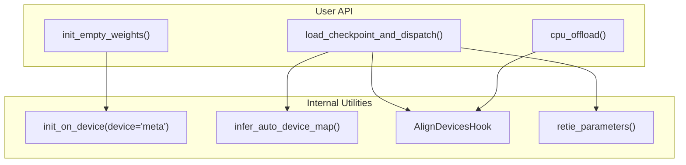
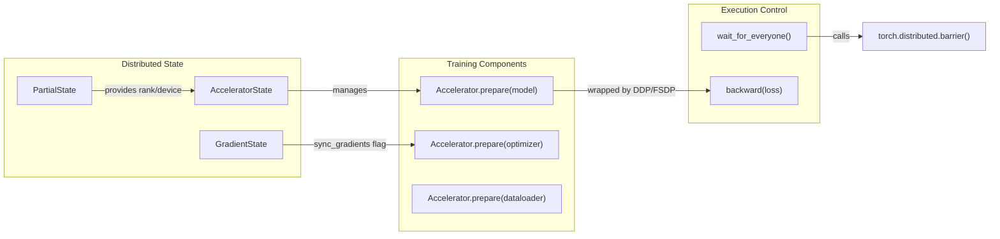

<!-- source: DeepWiki mcp.deepwiki.com · repo huggingface/accelerate · page 16 Glossary · fetched 2026-10-21 -->

# Glossary

Relevant source files

The following files were used as context for generating this wiki page:

- [src/accelerate/accelerator.py](src/accelerate/accelerator.py)
- [src/accelerate/big_modeling.py](src/accelerate/big_modeling.py)
- [src/accelerate/commands/config/cluster.py](src/accelerate/commands/config/cluster.py)
- [src/accelerate/commands/config/config_args.py](src/accelerate/commands/config/config_args.py)
- [src/accelerate/commands/config/sagemaker.py](src/accelerate/commands/config/sagemaker.py)
- [src/accelerate/commands/launch.py](src/accelerate/commands/launch.py)
- [src/accelerate/hooks.py](src/accelerate/hooks.py)
- [src/accelerate/state.py](src/accelerate/state.py)
- [src/accelerate/test_utils/scripts/external_deps/test_performance.py](src/accelerate/test_utils/scripts/external_deps/test_performance.py)
- [src/accelerate/utils/__init__.py](src/accelerate/utils/__init__.py)
- [src/accelerate/utils/constants.py](src/accelerate/utils/constants.py)
- [src/accelerate/utils/dataclasses.py](src/accelerate/utils/dataclasses.py)
- [src/accelerate/utils/fsdp_utils.py](src/accelerate/utils/fsdp_utils.py)
- [src/accelerate/utils/imports.py](src/accelerate/utils/imports.py)
- [src/accelerate/utils/launch.py](src/accelerate/utils/launch.py)
- [src/accelerate/utils/modeling.py](src/accelerate/utils/modeling.py)
- [tests/deepspeed/test_deepspeed.py](tests/deepspeed/test_deepspeed.py)
- [tests/fsdp/test_fsdp.py](tests/fsdp/test_fsdp.py)
- [tests/test_big_modeling.py](tests/test_big_modeling.py)
- [tests/test_hooks.py](tests/test_hooks.py)
- [tests/test_modeling_utils.py](tests/test_modeling_utils.py)

Definitions of codebase-specific terms, jargon, abbreviations, and domain concepts used within the Accelerate library.

## Distributed Training Terminology

### Backends and Frameworks
*   **DDP (Distributed Data Parallel)**: The standard PyTorch strategy for multi-GPU training where the model is replicated across all GPUs, and gradients are averaged during the backward pass [src/accelerate/utils/dataclasses.py:157-181]().
*   **FSDP (Fully Sharded Data Parallel)**: A type of data parallelism that shards model parameters, gradients, and optimizer states across data-parallel workers. Accelerate supports both FSDP v1 (native PyTorch) and FSDP v2 (standardized in newer PyTorch versions) [src/accelerate/utils/fsdp_utils.py:121-123](), [src/accelerate/utils/constants.py:108]().
*   **DeepSpeed**: A deep learning optimization library that enables ZeRO (Zero Redundancy Optimizer) stages to shard states across GPUs [src/accelerate/utils/dataclasses.py:44]().
*   **Megatron-LM**: A framework for large-scale training using model parallelism (tensor and pipeline parallelism) [src/accelerate/accelerator.py:68]().
*   **XLA (Accelerated Linear Algebra)**: The backend used for training on TPUs (Tensor Processing Units) via `torch_xla` [src/accelerate/utils/imports.py:31-42]().

### Hardware Backends
Accelerate abstracts various hardware through a unified interface.
*   **CUDA**: NVIDIA GPU architecture [src/accelerate/utils/imports.py:119-127]().
*   **XPU**: Intel GPU architecture [src/accelerate/utils/imports.py:44]().
*   **NPU**: Huawei Ascend architecture [src/accelerate/utils/imports.py:45]().
*   **MLU**: Cambricon architecture [src/accelerate/utils/imports.py:49]().
*   **MUSA**: Moore Threads architecture [src/accelerate/utils/imports.py:51]().
*   **HPU**: Habana Gaudi architecture [src/accelerate/utils/imports.py:41]().

**Sources:** [src/accelerate/utils/dataclasses.py](), [src/accelerate/utils/imports.py](), [src/accelerate/utils/fsdp_utils.py]()

## Core Accelerate Concepts

### The State Singletons
Accelerate uses a singleton pattern to manage the distributed environment state across a training script.

*   **PartialState**: A lightweight singleton that only tracks the distributed environment (device, rank, world size). It can be initialized without the full `Accelerator` class [src/accelerate/state.py:123-160]().
*   **AcceleratorState**: An extension of `PartialState` that also tracks mixed precision and gradient accumulation settings. It is usually managed by the `Accelerator` class [src/accelerate/state.py:44]().
*   **GradientState**: Tracks the status of gradient synchronization, specifically for gradient accumulation [src/accelerate/state.py:44]().

### Process Identifiers
*   **Main Process**: The process with `process_index == 0`. Often used for logging or saving checkpoints [src/accelerate/state.py:148]().
*   **Local Main Process**: The process with `local_process_index == 0` on a specific node/machine. Useful for tasks that should happen once per machine (e.g., downloading data) [src/accelerate/state.py:149]().
*   **Rank**: The global index of a process (0 to `num_processes - 1`) [src/accelerate/state.py:146]().

### Precision Formats
*   **Mixed Precision**: Using lower-bit formats to speed up training while maintaining a master copy of weights in FP32 [src/accelerate/accelerator.py:192-196]().
*   **BF16 (BFloat16)**: A 16-bit float format with the same dynamic range as FP32, preferred for stability on supported hardware (TPU, Ampere+ GPUs) [src/accelerate/utils/imports.py:164-176]().
*   **FP8**: 8-bit floating point, requiring specific backends like `TransformerEngine`, `MS-AMP`, or `torchao` [src/accelerate/utils/imports.py:187-190]().

**Sources:** [src/accelerate/state.py](), [src/accelerate/accelerator.py](), [src/accelerate/utils/imports.py]()

## Big Model Support & Hooks

### Memory Management
*   **Meta Device**: A virtual device in PyTorch used for "empty" initialization where tensors have shape and dtype but no allocated memory [src/accelerate/big_modeling.py:62-80]().
*   **Device Map**: A dictionary mapping model submodules to specific devices (e.g., `{"layer1": 0, "layer2": 1, "layer3": "cpu"}`) [src/accelerate/big_modeling.py:41]().
*   **Offloading**: Moving weights from the GPU to CPU RAM or Disk when they are not actively being used in a forward/backward pass [src/accelerate/big_modeling.py:179-190]().

### Hook System
Accelerate uses PyTorch hooks to dynamically move parameters between devices during the forward pass.

*   **ModelHook**: The base class for defining execution behavior [src/accelerate/hooks.py]().
*   **AlignDevicesHook**: Ensures that the input tensors and the module parameters are on the same device before execution [src/accelerate/big_modeling.py:26]().
*   **CpuOffload**: A specific hook that manages moving parameters to the GPU just before execution and back to the CPU immediately after [src/accelerate/big_modeling.py:27]().

### System Mapping: Big Modeling Logic
This diagram illustrates how user-facing functions map to internal modeling utilities.

**Sources:** [src/accelerate/big_modeling.py:62-118](), [src/accelerate/big_modeling.py:179-210](), [src/accelerate/utils/modeling.py:165-171]()

## Distributed Training Data Flow

The following diagram maps the high-level distributed concepts to specific code entities within the `Accelerator` and `state.py` modules.

**Sources:** [src/accelerate/state.py:123-160](), [src/accelerate/accelerator.py:1250-1350](), [src/accelerate/accelerator.py:2020-2050]()

## Implementation Details

### Data Handling
| Term | Description | Code Pointer |
| :--- | :--- | :--- |
| **Split Batches** | Whether the batch from the DataLoader is split across processes (True) or if each process gets the full batch (False). | [src/accelerate/accelerator.py:178]() |
| **Even Batches** | Logic to ensure all processes have the same number of batches by padding the end of the dataset. | [src/accelerate/accelerator.py:180]() |
| **DataLoaderShard** | A wrapper that iterates over a subset of a DataLoader's data based on the process rank. | [src/accelerate/data_loader.py]() |

### Utility Functions
*   **`recursively_apply`**: A utility that applies a function to every tensor found inside a nested structure (dict, list, tuple) [src/accelerate/utils/operations.py:206]().
*   **`send_to_device`**: Moves all tensors within a nested data structure to a specific device [src/accelerate/utils/operations.py:208]().
*   **`gather`**: Collects tensors from all distributed processes and concatenates them on each process [src/accelerate/utils/operations.py:194]().
*   **`pad_across_processes`**: Pads a tensor so that it has the same size across all processes, preventing hangs during collective operations [src/accelerate/utils/operations.py:204]().

**Sources:** [src/accelerate/accelerator.py](), [src/accelerate/utils/operations.py](), [src/accelerate/data_loader.py]()