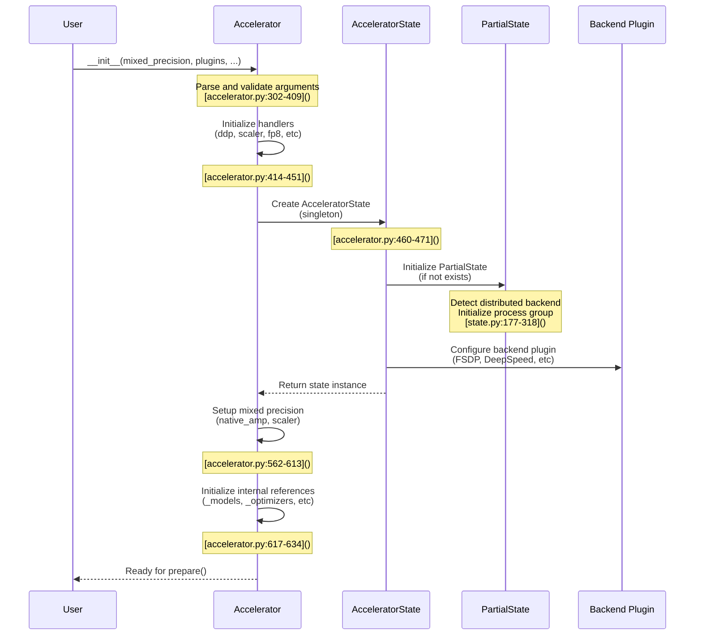
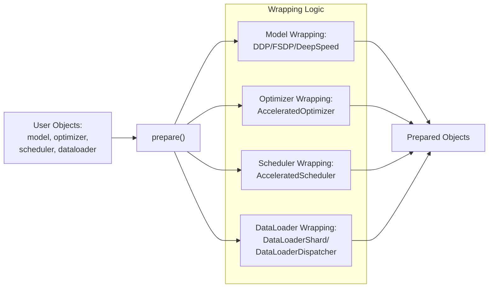
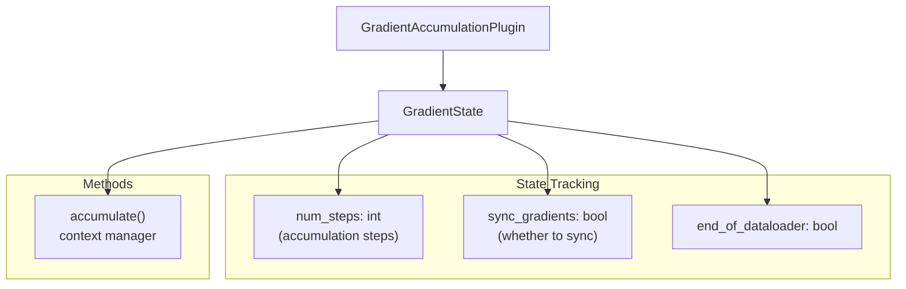
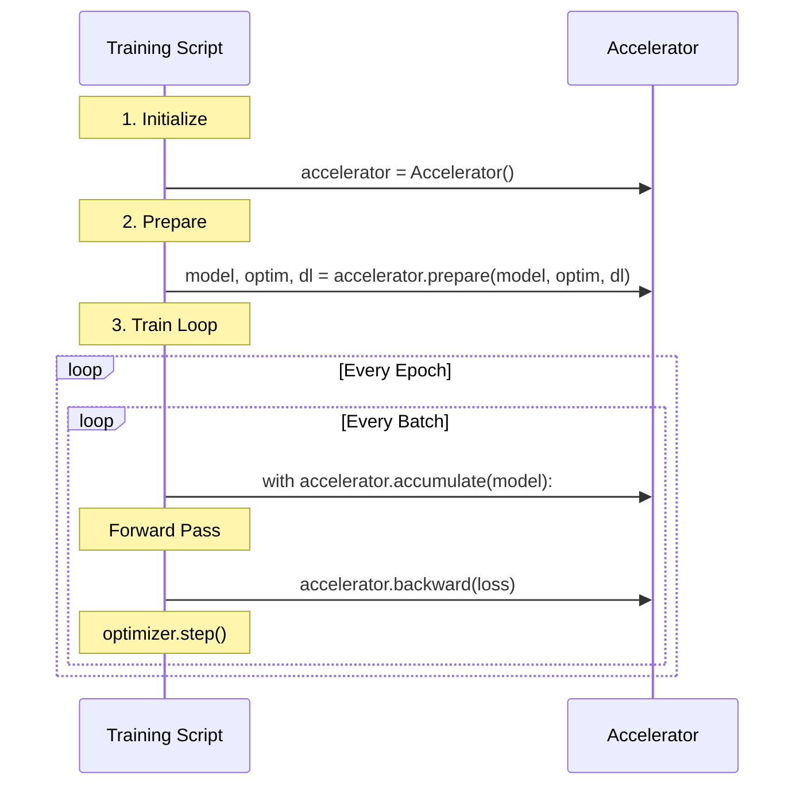

<!-- source: DeepWiki mcp.deepwiki.com · repo huggingface/accelerate · page 2 The Accelerator Class · fetched 2026-10-21 -->

# The Accelerator Class

Relevant source files

The following files were used as context for generating this wiki page:

- [docs/source/package_reference/accelerator.md](docs/source/package_reference/accelerator.md)
- [src/accelerate/accelerator.py](src/accelerate/accelerator.py)
- [src/accelerate/state.py](src/accelerate/state.py)
- [src/accelerate/utils/dataclasses.py](src/accelerate/utils/dataclasses.py)

## Purpose and Scope

This page documents the `Accelerator` class, the primary API entry point for users of the Accelerate library. The `Accelerator` serves as the orchestration layer that coordinates distributed training, mixed precision, gradient accumulation, and device management. This page provides an overview of the class architecture and its role in the system.

For detailed information about specific aspects:
- Initialization parameters and configuration options: see [Initialization and Configuration](#2.1)
- The `prepare()` method and component wrapping: see [Preparing Training Components](#2.2)
- Training loop integration (`backward()`, gradient accumulation): see [Training Loop Integration](#2.3)
- State properties and process control utilities: see [State Properties and Process Control](#2.4)

For information about data loading specifically, see [Data Loading and Processing](#4). For backend plugins (FSDP, DeepSpeed, Megatron-LM), see [Distributed Training Backends](#3).

## Class Overview

The `Accelerator` class is defined in [src/accelerate/accelerator.py:184-277]() and serves as a high-level wrapper that simplifies distributed PyTorch training. It abstracts away the complexity of different distributed backends, mixed precision configurations, and hardware setups, allowing users to write training code that works across single GPU, multi-GPU, multi-node, TPU, and other accelerated environments with minimal code changes.

**Core Design Principles:**
- **Single API**: One class interface for all distributed configurations.
- **Minimal Code Changes**: Typically requires only 4 to 5 lines of code changes to existing PyTorch scripts.
- **Plugin Architecture**: Extensible backend support through plugins (DeepSpeed, FSDP, Megatron-LM).
- **State Management**: Centralized state handling via singleton pattern in `AcceleratorState` and `PartialState`.

## Architecture and Relationships

### Accelerator in the System Hierarchy

The `Accelerator` acts as a facade, aggregating several configuration plugins, state singletons, and internal trackers for prepared objects.

```mermaid
graph TB
    User["User Training Script"]
    Accelerator["Accelerator<br/>(Main API)"]
    
    subgraph "State Singletons"
        AcceleratorState["AcceleratorState"]
        PartialState["PartialState"]
        GradientState["GradientState"]
    end
    
    subgraph "Configuration"
        ProjectConfig["ProjectConfiguration"]
        DataLoaderConfig["DataLoaderConfiguration"]
        GradAccumPlugin["GradientAccumulationPlugin"]
    end
    
    subgraph "Plugins"
        DeepSpeedPlugin["DeepSpeedPlugin"]
        FSDPPlugin["FullyShardedDataParallelPlugin"]
        MegatronPlugin["MegatronLMPlugin"]
        DynamoPlugin["TorchDynamoPlugin"]
    end
    
    subgraph "Handlers"
        DDPHandler["DistributedDataParallelKwargs<br/>(ddp_handler)"]
        ScalerHandler["GradScalerKwargs<br/>(scaler_handler)"]
        FP8Handler["FP8RecipeKwargs<br/>(fp8_recipe_handler)"]
        AutocastHandler["AutocastKwargs<br/>(autocast_handler)"]
    end
    
    subgraph "Internal Components"
        Models["_models: list"]
        Optimizers["_optimizers: list"]
        Schedulers["_schedulers: list"]
        DataLoaders["_dataloaders: list"]
        Scaler["scaler: GradScaler"]
    end
    
    User --> Accelerator
    
    Accelerator --> AcceleratorState
    Accelerator --> GradientState
    AcceleratorState --> PartialState
    
    Accelerator --> ProjectConfig
    Accelerator --> DataLoaderConfig
    Accelerator --> GradAccumPlugin
    
    Accelerator --> DeepSpeedPlugin
    Accelerator --> FSDPPlugin
    Accelerator --> MegatronPlugin
    Accelerator --> DynamoPlugin
    
    Accelerator --> DDPHandler
    Accelerator --> ScalerHandler
    Accelerator --> FP8Handler
    Accelerator --> AutocastHandler
    
    Accelerator --> Models
    Accelerator --> Optimizers
    Accelerator --> Schedulers
    Accelerator --> DataLoaders
    Accelerator --> Scaler
```

**Sources:** [src/accelerate/accelerator.py:184-636](), [src/accelerate/state.py:123-160](), [src/accelerate/state.py:863-1080]()

### Initialization Flow

When initialized, the `Accelerator` establishes the distributed backend via `AcceleratorState`.

**Sources:** [src/accelerate/accelerator.py:278-636](), [src/accelerate/state.py:123-160](), [src/accelerate/state.py:863-1080]()

## Core Responsibilities

The `Accelerator` class manages five primary responsibilities:

### 1. Distributed Environment Setup

The `Accelerator` initializes the distributed training environment through `AcceleratorState`. This includes:

- **Backend Selection**: Automatically detects or manually configures backends (NCCL, Gloo, XLA, etc.).
- **Process Group Initialization**: Sets up communication via `torch.distributed`.
- **Device Assignment**: Assigns the process to the correct device (e.g., `cuda:0`, `xla:0`).

The logic for basic process management is in `PartialState` [src/accelerate/state.py:123-160](), which is inherited/extended by `AcceleratorState` [src/accelerate/state.py:863-1080]().

**Key Properties:**
- `distributed_type`: Returns the `DistributedType` (e.g., `MULTI_GPU`, `DEEPSPEED`) [src/accelerate/accelerator.py:669-671]().
- `num_processes`: Total number of processes in the job [src/accelerate/accelerator.py:673-675]().
- `process_index`: The global rank of the process [src/accelerate/accelerator.py:677-679]().

### 2. Component Preparation

The `prepare()` method [src/accelerate/accelerator.py:1361-1577]() wraps models, optimizers, and dataloaders.

**Sources:** [src/accelerate/accelerator.py:1361-1577]()

### 3. Mixed Precision Management

Supports FP16, BF16, and FP8 precision:

| Precision Type | GradScaler Required | Configuration Handler |
|---------------|---------------------|-----------------------|
| FP16 | Yes (for non-DeepSpeed) | `GradScalerKwargs` [src/accelerate/utils/dataclasses.py:596-620]() |
| BF16 | No | N/A |
| FP8 | Varies | `FP8RecipeKwargs` [src/accelerate/utils/dataclasses.py:1225-1262]() |

The `Accelerator` sets up the `scaler` in [src/accelerate/accelerator.py:562-613]().

### 4. Gradient Accumulation Control

Tracks synchronization states across uneven batches and accumulation steps through `GradientState`.

The `accumulate()` context manager [src/accelerate/accelerator.py:2050-2112]() uses the `GradientState` [src/accelerate/state.py:1083-1209]() to determine if the backward pass should trigger gradient synchronization.

### 5. Training Utilities

- **Synchronization**: `wait_for_everyone()` [src/accelerate/accelerator.py:2260-2262]().
- **Collectives**: `gather()` [src/accelerate/accelerator.py:2180-2212](), `reduce()` [src/accelerate/accelerator.py:2214-2228]().
- **Checkpointing**: `save_state()` and `load_state()` [src/accelerate/accelerator.py:2485-2565]().

## Internal Architecture

### State Management Objects

The `Accelerator` maintains several singleton state objects:

| State Object | Singleton Class | Purpose |
|-------------|-----------------|---------|
| Distributed State | `AcceleratorState` | Manages process groups and plugin state [src/accelerate/state.py:863](). |
| Basic State | `PartialState` | Lowest-level process and device info [src/accelerate/state.py:123](). |
| Gradient State | `GradientState` | Tracks accumulation synchronization [src/accelerate/state.py:1083](). |

### Internal Collections

The `Accelerator` tracks all objects passed to `prepare()` in its internal lists:
- `self._models` [src/accelerate/accelerator.py:618]()
- `self._optimizers` [src/accelerate/accelerator.py:617]()
- `self._schedulers` [src/accelerate/accelerator.py:619]()
- `self._dataloaders` [src/accelerate/accelerator.py:620]()

### Handler System

The `Accelerator` accepts `kwargs_handlers` [src/accelerate/accelerator.py:414-451]() which are instances of `KwargsHandler` subclasses like `DistributedDataParallelKwargs` or `AutocastKwargs` [src/accelerate/utils/dataclasses.py:70-89](). These are used to pass fine-grained arguments to underlying PyTorch components.

## Typical Usage Pattern

### Integration Workflow

**Sources:** [src/accelerate/accelerator.py:184-277]()

## Key Properties Reference

| Property | Description |
|----------|-------------|
| `device` | The device to put tensors on [src/accelerate/accelerator.py:686-687](). |
| `is_main_process` | Whether the current process is the global rank 0 [src/accelerate/accelerator.py:731-734](). |
| `is_local_main_process` | Whether the process is rank 0 on its local node [src/accelerate/accelerator.py:736-739](). |
| `optimizer_step_was_skipped` | Useful for gradient clipping when using a scaler [src/accelerate/accelerator.py:771-778](). |

**Sources:** [src/accelerate/accelerator.py:638-791]()

---

This page provides an overview of the `Accelerator` class. For detailed implementation details, follow the links to the child pages.

---

