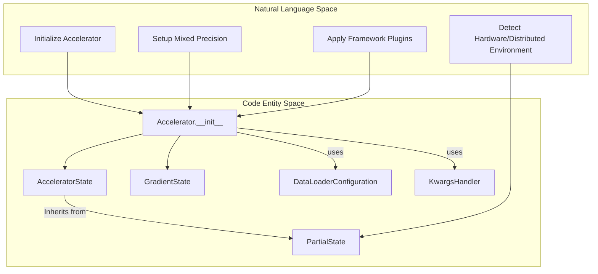
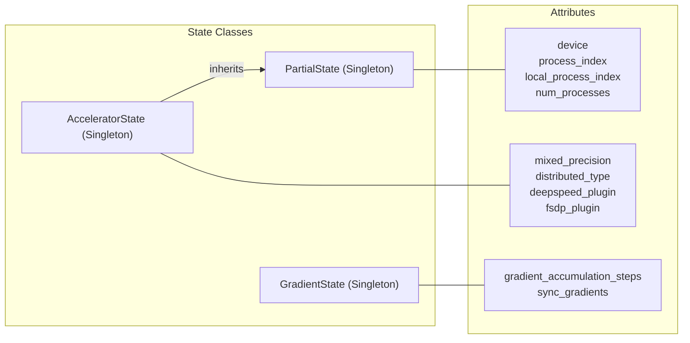

<!-- source: DeepWiki mcp.deepwiki.com · repo huggingface/accelerate · page 2.1 Initialization and Configuration · fetched 2026-10-21 -->

# Initialization and Configuration

<details>
<summary>Relevant source files</summary>

The following files were used as context for generating this wiki page:

- [src/accelerate/accelerator.py](src/accelerate/accelerator.py)
- [src/accelerate/parallelism_config.py](src/accelerate/parallelism_config.py)
- [src/accelerate/state.py](src/accelerate/state.py)
- [src/accelerate/utils/__init__.py](src/accelerate/utils/__init__.py)
- [src/accelerate/utils/dataclasses.py](src/accelerate/utils/dataclasses.py)
- [src/accelerate/utils/imports.py](src/accelerate/utils/imports.py)
- [tests/test_dataclasses.py](tests/test_dataclasses.py)

</details>


This page details the initialization and configuration of the `Accelerator` class, the primary entry point for the Accelerate library. The `Accelerator` orchestrates distributed training, mixed precision, and hardware-specific optimizations by managing internal state and providing a unified API across diverse backends.

## Core Initialization Flow

When an `Accelerator` is instantiated, it initializes a singleton `AcceleratorState` (or `PartialState`) which detects the hardware environment and distributed setup. It also sets up precision handlers and experiment trackers.



Sources: [src/accelerate/accelerator.py:270-313](), [src/accelerate/state.py:177-210](), [src/accelerate/state.py:656-680]()

## Constructor Parameters

The `Accelerator` constructor accepts parameters that define the behavior of the training environment.

| Parameter | Type | Default | Description |
|-----------|------|---------|-------------|
| `device_placement` | `bool` | `True` | Automatically moves models, optimizers, and data to the correct `torch.device`. [src/accelerate/accelerator.py:189-191]() |
| `mixed_precision` | `str` | `None` | Options: `'no'`, `'fp16'`, `'bf16'`, `'fp8'`. Can be overridden by `ACCELERATE_MIXED_PRECISION` env var. [src/accelerate/accelerator.py:192-196]() |
| `gradient_accumulation_steps` | `int` | `1` | Number of steps to accumulate gradients before an optimizer step. [src/accelerate/accelerator.py:197-201]() |
| `cpu` | `bool` | `False` | Forces execution on CPU, ignoring available GPUs. [src/accelerate/accelerator.py:202-203]() |
| `dataloader_config` | `DataLoaderConfiguration` | `None` | Controls batch splitting and dispatching behavior. [src/accelerate/accelerator.py:204-205]() |
| `deepspeed_plugin` | `DeepSpeedPlugin` | `None` | Configuration for DeepSpeed ZeRO, offloading, etc. [src/accelerate/accelerator.py:206-209]() |
| `fsdp_plugin` | `FullyShardedDataParallelPlugin` | `None` | Configuration for FSDP sharding strategies and auto-wrap policies. [src/accelerate/accelerator.py:210-211]() |
| `megatron_lm_plugin` | `MegatronLMPlugin` | `None` | Configuration for Megatron-LM tensor/pipeline parallelism. [src/accelerate/accelerator.py:212-213]() |
| `parallelism_config` | `ParallelismConfig` | `None` | High-level config for 4D parallelism (DP, TP, CP, SP). [src/accelerate/accelerator.py:214-215]() |

Sources: [src/accelerate/accelerator.py:185-268]()

## State Management and Singletons

Accelerate uses a singleton pattern to ensure that distributed state is consistent across the application. 

### AcceleratorState vs. PartialState
- **`PartialState`**: Manages basic process information (index, number of processes, device). It can be used without a full `Accelerator` instance for simple distributed utilities. [src/accelerate/state.py:123-160]()
- **`AcceleratorState`**: Extends `PartialState` to include mixed precision settings and specialized plugin states (FSDP, DeepSpeed). [src/accelerate/state.py:656-670]()



Sources: [src/accelerate/state.py:162-175](), [src/accelerate/state.py:682-700](), [src/accelerate/state.py:1017-1030]()

## Specialized Configuration Plugins

### DeepSpeed, FSDP, and Megatron-LM
These plugins allow programmatic configuration of complex distributed backends. If a plugin is not provided, Accelerate attempts to load settings from the environment (e.g., generated by `accelerate config`).

- **DeepSpeedPlugin**: Handles ZeRO stages, optimizer offloading, and configuration files. [src/accelerate/utils/dataclasses.py:1094-1140]()
- **FullyShardedDataParallelPlugin**: Configures `sharding_strategy`, `backward_prefetch`, and `auto_wrap_policy`. [src/accelerate/utils/dataclasses.py:1260-1320]()
- **MegatronLMPlugin**: Manages `tp_degree`, `pp_degree`, and sequence parallelism. [src/accelerate/utils/dataclasses.py:1450-1490]()

### ParallelismConfig (4D Parallelism)
Introduced to unify different parallelism dimensions, `ParallelismConfig` manages `dp_replicate_size`, `dp_shard_size`, `tp_size`, `cp_size`, and `sp_size`. It builds a `DeviceMesh` to coordinate these dimensions.

```python
from accelerate import Accelerator
from accelerate.parallelism_config import ParallelismConfig

p_config = ParallelismConfig(dp_shard_size=2, tp_size=2)
accelerator = Accelerator(parallelism_config=p_config)
```

Sources: [src/accelerate/parallelism_config.py:34-82](), [src/accelerate/parallelism_config.py:167-170]()

## KwargsHandlers for Granular Control

For low-level PyTorch adjustments, `KwargsHandler` subclasses allow passing specific arguments to underlying PyTorch functions:

- **`DistributedDataParallelKwargs`**: Passed to `torch.nn.parallel.DistributedDataParallel`. Includes `find_unused_parameters` and `comm_hook`. [src/accelerate/utils/dataclasses.py:157-198]()
- **`AutocastKwargs`**: Controls `torch.autocast` behavior, such as `enabled` and `cache_enabled`. [src/accelerate/utils/dataclasses.py:115-134]()
- **`GradScalerKwargs`**: Customizes the `torch.cuda.amp.GradScaler`. [src/accelerate/utils/dataclasses.py:286-309]()
- **`InitProcessGroupKwargs`**: Arguments for `torch.distributed.init_process_group`, like `timeout` and `backend`. [src/accelerate/utils/dataclasses.py:382-411]()

Sources: [src/accelerate/utils/dataclasses.py:70-89]()

## Environment-Based Auto-Configuration

The `Accelerator` checks specific environment variables during `__init__` to determine the setup, primarily when launched via the CLI.

| Environment Variable | Accelerator Property |
|----------------------|----------------------|
| `ACCELERATE_MIXED_PRECISION` | `self.state.mixed_precision` |
| `ACCELERATE_GRADIENT_ACCUMULATION_STEPS` | `self.gradient_state.gradient_accumulation_steps` |
| `ACCELERATE_TORCH_DEVICE` | `self.state.device` |
| `ACCELERATE_DEBUG_MODE` | `self.state.debug` |

Sources: [src/accelerate/state.py:182-184](), [src/accelerate/state.py:720-725](), [src/accelerate/accelerator.py:358-367]()

---

