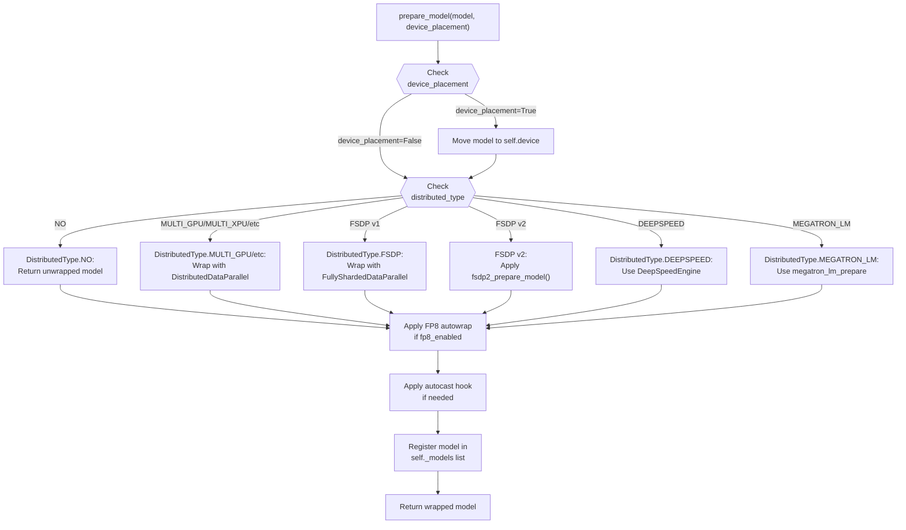
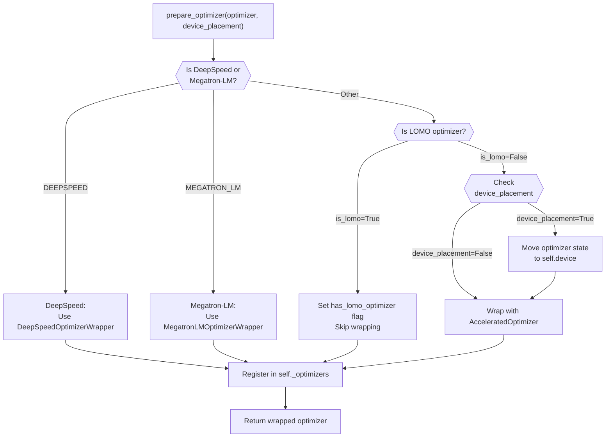
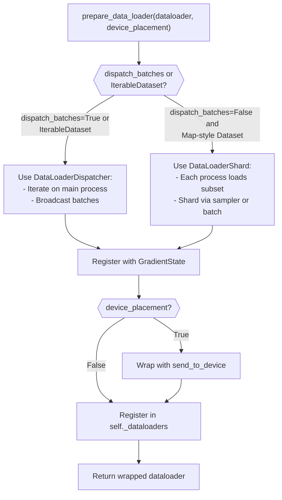

<!-- source: DeepWiki mcp.deepwiki.com · repo huggingface/accelerate · page 2.2 Preparing Training Components · fetched 2026-10-21 -->

# Preparing Training Components

<details>
<summary>Relevant source files</summary>

The following files were used as context for generating this wiki page:

- [src/accelerate/accelerator.py](src/accelerate/accelerator.py)
- [src/accelerate/state.py](src/accelerate/state.py)
- [src/accelerate/test_utils/scripts/external_deps/test_performance.py](src/accelerate/test_utils/scripts/external_deps/test_performance.py)
- [src/accelerate/utils/dataclasses.py](src/accelerate/utils/dataclasses.py)
- [src/accelerate/utils/fsdp_utils.py](src/accelerate/utils/fsdp_utils.py)
- [tests/deepspeed/test_deepspeed.py](tests/deepspeed/test_deepspeed.py)
- [tests/fsdp/test_fsdp.py](tests/fsdp/test_fsdp.py)

</details>


This page documents the `prepare()` method and its associated preparation functions that transform standard PyTorch training components (models, optimizers, dataloaders, schedulers) into distributed-aware, mixed-precision-ready objects. For information about using these prepared components in the training loop, see [Training Loop Integration](#2.3). For details on initializing the Accelerator that controls preparation behavior, see [Initialization and Configuration](#2.1).

---

## Overview

The `prepare()` method is the central mechanism that enables Accelerate's "write once, run anywhere" capability. It wraps PyTorch training components to handle:

- **Distributed training**: Wraps models with DDP, FSDP, DeepSpeed, or Megatron-LM based on configuration.
- **Mixed precision**: Applies autocast contexts and gradient scaling.
- **Device placement**: Moves components to appropriate devices automatically.
- **Data distribution**: Shards data across processes or dispatches from main process.
- **State tracking**: Registers components for checkpointing and lifecycle management.

The method accepts any number of PyTorch objects and returns them in the same order after wrapping.

**Sources**: [src/accelerate/accelerator.py:1161-1368]()

---

## The prepare() Method

### Method Signature

```python
def prepare(self, *args, device_placement=None)
```

The `prepare()` method accepts any combination of models, optimizers, dataloaders, and schedulers. The `device_placement` parameter (optional) overrides the Accelerator's default device placement behavior for this specific call [src/accelerate/accelerator.py:1214-1216]().

### Behavior and Return Values

The method:
1. Identifies the type of each argument (model, optimizer, dataloader, scheduler, or custom object) [src/accelerate/accelerator.py:1280-1345]().
2. Calls the appropriate preparation function for each type.
3. Returns prepared objects in the same order they were passed in [src/accelerate/accelerator.py:1368]().
4. Registers prepared objects internally for state management [src/accelerate/accelerator.py:1347-1366]().

### Type Detection Logic

The method uses `isinstance()` checks in the following order [src/accelerate/accelerator.py:1280-1345]():

| Check Order | Type | Preparation Function |
|-------------|------|---------------------|
| 1 | `torch.optim.Optimizer` | `prepare_optimizer()` |
| 2 | `torch.nn.Module` | `prepare_model()` |
| 3 | `torch.utils.data.DataLoader` | `prepare_data_loader()` |
| 4 | `LRScheduler` | `prepare_scheduler()` |

If an object doesn't match any known type, it's registered as a "custom object" and returned unchanged [src/accelerate/accelerator.py:1340-1345]().

**Sources**: [src/accelerate/accelerator.py:1161-1368]()

---

## Model Preparation

### Overview

The `prepare_model()` method wraps PyTorch models based on the active distributed type. The wrapping strategy depends on whether you're using DDP, FSDP, DeepSpeed, Megatron-LM, or single-device training [src/accelerate/accelerator.py:1370-1632]().

### Preparation Flow Diagram


**Sources**: [src/accelerate/accelerator.py:1370-1632]()

### Distributed Type Handlers

#### DistributedDataParallel (DDP)

For `DistributedType.MULTI_GPU`, `MULTI_XPU`, `MULTI_NPU`, `MULTI_MLU`, `MULTI_MUSA`, `MULTI_SDAA`, and `MULTI_HPU`:

1. **Wrapper class**: Uses `torch.nn.parallel.DistributedDataParallel` [src/accelerate/accelerator.py:1516-1522]().
2. **Configuration**: Applies settings from `DistributedDataParallelKwargs` handler if present [src/accelerate/accelerator.py:1516]().
3. **Communication hooks**: Registers DDP communication hooks for gradient compression (FP16, BF16, PowerSGD) if specified [src/accelerate/utils/dataclasses.py:202-230]().
4. **Device placement**: Model moved to `self.device` before wrapping [src/accelerate/accelerator.py:1450-1455]().

**Sources**: [src/accelerate/accelerator.py:1466-1534](), [src/accelerate/utils/dataclasses.py:157-230]()

#### Fully Sharded Data Parallel (FSDP)

For `DistributedType.FSDP`:

**FSDP v1** (PyTorch < 2.4/2.6 depending on features):
1. **Wrapper class**: Uses `torch.distributed.fsdp.FullyShardedDataParallel` [src/accelerate/accelerator.py:1568-1577]().
2. **Configuration**: Uses settings from `FullyShardedDataParallelPlugin` [src/accelerate/utils/dataclasses.py:844-1065]().
3. **Auto-wrap policy**: Applies wrapping policy to shard model layers [src/accelerate/utils/dataclasses.py:978-1002]().

**FSDP v2** (PyTorch >= 2.6):
1. **Preparation function**: Uses `fsdp2_prepare_model()` utility [src/accelerate/accelerator.py:1546-1555]().
2. **Activation checkpointing**: Applies via `fsdp2_apply_ac()` if configured [src/accelerate/accelerator.py:1557-1558]().

**Sources**: [src/accelerate/accelerator.py:1536-1583](), [src/accelerate/utils/fsdp_utils.py:1-103]()

#### DeepSpeed

For `DistributedType.DEEPSPEED`:

1. **Engine wrapper**: Wraps model, optimizer, and scheduler together in `DeepSpeedEngine` [src/accelerate/accelerator.py:1590-1600]().
2. **Zero redundancy**: Uses `DeepSpeedPlugin` configuration for ZeRO stages (1, 2, or 3) [src/accelerate/utils/dataclasses.py:640-842]().
3. **Note**: DeepSpeed wraps model and optimizer together, so the optimizer must be prepared alongside the model [src/accelerate/accelerator.py:1260-1271]().

**Sources**: [src/accelerate/accelerator.py:1590-1600](), [src/accelerate/utils/deepspeed.py:1-100]()

---

## Optimizer Preparation

### Overview

The `prepare_optimizer()` method wraps PyTorch optimizers in `AcceleratedOptimizer`, which handles device placement, gradient scaling, and distributed optimization strategies [src/accelerate/accelerator.py:1634-1726]().

### Preparation Flow


**Sources**: [src/accelerate/accelerator.py:1634-1726]()

### AcceleratedOptimizer Wrapper

The `AcceleratedOptimizer` class wraps the original optimizer and provides:

| Feature | Description |
|---------|-------------|
| **Device placement** | Moves optimizer state tensors to correct device [src/accelerate/optimizer.py:53-62](). |
| **Gradient scaling** | Integrates with `GradScaler` for mixed precision [src/accelerate/optimizer.py:160-170](). |
| **Conditional stepping** | Skips `step()` during gradient accumulation [src/accelerate/optimizer.py:142-146](). |
| **XLA synchronization** | Calls `xm.optimizer_step()` for TPU compatibility [src/accelerate/optimizer.py:172-174](). |

**Sources**: [src/accelerate/optimizer.py:38-213]()

---

## DataLoader Preparation

### Overview

The `prepare_data_loader()` method wraps PyTorch dataloaders to handle distributed data sampling, batching, and device placement [src/accelerate/accelerator.py:1728-1911]().

### Preparation Decision Tree


**Sources**: [src/accelerate/accelerator.py:1728-1911](), [src/accelerate/data_loader.py:352-794]()

### Sharding and Dispatching

- **DataLoaderShard**: Distributes data by modifying the sampler so each process gets a unique subset [src/accelerate/data_loader.py:352-598]().
- **DataLoaderDispatcher**: Iterates the dataloader on the main process and broadcasts batches to all processes [src/accelerate/data_loader.py:600-794]().

**Sources**: [src/accelerate/data_loader.py:352-794]()

---

## Scheduler Preparation

### Overview

The `prepare_scheduler()` method wraps learning rate schedulers in `AcceleratedScheduler` to coordinate with gradient accumulation [src/accelerate/accelerator.py:1913-2009]().

### AcceleratedScheduler Wrapper

The `AcceleratedScheduler` adjusts scheduler behavior based on gradient accumulation:
- **Step adjustment**: Scheduler only steps every `gradient_accumulation_steps` optimizer steps if `step_scheduler_with_optimizer=True` [src/accelerate/scheduler.py:77-96]().
- **Optimizer linkage**: The scheduler must be prepared **after** its associated optimizer [src/accelerate/accelerator.py:1940-1948]().

**Sources**: [src/accelerate/scheduler.py:44-98](), [src/accelerate/accelerator.py:1913-2009]()

---

## Mixed Precision Configuration

Mixed precision settings are applied during component preparation based on the `mixed_precision` parameter:

- **FP16/BF16**: Returns appropriate `torch.autocast()` context via `get_mixed_precision_context_manager()` [src/accelerate/utils/modeling.py:254-323]().
- **FP8**: Requires special handling via `apply_fp8_autowrap()` or backend-specific conversion [src/accelerate/accelerator.py:1610-1618]().

**Sources**: [src/accelerate/accelerator.py:1610-1618](), [src/accelerate/utils/modeling.py:254-323]()

---

## Internal Object Tracking

The Accelerator maintains internal lists of prepared objects for lifecycle management:
- `self._models` [src/accelerate/accelerator.py:618]()
- `self._optimizers` [src/accelerate/accelerator.py:619]()
- `self._schedulers` [src/accelerate/accelerator.py:620]()
- `self._dataloaders` [src/accelerate/accelerator.py:621]()

These lists are used by `save_state()`, `load_state()`, and `free_memory()` [src/accelerate/accelerator.py:2798-2807]().

**Sources**: [src/accelerate/accelerator.py:618-622](), [src/accelerate/accelerator.py:2798-2807]()

---

