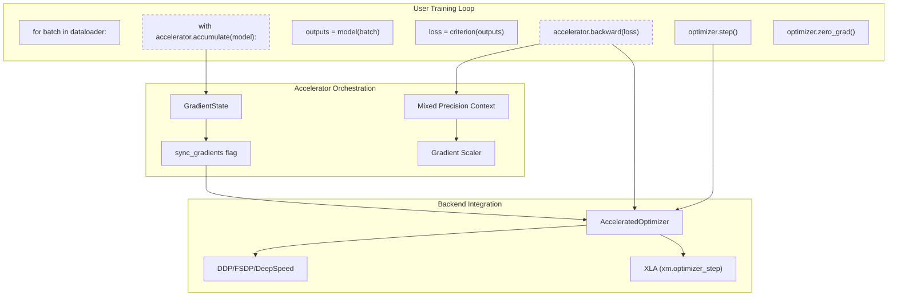
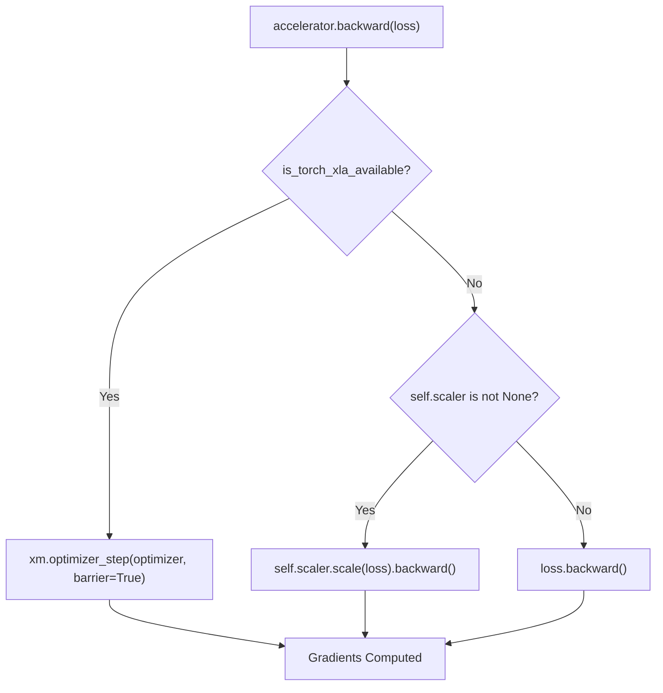
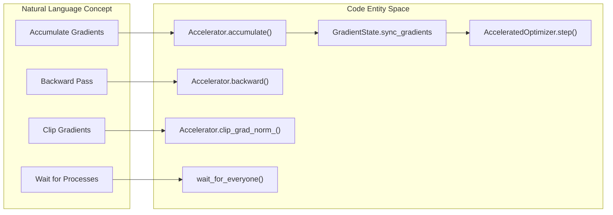

<!-- source: DeepWiki mcp.deepwiki.com · repo huggingface/accelerate · page 2.3 Training Loop Integration · fetched 2026-10-21 -->

# Training Loop Integration

<details>
<summary>Relevant source files</summary>

The following files were used as context for generating this wiki page:

- [docs/source/usage_guides/gradient_accumulation.md](docs/source/usage_guides/gradient_accumulation.md)
- [examples/by_feature/gradient_accumulation_for_autoregressive_models.py](examples/by_feature/gradient_accumulation_for_autoregressive_models.py)
- [src/accelerate/accelerator.py](src/accelerate/accelerator.py)
- [src/accelerate/commands/test.py](src/accelerate/commands/test.py)
- [src/accelerate/optimizer.py](src/accelerate/optimizer.py)
- [src/accelerate/state.py](src/accelerate/state.py)
- [src/accelerate/test_utils/scripts/external_deps/test_checkpointing.py](src/accelerate/test_utils/scripts/external_deps/test_checkpointing.py)
- [src/accelerate/test_utils/scripts/external_deps/test_ds_alst_ulysses_sp.py](src/accelerate/test_utils/scripts/external_deps/test_ds_alst_ulysses_sp.py)
- [src/accelerate/test_utils/scripts/external_deps/test_metrics.py](src/accelerate/test_utils/scripts/external_deps/test_metrics.py)
- [src/accelerate/test_utils/training.py](src/accelerate/test_utils/training.py)
- [src/accelerate/utils/dataclasses.py](src/accelerate/utils/dataclasses.py)
- [tests/test_grad_sync.py](tests/test_grad_sync.py)
- [tests/test_kwargs_handlers.py](tests/test_kwargs_handlers.py)
- [tests/test_load_checkpoint_and_dispatch_with_broadcast.py](tests/test_load_checkpoint_and_dispatch_with_broadcast.py)
- [tests/test_metrics.py](tests/test_metrics.py)
- [tests/test_optimizer.py](tests/test_optimizer.py)
- [tests/test_tpu.py](tests/test_tpu.py)

</details>


## Purpose and Scope

This page covers how the `Accelerator` class integrates with PyTorch training loops, focusing on the backward pass, gradient accumulation, and process synchronization. These core mechanisms allow Accelerate to transparently handle distributed training, mixed precision, and TPU execution with minimal user code changes.

For information about preparing training components (models, optimizers, dataloaders) before the training loop, see [2.2 Preparing Training Components](). For details on the optimizer wrapper implementation, see [10. Optimizer Integration]().

## Overview of Training Loop Integration

The `Accelerator` class provides key integration points for training loops to manage distributed state and hardware-specific optimizations:

1.  **`backward(loss)`**: Replaces `loss.backward()` to handle mixed precision scaling and XLA-specific gradient logic.
2.  **`accumulate(model)`**: A context manager that orchestrates gradient accumulation across multiple steps.
3.  **`sync_gradients`**: A property that indicates when gradients should be synchronized across processes.
4.  **`wait_for_everyone()`**: Synchronizes all processes at specific barriers.



**Sources:** [src/accelerate/accelerator.py:184-184](), [src/accelerate/accelerator.py:2167-2301]()

## The Backward Pass

### The `backward()` Method

The `backward()` method is the primary interface for computing gradients. It replaces the standard `loss.backward()` call to ensure that gradient scaling (for FP16) and TPU-specific requirements are met.

```python
# Standard PyTorch
loss.backward()

# With Accelerator
accelerator.backward(loss)
```

**Key Responsibilities:**
- **Gradient Scaling**: Automatically applies `scaler.scale(loss).backward()` when FP16 mixed precision is enabled [src/accelerate/accelerator.py:2281-2283]().
- **TPU/XLA Support**: Uses `xm.optimizer_step(optimizer)` logic to handle gradients on XLA devices [src/accelerate/accelerator.py:2256-2279]().
- **DeepSpeed/FSDP**: Integrates with backend-specific backward passes where the engine manages the reduction [src/accelerate/accelerator.py:2285-2301]().

### Implementation and Data Flow

The `backward()` implementation branches based on the detected `DistributedType` and `PrecisionType`.



**Sources:** [src/accelerate/accelerator.py:2245-2301](), [src/accelerate/state.py:29-29]()

## Gradient Accumulation

Gradient accumulation allows training with larger effective batch sizes by accumulating gradients over $N$ steps before performing a weight update and process synchronization.

### The `accumulate()` Context Manager

The `accumulate()` context manager automates the logic for when to sync gradients. It tracks the current step and the configured `gradient_accumulation_steps`.

```python
for batch in dataloader:
    with accelerator.accumulate(model):
        outputs = model(batch)
        loss = loss_func(outputs, targets)
        accelerator.backward(loss)
        optimizer.step()
        optimizer.zero_grad()
```

**Functionality:**
1.  **Synchronization Control**: Sets `self.gradient_state.sync_gradients` to `True` only when a weight update is due [src/accelerate/accelerator.py:2189-2193]().
2.  **`no_sync` Application**: Automatically wraps the model in a `model.no_sync()` context (for DDP/FSDP) during accumulation steps to prevent premature all-reduce operations [src/accelerate/accelerator.py:2195-2220]().
3.  **Dataloader Awareness**: If `sync_with_dataloader` is enabled, it ensures gradients are synced at the end of a dataloader even if the accumulation count isn't reached [src/accelerate/accelerator.py:2179-2187]().

### GradientState and Synchronization Flag

The `GradientState` singleton (defined in [src/accelerate/state.py:1371]()) tracks the global state of accumulation.

| Property | Role |
| :--- | :--- |
| `sync_gradients` | Boolean flag indicating if the current step should synchronize [src/accelerate/state.py:1371](). |
| `num_steps` | Total number of accumulation steps configured [src/accelerate/state.py:1371](). |
| `end_of_dataloader` | Flag indicating the dataloader has finished its iteration [src/accelerate/state.py:1371](). |

**Sources:** [src/accelerate/state.py:1371](), [src/accelerate/accelerator.py:1023-1028]()

## Gradient Clipping

Accelerate provides wrappers for gradient clipping that correctly handle unscaling for mixed precision and sharded parameters in FSDP/DeepSpeed.

### `clip_grad_norm_`

This method replaces `torch.nn.utils.clip_grad_norm_`. It is backend-aware:
- **FSDP**: Calls `model.clip_grad_norm_` on the sharded model [src/accelerate/accelerator.py:2315-2323]().
- **DeepSpeed**: Uses `engine.clip_fp32_gradients` [src/accelerate/accelerator.py:2325-2332]().
- **Standard/DDP**: Unscales gradients (if using a `GradScaler`) before clipping [src/accelerate/accelerator.py:2340-2363]().

### `clip_grad_value_`

Similarly, `clip_grad_value_` wraps the standard PyTorch value clipping while ensuring gradients are unscaled first if necessary [src/accelerate/accelerator.py:2365-2393]().

**Sources:** [src/accelerate/accelerator.py:2303-2393]()

## Process Synchronization

### `wait_for_everyone()`

The `wait_for_everyone()` method ensures that all distributed processes reach the same point in the code before any process proceeds. This is critical for operations like saving checkpoints or logging metrics.

- **Implementation**: Calls `torch.distributed.barrier()` for GPU/CPU distributed training and `xm.rendezvous()` for TPU [src/accelerate/utils/operations.py:382-397]().
- **Usage**:
  ```python
  # Ensure all processes finished computation before saving
  accelerator.wait_for_everyone()
  if accelerator.is_main_process:
      accelerator.save_state("checkpoint")
  ```

**Sources:** [src/accelerate/utils/operations.py:382-397](), [src/accelerate/accelerator.py:122-122]()

## Summary of Integration Logic

The following diagram maps the high-level training loop concepts to the specific internal entities within `accelerate/accelerator.py` and `accelerate/state.py`.



**Sources:** [src/accelerate/accelerator.py:2167-2393](), [src/accelerate/optimizer.py:145-182](), [src/accelerate/state.py:1371]()

---

