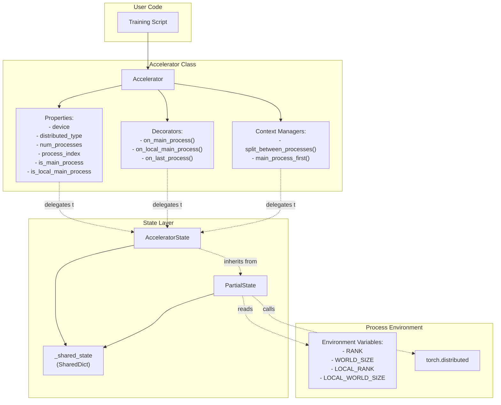
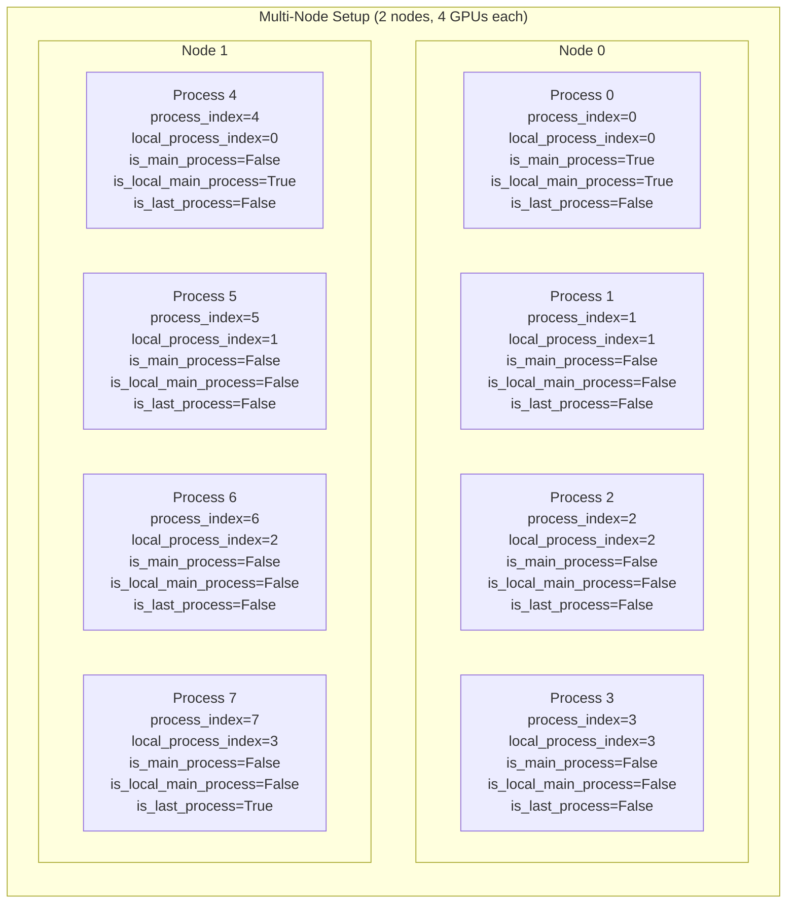
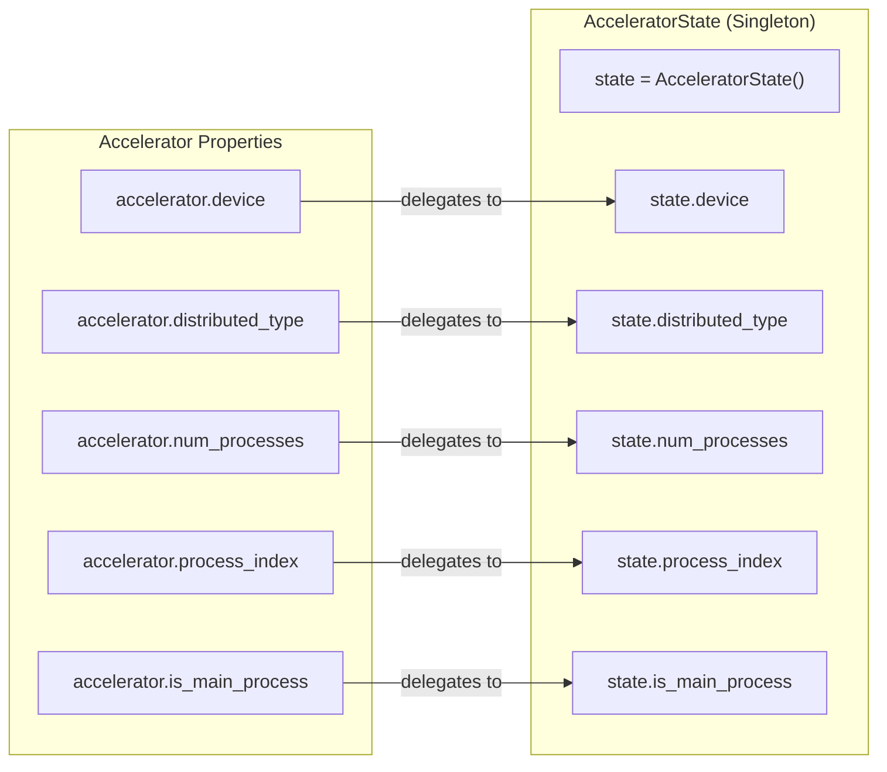

<!-- source: DeepWiki mcp.deepwiki.com · repo huggingface/accelerate · page 2.4 State Properties and Process Control · fetched 2026-10-21 -->

# State Properties and Process Control

<details>
<summary>Relevant source files</summary>

The following files were used as context for generating this wiki page:

- [src/accelerate/accelerator.py](src/accelerate/accelerator.py)
- [src/accelerate/commands/config/update.py](src/accelerate/commands/config/update.py)
- [src/accelerate/commands/to_fsdp2.py](src/accelerate/commands/to_fsdp2.py)
- [src/accelerate/state.py](src/accelerate/state.py)
- [src/accelerate/test_utils/scripts/test_ops.py](src/accelerate/test_utils/scripts/test_ops.py)
- [src/accelerate/utils/dataclasses.py](src/accelerate/utils/dataclasses.py)
- [src/accelerate/utils/operations.py](src/accelerate/utils/operations.py)
- [src/accelerate/utils/other.py](src/accelerate/utils/other.py)
- [tests/test_utils.py](tests/test_utils.py)

</details>


This page documents the properties and methods of the `Accelerator` class that provide information about the distributed training environment and control code execution across processes. These properties allow you to query which process is currently executing, what hardware is being used, and provide decorators and context managers to selectively run code on specific processes or coordinate work across processes.

For information about initializing the Accelerator with these properties, see [Initialization and Configuration](#2.1). For properties related to mixed precision and gradient accumulation, see [Training Loop Integration](#2.3).

## State Property Architecture

The `Accelerator` class exposes state properties through a delegation pattern. Properties are stored in the `AcceleratorState` singleton (which inherits from `PartialState`), and `Accelerator` provides convenient access to these properties through property decorators.



Sources: [src/accelerate/accelerator.py:184-636](), [src/accelerate/state.py:123-162](), [src/accelerate/state.py:863-1111]()

## Process Identification Properties

These properties identify which process is currently executing and its role in the distributed setup.

### Core Process Properties

| Property | Type | Description | Example Values |
|----------|------|-------------|----------------|
| `num_processes` | `int` | Total number of processes across all nodes | 1 (single GPU), 8 (8 GPUs), 16 (2 nodes × 8 GPUs) |
| `process_index` | `int` | Global rank of the current process (0 to num_processes-1) | 0, 1, 2, ..., 15 |
| `local_process_index` | `int` | Local rank on the current node (0 to local_world_size-1) | 0, 1, 2, ..., 7 |

These properties are read-only and are determined during `PartialState` initialization based on the distributed backend:

- For `torch.distributed`: Retrieved via `torch.distributed.get_rank()` and `torch.distributed.get_world_size()` [src/accelerate/state.py:292-307]()
- For XLA/TPU: Retrieved via `xm.get_ordinal()` and `xr.world_size()` [src/accelerate/state.py:311-314]()
- For single process: Set to 0 and 1 respectively [src/accelerate/state.py:316-321]()

Sources: [src/accelerate/accelerator.py:673-683](), [src/accelerate/state.py:142-146]()

### Process Role Flags



| Property | Type | Condition | Common Use Case |
|----------|------|-----------|-----------------|
| `is_main_process` | `bool` | `process_index == 0` | Save checkpoints, log to trackers, print once |
| `is_local_main_process` | `bool` | `local_process_index == 0` | Per-node operations (e.g., load dataset once per machine) |
| `is_last_process` | `bool` | `process_index == num_processes - 1` | Special cleanup operations |

**Note**: For Megatron-LM, `is_main_process` and `is_local_main_process` use `is_last_process` instead due to Megatron's process layout conventions [src/accelerate/accelerator.py:734-738]().

Sources: [src/accelerate/accelerator.py:731-743](), [src/accelerate/state.py:356-375]()

## Device and Environment Properties

### Device Property

The `device` property returns the `torch.device` object for the current process:

```python
accelerator.device  # torch.device('cuda:0'), torch.device('cuda:1'), etc.
```

The device is automatically set based on hardware availability and environment variables like `ACCELERATE_TORCH_DEVICE` [src/accelerate/state.py:182-183](). It handles GPU/MLU/NPU/XPU/HPU/MUSA/SDAA via `local_process_index` and TPU via `xm.xla_device()` [src/accelerate/state.py:814-838]().

Sources: [src/accelerate/accelerator.py:685-687](), [src/accelerate/state.py:139]()

### Distributed Type Property

The `distributed_type` property returns a `DistributedType` enum value indicating the current distributed setup [src/accelerate/utils/dataclasses.py:600-633]():

| DistributedType Value | Description |
|----------------------|-------------|
| `NO` | Single process, no distribution |
| `MULTI_CPU` | Multiple CPU processes |
| `MULTI_GPU` | Multiple NVIDIA GPUs with DDP/FSDP |
| `MULTI_NPU` | Multiple Ascend NPUs |
| `MULTI_MLU` | Multiple Cambricon MLUs |
| `MULTI_XPU` | Multiple Intel XPUs |
| `MULTI_HPU` | Multiple Habana HPUs |
| `MULTI_MUSA` | Multiple Moore Threads MUSAs |
| `MULTI_SDAA` | Multiple SDAAs |
| `DEEPSPEED` | DeepSpeed distributed training |
| `FSDP` | Fully Sharded Data Parallel |
| `MEGATRON_LM` | Megatron-LM tensor/pipeline parallelism |
| `XLA` | TPU with XLA |

Sources: [src/accelerate/accelerator.py:669-671](), [src/accelerate/state.py:753-812]()

### Additional State Properties

| Property | Type | Description |
|----------|------|-------------|
| `use_distributed` | `bool` | True if using any distributed setup (not single process) |
| `multi_device` | `bool` | True if using multi-GPU/MLU/NPU/XPU/HPU/MUSA/SDAA (excludes XLA and DeepSpeed) |
| `backend` | `str` | Communication backend ('nccl', 'gloo', 'xla', 'hccl', 'cncl', etc.) |

Sources: [src/accelerate/accelerator.py:650-667]()

## Parallelism Configuration Properties

When using advanced parallelism features, the `Accelerator` provides rank information within specific groups:

| Property | Type | Description |
|----------|------|-------------|
| `tensor_parallel_rank` | `int` | Rank within tensor parallel group |
| `data_parallel_rank` | `int` | Rank within replicate-based DP group |
| `data_parallel_shard_rank` | `int` | Rank within shard-based DP group |

These properties interact with the `ParallelismConfig` and `torch.distributed.DeviceMesh` [src/accelerate/accelerator.py:758-829]().

## Process Control Decorators

Decorators allow you to run functions only on specific processes. All decorators are methods of the `Accelerator` class.

### on_main_process

Decorator that only executes the function on the main process (global rank 0):

```python
@accelerator.on_main_process
def save_checkpoint(path):
    torch.save(model.state_dict(), path)

save_checkpoint("model.pt")  # Only runs on process 0
```

**Implementation**: Returns `do_nothing` (a no-op lambda) on non-main processes [src/accelerate/state.py:87-88]().

Sources: [src/accelerate/accelerator.py:970-995](), [src/accelerate/state.py:556-584]()

### on_local_main_process

Decorator that executes the function on the local main process of each node (local rank 0):

```python
@accelerator.on_local_main_process
def load_dataset():
    # Runs once per node (e.g., to use local SSD)
    return datasets.load_from_disk("/local/ssd/data")

dataset = load_dataset()  # Runs on process 0 of each node
```

Sources: [src/accelerate/accelerator.py:997-1023](), [src/accelerate/state.py:586-615]()

### on_last_process

Decorator that executes the function only on the last process:

```python
@accelerator.on_last_process
def cleanup():
    # Only runs on the last process
    shutil.rmtree("/tmp/workspace")

cleanup()
```

Sources: [src/accelerate/accelerator.py:1025-1052](), [src/accelerate/state.py:617-643]()

## Context Managers for Process Coordination

### split_between_processes

Context manager that splits input data across processes for distributed inference or data processing:

```python
prompts = ["prompt1", "prompt2", "prompt3", "prompt4", "prompt5"]

with accelerator.split_between_processes(prompts) as split_prompts:
    # Process 0 gets ["prompt1", "prompt2", "prompt3"]
    # Process 1 gets ["prompt4", "prompt5"]
    results = model.generate(split_prompts)
```

**Key Features**:
1. **Automatic splitting**: Divides input list/tuple/dict/tensor by `num_processes` [src/accelerate/state.py:440-452]().
2. **Padding support**: `apply_padding=True` repeats the last element to equalize lengths [src/accelerate/state.py:453-458]().

Sources: [src/accelerate/accelerator.py:831-918](), [src/accelerate/state.py:424-512]()

### main_process_first

Context manager that ensures the main process executes code first, while other processes wait:

```python
with accelerator.main_process_first():
    # Main process (rank 0) downloads/processes dataset first
    dataset = datasets.load_dataset("squad")
```

**Execution Flow**: Non-main processes call `wait_for_everyone()` at entry, while the main process enters immediately and calls the barrier at exit [src/accelerate/state.py:514-533]().

Sources: [src/accelerate/accelerator.py:920-943](), [src/accelerate/state.py:514-533]()

### wait_for_everyone

Fundamental synchronization primitive:

```python
accelerator.wait_for_everyone()
```

**Implementation**:
- GPU/CPU/HPU/NPU: `torch.distributed.barrier()` [src/accelerate/state.py:388-390]().
- XLA/TPU: `xm.rendezvous()` [src/accelerate/state.py:403-404]().

Sources: [src/accelerate/accelerator.py:1868-1896](), [src/accelerate/state.py:376-412]()

## Integration with AcceleratorState

All properties and methods delegate to the underlying `AcceleratorState`/`PartialState` singleton:



This allows you to access the same state from `PartialState()` or `AcceleratorState()` directly if needed [src/accelerate/state.py:123-162]().

Sources: [src/accelerate/accelerator.py:638-687](), [src/accelerate/state.py:863-912]()

---

