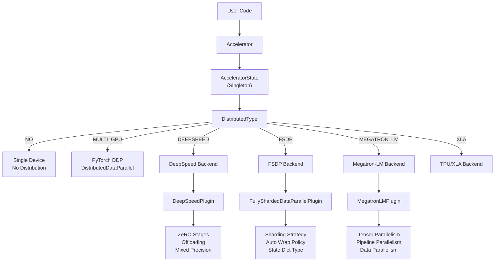
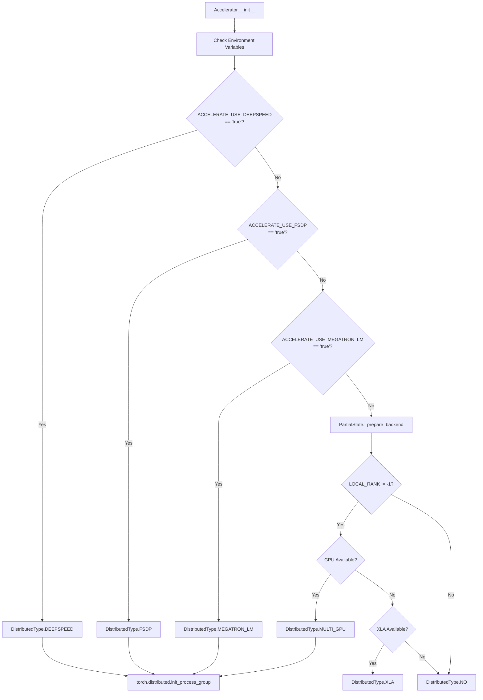

<!-- source: DeepWiki mcp.deepwiki.com · repo huggingface/accelerate · page 3 Distributed Training Backends · fetched 2026-10-21 -->

# Distributed Training Backends

Relevant source files

The following files were used as context for generating this wiki page:

- [docs/source/concept_guides/fsdp1_vs_fsdp2.md](docs/source/concept_guides/fsdp1_vs_fsdp2.md)
- [docs/source/concept_guides/low_precision_training.md](docs/source/concept_guides/low_precision_training.md)
- [docs/source/usage_guides/deepspeed.md](docs/source/usage_guides/deepspeed.md)
- [docs/source/usage_guides/fsdp.md](docs/source/usage_guides/fsdp.md)
- [docs/source/usage_guides/local_sgd.md](docs/source/usage_guides/local_sgd.md)
- [docs/source/usage_guides/low_precision_training.md](docs/source/usage_guides/low_precision_training.md)
- [src/accelerate/accelerator.py](src/accelerate/accelerator.py)
- [src/accelerate/state.py](src/accelerate/state.py)
- [src/accelerate/utils/dataclasses.py](src/accelerate/utils/dataclasses.py)

This page provides an overview of how Accelerate supports different distributed training frameworks through a plugin architecture. Accelerate abstracts away the complexity of different distributed training backends (DeepSpeed, FSDP, Megatron-LM, etc.) through a unified interface, allowing users to switch between backends with minimal code changes.

## Plugin Architecture Overview

Accelerate uses a plugin-based architecture to support various distributed training backends. The `Accelerator` class accepts backend-specific plugins during initialization [src/accelerate/accelerator.py:184-232](), and the `AcceleratorState` singleton manages the distributed environment state based on the selected backend [src/accelerate/state.py:123-175]().

**Plugin Architecture Diagram**

Sources: [src/accelerate/accelerator.py:184-232](), [src/accelerate/state.py:123-175](), [src/accelerate/utils/dataclasses.py:588-622]()

## Backend Detection and Selection

Accelerate automatically detects and selects the appropriate backend based on environment variables, configuration files, and plugin parameters. The detection logic is primarily handled within `PartialState` and `AcceleratorState` during initialization [src/accelerate/state.py:177-318]().

**Backend Selection Logic**

Sources: [src/accelerate/state.py:177-318](), [src/accelerate/accelerator.py:335-471]()

The `DistributedType` enum defines all supported backend types:

| DistributedType Value | Description |
|----------------------|-------------|
| `NO` | Single device, no distribution |
| `MULTI_GPU` | PyTorch DistributedDataParallel (DDP) |
| `MULTI_CPU` | CPU-based distributed training |
| `MULTI_NPU` | NPU-based distributed training |
| `MULTI_XPU` | XPU-based distributed training |
| `MULTI_MLU` | MLU-based distributed training |
| `DEEPSPEED` | DeepSpeed ZeRO optimization |
| `FSDP` | PyTorch Fully Sharded Data Parallel |
| `MEGATRON_LM` | Megatron-LM model/tensor parallelism |
| `XLA` | TPU training via PyTorch XLA |

Sources: [src/accelerate/utils/dataclasses.py:588-622]()

## DeepSpeed Integration

DeepSpeed implements the ZeRO (Zero Redundancy Optimizer) family of optimizations, allowing for training models with billions of parameters by partitioning optimizer states, gradients, and parameters across GPUs [docs/source/usage_guides/deepspeed.md:16-30]().

Accelerate integrates DeepSpeed through the `DeepSpeedPlugin` [src/accelerate/utils/dataclasses.py:1145-1620](). This plugin allows users to specify ZeRO stages (1, 2, or 3), offloading strategies to CPU or NVMe, and mixed precision settings [docs/source/usage_guides/deepspeed.md:46-67]().

For details, see [DeepSpeed Integration](#3.2).

Sources: [src/accelerate/utils/dataclasses.py:1145-1620](), [docs/source/usage_guides/deepspeed.md:16-67]()

## FSDP Integration

PyTorch Fully Sharded Data Parallel (FSDP) shards a model's parameters, gradients, and optimizer states across data parallel processes [docs/source/usage_guides/fsdp.md:16-23](). Accelerate supports both FSDP v1 and the newer FSDP v2 (available in PyTorch 2.6+) [docs/source/concept_guides/fsdp1_vs_fsdp2.md:16-18]().

The `FullyShardedDataParallelPlugin` manages FSDP configurations such as sharding strategies (e.g., `FULL_SHARD`, `SHARD_GRAD_OP`), auto-wrap policies for transformer layers, and state dict types for efficient checkpointing [src/accelerate/utils/dataclasses.py:743-1143]().

For details, see [FSDP Integration](#3.1).

Sources: [src/accelerate/utils/dataclasses.py:743-1143](), [docs/source/concept_guides/fsdp1_vs_fsdp2.md:16-83]()

## Megatron-LM Integration

Megatron-LM support in Accelerate enables advanced parallelism techniques including Tensor Parallelism (TP), Pipeline Parallelism (PP), and Sequence Parallelism [src/accelerate/utils/dataclasses.py:1715-2133]().

The `MegatronLMPlugin` allows configuring the degrees of these different parallelism dimensions. Unlike standard DDP, Megatron-LM requires specialized data loaders and model wrappers, which Accelerate handles via `megatron_lm_prepare_model_optimizer_scheduler` and `megatron_lm_prepare_data_loader` [src/accelerate/accelerator.py:145-155]().

For details, see [Megatron-LM Integration](#3.3).

Sources: [src/accelerate/utils/dataclasses.py:1715-2133](), [src/accelerate/accelerator.py:145-155]()

## Environment Configuration and Backend Selection

Accelerate uses a sophisticated detection mechanism to identify hardware and initialize the appropriate distributed backend. The `PartialState` class parses environment variables like `LOCAL_RANK`, `WORLD_SIZE`, and `ACCELERATE_USE_FSDP` to determine the `DistributedType` [src/accelerate/state.py:177-318]().

It supports a wide range of backends beyond standard NCCL, including GLOO for CPU, HCCL for Huawei NPUs, and CNCL for Cambricon MLUs [src/accelerate/state.py:28-54]().

For details, see [Environment Configuration and Backend Selection](#3.4).

Sources: [src/accelerate/state.py:28-54](), [src/accelerate/state.py:177-318]()

## Low Precision and Local SGD

In addition to full-scale distributed backends, Accelerate provides utilities for:
- **Low Precision Training**: Support for FP8 via `TransformersEngine`, `torchao`, or `MS-AMP` [docs/source/usage_guides/low_precision_training.md:16-33]().
- **Local SGD**: A technique to reduce communication overhead by synchronizing model weights every few steps rather than every gradient update [docs/source/usage_guides/local_sgd.md:16-21]().

Sources: [docs/source/usage_guides/low_precision_training.md:16-33](), [docs/source/usage_guides/local_sgd.md:16-21]()

---

