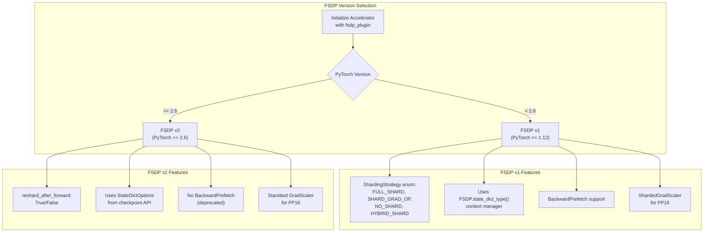
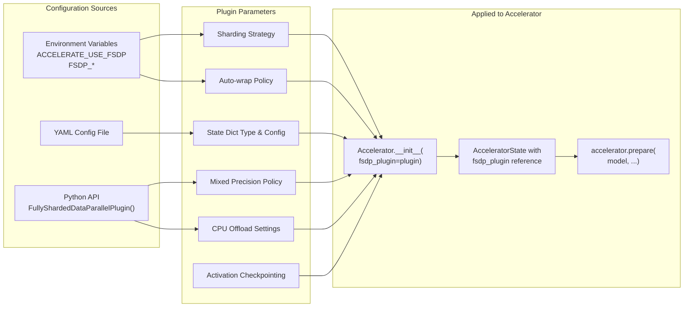
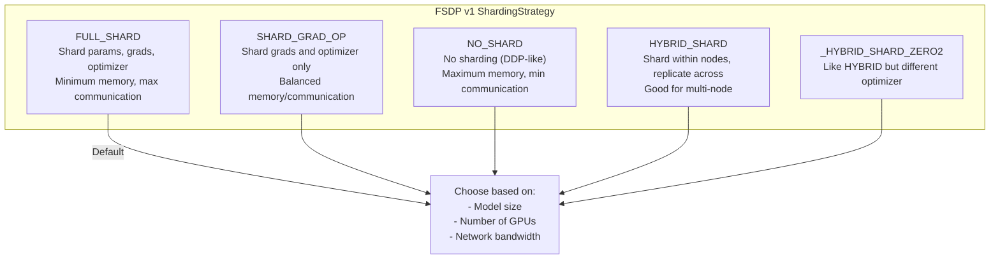
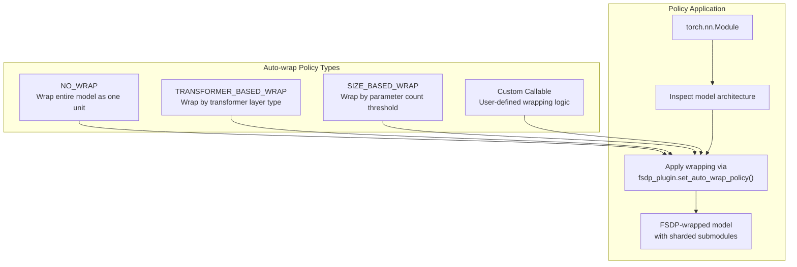
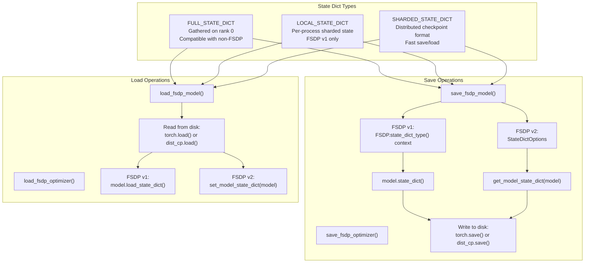
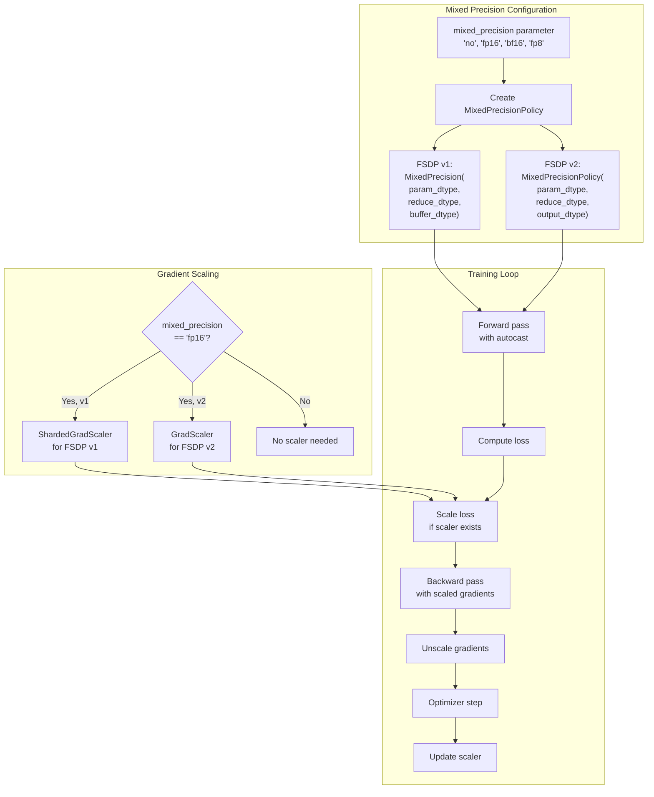
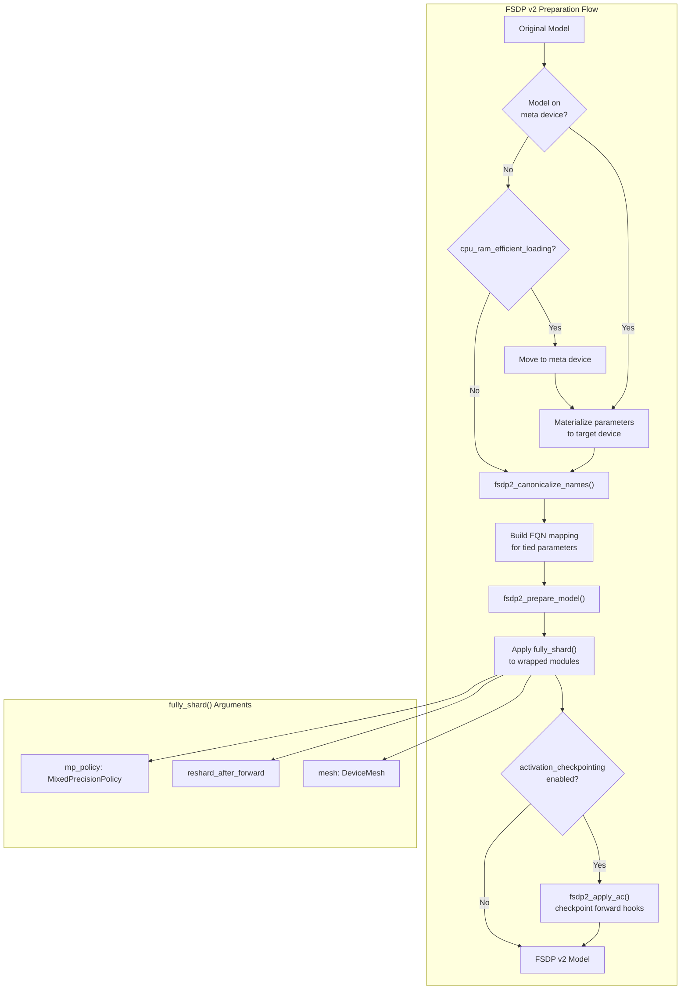
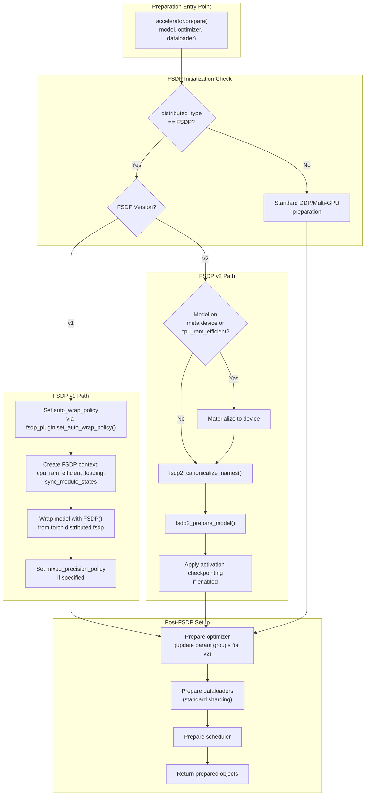
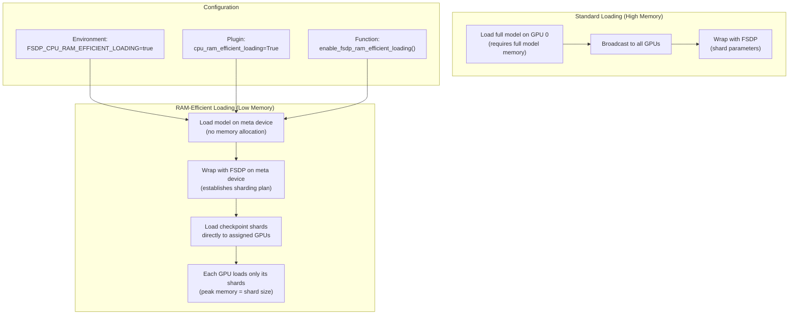

<!-- source: DeepWiki mcp.deepwiki.com · repo huggingface/accelerate · page 3.1 FSDP Integration · fetched 2026-10-21 -->

# FSDP Integration

Relevant source files

The following files were used as context for generating this wiki page:

- [docs/source/concept_guides/fsdp1_vs_fsdp2.md](docs/source/concept_guides/fsdp1_vs_fsdp2.md)
- [docs/source/concept_guides/low_precision_training.md](docs/source/concept_guides/low_precision_training.md)
- [docs/source/usage_guides/deepspeed.md](docs/source/usage_guides/deepspeed.md)
- [docs/source/usage_guides/fsdp.md](docs/source/usage_guides/fsdp.md)
- [docs/source/usage_guides/local_sgd.md](docs/source/usage_guides/local_sgd.md)
- [docs/source/usage_guides/low_precision_training.md](docs/source/usage_guides/low_precision_training.md)
- [src/accelerate/parallelism_config.py](src/accelerate/parallelism_config.py)
- [src/accelerate/test_utils/scripts/external_deps/test_performance.py](src/accelerate/test_utils/scripts/external_deps/test_performance.py)
- [src/accelerate/utils/fsdp_utils.py](src/accelerate/utils/fsdp_utils.py)
- [tests/deepspeed/test_deepspeed.py](tests/deepspeed/test_deepspeed.py)
- [tests/fsdp/test_fsdp.py](tests/fsdp/test_fsdp.py)
- [tests/test_dataclasses.py](tests/test_dataclasses.py)

## Purpose and Scope

This document describes how Accelerate integrates with PyTorch's Fully Sharded Data Parallel (FSDP) for memory-efficient distributed training of large models. FSDP shards model parameters, gradients, and optimizer states across multiple GPUs, enabling training of models that would not fit on a single device.

For general distributed training backends, see [3: Distributed Training Backends](). For large model loading and device mapping, see [5: Big Model Support](). For checkpointing mechanics, see [7: Checkpointing and State Management]().

## Overview

FSDP enables training of models larger than GPU memory by:
- **Sharding model parameters** across devices (reduces memory per GPU).
- **Sharding optimizer states** across devices (major memory savings).
- **Sharding gradients** across devices during the backward pass.
- **Gathering parameters** on-demand during forward/backward passes.

Accelerate supports both FSDP v1 (PyTorch ≥ 1.12) and FSDP v2 (PyTorch ≥ 2.6), configured via the `FullyShardedDataParallelPlugin` [src/accelerate/utils/dataclasses.py:1392-1796]().

Sources: [src/accelerate/utils/dataclasses.py:1392-1796](), [src/accelerate/accelerator.py:380-400]()

## FSDP Version Support

### FSDP v1 vs FSDP v2

**FSDP v2** is a composable API available in PyTorch 2.6+. Key differences:

| Feature | FSDP v1 | FSDP v2 |
|---------|---------|---------|
| **Sharding Configuration** | `ShardingStrategy` enum | `reshard_after_forward` boolean |
| **State Dict API** | `FSDP.state_dict_type()` context | `torch.distributed.checkpoint` API |
| **Backward Prefetch** | Supported | Deprecated (warns and sets to None) |
| **Mixed Precision** | `MixedPrecision` with `buffer_dtype` | `MixedPrecisionPolicy` with `output_dtype` |
| **Grad Scaler** | `ShardedGradScaler` | Standard `GradScaler` |

The version is automatically detected based on the PyTorch version or can be set via `fsdp_plugin.fsdp_version` or the environment variable `FSDP_VERSION` [src/accelerate/utils/dataclasses.py:1416-1430]().

Sources: [src/accelerate/utils/dataclasses.py:1392-1450](), [tests/fsdp/test_fsdp.py:80-127](), [src/accelerate/accelerator.py:397-400]()

## FullyShardedDataParallelPlugin Configuration

### Plugin Initialization

The `FullyShardedDataParallelPlugin` [src/accelerate/utils/dataclasses.py:1392-1796]() is the central configuration object for FSDP:

**Key Parameters**:

| Parameter | FSDP v1 | FSDP v2 | Default | Description |
|-----------|---------|---------|---------|-------------|
| `sharding_strategy` | ✓ | - | `FULL_SHARD` | Enum from `torch.distributed.fsdp` |
| `reshard_after_forward` | - | ✓ | `True` | Whether to reshard after forward pass |
| `backward_prefetch` | ✓ | - | `None` | BackwardPrefetch enum or "NO_PREFETCH" |
| `state_dict_type` | ✓ | ✓ | `SHARDED_STATE_DICT` | How to save model state |
| `cpu_offload` | ✓ | ✓ | `False` | Offload parameters to CPU |
| `auto_wrap_policy` | ✓ | ✓ | `None` | How to wrap model layers |
| `mixed_precision_policy` | ✓ | ✓ | `None` | Mixed precision configuration |
| `use_orig_params` | ✓ | - | `True` | Use original parameter variables |
| `cpu_ram_efficient_loading` | ✓ | ✓ | `False` | Load model on CPU before FSDP wrapping |

Sources: [src/accelerate/utils/dataclasses.py:1392-1550](), [src/accelerate/accelerator.py:386-396]()

## Sharding Strategies

### FSDP v1 Sharding Strategies

**Strategy Comparison**:

| Strategy | Parameters Sharded | Gradients Sharded | Optimizer Sharded | Memory Savings | Communication Cost |
|----------|-------------------|-------------------|-------------------|----------------|-------------------|
| `FULL_SHARD` | ✓ | ✓ | ✓ | Maximum | Maximum |
| `SHARD_GRAD_OP` | ✗ | ✓ | ✓ | Moderate | Moderate |
| `NO_SHARD` | ✗ | ✗ | ✗ | None (DDP) | Minimum |
| `HYBRID_SHARD` | ✓ (within node) | ✓ (within node) | ✓ (within node) | High | Reduced cross-node |

### FSDP v2 Sharding Configuration

For FSDP v2, sharding is controlled by the simpler `reshard_after_forward` boolean [src/accelerate/utils/dataclasses.py:1435-1440]():
- `True` (default): Equivalent to `FULL_SHARD` - parameters are freed after forward pass.
- `False`: Equivalent to `SHARD_GRAD_OP` - parameters remain in memory.

Sources: [src/accelerate/utils/dataclasses.py:1451-1513](), [tests/fsdp/test_fsdp.py:90-138](), [src/accelerate/utils/constants.py:108]()

## Auto-wrap Policies

Auto-wrap policies determine which modules are wrapped with FSDP. This affects memory distribution and communication patterns.

### Policy Configuration

**TRANSFORMER_BASED_WRAP**:
- Wraps specific transformer layer classes (e.g., `BertLayer`, `LlamaDecoderLayer`).
- Configure via `transformer_cls_names_to_wrap` parameter [src/accelerate/utils/dataclasses.py:1443-1444]().
- Uses `transformer_auto_wrap_policy` from PyTorch [src/accelerate/utils/dataclasses.py:1718-1725]().

**SIZE_BASED_WRAP**:
- Wraps modules exceeding `min_num_params` threshold.
- Configure via `min_num_params` parameter (default: 1e8) [src/accelerate/utils/dataclasses.py:1442]().
- Uses `size_based_auto_wrap_policy` from PyTorch [src/accelerate/utils/dataclasses.py:1706-1711]().

**NO_WRAP**:
- Wraps the entire model as a single FSDP unit.
- Simplest configuration but least memory efficient.

The policy is set by calling `fsdp_plugin.set_auto_wrap_policy(model)` [src/accelerate/utils/dataclasses.py:1697-1774]() before model wrapping.

Sources: [src/accelerate/utils/dataclasses.py:1697-1774](), [tests/fsdp/test_fsdp.py:214-290]()

## State Dictionary Management

FSDP provides three state dict types for checkpointing:

### State Dict Type Details

| Type | Save Location | Load Requirement | FSDP v1 | FSDP v2 |
|------|---------------|------------------|---------|---------|
| `FULL_STATE_DICT` | Single file on rank 0 | Any process can load | ✓ | ✓ |
| `LOCAL_STATE_DICT` | One file per process | Must load with same world size | ✓ | ✗ |
| `SHARDED_STATE_DICT` | Directory with metadata + shards | Can load with different world size | ✓ | ✓ |

### Save/Load Functions

**Model Checkpointing**:
- `save_fsdp_model()` [src/accelerate/utils/fsdp_utils.py:103-159](): Saves model state dict.
  - `FULL_STATE_DICT`: Saves to `pytorch_model_fsdp_{index}.bin`.
  - `LOCAL_STATE_DICT`: Saves to `pytorch_model_fsdp_{index}_rank{rank}.bin`.
  - `SHARDED_STATE_DICT`: Saves to `pytorch_model_fsdp_{index}/` directory. Supports `use_dcp=False` for per-rank `torch.save` [src/accelerate/utils/fsdp_utils.py:111-119]().

- `load_fsdp_model()` [src/accelerate/utils/fsdp_utils.py:161-231](): Loads model state dict.
  - Handles broadcast from rank 0 for FSDP v2 with `FULL_STATE_DICT`.
  - Uses `torch.distributed.checkpoint` for sharded formats.

**Optimizer Checkpointing**:
- `save_fsdp_optimizer()` [src/accelerate/utils/fsdp_utils.py:233-279](): Saves optimizer state.
- `load_fsdp_optimizer()` [src/accelerate/utils/fsdp_utils.py:281-330](): Loads optimizer state.
  - FSDP v1: Uses `FSDP.optim_state_dict()` and `FSDP.optim_state_dict_to_load()`.
  - FSDP v2: Uses `get_optimizer_state_dict()` and `set_optimizer_state_dict()`.

### Configuration Options

The `state_dict_config` and `optim_state_dict_config` control state dict behavior [src/accelerate/utils/dataclasses.py:1447-1448]().

**For `FULL_STATE_DICT`**:
- `offload_to_cpu`: Whether to offload to CPU during gathering (default: `True` for multi-process) [src/accelerate/utils/fsdp_utils.py:129]().
- `rank0_only`: Whether only rank 0 saves/loads (default: `True` for multi-process) [src/accelerate/utils/fsdp_utils.py:130]().

Sources: [src/accelerate/utils/fsdp_utils.py:86-101](), [src/accelerate/utils/fsdp_utils.py:103-330](), [src/accelerate/utils/dataclasses.py:1604-1647]()

## Mixed Precision with FSDP

FSDP supports mixed precision training with automatic casting and gradient scaling:

### Mixed Precision Policies

**Setting Mixed Precision**:
1. Via `Accelerator(mixed_precision="fp16")` - automatically creates policy.
2. Via `FullyShardedDataParallelPlugin(mixed_precision_policy=...)` - explicit configuration.
3. Via `fsdp_plugin.set_mixed_precision(dtype)` [src/accelerate/utils/dataclasses.py:1648-1695]() - programmatic update.

**Policy Parameters**:
- `param_dtype`: Data type for model parameters during computation.
- `reduce_dtype`: Data type for gradient all-reduce operations.
- `buffer_dtype` (v1) / `output_dtype` (v2): Data type for buffers/outputs.

**Common Configurations**:
- **FP16**: `param_dtype=float16`, `reduce_dtype=float16`, requires gradient scaling.
- **BF16**: `param_dtype=bfloat16`, `reduce_dtype=bfloat16`, no gradient scaling needed.
- **FP32**: No mixed precision policy.

### Gradient Scaling

For FP16 training, FSDP requires a specialized gradient scaler:
- **FSDP v1**: `ShardedGradScaler` [src/accelerate/utils/modeling.py:191-199]() from `torch.distributed.fsdp.sharded_grad_scaler`.
- **FSDP v2**: Standard `GradScaler` via `get_fsdp2_grad_scaler()` [src/accelerate/utils/fsdp_utils.py:707-719]().

The scaler is automatically created and used during `accelerator.backward()` [src/accelerate/accelerator.py:564-596]().

Sources: [src/accelerate/utils/dataclasses.py:1648-1695](), [tests/fsdp/test_fsdp.py:291-330](), [src/accelerate/accelerator.py:564-596](), [src/accelerate/utils/fsdp_utils.py:707-719]()

## FSDP v2 Specific Features

### Model Preparation for FSDP v2

FSDP v2 uses a composable API with additional preparation steps:

### Key FSDP v2 Functions

**`fsdp2_canonicalize_names()`** [src/accelerate/utils/fsdp_utils.py:497-560]():
- Establishes canonical FQN (Fully Qualified Name) mappings.
- Required for proper state dict handling with tied parameters.
- Returns `fqn_map` used during state dict operations.

**`fsdp2_prepare_model()`** [src/accelerate/utils/fsdp_utils.py:403-495]():
- Applies `fully_shard()` to model (sub)modules based on auto-wrap policy.
- Configures `reshard_after_forward` and `mp_policy`.
- Handles PEFT models and composability with other parallelism.

**`fsdp2_apply_ac()`** [src/accelerate/utils/fsdp_utils.py:562-588]():
- Applies activation checkpointing via `checkpoint_wrapper`.
- Configures which modules to checkpoint based on policy.
- Reduces memory at the cost of recomputation.

**`fsdp2_switch_optimizer_parameters()`** [src/accelerate/utils/fsdp_utils.py:590-640]():
- Updates optimizer parameter groups after FSDP wrapping.
- Ensures the optimizer tracks the correct parameter references.
- Required because FSDP v2 changes parameter structure.

### Optimizer Integration for FSDP v2

After FSDP v2 model preparation, optimizer parameters must be updated using `fsdp2_switch_optimizer_parameters()` [src/accelerate/utils/fsdp_utils.py:590-640]().

Sources: [src/accelerate/utils/fsdp_utils.py:403-640](), [src/accelerate/accelerator.py:1283-1315]()

## Integration with Accelerator

### Model Preparation Flow

### Code Flow in Accelerator

**Initialization** [src/accelerate/accelerator.py:380-400]():
- Detects `ACCELERATE_USE_FSDP` or presence of `fsdp_plugin`.
- Automatically initializes a default plugin if needed.

**FSDP v1 Wrapping** [src/accelerate/accelerator.py:1318-1351]():
- Applies auto-wrap policy.
- Creates CPU offload context if `cpu_ram_efficient_loading=True`.
- Wraps model with `FSDP()` constructor.
- Sets mixed precision policy.

**FSDP v2 Preparation** [src/accelerate/accelerator.py:1352-1400]():
- Handles meta device materialization.
- Calls `fsdp2_prepare_model()`.
- Applies activation checkpointing via `fsdp2_apply_ac()`.
- Updates optimizer via `fsdp2_switch_optimizer_parameters()`.

### Environment Variables

FSDP can be configured via environment variables, which are read during initialization:

| Variable | Purpose | Values |
|----------|---------|--------|
| `ACCELERATE_USE_FSDP` | Enable FSDP mode | `"true"` / `"false"` |
| `FSDP_VERSION` | Select FSDP version | `"1"` / `"2"` |
| `FSDP_SHARDING_STRATEGY` | v1 sharding strategy | `1-5` (enum values) |
| `FSDP_RESHARD_AFTER_FORWARD` | v2 resharding | `"true"` / `"false"` |
| `FSDP_BACKWARD_PREFETCH` | v1 backward prefetch | `"BACKWARD_PRE"` / `"BACKWARD_POST"` / `"NO_PREFETCH"` |
| `FSDP_STATE_DICT_TYPE` | State dict type | `"FULL_STATE_DICT"` / `"LOCAL_STATE_DICT"` / `"SHARDED_STATE_DICT"` |
| `FSDP_AUTO_WRAP_POLICY` | Auto-wrap policy type | `"NO_WRAP"` / `"TRANSFORMER_BASED_WRAP"` / `"SIZE_BASED_WRAP"` |
| `FSDP_TRANSFORMER_CLS_TO_WRAP` | Layer classes to wrap | Comma-separated class names |
| `FSDP_MIN_NUM_PARAMS` | Size threshold for wrapping | Integer (default: 1e8) |
| `FSDP_CPU_RAM_EFFICIENT_LOADING` | Load on CPU then move | `"true"` / `"false"` |

Sources: [src/accelerate/accelerator.py:1283-1400](), [src/accelerate/utils/dataclasses.py:1392-1550](), [src/accelerate/utils/fsdp_utils.py:39-54]()

## RAM-Efficient Loading

### CPU RAM-Efficient Loading

For very large models, FSDP supports loading weights on CPU before distributing to GPUs:

**Enabling RAM-Efficient Loading**:

1. **Via plugin**: `FullyShardedDataParallelPlugin(cpu_ram_efficient_loading=True)`
2. **Via environment**: Set `FSDP_CPU_RAM_EFFICIENT_LOADING=true`
3. **Via function**: Call `enable_fsdp_ram_efficient_loading()` [src/accelerate/utils/fsdp_utils.py:39-47]().

**How It Works**:
- The model is initialized on the `meta` device (no memory).
- FSDP wrapping happens on the `meta` device (establishes sharding).
- Checkpoint is loaded shard-by-shard to assigned GPUs.
- Peak memory usage = size of one shard (not full model).

Sources: [src/accelerate/utils/fsdp_utils.py:39-54](), [src/accelerate/utils/dataclasses.py:1551-1577](), [src/accelerate/accelerator.py:1318-1351]()

## Troubleshooting and Common Issues

### Key Considerations

**Version Compatibility**:
- FSDP v1 requires PyTorch ≥ 1.12.
- FSDP v2 requires PyTorch ≥ 2.6.
- Some features (like sharded state dict) require PyTorch ≥ 2.0.

**Memory Management**:
- `FULL_SHARD` provides maximum memory savings but highest communication.
- Use `cpu_ram_efficient_loading` for models larger than GPU memory.
- Mixed precision (FP16/BF16) can reduce memory by 2x.
- Activation checkpointing trades memory for computation.

**State Dict Issues**:
- `FULL_STATE_DICT` requires gathering all parameters (memory spike).
- `LOCAL_STATE_DICT` requires loading with the same world size (v1 only).
- `SHARDED_STATE_DICT` is the most flexible and efficient.
- Use `offload_to_cpu=True` for `FULL_STATE_DICT` to reduce GPU memory [src/accelerate/utils/fsdp_utils.py:129]().

**Auto-wrap Policy**:
- Incorrect wrapping can cause OOM or poor performance.
- Transformer-based wrapping is typically best for transformer models.
- Size-based wrapping is useful for heterogeneous architectures.

Sources: [src/accelerate/accelerator.py:380-400](), [src/accelerate/utils/fsdp_utils.py:103-330](), [tests/fsdp/test_fsdp.py:68-516]()

---

