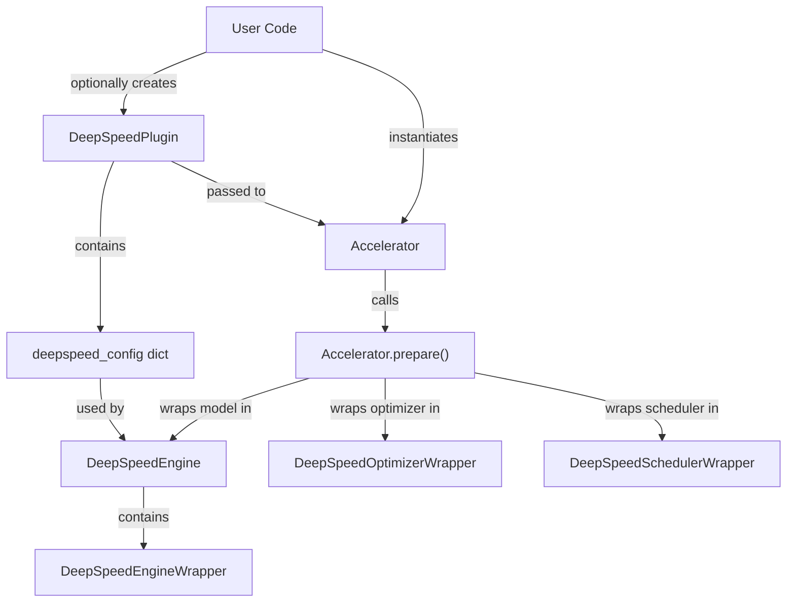
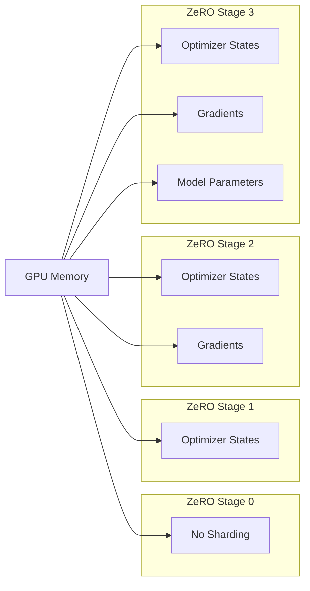
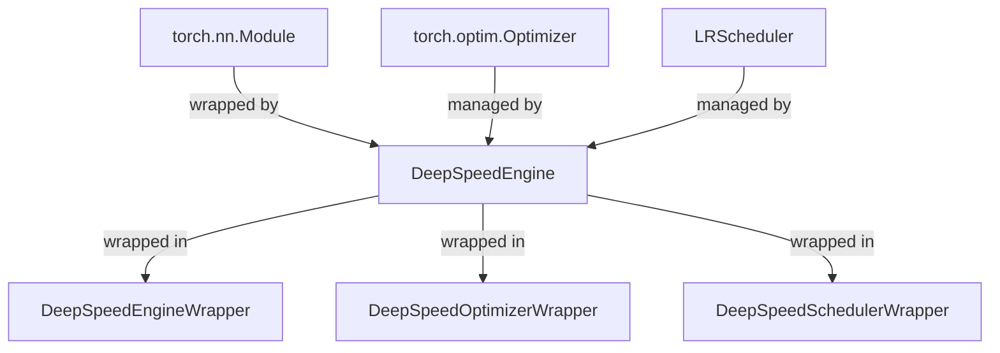

<!-- source: DeepWiki mcp.deepwiki.com · repo huggingface/accelerate · page 3.2 DeepSpeed Integration · fetched 2026-10-21 -->

# DeepSpeed Integration

<details>
<summary>Relevant source files</summary>

The following files were used as context for generating this wiki page:

- [docs/source/package_reference/deepspeed.md](docs/source/package_reference/deepspeed.md)
- [docs/source/usage_guides/deepspeed_multiple_model.md](docs/source/usage_guides/deepspeed_multiple_model.md)
- [examples/by_feature/ddp_comm_hook.py](examples/by_feature/ddp_comm_hook.py)
- [examples/by_feature/profiler.py](examples/by_feature/profiler.py)
- [src/accelerate/test_utils/scripts/external_deps/test_performance.py](src/accelerate/test_utils/scripts/external_deps/test_performance.py)
- [src/accelerate/utils/deepspeed.py](src/accelerate/utils/deepspeed.py)
- [src/accelerate/utils/fsdp_utils.py](src/accelerate/utils/fsdp_utils.py)
- [tests/deepspeed/ds_config_zero2_model_only.json](tests/deepspeed/ds_config_zero2_model_only.json)
- [tests/deepspeed/test_deepspeed.py](tests/deepspeed/test_deepspeed.py)
- [tests/deepspeed/test_deepspeed_gradient_accumulation.py](tests/deepspeed/test_deepspeed_gradient_accumulation.py)
- [tests/fsdp/test_fsdp.py](tests/fsdp/test_fsdp.py)

</details>


This page documents the DeepSpeed integration in Accelerate, including the `DeepSpeedPlugin` class, wrapper classes, configuration management, and ZeRO optimization stages. DeepSpeed provides memory-efficient training through ZeRO (Zero Redundancy Optimizer) sharding strategies and offloading capabilities.

## Overview

Accelerate integrates DeepSpeed through the `DeepSpeedPlugin` class defined in [src/accelerate/utils/dataclasses.py:580-800]() and wrapper classes in [src/accelerate/utils/deepspeed.py:50-320](). The integration supports two configuration approaches:

1.  **Plugin-based Configuration**: Initialize `DeepSpeedPlugin` with parameters and pass it to `Accelerator.__init__`. The plugin generates a DeepSpeed configuration dictionary internally.
2.  **Config File-based Configuration**: Provide a JSON configuration file path to `DeepSpeedPlugin.hf_ds_config`. This gives complete control over all DeepSpeed settings.

Both approaches result in the model being wrapped in a `DeepSpeedEngine` during `Accelerator.prepare()`, with optimizer and scheduler wrapped in `DeepSpeedOptimizerWrapper` and `DeepSpeedSchedulerWrapper` respectively.

### Integration Flow Diagram



Sources: [src/accelerate/utils/dataclasses.py:580-800](), [src/accelerate/utils/deepspeed.py:50-320](), [tests/deepspeed/test_deepspeed.py:109-278]()

## DeepSpeedPlugin Class

The `DeepSpeedPlugin` class in [src/accelerate/utils/dataclasses.py:580-800]() configures DeepSpeed integration. Key initialization parameters:

| Parameter | Type | Description |
| :--- | :--- | :--- |
| `hf_ds_config` | `str` or `dict` | Path to DeepSpeed config JSON file or config dictionary |
| `zero_stage` | `int` | ZeRO optimization stage (0, 1, 2, or 3) |
| `gradient_accumulation_steps` | `int` | Number of gradient accumulation steps |
| `gradient_clipping` | `float` | Gradient clipping threshold |
| `offload_optimizer_device` | `str` | Device for optimizer offload ("cpu", "nvme", or "none") |
| `offload_param_device` | `str` | Device for parameter offload ("cpu", "nvme", or "none") |
| `zero3_init_flag` | `bool` | Enable ZeRO-3 initialization wrapper |
| `zero3_save_16bit_model` | `bool` | Save model weights in fp16 with ZeRO-3 |

When `hf_ds_config` is provided, the plugin loads the configuration from file. Otherwise, it constructs a configuration dictionary from the individual parameters. The plugin's `deepspeed_config` attribute contains the final configuration dictionary passed to DeepSpeed.

The plugin performs validation in `__post_init__()` to ensure:
*   `zero3_init_flag` is only set when `zero_stage == 3` [src/accelerate/utils/dataclasses.py:657-658]()
*   Required configuration sections are present
*   Environment variables are properly set for DeepSpeed

### ZeRO Stages and Sharding



Sources: [src/accelerate/utils/dataclasses.py:580-680](), [tests/deepspeed/test_deepspeed.py:146-278]()

## DeepSpeed Configuration Processing

The `DeepSpeedPlugin.deepspeed_config_process()` method in [src/accelerate/utils/dataclasses.py:700-750]() fills in configuration values based on provided kwargs. This method:

1.  Updates the `deepspeed_config` dictionary with provided values.
2.  Resolves "auto" fields using provided kwargs.
3.  Validates that config values match provided kwargs.
4.  Raises `ValueError` for mismatches [src/accelerate/utils/dataclasses.py:748-750]().

Fields that support "auto" value:
*   `train_batch_size`
*   `train_micro_batch_size_per_gpu`
*   `gradient_accumulation_steps`
*   `gradient_clipping`
*   `optimizer.params.lr`
*   `optimizer.params.weight_decay`

The auto-fill logic for communication buffer sizes uses model configuration in [tests/deepspeed/test_deepspeed.py:610-646]():
*   `reduce_bucket_size`: `hidden_size * hidden_size`
*   `stage3_prefetch_bucket_size`: `0.9 * hidden_size * hidden_size`
*   `stage3_param_persistence_threshold`: `10 * hidden_size`

Sources: [src/accelerate/utils/dataclasses.py:700-750](), [tests/deepspeed/test_deepspeed.py:202-244](), [tests/deepspeed/test_deepspeed.py:610-646]()

## Wrapper Classes

DeepSpeed integration uses three wrapper classes defined in [src/accelerate/utils/deepspeed.py]():

### DeepSpeedEngineWrapper
Wraps the `DeepSpeedEngine` returned by `deepspeed.initialize()`. Located at [src/accelerate/utils/deepspeed.py:50-150](), it provides:
*   `backward(loss)`: Calls `engine.backward(loss)` and optionally `engine.step()` for gradient accumulation.
*   `step()`: Delegates to the wrapped engine.

### DeepSpeedOptimizerWrapper
Wraps the optimizer in the DeepSpeed engine [src/accelerate/utils/deepspeed.py:150-250](). It provides:
*   `step()`: Delegates to `deepspeed_engine.step()`.
*   `zero_grad()`: Delegates to `deepspeed_engine.optimizer.zero_grad()`.

### DeepSpeedSchedulerWrapper
Wraps the learning rate scheduler [src/accelerate/utils/deepspeed.py:250-320](). It delegates `step()` calls to the underlying DeepSpeed scheduler.

### Wrapper Class Relationships



Sources: [src/accelerate/utils/deepspeed.py:50-320](), [tests/deepspeed/test_deepspeed.py:281-456]()

## Optimizer and Scheduler Integration

DeepSpeed can manage optimizers and schedulers through its configuration file.

### DummyOptim and DummyScheduler
`DummyOptim` and `DummyScheduler` are placeholder classes in [src/accelerate/utils/deepspeed.py:320-385]() that signal to `Accelerator.prepare()` that DeepSpeed should instantiate these objects using the configuration file.

Example usage from [tests/deepspeed/test_deepspeed.py:367-423]():
```python
dummy_optimizer = DummyOptim(params=model.parameters())
dummy_lr_scheduler = DummyScheduler(dummy_optimizer)

model, optimizer, train_dataloader, eval_dataloader, lr_scheduler = accelerator.prepare(
    model, dummy_optimizer, train_dataloader, eval_dataloader, dummy_lr_scheduler
)
```

### Custom Optimizer with DeepSpeed Scheduler
When using a custom optimizer with a DeepSpeed scheduler, pass `lr_scheduler_callable` to `DummyScheduler` [src/accelerate/utils/deepspeed.py:385]().

Sources: [src/accelerate/utils/deepspeed.py:320-385](), [tests/deepspeed/test_deepspeed.py:281-515]()

## Multi-Model and Multi-Node Support

### Multiple Models
Accelerate supports multiple DeepSpeed models by passing a dictionary of `DeepSpeedPlugin` objects to the `Accelerator` [docs/source/usage_guides/deepspeed_multiple_model.md:43-50]().
*   Use `accelerator.state.select_deepspeed_plugin(name)` to switch the active plugin [docs/source/usage_guides/deepspeed_multiple_model.md:154]().
*   Each model must be prepared while its corresponding plugin is active.

### Multi-Node Launching
DeepSpeed multi-node training is facilitated via the `accelerate launch` CLI. It supports passing a `--config_file` that specifies the DeepSpeed settings or using environment variables like `MASTER_ADDR` and `MASTER_PORT` [tests/deepspeed/test_deepspeed.py:133-140]().

Sources: [docs/source/usage_guides/deepspeed_multiple_model.md:1-200](), [tests/deepspeed/test_deepspeed.py:133-140]()

## Checkpointing and State Management

### Saving and Loading State
`Accelerator.save_state()` and `Accelerator.load_state()` handle DeepSpeed checkpoints.
*   For ZeRO-3, model state is saved using `model.save_checkpoint()` [src/accelerate/accelerator.py:2700-2900]().
*   Weights can be gathered in 16-bit if `stage3_gather_16bit_weights_on_model_save` is enabled [tests/deepspeed/test_deepspeed.py:600-608]().

### Saving FSDP vs DeepSpeed
While DeepSpeed uses its own engine-based checkpointing, Accelerate provides `save_fsdp_model` for FSDP in [src/accelerate/utils/fsdp_utils.py:103-120](). For DeepSpeed, the engine's internal `save_checkpoint` is the primary mechanism.

Sources: [src/accelerate/accelerator.py:2500-2900](), [tests/deepspeed/test_deepspeed.py:558-608](), [src/accelerate/utils/fsdp_utils.py:103-120]()

---

