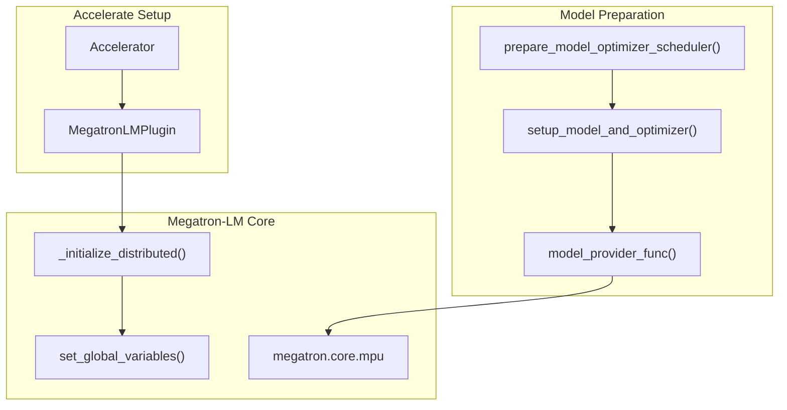
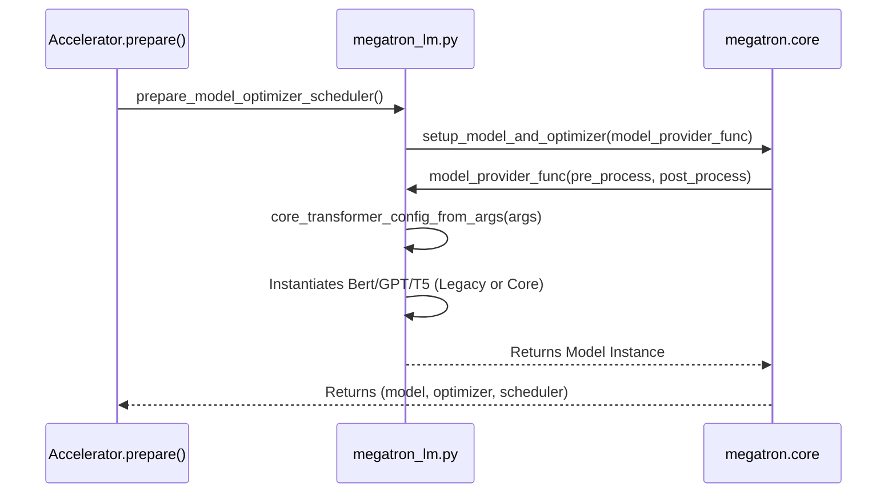

<!-- source: DeepWiki mcp.deepwiki.com · repo huggingface/accelerate · page 3.3 Megatron-LM Integration · fetched 2026-10-21 -->

# Megatron-LM Integration

<details>
<summary>Relevant source files</summary>

The following files were used as context for generating this wiki page:

- [benchmarks/fsdp2/utils.py](benchmarks/fsdp2/utils.py)
- [benchmarks/fsdp2/visualize.py](benchmarks/fsdp2/visualize.py)
- [docs/source/concept_guides/context_parallelism.md](docs/source/concept_guides/context_parallelism.md)
- [docs/source/concept_guides/sequence_parallelism.md](docs/source/concept_guides/sequence_parallelism.md)
- [docs/source/package_reference/cli.md](docs/source/package_reference/cli.md)
- [docs/source/usage_guides/compilation.md](docs/source/usage_guides/compilation.md)
- [docs/source/usage_guides/megatron_lm.md](docs/source/usage_guides/megatron_lm.md)
- [examples/by_feature/deepspeed_with_config_support.py](examples/by_feature/deepspeed_with_config_support.py)
- [examples/by_feature/megatron_lm_gpt_pretraining.py](examples/by_feature/megatron_lm_gpt_pretraining.py)
- [src/accelerate/utils/megatron_lm.py](src/accelerate/utils/megatron_lm.py)

</details>


## Purpose and Scope

This page documents Accelerate's integration with Megatron-LM, NVIDIA's framework for training large transformer models using model parallelism techniques. Megatron-LM support enables training models that exceed single-GPU memory capacity through **Tensor Parallelism (TP)**, **Pipeline Parallelism (PP)**, and **Sequence Parallelism (SP)**. Accelerate provides a high-level wrapper around Megatron-LM's core utilities to simplify the setup of complex parallelism 3D strategies.

For other distributed training backends, see [FSDP Integration](#3.1) and [DeepSpeed Integration](#3.2).

---

## Overview

Megatron-LM integration allows users to leverage multiple forms of model parallelism:

- **Tensor Parallelism (TP)**: Splits individual layers across multiple GPUs, enabling layers larger than single-GPU memory [docs/source/usage_guides/megatron_lm.md:29-35]().
- **Pipeline Parallelism (PP)**: Distributes transformer layers across GPUs in a pipelined fashion with micro-batching to reduce bubbles [docs/source/usage_guides/megatron_lm.md:38-44]().
- **Sequence Parallelism (SP)**: Shards sequence dimension across GPUs when TP is enabled, reducing memory for activations at no added communication cost [docs/source/usage_guides/megatron_lm.md:46-53]().
- **Expert Parallelism (EP)**: Distributes different experts across GPUs for Mixture-of-Experts (MoE) layers [docs/source/usage_guides/megatron_lm.md:63-63]().

These strategies are configured via the `MegatronLMPlugin` and launched through `accelerate launch --use_megatron_lm`.

**Sources:** [src/accelerate/commands/launch.py:272-276](), [src/accelerate/commands/config/cluster.py:547-606](), [docs/source/usage_guides/megatron_lm.md:24-80]()

---

## Architecture Integration

The integration bridges Accelerate's `Accelerator` class with Megatron-LM's internal global variables and model builders.



**Megatron-LM Code Entity Mapping**

Accelerate uses `src/accelerate/utils/megatron_lm.py` to interface with `megatron.core` and `megatron.training`. Key functions like `setup_model_and_optimizer` [src/accelerate/utils/megatron_lm.py:153-156]() are used to instantiate models using Megatron's internal logic.

**Sources:** [src/accelerate/utils/megatron_lm.py:31-81](), [src/accelerate/utils/megatron_lm.py:134-158]()

---

## Configuration Methods

### Command-Line Launch

Megatron-LM training is launched via the `--use_megatron_lm` flag with accompanying parameters:

```bash
accelerate launch \
  --use_megatron_lm \
  --megatron_lm_tp_degree 2 \
  --megatron_lm_pp_degree 2 \
  --megatron_lm_num_micro_batches 4 \
  --megatron_lm_sequence_parallelism true \
  --megatron_lm_recompute_activations true \
  --megatron_lm_use_distributed_optimizer true \
  train.py
```

**Sources:** [src/accelerate/commands/launch.py:608-779]()

### MegatronLMPlugin Configuration

The `MegatronLMPlugin` allows for programmatic control over the Megatron environment. It can handle custom model providers and preparation functions.

| Attribute | Description |
|-----------|-------------|
| `custom_model_provider_function` | User-defined function to build the Megatron model [src/accelerate/utils/megatron_lm.py:151-152](). |
| `custom_prepare_model_function` | User-defined function to wrap model preparation logic [src/accelerate/utils/megatron_lm.py:137-143](). |
| `other_megatron_args` | Dictionary for passing arbitrary Megatron-LM CLI arguments. |

**Sources:** [src/accelerate/utils/megatron_lm.py:137-156]()

---

## Parallelism Strategies

### Tensor Parallelism (TP)
Reduces memory footprint by splitting tensors into chunks across GPUs. In a transformer layer, this results in 2 `all-reduces` in both forward and backward paths [docs/source/usage_guides/megatron_lm.md:29-35]().

### Pipeline Parallelism (PP)
Distributes layers across stages. For a 24-layer model with 4 GPUs for PP, each GPU receives 6 layers [docs/source/usage_guides/megatron_lm.md:38-44](). Accelerate supports setting the number of layers in the last stage via `megatron_lm_decoder_last_pipeline_num_layers` [src/accelerate/commands/launch.py:668-672]().

### Sequence Parallelism (SP)
Shards outputs along the sequence dimension (e.g., 1024 tokens split across 4 GPUs = 256 tokens per GPU). It replaces `all-reduce` with `reduce-scatter` and `all-gather` [docs/source/usage_guides/megatron_lm.md:46-53]().

---

## Data Flow and Model Building

Megatron-LM requires a specific model building pattern where a "provider" function is passed to the initializer.



**Model Initialization Flow**

Accelerate provides a default `model_provider_func` [src/accelerate/utils/megatron_lm.py:85-131]() that supports BERT, GPT, and T5 architectures. It uses `core_transformer_config_from_args` [src/accelerate/utils/megatron_lm.py:95]() to translate CLI arguments into Megatron's internal configuration objects.

**Sources:** [src/accelerate/utils/megatron_lm.py:85-131](), [src/accelerate/utils/megatron_lm.py:134-158]()

---

## Memory Optimization Features

### Distributed Optimizer
Reduces memory by sharding optimizer states and gradients across Data Parallel (DP) ranks. For Adam in mixed-precision, this reduces the 12 bytes per parameter to 3 bytes if sharded across 4 GPUs [docs/source/usage_guides/megatron_lm.md:55-61]().

### Activation Recomputation
Accelerate supports `full` and `selective` recomputation [src/accelerate/commands/launch.py:702-710](). For GPT-3, full recomputation can lead to a 70% reduction in activation memory with only ~2.7% FLOPs overhead [docs/source/usage_guides/megatron_lm.md:64-68]().

---

## Data Loading and Datasets

Megatron-LM uses a specialized data handling system that Accelerate integrates via `MegatronLMDummyDataLoader` [src/accelerate/utils/megatron_lm.py:162-176]().

- **Indexed Datasets**: Supports efficient binary formats like `mmap`, `cached`, and `lazy` [docs/source/usage_guides/megatron_lm.md:73-74]().
- **Iterators**: Accelerate uses `build_train_valid_test_data_iterators` [src/accelerate/utils/megatron_lm.py:70]() to manage data across model parallel ranks.

**Sources:** [src/accelerate/utils/megatron_lm.py:69-71](), [src/accelerate/utils/megatron_lm.py:162-176]()

---

## Usage Example: GPT Pre-training

The following example demonstrates how `Accelerator` is used with Megatron-specific dummy objects for scheduling:

```python
from accelerate import Accelerator
from accelerate.utils import MegatronLMDummyScheduler

# Accelerator detects Megatron settings from environment/plugin
accelerator = Accelerator()

# Megatron-LM handles model/optimizer creation internally during prepare
model, optimizer, lr_scheduler = accelerator.prepare(model, optimizer, lr_scheduler)

# Training loop uses Megatron's internal train_step logic via accelerator
for batch in train_dataloader:
    # Megatron handles its own backward and stepping logic
    loss = train_step(model_provider_func, optimizer, ...)
```

**Sources:** [examples/by_feature/megatron_lm_gpt_pretraining.py:53-55](), [src/accelerate/utils/megatron_lm.py:74]()

---

