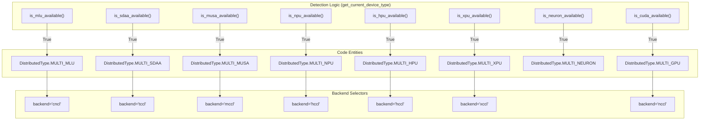
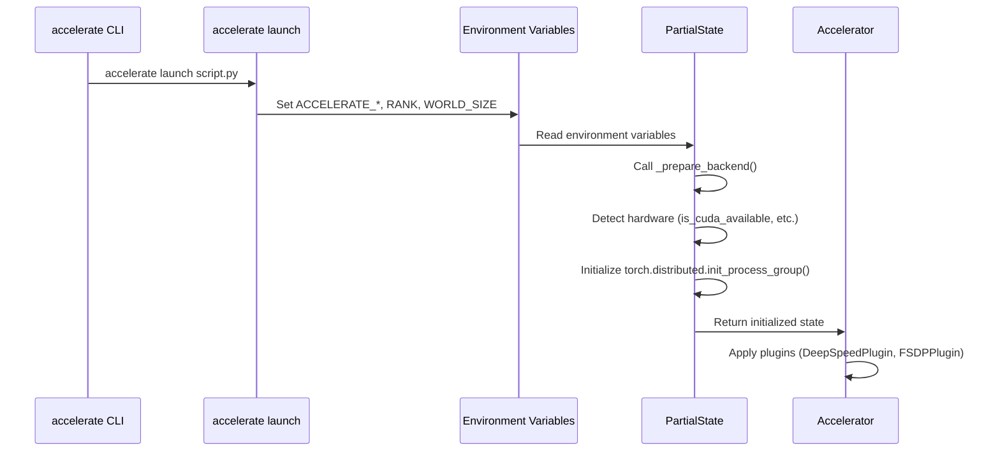

<!-- source: DeepWiki mcp.deepwiki.com · repo huggingface/accelerate · page 3.4 Environment Configuration and Backend Selection · fetched 2026-10-21 -->

# Environment Configuration and Backend Selection

<details>
<summary>Relevant source files</summary>

The following files were used as context for generating this wiki page:

- [src/accelerate/launchers.py](src/accelerate/launchers.py)
- [src/accelerate/test_utils/scripts/test_notebook.py](src/accelerate/test_utils/scripts/test_notebook.py)
- [src/accelerate/utils/__init__.py](src/accelerate/utils/__init__.py)
- [src/accelerate/utils/environment.py](src/accelerate/utils/environment.py)
- [src/accelerate/utils/imports.py](src/accelerate/utils/imports.py)
- [src/accelerate/utils/torch_xla.py](src/accelerate/utils/torch_xla.py)
- [src/accelerate/utils/versions.py](src/accelerate/utils/versions.py)

</details>


This document explains how Accelerate detects hardware, reads configuration, and selects the appropriate distributed training backend. It covers the environment variable system, hardware detection mechanisms, and the initialization flow from user configuration to backend selection.

For information about specific backend configurations (FSDP, DeepSpeed, Megatron-LM), see sections [3.1](), [3.2](), and [3.3](). For configuration file generation via the CLI, see [6.2]().

---

## Overview of the Selection Process

Accelerate's backend selection follows a three-stage process:

1. **Configuration Stage**: User specifies preferences via `accelerate config` or command-line arguments.
2. **Environment Preparation**: The `accelerate launch` command sets environment variables based on configuration.
3. **Runtime Detection**: `PartialState` and `AcceleratorState` detect hardware and select the appropriate backend.

The system prioritizes explicit configuration (environment variables and config files) over automatic detection, allowing users to override default behavior when needed.

Sources: [src/accelerate/state.py:122-328](), [src/accelerate/accelerator.py:278-636]()

---

## Hardware Detection System

### Detection Priority and Available Hardware Types

Accelerate supports multiple hardware types, each with its own detection mechanism. The `get_current_device_type` function determines the hardware without initializing the device driver, which is critical for fork-based multiprocessing [src/accelerate/utils/environment.py:101-149]().



### Hardware Detection Implementation

The detection functions in `src/accelerate/utils/imports.py` check for required library imports and device availability via PyTorch APIs.

**Key Detection Functions:**

| Function | Purpose | Location |
|----------|---------|----------|
| `is_torch_xla_available()` | Detects TPU availability via torch_xla | [src/accelerate/utils/imports.py:131-145]() |
| `is_cuda_available()` | Detects CUDA GPUs using NVML-based check to avoid initialization | [src/accelerate/utils/imports.py:119-127]() |
| `is_npu_available()` | Detects Ascend NPU devices | [src/accelerate/utils/imports.py:383-399]() |
| `is_xpu_available()` | Detects Intel XPU devices | [src/accelerate/utils/imports.py:451-467]() |
| `is_rocm_available()` | Detects AMD ROCm via `torch.version.hip` | [src/accelerate/utils/imports.py:84-85]() |

Sources: [src/accelerate/utils/imports.py:119-467](), [src/accelerate/utils/environment.py:101-149]()

---

## Environment Variables System

### Core Environment Variables

Accelerate uses environment variables to pass configuration from the launcher to the training script.

**Primary Configuration Variables:**

| Variable | Purpose | Set By | Read By |
|----------|---------|--------|---------|
| `ACCELERATE_USE_DEEPSPEED` | Enable DeepSpeed backend | `accelerate launch` | [src/accelerate/accelerator.py:346]() |
| `ACCELERATE_USE_FSDP` | Enable FSDP backend | `accelerate launch` | [src/accelerate/accelerator.py:380]() |
| `ACCELERATE_MIXED_PRECISION` | Mixed precision mode (no/fp16/bf16/fp8) | Launcher | [src/accelerate/state.py:710]() |
| `ACCELERATE_USE_CPU` | Force CPU execution | [src/accelerate/utils/launch.py:131]() | [src/accelerate/state.py:179]() |
| `ACCELERATE_TORCH_DEVICE` | Override device selection | User | [src/accelerate/state.py:181-182]() |

**Hardware Visibility Variables:**

Accelerate manages device visibility through standard variables like `CUDA_VISIBLE_DEVICES` [src/accelerate/utils/launch.py:148]() and vendor-specific ones like `ZE_AFFINITY_MASK` (Intel XPU) [src/accelerate/utils/launch.py:136]() or `MLU_VISIBLE_DEVICES` (Cambricon MLU) [src/accelerate/utils/launch.py:138]().

Sources: [src/accelerate/utils/launch.py:98-194](), [src/accelerate/state.py:176-243]()

---

## Backend Selection Logic

### The _prepare_backend Method

The `_prepare_backend` method in `PartialState` determines the communication backend. It respects the hardware priority defined in `get_current_device_type`.

**Backend to Communication Library Mapping:**

| Backend | Library | Hardware | DistributedType |
|---------|---------|----------|-----------------|
| `nccl` | NVIDIA NCCL | CUDA GPUs | `MULTI_GPU` |
| `gloo` | Facebook Gloo | CPU | `MULTI_CPU` |
| `xla` | XLA Runtime | TPU | `XLA` |
| `hccl` | Huawei HCCL | NPU/HPU | `MULTI_NPU`/`MULTI_HPU` |
| `cncl` | Cambricon CNCL | MLU | `MULTI_MLU` |
| `tccl` | Teco TCCL | SDAA | `MULTI_SDAA` |
| `mccl` | Moore Threads MCCL | MUSA | `MULTI_MUSA` |
| `xccl` | Intel XCCL | XPU | `MULTI_XPU` |

Sources: [src/accelerate/state.py:545-630](), [src/accelerate/utils/environment.py:133-148]()

---

## Configuration to Initialization Flow

### End-to-End Process



### Notebook Launcher Integration

The `notebook_launcher` provides a specialized entry point for Jupyter/Colab environments. It handles environment patching and process spawning using `torch.multiprocessing` or `torch_xla.distributed.xla_multiprocessing` for TPUs [src/accelerate/launchers.py:43-153](). It includes a regression guard to ensure the CUDA driver is not loaded in the parent process before forking, which would lead to "bad-fork" states [src/accelerate/test_utils/scripts/test_notebook.py:53-65]().

Sources: [src/accelerate/launchers.py:43-176](), [src/accelerate/test_utils/scripts/test_notebook.py:76-80]()

---

## Plugin Initialization System

### Plugin Discovery

Plugins are initialized in `Accelerator.__init__` based on environment variables or explicit arguments.

1. **DeepSpeed**: If `ACCELERATE_USE_DEEPSPEED=true` or `deepspeed_plugin` is passed, it sets `DistributedType.DEEPSPEED` [src/accelerate/accelerator.py:335-378]().
2. **FSDP**: If `ACCELERATE_USE_FSDP=true` or `fsdp_plugin` is passed, it sets `DistributedType.FSDP` [src/accelerate/accelerator.py:380-395]().
3. **Megatron-LM**: If `ACCELERATE_USE_MEGATRON_LM=true` or `megatron_lm_plugin` is passed, it sets `DistributedType.MEGATRON_LM` [src/accelerate/accelerator.py:401-412]().

### KwargsHandlers

`KwargsHandler` objects allow granular control over backend-specific initialization:

| Handler Class | Purpose |
|--------------|---------|
| `InitProcessGroupKwargs` | Parameters for `init_process_group()` [src/accelerate/utils/dataclasses.py:483-500]() |
| `DistributedDataParallelKwargs` | Parameters for DDP wrapping [src/accelerate/utils/dataclasses.py:383-424]() |
| `GradScalerKwargs` | Parameters for `torch.cuda.amp.GradScaler` [src/accelerate/utils/dataclasses.py:355-374]() |

Sources: [src/accelerate/accelerator.py:414-451](), [src/accelerate/utils/dataclasses.py:68-598]()

---

## Backend-Specific Initialization Details

### torch.distributed.init_process_group

Accelerate manages the initialization of the process group. For FSDP with parameter offloading, it automatically configures a hybrid backend:
```python
# In PartialState._prepare_backend
if self.backend == "nccl" and os.environ.get("ACCELERATE_USE_FSDP", "false").lower() == "true":
    if os.environ.get("FSDP_OFFLOAD_PARAMS", "false").lower() == "true":
        self.backend = "cuda:nccl,cpu:gloo"
```
Sources: [src/accelerate/state.py:200-243](), [src/accelerate/state.py:283-284]()

### Device Assignment

Device assignment is performed in `PartialState.set_device()`, mapping the `local_process_index` to the specific hardware ordinal (e.g., `torch.device("npu", self.local_process_index)`) [src/accelerate/state.py:638-694]().

Sources: [src/accelerate/state.py:638-694]()

---

