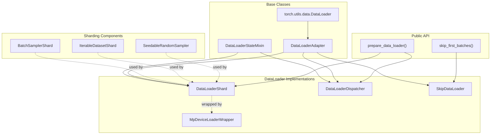
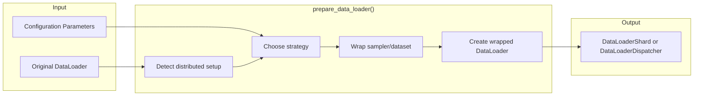
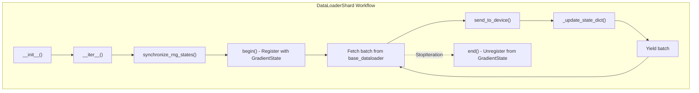

<!-- source: DeepWiki mcp.deepwiki.com · repo huggingface/accelerate · page 4 Data Loading and Processing · fetched 2026-10-21 -->

# Data Loading and Processing

Relevant source files

The following files were used as context for generating this wiki page:

- [src/accelerate/data_loader.py](src/accelerate/data_loader.py)
- [src/accelerate/test_utils/scripts/external_deps/test_peak_memory_usage.py](src/accelerate/test_utils/scripts/external_deps/test_peak_memory_usage.py)
- [src/accelerate/test_utils/scripts/test_distributed_data_loop.py](src/accelerate/test_utils/scripts/test_distributed_data_loop.py)
- [src/accelerate/test_utils/scripts/test_script.py](src/accelerate/test_utils/scripts/test_script.py)
- [src/accelerate/test_utils/scripts/test_sync.py](src/accelerate/test_utils/scripts/test_sync.py)
- [tests/test_data_loader.py](tests/test_data_loader.py)

## Purpose and Scope

This document describes Accelerate's data loading system, which handles distributed sampling, batch sharding, device placement, and state persistence for training resumption. The system wraps PyTorch `DataLoader` objects to automatically distribute data across multiple processes while ensuring reproducibility and correct synchronization.

For information about preparing models and optimizers, see [Preparing Training Components](#2.2). For checkpoint management of dataloaders, see [Checkpointing and State Management](#7).

## Core Architecture

Accelerate provides two primary strategies for distributed data loading:

1. **Sharding**: Each process independently reads different data samples using wrapped samplers (`DataLoaderShard`). [src/accelerate/data_loader.py:110-152]()
2. **Dispatching**: The main process reads all data and broadcasts portions to other processes (`DataLoaderDispatcher`). [src/accelerate/data_loader.py:704-740]()

**Class Hierarchy**

Sources: [src/accelerate/data_loader.py:1-1408]()

The system is built on three foundational components:

| Component | Purpose | Key Methods |
|-----------|---------|-------------|
| `DataLoaderAdapter` | Wraps base PyTorch DataLoader with compatibility layer | `state_dict()`, `load_state_dict()` |
| `DataLoaderStateMixin` | Tracks dataloader state during iteration | `begin()`, `end()`, `_update_state_dict()` |
| Sampler/Dataset Shards | Distribute data samples across processes | `__iter__()`, `set_epoch()` |

Sources: [src/accelerate/data_loader.py:408-443](), [src/accelerate/data_loader.py:365-406](), [src/accelerate/data_loader.py:110-362]()

## Preparation and Configuration

The `prepare_data_loader()` function is the primary entry point for wrapping PyTorch DataLoaders. It automatically detects the distributed environment and applies appropriate sharding or dispatching strategies. [src/accelerate/data_loader.py:996-1025]()

**Function Signature and Key Parameters**

Sources: [src/accelerate/data_loader.py:996-1309]()

**Configuration Parameters**

| Parameter | Type | Default | Purpose |
|-----------|------|---------|---------|
| `split_batches` | bool | False | Whether to split batches across processes or yield different batches |
| `dispatch_batches` | bool | None | Use dispatching strategy (main process iterates and broadcasts) |
| `even_batches` | bool | True | Loop back to beginning to ensure equal batch counts across processes |
| `put_on_device` | bool | False | Automatically move batches to device |
| `use_seedable_sampler` | bool | False | Use `SeedableRandomSampler` for reproducibility |
| `data_seed` | int | None | Seed for `SeedableRandomSampler` |
| `use_stateful_dataloader` | bool | False | Use `torchdata.StatefulDataLoader` backend |

Sources: [src/accelerate/data_loader.py:996-1091]()

**Automatic Strategy Selection**

The function automatically chooses between sharding and dispatching:

- **Dispatching** is used when `dispatch_batches=True` or when the dataset is an `IterableDataset` and `put_on_device=True`. [src/accelerate/data_loader.py:1093-1097]()
- **Sharding** is used otherwise.

**Device Mesh Support**

When using multi-dimensional parallelism (e.g., tensor parallel + data parallel), `prepare_data_loader()` adjusts process indices based on the device mesh dimensions to ensure ranks in the same TP group receive identical data. [src/accelerate/data_loader.py:1109-1145]()

## Sharding Strategies

For details, see [Sharding Strategies](#4.2).

### DataLoaderShard

`DataLoaderShard` handles distributed sampling with automatic device placement and RNG synchronization. Each process receives different data samples. [src/accelerate/data_loader.py:500-520]()

**Architecture**

Sources: [src/accelerate/data_loader.py:558-592]()

### BatchSamplerShard

`BatchSamplerShard` wraps a PyTorch `BatchSampler` to generate batches for a single process. It ensures all processes yield the same number of batches if `even_batches=True`. [src/accelerate/data_loader.py:110-152]()

### IterableDatasetShard

Wraps PyTorch `IterableDataset` objects. It collects samples into `real_batch_size` chunks before distributing slices to processes. [src/accelerate/data_loader.py:266-362]()

### SeedableRandomSampler

Extends PyTorch's `RandomSampler` to support deterministic shuffling across epochs via `set_epoch()`. [src/accelerate/data_loader.py:73-108]()

## Dispatching Strategy

For details, see [Dispatching Strategies](#4.3).

### DataLoaderDispatcher

`DataLoaderDispatcher` implements a centralized data loading strategy where the main process (rank 0) iterates through the dataloader and broadcasts batches to all other processes. [src/accelerate/data_loader.py:704-740]()

**Key Methods**

| Method | Purpose |
|--------|---------|
| `_fetch_batches()` | Main process fetches and concatenates batches; broadcasts metadata. [src/accelerate/data_loader.py:786-850]() |
| `__iter__()` | Coordinates iteration: main process reads, all processes receive and slice. [src/accelerate/data_loader.py:852-926]() |

## Stateful DataLoaders and Resumption

For details, see [Stateful DataLoaders and Resumption](#4.4).

### DataLoaderStateMixin

Tracks iteration state and integrates with `GradientState` to determine when to sync gradients at the end of a dataloader. [src/accelerate/data_loader.py:365-406]()

### Resumption Utilities

- `state_dict()`/`load_state_dict()`: Persists iteration progress. [src/accelerate/data_loader.py:445-498]()
- `skip_first_batches()`: Utility to skip N batches when resuming. [src/accelerate/data_loader.py:1375-1408]()
- `torchdata` support: Integration with `StatefulDataLoader` for complex pipelines. [src/accelerate/data_loader.py:414-433]()

## Special Cases and Utilities

For details, see [Special Cases and Utilities](#4.5).

- **XLA Support**: `MpDeviceLoaderWrapper` handles TPU-specific parallel loading and RNG synchronization for XLA threads. [src/accelerate/data_loader.py:651-702]()
- **Device Mesh**: Support for complex parallelism configs (DP + TP + FSDP). [src/accelerate/data_loader.py:1109-1145]()
- **GradientState**: Automated synchronization tracking via `end_of_dataloader` and `remainder` attributes. [src/accelerate/data_loader.py:622-636]()

---

**Sources Summary**:
- [src/accelerate/data_loader.py:1-1408]()
- [src/accelerate/test_utils/scripts/test_script.py:187-210]()
- [tests/test_data_loader.py:100-178]()

---

