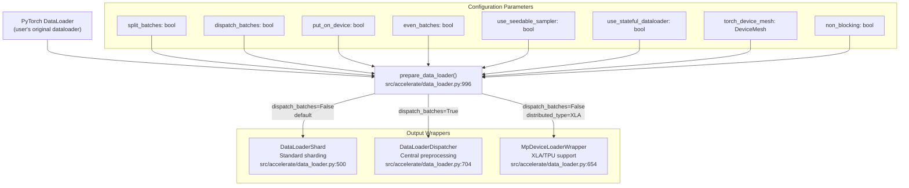
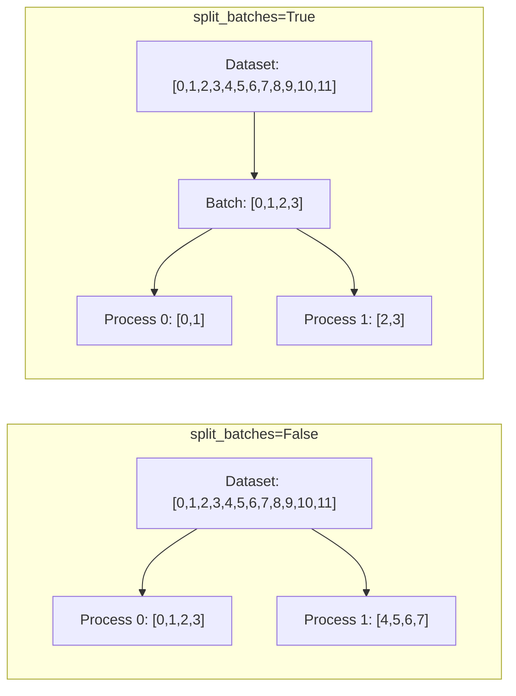
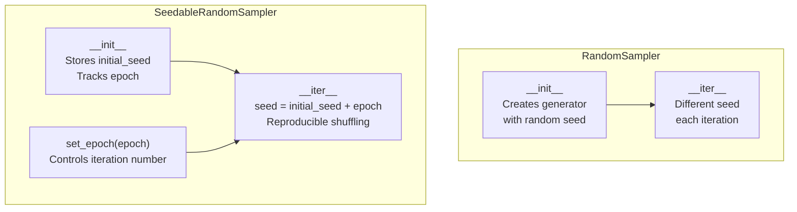
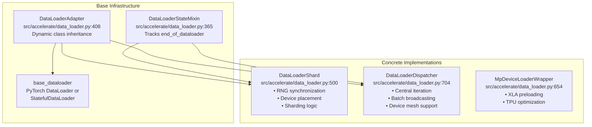
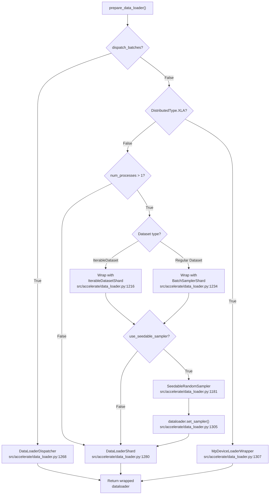
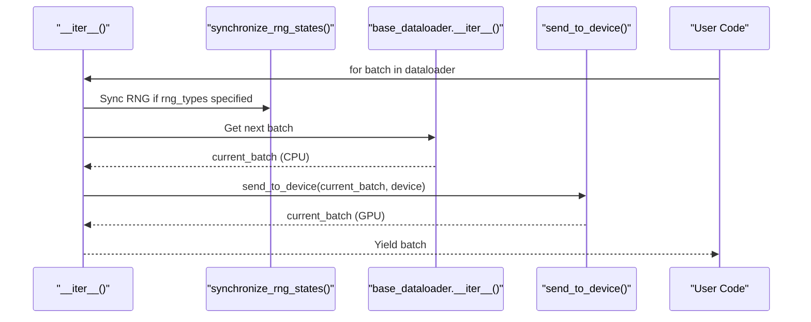
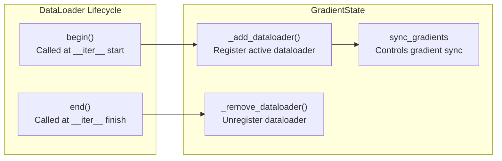
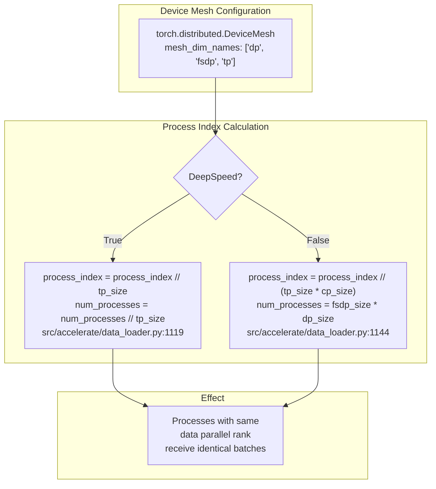

<!-- source: DeepWiki mcp.deepwiki.com · repo huggingface/accelerate · page 4.1 DataLoader Configuration and Preparation · fetched 2026-10-21 -->

# DataLoader Configuration and Preparation

Relevant source files

The following files were used as context for generating this wiki page:

- [src/accelerate/data_loader.py](src/accelerate/data_loader.py)
- [src/accelerate/test_utils/scripts/external_deps/test_peak_memory_usage.py](src/accelerate/test_utils/scripts/external_deps/test_peak_memory_usage.py)
- [src/accelerate/test_utils/scripts/test_distributed_data_loop.py](src/accelerate/test_utils/scripts/test_distributed_data_loop.py)
- [src/accelerate/test_utils/scripts/test_script.py](src/accelerate/test_utils/scripts/test_script.py)
- [src/accelerate/test_utils/scripts/test_sync.py](src/accelerate/test_utils/scripts/test_sync.py)
- [tests/test_data_loader.py](tests/test_data_loader.py)

## Purpose and Scope

This document covers the `prepare_data_loader()` function, which is the core API for preparing PyTorch `DataLoader` instances for distributed training in Accelerate. It details the configuration parameters that control data distribution, device placement, reproducibility, and state persistence.

For implementation details of how data is sharded across processes, see [Sharding Strategies](#4.2). For the dispatcher pattern that preprocesses on one process and broadcasts to others, see [Dispatching Strategies](#4.3). For resuming dataloaders mid-epoch, see [Stateful DataLoaders and Resumption](#4.4).

## Function Overview

The `prepare_data_loader()` function transforms a standard PyTorch `DataLoader` into one of several specialized wrapper classes depending on configuration:

**Sources:** [src/accelerate/data_loader.py:996-1309](), [src/accelerate/data_loader.py:500-649](), [src/accelerate/data_loader.py:704-976](), [src/accelerate/data_loader.py:654-701]()

## Key Configuration Parameters

### split_batches

Controls whether batches are split across processes or each process receives full batches.

| `split_batches` | Behavior | Observed Batch Size |
|-----------------|----------|---------------------|
| `False` (default) | Each process receives different full batches, advancing by `num_processes` batches | `original_batch_size × num_processes` |
| `True` | Each batch is split and distributed across processes | `original_batch_size` (same as single process) |

**Example with 2 processes and `batch_size=4`:**

**Validation:** When `split_batches=True`, the batch size must be a multiple of `num_processes` ([src/accelerate/data_loader.py:1148-1167]()).

**Sources:** [src/accelerate/data_loader.py:1028-1038](), [src/accelerate/data_loader.py:1148-1167]()

### dispatch_batches

Determines whether the main process iterates through the dataloader and broadcasts batches to other processes.

| `dispatch_batches` | Iteration Pattern | Use Case |
|-------------------|-------------------|----------|
| `False` (default) | Each process iterates independently | Standard datasets with low preprocessing cost |
| `True` | Process 0 iterates and broadcasts | Expensive preprocessing, `IterableDataset` |
| `None` | Auto-detected (`True` for `IterableDataset` if `put_on_device=True`) | Automatic optimization |

**Requirements:** `dispatch_batches=True` requires `put_on_device=True` ([src/accelerate/data_loader.py:1099-1100]()).

**Sources:** [src/accelerate/data_loader.py:1052-1055](), [src/accelerate/data_loader.py:1093-1097](), [src/accelerate/data_loader.py:1099-1100]()

### even_batches

Controls handling of incomplete final batches when the dataset size is not evenly divisible.

| `even_batches` | Behavior | Effect on Length |
|----------------|----------|------------------|
| `True` (default) | Cycles to beginning to complete final batch | All processes get same number of batches |
| `False` | Allows incomplete batches | Processes may get different numbers of batches |

**Constraint:** Cannot use `even_batches=True` with batch samplers that have no `batch_size` attribute ([src/accelerate/data_loader.py:165-169]()).

**Sources:** [src/accelerate/data_loader.py:1056-1059](), [src/accelerate/data_loader.py:134-142](), [src/accelerate/data_loader.py:165-169]()

### use_seedable_sampler

Enables reproducible shuffling across distributed processes by replacing `RandomSampler` with `SeedableRandomSampler`.

**Key Features:**
- Maintains consistent shuffling across processes when `set_seed()` is called ([src/accelerate/data_loader.py:77-79]()).
- Supports `set_epoch()` to change shuffle order between epochs ([src/accelerate/data_loader.py:105-107]()).
- Automatically increments `epoch` after each full iteration ([src/accelerate/data_loader.py:102-103]()).

**Sources:** [src/accelerate/data_loader.py:73-107](), [src/accelerate/data_loader.py:1064-1068](), [src/accelerate/data_loader.py:1176-1191]()

### use_stateful_dataloader

Enables state persistence for mid-epoch resumption using `torchdata.StatefulDataLoader`.

| `use_stateful_dataloader` | Base Class | State Persistence |
|---------------------------|-----------|-------------------|
| `False` (default) | `torch.utils.data.DataLoader` | Not supported |
| `True` | `torchdata.stateful_dataloader.StatefulDataLoader` | Full state via `state_dict()`/`load_state_dict()` |

**Requirements:** `torchdata` version 0.8.0 or higher ([src/accelerate/data_loader.py:41-44]()).

**Sources:** [src/accelerate/data_loader.py:1075-1078](), [src/accelerate/data_loader.py:414-433]()

### put_on_device and non_blocking

Control device placement of batches.

| Parameter | Effect |
|-----------|--------|
| `put_on_device=True` | Batches automatically moved to target device |
| `put_on_device=False` | Manual device placement required |
| `non_blocking=True` | Enables asynchronous H2D transfers (requires `pin_memory=True`) |

**TPU Exception:** Device placement is handled by `MpDeviceLoaderWrapper` on XLA devices regardless of `put_on_device` value ([src/accelerate/data_loader.py:1307-1308]()).

**Sources:** [src/accelerate/data_loader.py:1039-1041](), [src/accelerate/data_loader.py:1072-1074](), [src/accelerate/data_loader.py:576-577]()

## DataLoader Wrapper Architecture

The `prepare_data_loader()` function returns specialized wrappers that inherit from `DataLoaderAdapter`:

**Key Design Pattern:** `DataLoaderAdapter` dynamically overrides its `__class__` property to maintain `isinstance(dataloader, DataLoader)` compatibility ([src/accelerate/data_loader.py:452-458]()).

**Sources:** [src/accelerate/data_loader.py:408-498](), [src/accelerate/data_loader.py:365-406](), [src/accelerate/data_loader.py:500-649](), [src/accelerate/data_loader.py:704-976]()

## Preparation Logic Flow

**Sources:** [src/accelerate/data_loader.py:996-1309]()

## Device Placement Mechanism

Device placement occurs at different stages depending on the wrapper type:

### DataLoaderShard Device Placement

The `device` parameter is set during wrapper creation:
- If `put_on_device=True` and not XLA: `device=device_parameter` ([src/accelerate/data_loader.py:1282-1290]()).
- Otherwise: `device=None` (no automatic placement).

**Sources:** [src/accelerate/data_loader.py:558-592](), [src/accelerate/data_loader.py:1282-1303]()

### DataLoaderDispatcher Device Placement

For `dispatch_batches=True`, the main process retrieves batches, broadcasts the structure, then all processes receive and place on device via `send_to_device()` within the iteration loop ([src/accelerate/data_loader.py:874-876]()).

**Sources:** [src/accelerate/data_loader.py:852-926](), [src/accelerate/data_loader.py:874-876]()

## Integration with GradientState

Both `DataLoaderShard` and `DataLoaderDispatcher` integrate with `GradientState` to coordinate gradient synchronization:

This coordination enables features like gradient accumulation and conditional gradient synchronization during distributed training ([src/accelerate/data_loader.py:394-405]()).

**Sources:** [src/accelerate/data_loader.py:394-405](), [src/accelerate/data_loader.py:561-562](), [src/accelerate/data_loader.py:853-854]()

## Device Mesh Support for Multi-Dimensional Parallelism

When `torch_device_mesh` is provided, `prepare_data_loader()` adjusts process indices to ensure correct data distribution across parallel dimensions:

**Rationale:** In tensor parallel (TP) or context parallel (CP) setups, processes with the same TP/CP rank but different DP/FSDP ranks need different batches, while processes with the same DP/FSDP rank but different TP/CP ranks need identical batches ([src/accelerate/data_loader.py:1109-1145]()).

**Sources:** [src/accelerate/data_loader.py:1109-1145](), [src/accelerate/data_loader.py:764-784]()

## RNG Synchronization

The `rng_types` parameter controls which random number generators are synchronized at the start of each iteration:

| RNG Type | Description | Backend |
|----------|-------------|---------|
| `"torch"` | Base PyTorch RNG | CPU |
| `"cuda"` | CUDA RNG | GPU |
| `"xla"` | XLA RNG | TPU |
| `"generator"` | Custom `torch.Generator` | Sampler/Dataset |

**Synchronization Process:**
1. At the start of each `__iter__()`, `synchronize_rng_states()` is called ([src/accelerate/data_loader.py:559-560]()).
2. RNG states are gathered from all processes and broadcast from the main process ([src/accelerate/utils/operations.py:40]()).
3. Ensures identical random operations across processes.

**Sources:** [src/accelerate/data_loader.py:1042-1050](), [src/accelerate/data_loader.py:559-560]()

## Parameter Interaction Summary

| Parameter Combination | Result | Use Case |
|-----------------------|--------|----------|
| `split_batches=False`, `dispatch_batches=False` | Independent iteration, full batches | Standard DDP training |
| `split_batches=True`, `dispatch_batches=False` | Independent iteration, split batches | Smaller GPU memory |
| `split_batches=False`, `dispatch_batches=True` | Central iteration, full batches broadcast | Expensive preprocessing |
| `split_batches=True`, `dispatch_batches=True` | Central iteration, split batches broadcast | Expensive preprocessing + memory constraints |
| `use_seedable_sampler=True` | Reproducible shuffling | Research reproducibility |
| `use_stateful_dataloader=True` | Checkpoint-resumable | Fault-tolerant training |
| `even_batches=False` | Variable batch counts | Custom samplers with varying sizes |

**Sources:** [src/accelerate/data_loader.py:996-1309](), [tests/test_data_loader.py:98-417]()

---

