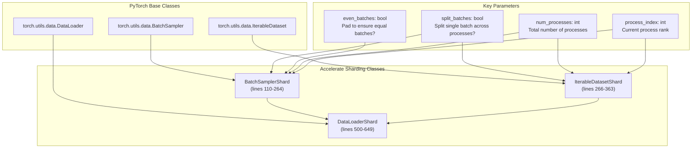
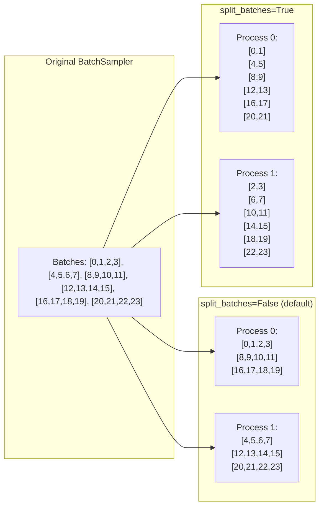
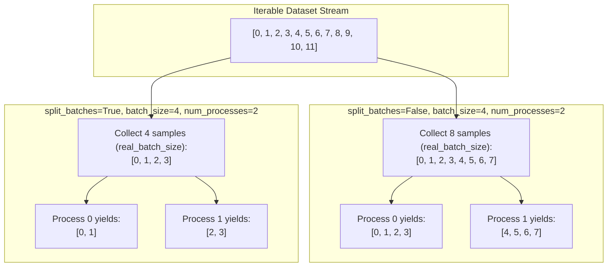
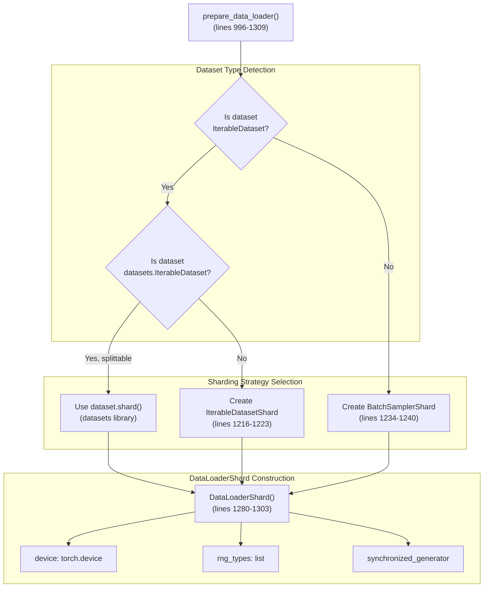
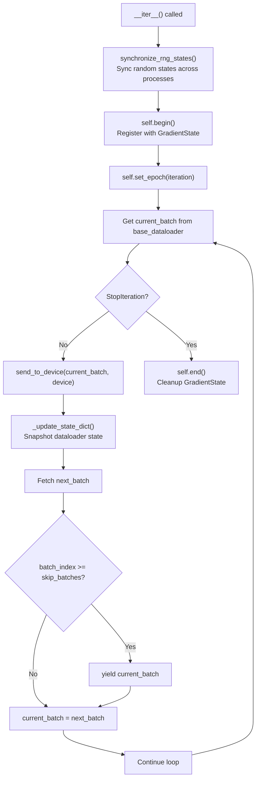
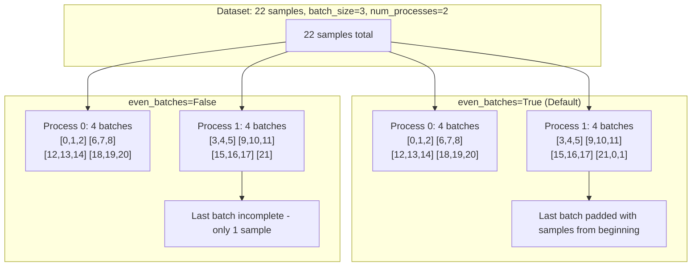
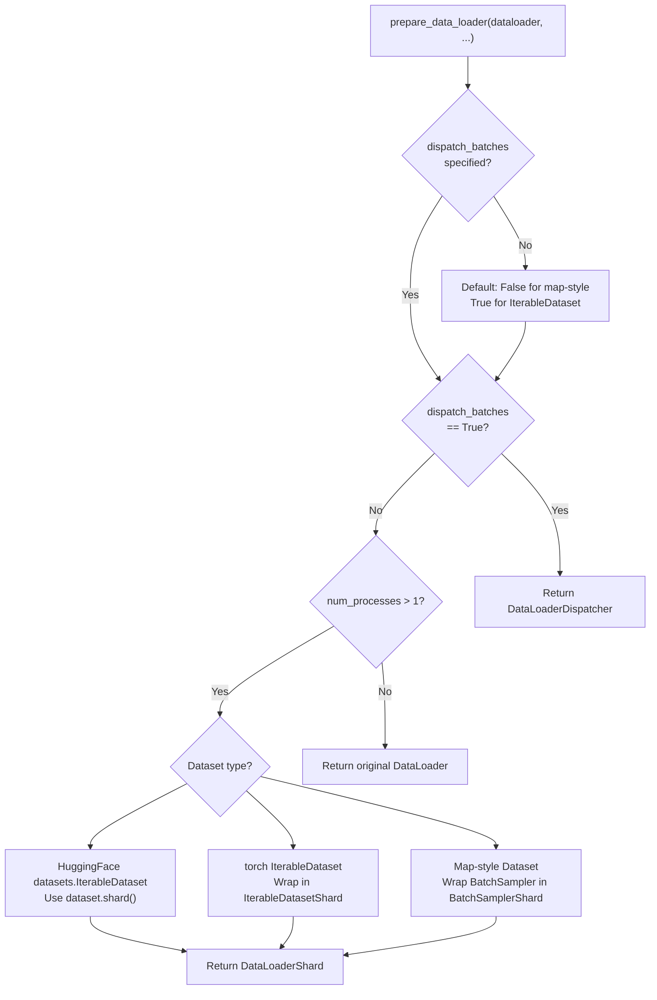

<!-- source: DeepWiki mcp.deepwiki.com · repo huggingface/accelerate · page 4.2 Sharding Strategies · fetched 2026-10-21 -->

# Sharding Strategies

<details>
<summary>Relevant source files</summary>

The following files were used as context for generating this wiki page:

- [src/accelerate/data_loader.py](src/accelerate/data_loader.py)
- [src/accelerate/test_utils/scripts/external_deps/test_peak_memory_usage.py](src/accelerate/test_utils/scripts/external_deps/test_peak_memory_usage.py)
- [src/accelerate/test_utils/scripts/test_distributed_data_loop.py](src/accelerate/test_utils/scripts/test_distributed_data_loop.py)
- [src/accelerate/test_utils/scripts/test_script.py](src/accelerate/test_utils/scripts/test_script.py)
- [src/accelerate/test_utils/scripts/test_sync.py](src/accelerate/test_utils/scripts/test_sync.py)
- [tests/test_data_loader.py](tests/test_data_loader.py)

</details>


## Purpose and Scope

This document explains the **sharding strategies** used by Accelerate to distribute data across multiple processes during distributed training. Sharding is the mechanism by which each process receives a distinct subset of the training data, ensuring efficient parallel processing without data duplication. This page covers the `DataLoaderShard`, `BatchSamplerShard`, and `IterableDatasetShard` classes, as well as the `split_batches` and `even_batches` configuration options.

For information about the alternative **dispatching strategy** (where one process fetches data and distributes it to others), see [Dispatching Strategies](#4.3). For general DataLoader configuration, see [DataLoader Configuration and Preparation](#4.1). For stateful dataloader resumption, see [Stateful DataLoaders and Resumption](#4.4).

## Overview: Sharding vs Dispatching

Accelerate provides two fundamental strategies for distributing data across processes:

| Strategy | Class | Behavior | Use Case |
|----------|-------|----------|----------|
| **Sharding** | `DataLoaderShard` | Each process independently iterates through its own shard of the dataset | Standard multi-GPU training with map-style datasets |
| **Dispatching** | `DataLoaderDispatcher` | Process 0 fetches batches and broadcasts them to all processes | Iterable datasets, complex preprocessing, or tensor parallelism |

The sharding strategy is the default for map-style datasets and is automatically selected by `prepare_data_loader` unless `dispatch_batches=True` is specified.

Sources: [src/accelerate/data_loader.py:1056-1070](), [src/accelerate/data_loader.py:1216-1303]()

## Core Sharding Classes

### Class Hierarchy and Relationships



Sources: [src/accelerate/data_loader.py:110-169](), [src/accelerate/data_loader.py:266-312](), [src/accelerate/data_loader.py:500-547]()

## BatchSamplerShard: Sharding Map-Style Datasets

The `BatchSamplerShard` class wraps a PyTorch `BatchSampler` to generate batches for a single process. It ensures that all processes receive the same number of batches (a round multiple of `num_processes`) by either dropping incomplete batches or looping back to the beginning of the dataset.

### Core Behavior



### Key Methods and Logic

**Initialization**: [src/accelerate/data_loader.py:145-169]()
```python
BatchSamplerShard(
    batch_sampler: BatchSampler,
    num_processes: int = 1,
    process_index: int = 0,
    split_batches: bool = False,
    even_batches: bool = True
)
```

**Iteration Logic**:
- **`split_batches=False`**: [src/accelerate/data_loader.py:218-263]()
  - Each process takes every `num_processes`-th batch
  - Process 0 gets batches 0, 2, 4, ...; Process 1 gets batches 1, 3, 5, ...
  - When `even_batches=True`, incomplete final batches are padded with samples from the beginning.

- **`split_batches=True`**: [src/accelerate/data_loader.py:196-216]()
  - Each batch is divided into `num_processes` slices.
  - Each process takes its slice: `batch[batch_length * process_index : batch_length * (process_index + 1)]`.
  - Requires batch size to be divisible by `num_processes` [src/accelerate/data_loader.py:160-164]().

### Handling Uneven Dataset Sizes

The `even_batches` parameter controls behavior when the dataset size is not a round multiple of `batch_size * num_processes`:

| Configuration | Behavior | Example (24 samples, bs=3, 2 processes) |
|---------------|----------|----------------------------------------|
| `even_batches=True` | Pad incomplete batches by cycling dataset | Both processes get 4 batches, last batch may contain duplicates |
| `even_batches=False` | Yield incomplete batches as-is | Process 0 may get 4 batches, Process 1 gets 3 batches |

Sources: [src/accelerate/data_loader.py:110-264](), [tests/test_data_loader.py:99-297]()

## IterableDatasetShard: Sharding Iterable Datasets

The `IterableDatasetShard` class wraps a PyTorch `IterableDataset` to shard streaming data across processes. Unlike `BatchSamplerShard`, it operates on individual elements rather than pre-formed batches.

### Iteration Strategy



### Key Variables

The class uses these computed values during iteration [src/accelerate/data_loader.py:332-362]():

- `real_batch_size = batch_size * num_processes` (when `split_batches=False`)
- `real_batch_size = batch_size` (when `split_batches=True`)
- `process_batch_size = batch_size // num_processes` (when `split_batches=True`)
- `process_batch_size = batch_size` (when `split_batches=False`)
- `process_slice = range(process_index * process_batch_size, (process_index + 1) * process_batch_size)`

### Drop Last and Padding Behavior

When `drop_last=False` and the stream ends with an incomplete batch [src/accelerate/data_loader.py:356-362]():
1. Samples from the first batch are reused to complete the final batch.
2. All processes receive the same number of samples.
3. Each process takes its designated slice from the padded batch.

Sources: [src/accelerate/data_loader.py:266-363](), [tests/test_data_loader.py:361-416]()

## DataLoaderShard: The Main Wrapper

`DataLoaderShard` is the primary class returned by `prepare_data_loader` when using the sharding strategy. It inherits from `DataLoaderAdapter` and `DataLoaderStateMixin`, providing both dataloader functionality and state tracking.

### Initialization and Components



### Key Attributes

| Attribute | Type | Purpose |
|-----------|------|---------|
| `device` | `torch.device` | Target device for batch placement |
| `rng_types` | `list[str/RNGType]` | RNG types to synchronize before each iteration |
| `synchronized_generator` | `torch.Generator` | Shared generator for reproducibility |
| `skip_batches` | `int` | Number of batches to skip at start (for resumption) |
| `total_batch_size` | `int` (property) | Total batch size across all processes |
| `total_dataset_length` | `int` (property) | Total dataset length across all processes |

Sources: [src/accelerate/data_loader.py:500-547](), [src/accelerate/data_loader.py:623-649]()

### Iteration Flow

The `__iter__` method orchestrates the complete iteration cycle [src/accelerate/data_loader.py:558-592]():



**Key Implementation Details**:

1. **One-Batch-Ahead Pattern**: [src/accelerate/data_loader.py:565-589]()
   - The iterator fetches one batch ahead to detect `StopIteration` early.
   - This allows setting `end_of_dataloader=True` before yielding the final batch.
   - Critical for gradient accumulation logic (see [Gradient Accumulation](#10.2)).

2. **RNG Synchronization**: [src/accelerate/data_loader.py:559-560]()
   - Before iteration starts, `synchronize_rng_states()` ensures all processes have identical random states.
   - Guarantees reproducible shuffling across processes.

3. **State Tracking**: [src/accelerate/data_loader.py:578-586]()
   - `_update_state_dict()` snapshots the dataloader state after each batch.
   - Enables checkpoint-based resumption (see [Stateful DataLoaders and Resumption](#4.4)).

Sources: [src/accelerate/data_loader.py:558-592]()

## The split_batches Parameter

The `split_batches` parameter fundamentally changes how data is distributed across processes.

### Behavior Comparison

```mermaid
graph TB
    subgraph "split_batches=False (Default)"
        Config1["DataLoader batch_size=32"]
        Shard1["Each process gets FULL batches"]
        Observed1["Observed batch size per process: 32"]
        Total1["Total samples per step: 32 × num_processes"]
        Memory1["Memory: Each GPU holds 32 samples"]
    end
    
    subgraph "split_batches=True"
        Config2["DataLoader batch_size=32"]
        Shard2["Each batch SPLIT across processes"]
        Observed2["Observed batch size per process: 32 ÷ num_processes"]
        Total2["Total samples per step: 32"]
        Memory2["Memory: Each GPU holds 32÷num_processes samples"]
    end
    
    Config1 --> Shard1 --> Observed1 --> Total1 --> Memory1
    Config2 --> Shard2 --> Observed2 --> Total2 --> Memory2
```



### Practical Example

For a dataset with 128 samples, batch_size=32, 2 GPUs:

| Configuration | Process 0 Batches | Process 1 Batches | Gradient Accumulation Impact |
|---------------|-------------------|-------------------|------------------------------|
| `split_batches=False` | [0-31], [64-95] | [32-63], [96-127] | Each process sees 64 samples per epoch |
| `split_batches=True` | [0-15], [32-47], [64-79], [96-111] | [16-31], [48-63], [80-95], [112-127] | Each process sees 64 samples per epoch (but smaller per-step batches) |

**When to use `split_batches=True`**:
- Limited GPU memory (need smaller per-GPU batch sizes).
- Want to maintain the same effective batch size regardless of number of GPUs.
- Dataset preprocessing is expensive (avoid redundant work).

**When to use `split_batches=False`**:
- Want to maximize per-GPU batch size for better GPU utilization.
- Dataset is already pre-processed and cached.
- Standard multi-GPU data parallelism pattern.

Sources: [src/accelerate/data_loader.py:124-133](), [src/accelerate/data_loader.py:1148-1167](), [tests/test_data_loader.py:178-228]()

## The even_batches Parameter

The `even_batches` parameter controls how Accelerate handles datasets whose size is not a perfect multiple of `batch_size * num_processes`.

### Configuration Impact



### Use Cases

| Scenario | Recommended Setting | Rationale |
|----------|-------------------|-----------|
| Standard training | `even_batches=True` | Ensures all processes take the same number of steps; prevents hangs. |
| Variable batch sizes | `even_batches=False` | Required when using custom `BatchSampler` with varying batch sizes. |
| Evaluation/Inference | `even_batches=False` | Avoid seeing duplicate samples in metrics. |
| Small datasets | `even_batches=True` | Prevents processes from having zero batches. |

**Important**: Setting `even_batches=False` with `BatchSampler` that lacks a `batch_size` attribute will raise an error [src/accelerate/data_loader.py:160-164]().

Sources: [src/accelerate/data_loader.py:134-142](), [src/accelerate/test_utils/scripts/test_distributed_data_loop.py:120-160](), [tests/test_data_loader.py:230-349]()

## Integration with prepare_data_loader

The `prepare_data_loader` function orchestrates the entire sharding setup process. Here's the decision tree it follows:



### Automatic Optimization for HuggingFace Datasets

When using HuggingFace `datasets` library with iterable datasets that have multiple shards [src/accelerate/data_loader.py:1204-1212]():
- If the dataset has more shards than `num_processes` and `split_batches=False`.
- Accelerate calls `dataset.shard(num_shards=num_processes, index=process_index)`.
- This leverages the native sharding mechanism, avoiding the need for `IterableDatasetShard`.
- More efficient as it prevents redundant data streaming.

Sources: [src/accelerate/data_loader.py:996-1309]()

## Special Considerations

### SeedableRandomSampler Integration

When `use_seedable_sampler=True` is specified [src/accelerate/data_loader.py:1176-1191]():
- The default `RandomSampler` is replaced with `SeedableRandomSampler`.
- This sampler uses a deterministic seed that can be updated via `set_epoch()` [src/accelerate/data_loader.py:105-108]().
- Ensures reproducible shuffling across multiple training runs.
- Critical for exact reproducibility in distributed training (see [RNG Synchronization](#13.2)).

### XLA/TPU Special Handling

For TPU training [src/accelerate/data_loader.py:1193-1201]():
- A synchronized generator is automatically created and shared across processes.
- `MpDeviceLoaderWrapper` wraps the `DataLoaderShard` for XLA-specific device placement.
- RNG synchronization is handled differently due to XLA's execution model.

Sources: [src/accelerate/data_loader.py:73-108](), [src/accelerate/data_loader.py:651-702]()

## Performance Implications

### Memory Footprint

| Configuration | Per-GPU Memory | Total Memory | Use Case |
|---------------|----------------|--------------|----------|
| `split_batches=False`, bs=32, 4 GPUs | 32 samples | 128 samples | Maximum GPU utilization |
| `split_batches=True`, bs=32, 4 GPUs | 8 samples | 32 samples | Limited GPU memory |

### Iteration Speed

- **`split_batches=False`**: Each process independently iterates its sampler - faster for map-style datasets.
- **`split_batches=True`**: Each batch must be constructed then split - adds overhead.
- **`IterableDataset`**: Both modes require buffering `real_batch_size` samples before yielding.

### Gradient Accumulation Interaction

The choice of sharding strategy affects gradient accumulation behavior:
- Total samples per accumulation cycle = `batch_size × gradient_accumulation_steps × num_processes` (when `split_batches=False`) [src/accelerate/data_loader.py:623-629]().
- Total samples per accumulation cycle = `batch_size × gradient_accumulation_steps` (when `split_batches=True`).

Sources: [src/accelerate/data_loader.py:623-629](), [src/accelerate/test_utils/scripts/test_sync.py:114-152]()

---

