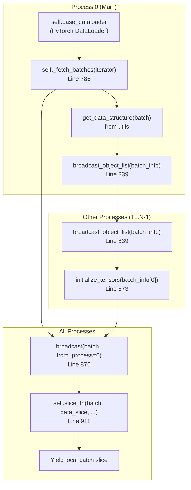
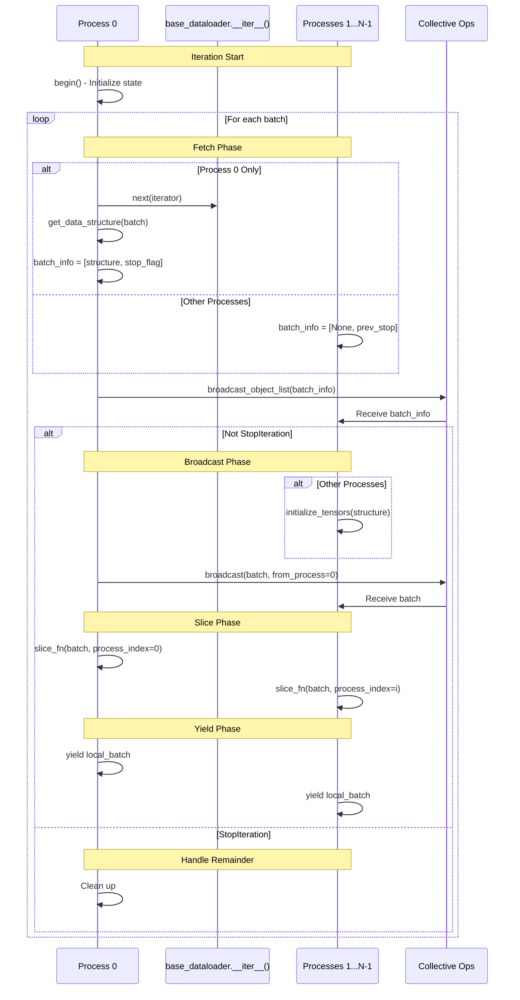
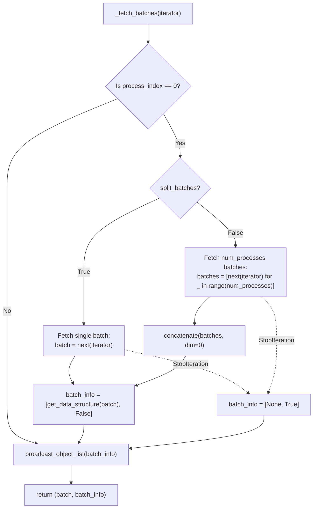

<!-- source: DeepWiki mcp.deepwiki.com · repo huggingface/accelerate · page 4.3 Dispatching Strategies · fetched 2026-10-21 -->

# Dispatching Strategies

<details>
<summary>Relevant source files</summary>

The following files were used as context for generating this wiki page:

- [src/accelerate/commands/config/update.py](src/accelerate/commands/config/update.py)
- [src/accelerate/commands/to_fsdp2.py](src/accelerate/commands/to_fsdp2.py)
- [src/accelerate/data_loader.py](src/accelerate/data_loader.py)
- [src/accelerate/test_utils/scripts/external_deps/test_peak_memory_usage.py](src/accelerate/test_utils/scripts/external_deps/test_peak_memory_usage.py)
- [src/accelerate/test_utils/scripts/test_distributed_data_loop.py](src/accelerate/test_utils/scripts/test_distributed_data_loop.py)
- [src/accelerate/test_utils/scripts/test_ops.py](src/accelerate/test_utils/scripts/test_ops.py)
- [src/accelerate/test_utils/scripts/test_script.py](src/accelerate/test_utils/scripts/test_script.py)
- [src/accelerate/test_utils/scripts/test_sync.py](src/accelerate/test_utils/scripts/test_sync.py)
- [src/accelerate/utils/operations.py](src/accelerate/utils/operations.py)
- [src/accelerate/utils/other.py](src/accelerate/utils/other.py)
- [tests/test_data_loader.py](tests/test_data_loader.py)
- [tests/test_utils.py](tests/test_utils.py)

</details>


## Purpose and Scope

This page documents the `DataLoaderDispatcher` class and the dispatching strategy for distributed data loading, where process 0 fetches batches and broadcasts them to all other processes. This contrasts with sharding ([Sharding Strategies](#4.2)), where each process independently iterates through its dataset partition.

Dispatching is used for iterable datasets (automatic default), expensive preprocessing operations, and tensor parallelism scenarios requiring identical batches across ranks. See [DataLoader Configuration and Preparation](#4.1) for prepare flow details and [Stateful DataLoaders and Resumption](#4.4) for checkpoint resumption.

---

## Overview: Dispatch vs Shard

When `prepare_data_loader()` is called, Accelerate selects between two data distribution strategies:

| Strategy | Class | Iteration Pattern | Use Case |
|----------|-------|-------------------|----------|
| **Sharding** | `DataLoaderShard` | Each process iterates independently through its assigned shard | Map-style datasets, efficient I/O, data parallelism |
| **Dispatching** | `DataLoaderDispatcher` | Process 0 fetches batches and broadcasts to all processes | Iterable datasets, centralized preprocessing, tensor parallelism |

The `dispatch_batches` parameter in `prepare_data_loader()` or `DataLoaderConfiguration` controls this choice. Dispatching is automatically enabled for `IterableDataset` instances [src/accelerate/data_loader.py:1093-1097]().

Sources: [src/accelerate/data_loader.py:704-976](), [src/accelerate/data_loader.py:996-1309]()

---

## DataLoaderDispatcher Architecture

### High-Level Component Structure



**Diagram: DataLoaderDispatcher Communication Pattern**

The `DataLoaderDispatcher` centralizes data fetching on process 0 via `_fetch_batches()`, then uses collective operations (`broadcast_object_list`, `broadcast`) to distribute batches. All processes receive identical data before slicing via `slice_fn`, ensuring consistency for tensor parallelism [src/accelerate/data_loader.py:852-926]().

Sources: [src/accelerate/data_loader.py:704-730](), [src/accelerate/data_loader.py:786-850](), [src/accelerate/data_loader.py:852-926]()

---

## Configuration and Initialization

### Enabling Dispatch Mode

Dispatching is controlled by the `dispatch_batches` parameter, which can be set in several ways:

**Method 1: Via `prepare_data_loader()`**
```python
from accelerate.data_loader import prepare_data_loader

dataloader = DataLoader(dataset, batch_size=32)
prepared_dl = prepare_data_loader(
    dataloader,
    dispatch_batches=True,  # Enable dispatching
    split_batches=False,    # Controls batch splitting behavior
    slice_fn_for_dispatch=None,  # Custom slicing function
    put_on_device=True,     # Required for dispatching
)
```

**Method 2: Via `DataLoaderConfiguration`**
```python
from accelerate import Accelerator
from accelerate.utils import DataLoaderConfiguration

config = DataLoaderConfiguration(dispatch_batches=True)
accelerator = Accelerator(dataloader_config=config)
dataloader = accelerator.prepare(dataloader)
```

**Method 3: Automatic (Default for IterableDataset)**
```python
# Automatically uses dispatch_batches=True
iterable_dataset = MyIterableDataset()
dataloader = DataLoader(iterable_dataset, batch_size=32)
accelerator = Accelerator()
prepared_dl = accelerator.prepare(dataloader)  # Uses DataLoaderDispatcher
```

Sources: [src/accelerate/data_loader.py:996-1012](), [src/accelerate/data_loader.py:1093-1097]()

### Configuration Parameters

| Parameter | Type | Default | Purpose |
|-----------|------|---------|---------|
| `dispatch_batches` | `bool` | Auto (True for IterableDataset) | Whether to use `DataLoaderDispatcher` |
| `split_batches` | `bool` | `False` | If True, fetch 1 batch and split; if False, fetch N batches and concatenate |
| `slice_fn_for_dispatch` | `Callable` | `slice_tensors` | Function to slice batches across processes (stored in `self.slice_fn`) |
| `put_on_device` | `bool` | `False` | Must be True when using `dispatch_batches` |

**Key Constraint**: `dispatch_batches=True` requires `put_on_device=True` because process 0 must move data to device before broadcasting (validated at lines 1099-1100) [src/accelerate/data_loader.py:1099-1100]().

Sources: [src/accelerate/data_loader.py:1099-1100](), [src/accelerate/data_loader.py:731-762]()

---

## Dispatching Iteration Flow

### Detailed Iteration Sequence



**Diagram: DataLoaderDispatcher Iteration Sequence**

Sources: [src/accelerate/data_loader.py:852-926](), [src/accelerate/data_loader.py:786-850]()

### The `_fetch_batches()` Method

The `_fetch_batches()` method [src/accelerate/data_loader.py:786-850]() implements the core logic for fetching batches on process 0:



**Diagram: _fetch_batches() Logic Flow**

**Key Behaviors**:

1. **`split_batches=True`** [src/accelerate/data_loader.py:799](): Process 0 fetches ONE batch via `next(iterator)` [src/accelerate/data_loader.py:807](), which is split across all processes.
2. **`split_batches=False`** [src/accelerate/data_loader.py:799](): Process 0 fetches `num_processes` batches [src/accelerate/data_loader.py:818](), concatenates via `concatenate(batches, dim=0)` [src/accelerate/data_loader.py:822](), then splits.
3. **Tensor Parallelism Mode** [src/accelerate/data_loader.py:812](): When `self.submesh_tp` exists, fetch ONE batch and replicate it `num_processes` times [src/accelerate/data_loader.py:816]() instead of fetching multiple distinct batches.

Sources: [src/accelerate/data_loader.py:786-850](), [src/accelerate/data_loader.py:799-829]()

---

## Tensor Parallelism and Device Mesh Support

The `DataLoaderDispatcher` extracts submeshes from `torch_device_mesh` to support multi-dimensional parallelism [src/accelerate/data_loader.py:764-784]().

**Tensor Parallelism Behavior**:
When `self.submesh_tp` is set, `_fetch_batches()` ensures all TP ranks receive identical batches by replicating a single fetched batch across all ranks in the group [src/accelerate/data_loader.py:812-816]().

**Current Limitations**:
Combining TP with DP or FSDP in dispatch mode is not yet supported and will raise a `ValueError` [src/accelerate/data_loader.py:783-784]().

Sources: [src/accelerate/data_loader.py:764-784](), [src/accelerate/data_loader.py:812-829](), [src/accelerate/data_loader.py:783-784]()

---

## Custom Slice Functions

By default, dispatching uses `slice_tensors` from `accelerate.utils` to split batches. You can provide a custom `slice_fn_for_dispatch` for non-standard data structures [src/accelerate/data_loader.py:761]().

The slice function is applied at line 911 in the `__iter__` method:
```python
batch = self.slice_fn(
    batch,
    data_slice,
    process_index=self.state.process_index,
    num_processes=self.state.num_processes,
)
```

Sources: [src/accelerate/data_loader.py:761](), [src/accelerate/data_loader.py:910-916]()

---

## Performance Considerations

**Advantages**:
- ✅ Centralized preprocessing on process 0.
- ✅ Critical for Tensor Parallelism consistency.
- ✅ Required for `IterableDataset`.

**Disadvantages**:
- ❌ Communication overhead from `broadcast` [src/accelerate/data_loader.py:876]().
- ❌ Potential bottleneck on process 0 if preprocessing is extremely heavy.

Sources: [src/accelerate/data_loader.py:704-730](), [src/accelerate/data_loader.py:876]()

---

