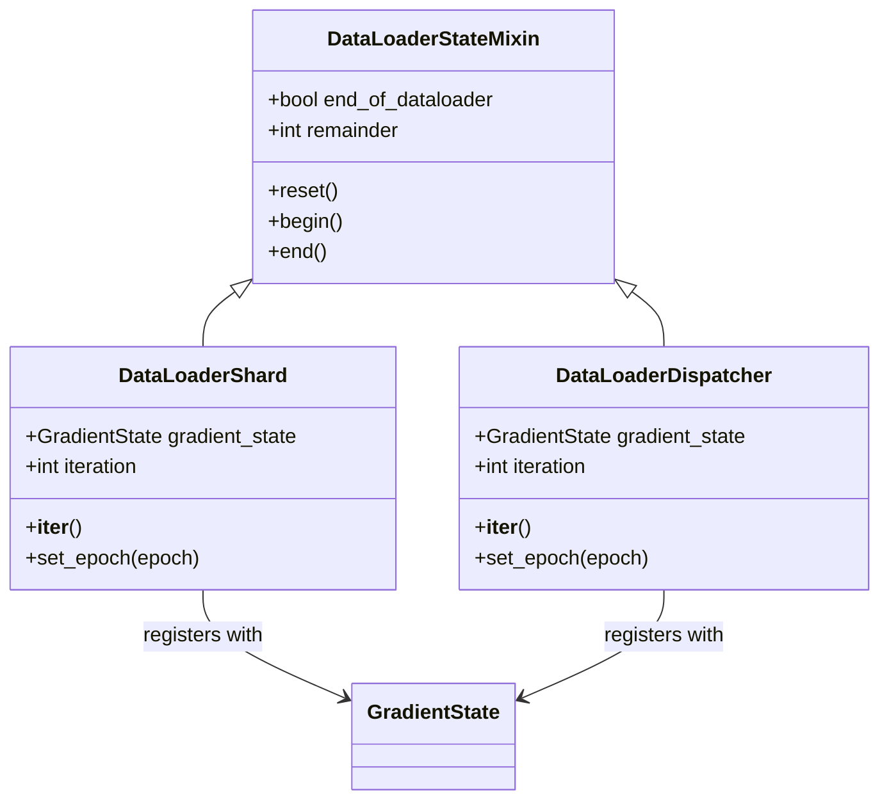
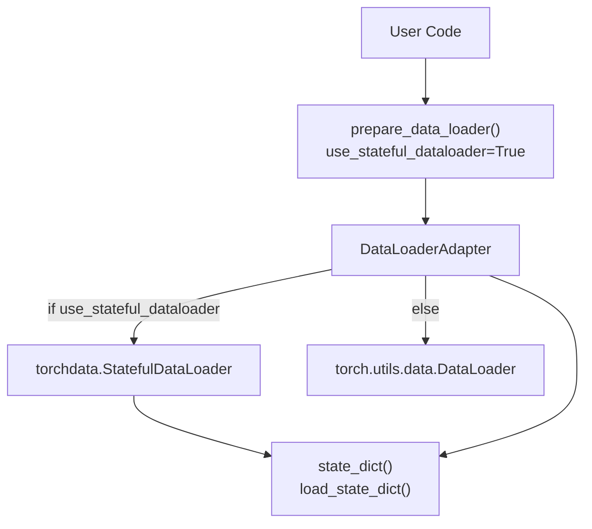
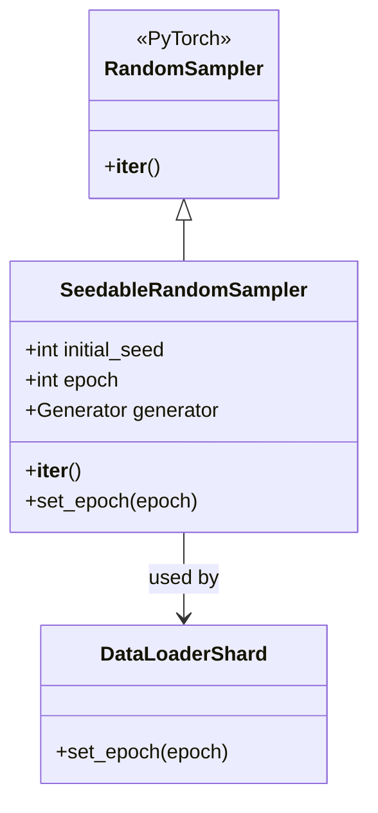
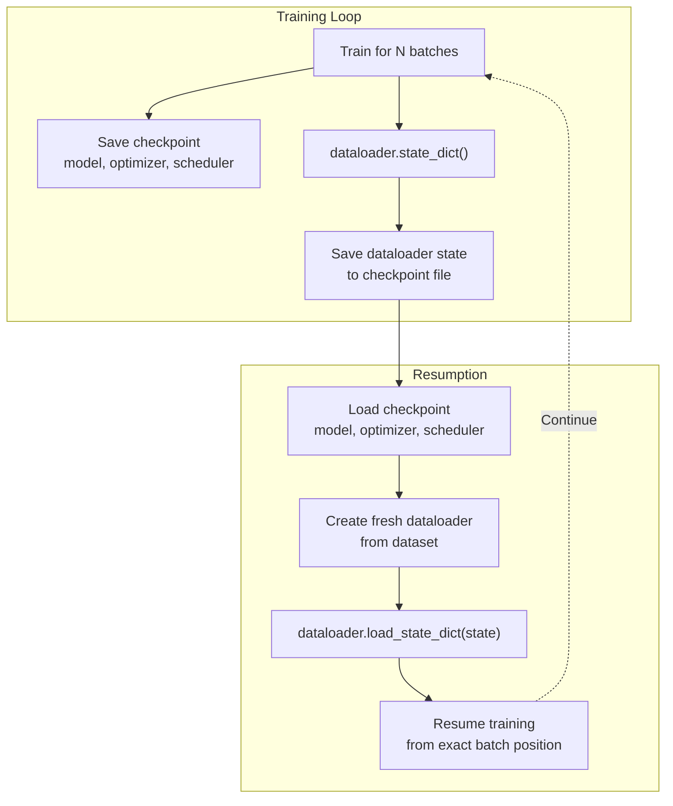
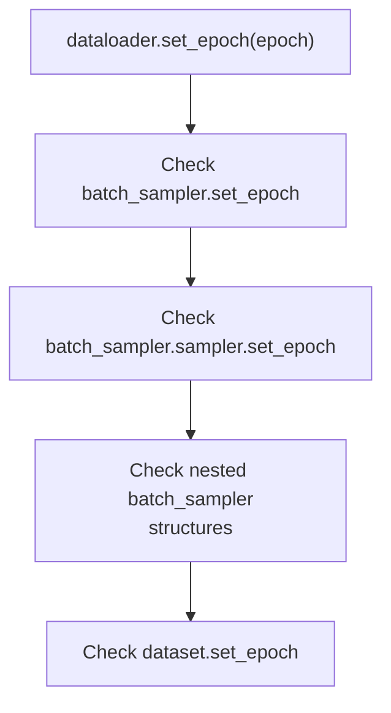

<!-- source: DeepWiki mcp.deepwiki.com · repo huggingface/accelerate · page 4.4 Stateful DataLoaders and Resumption · fetched 2026-10-21 -->

# Stateful DataLoaders and Resumption

<details>
<summary>Relevant source files</summary>

The following files were used as context for generating this wiki page:

- [src/accelerate/checkpointing.py](src/accelerate/checkpointing.py)
- [src/accelerate/commands/env.py](src/accelerate/commands/env.py)
- [src/accelerate/data_loader.py](src/accelerate/data_loader.py)
- [src/accelerate/test_utils/scripts/external_deps/test_peak_memory_usage.py](src/accelerate/test_utils/scripts/external_deps/test_peak_memory_usage.py)
- [src/accelerate/test_utils/scripts/test_distributed_data_loop.py](src/accelerate/test_utils/scripts/test_distributed_data_loop.py)
- [src/accelerate/test_utils/scripts/test_script.py](src/accelerate/test_utils/scripts/test_script.py)
- [src/accelerate/test_utils/scripts/test_sync.py](src/accelerate/test_utils/scripts/test_sync.py)
- [src/accelerate/utils/memory.py](src/accelerate/utils/memory.py)
- [src/accelerate/utils/random.py](src/accelerate/utils/random.py)
- [tests/test_data_loader.py](tests/test_data_loader.py)
- [tests/test_state_checkpointing.py](tests/test_state_checkpointing.py)

</details>


This page documents Accelerate's system for preserving and restoring dataloader state to enable training resumption at arbitrary points, including mid-epoch. This includes state dictionary serialization, seedable random sampling for reproducibility, and batch-skipping utilities.

For information about dataloader preparation and configuration parameters, see [DataLoader Configuration and Preparation](). For details on data distribution across processes, see [Sharding Strategies]() and [Dispatching Strategies](). For checkpoint management of models and optimizers, see [Saving and Loading State]().

---

## Overview of State Management

Accelerate's dataloader wrappers track iteration state to enable precise resumption. This state includes:

- **Batch position**: Which batch within the current epoch.
- **Sample yielding counters**: Internal tracking of samples processed.
- **Sampler state**: RNG state for shuffling operations.
- **End-of-dataloader status**: Whether the last batch has been reached.
- **Remainder tracking**: Number of samples in incomplete final batches.

State persistence enables:
- Resuming training from any checkpoint without data duplication.
- Reproducible shuffling across training runs.
- Skipping already-processed batches efficiently.

Sources: [src/accelerate/data_loader.py:365-406]()

---

## DataLoaderStateMixin

The `DataLoaderStateMixin` [365-406]() provides state tracking capabilities to dataloader classes. Both `DataLoaderShard` [500-649]() and `DataLoaderDispatcher` [704-976]() inherit from this mixin.



**Diagram: DataLoaderStateMixin Architecture**

### Key Attributes

| Attribute | Type | Description |
|-----------|------|-------------|
| `end_of_dataloader` | `bool` | Set to `True` when yielding the final batch [370](). |
| `remainder` | `int` | Number of items in the last batch relative to full batch size [371](). |
| `gradient_state` | `GradientState` | Shared gradient accumulation state singleton [372](). |

### Lifecycle Methods

**`begin()`** [394-401](): Called at the start of iteration.
- Resets `end_of_dataloader` and `remainder` flags.
- Computes remainder for incomplete final batches using `total_dataset_length` [399]().
- Registers the dataloader with `GradientState` for gradient accumulation coordination via `_add_dataloader` [401]().

**`end()`** [403-405](): Called when iteration completes.
- Unregisters the dataloader from `GradientState` via `_remove_dataloader` [405]().

**`reset()`** [390-392](): Resets state flags to initial values.

Sources: [src/accelerate/data_loader.py:365-406](), [src/accelerate/data_loader.py:500-649](), [src/accelerate/data_loader.py:704-976]()

---

## StatefulDataLoader Integration

When `use_stateful_dataloader=True`, Accelerate leverages `torchdata.StatefulDataLoader` if available [37-41](). This provides native state persistence through the `torchdata` library.



**Diagram: StatefulDataLoader Selection Path**

### DataLoaderAdapter State Methods

The `DataLoaderAdapter` class [408-498]() provides a unified interface for state management:

**`state_dict()`** [445-446](): Returns the current state dictionary. It delegates to the underlying `base_dataloader.state_dict()` [446]().

**`load_state_dict(state_dict)`** [448-449](): Restores state from a dictionary by calling `base_dataloader.load_state_dict(state_dict)` [449]().

**`_update_state_dict()`** [486-497](): Internal method called during iteration.
- Snapshots the current state after yielding each batch.
- Adjusts for prefetching with `adjust_state_dict_for_prefetch()` [492]().
- Sets `_iterator_finished` flag to `True` if the end is reached [496]().

### Prefetch Adjustment

In distributed training, the internal state of a dataloader is typically one batch ahead due to prefetching. The `adjust_state_dict_for_prefetch()` method [463-484]() corrects this by subtracting the process factor:

```python
# Adjusts counters by (num_processes - 1) during DDP
factor = PartialState().num_processes - 1
dl_state_dict["_sampler_iter_yielded"] -= factor
dl_state_dict["_num_yielded"] -= factor
```

Sources: [src/accelerate/data_loader.py:408-498](), [src/accelerate/data_loader.py:463-484]()

---

## SeedableRandomSampler

`SeedableRandomSampler` [73-108]() extends PyTorch's `RandomSampler` to enable reproducible shuffling across training runs. It maintains an internal epoch counter to modify the random seed at each iteration.



**Diagram: SeedableRandomSampler Class Hierarchy**

### Implementation Details

**Initialization** [84-89]():
- Accepts optional `data_seed`.
- Falls back to `torch.random.initial_seed()` if not provided [88]().
- Initializes `epoch` counter to 0 [89]().

**Iteration** [91-103]():
- Creates a `torch.Generator` if not present [93]().
- Computes effective seed: `seed = self.epoch + self.initial_seed` [99]().
- Manually seeds the generator before yielding indices [101]().
- Auto-increments epoch after yielding all samples [103]().

**Epoch Control** [105-107]():
- `set_epoch(epoch)` allows external management of the iteration counter, critical for multi-epoch resumption.

### Usage with prepare_data_loader

Enable seedable sampling via the `use_seedable_sampler` parameter in `prepare_data_loader` [1176-1191](). The function automatically replaces `RandomSampler` instances with `SeedableRandomSampler` [1185]().

Sources: [src/accelerate/data_loader.py:73-108](), [src/accelerate/data_loader.py:1176-1191](), [src/accelerate/test_utils/scripts/test_script.py:57-70]()

---

## Batch Skipping for Training Resumption

Accelerate provides utilities for skipping already-processed batches when resuming training mid-epoch.

### SkipBatchSampler

A `BatchSampler` wrapper [1312-1333]() that skips the first `n` batches.

```python
class SkipBatchSampler(BatchSampler):
    def __init__(self, batch_sampler, skip_batches=0):
        self.batch_sampler = batch_sampler
        self.skip_batches = skip_batches
    
    def __iter__(self):
        for index, samples in enumerate(self.batch_sampler):
            if index >= self.skip_batches:
                yield samples
```

Sources: [src/accelerate/data_loader.py:1312-1333]()

### SkipDataLoader

A `DataLoader` subclass [1335-1373]() that skips batches during iteration, specifically useful for `IterableDataset` [1365]().

Sources: [src/accelerate/data_loader.py:1335-1373]()

### skip_first_batches Utility

The recommended approach for skipping batches [1375-1411](). It creates an efficient wrapper without modifying the original dataloader.

**Implementation Logic** [1389-1411]():
- For XLA (TPU): Extracts and wraps the underlying dataloader [1390]().
- For map-style datasets: Uses `SkipBatchSampler` to wrap the existing sampler [1398]().
- For iterable datasets: Uses `SkipDataLoader` [1408]().

Sources: [src/accelerate/data_loader.py:1375-1411]()

---

## State Persistence Workflow

### Complete Save/Load Cycle



**Diagram: Complete State Persistence Workflow**

### Checkpointing Support

The `save_accelerator_state` function [63-180] in `checkpointing.py` handles dataloader persistence:
- It iterates through `dataloaders` [131]().
- If `use_stateful_dataloader` is True, it saves the `state_dict()` to `dl_state_dict.bin` [141-145]().
- If using `SeedableRandomSampler`, it saves the sampler state to `sampler.bin` [138-140]().

Sources: [src/accelerate/checkpointing.py:63-180](), [src/accelerate/checkpointing.py:131-146]()

### set_epoch Propagation

`DataLoaderShard.set_epoch(epoch)` [603-621]() propagates epoch information through the sampling hierarchy:



**Diagram: set_epoch Propagation Path**

This ensures that:
- `SeedableRandomSampler` uses the correct epoch for seeding [610]().
- Custom samplers or datasets with `set_epoch` methods are correctly updated [618]().

Sources: [src/accelerate/data_loader.py:603-621]()

---

## End-of-Dataloader Detection

Both `DataLoaderShard` and `DataLoaderDispatcher` provide accurate end-of-dataloader detection through the `end_of_dataloader` flag.

### DataLoaderShard Detection

The flag is set in the `__iter__` method [558-592]() by iterating one batch ahead to detect exhaustion:

```python
try:
    next_batch = next(dataloader_iter)
    # ... yield current ...
except StopIteration:
    self.end_of_dataloader = True
    self._update_state_dict()
    # ... yield final ...
```

### Usage Example

```python
for batch in dataloader:
    # Training step
    if dataloader.end_of_dataloader:
        # Perform end-of-epoch logic
        pass
```

Sources: [src/accelerate/data_loader.py:558-592](), [src/accelerate/data_loader.py:370]()

---

## Summary Table

| Component | Purpose | Key Methods/Attributes |
|-----------|---------|----------------------|
| `DataLoaderStateMixin` | State tracking mixin | `end_of_dataloader`, `remainder`, `begin()`, `end()` |
| `DataLoaderAdapter` | State persistence wrapper | `state_dict()`, `load_state_dict()`, `_update_state_dict()` |
| `SeedableRandomSampler` | Reproducible shuffling | `initial_seed`, `epoch`, `set_epoch()` |
| `SkipBatchSampler` | Skip first N batches | `skip_batches`, `__iter__()` |
| `SkipDataLoader` | DataLoader with skipping | `skip_batches`, `__iter__()` |
| `skip_first_batches()` | Utility for batch skipping | Returns wrapped dataloader |

Sources: [src/accelerate/data_loader.py:1-1411]()

---

