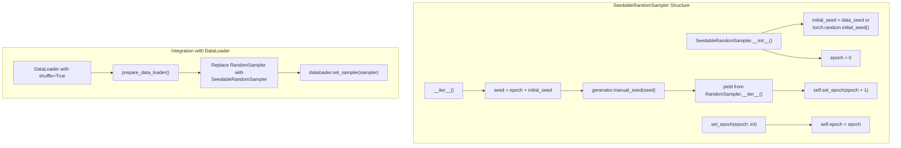
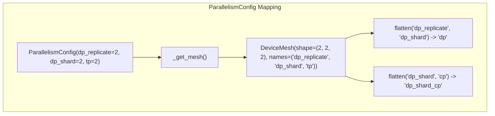
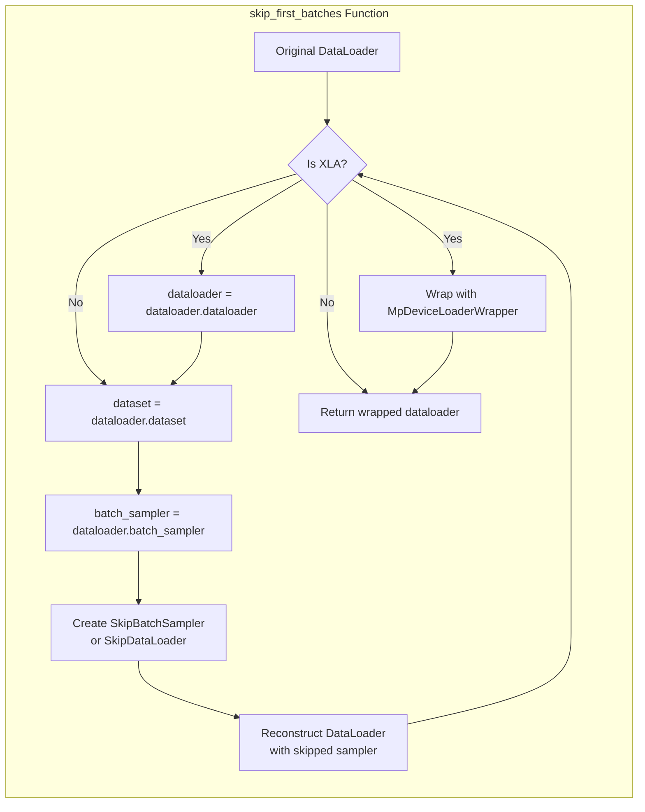
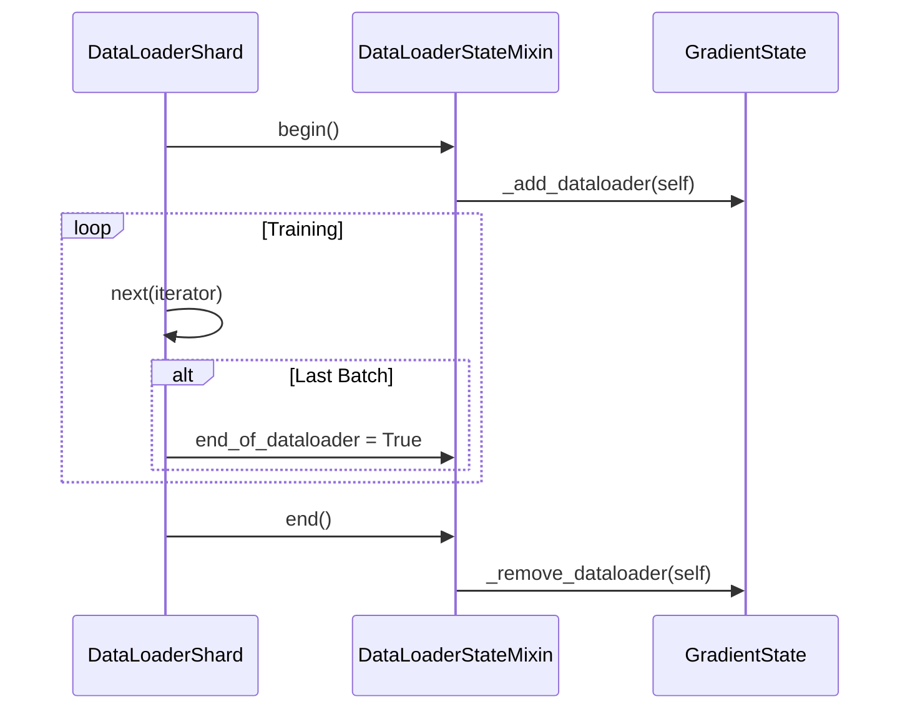

<!-- source: DeepWiki mcp.deepwiki.com · repo huggingface/accelerate · page 4.5 Special Cases and Utilities · fetched 2026-10-21 -->

# Special Cases and Utilities

<details>
<summary>Relevant source files</summary>

The following files were used as context for generating this wiki page:

- [src/accelerate/data_loader.py](src/accelerate/data_loader.py)
- [src/accelerate/parallelism_config.py](src/accelerate/parallelism_config.py)
- [src/accelerate/test_utils/scripts/external_deps/test_peak_memory_usage.py](src/accelerate/test_utils/scripts/external_deps/test_peak_memory_usage.py)
- [src/accelerate/test_utils/scripts/test_distributed_data_loop.py](src/accelerate/test_utils/scripts/test_distributed_data_loop.py)
- [src/accelerate/test_utils/scripts/test_script.py](src/accelerate/test_utils/scripts/test_script.py)
- [src/accelerate/test_utils/scripts/test_sync.py](src/accelerate/test_utils/scripts/test_sync.py)
- [tests/test_data_loader.py](tests/test_data_loader.py)
- [tests/test_dataclasses.py](tests/test_dataclasses.py)

</details>


## Purpose and Scope

This page documents special utilities and edge case handlers for distributed data loading and parallelism configuration in Accelerate. These utilities address common challenges such as reproducible shuffling across processes, resuming training from checkpoints, tracking dataloader state, and configuring complex device meshes for advanced parallelism strategies (TP, CP, SP).

For core dataloader preparation and sharding strategies, see [DataLoader Configuration and Preparation](#4.1) and [Sharding Strategies](#4.2). For stateful checkpoint resumption with `StatefulDataLoader`, see [Stateful DataLoaders and Resumption](#4.4).

---

## SeedableRandomSampler

The `SeedableRandomSampler` provides reproducible shuffling across multiple processes and training epochs. Unlike PyTorch's standard `RandomSampler`, it maintains an internal epoch counter that modifies the random seed, ensuring that all processes generate identical shuffled indices when given the same initial seed.

### Key Features

| Feature | Description |
|---------|-------------|
| **Epoch-based seeding** | Combines `data_seed` with current epoch number for reproducibility |
| **Cross-process consistency** | All processes use the same random state when initialized with same seed |
| **Generator tracking** | Maintains a `torch.Generator` instance with predictable state |

### Architecture



**Sources:** [src/accelerate/data_loader.py:73-108]()

### Usage Pattern

The sampler is automatically used when `use_seedable_sampler=True` is set in `DataLoaderConfiguration`:

```python
from accelerate import Accelerator, DataLoaderConfiguration

config = DataLoaderConfiguration(use_seedable_sampler=True, data_seed=42)
accelerator = Accelerator(dataloader_config=config)
```

The `prepare_data_loader()` function detects `RandomSampler` instances and replaces them with `SeedableRandomSampler` when requested:

**Sources:** [src/accelerate/data_loader.py:1175-1191]()

---

## Parallelism Config and Device Mesh

Accelerate introduces `ParallelismConfig` to manage multi-dimensional parallelism (Data, Tensor, Context, and Sequence Parallelism). This configuration is used to build a `torch.distributed.device_mesh.DeviceMesh`, which defines how the cluster is partitioned for different communication groups.

### Parallelism Dimensions

| Dimension | Config Attribute | Mesh Name | Description |
|-----------|------------------|-----------|-------------|
| **Data Parallel (Replication)** | `dp_replicate_size` | `dp_replicate` | Standard DDP/HSDP replication. |
| **Data Parallel (Sharding)** | `dp_shard_size` | `dp_shard` | FSDP-style sharding. |
| **Tensor Parallel** | `tp_size` | `tp` | Model parameter sharding across devices. |
| **Context Parallel** | `cp_size` | `cp` | Sharding sequence length for long-context training. |
| **Sequence Parallel** | `sp_size` | `sp` | DeepSpeed-style sequence parallelism. |

### Device Mesh Mapping

The `ParallelismConfig` maps these dimensions into a hierarchical device mesh.



**Sources:** [src/accelerate/parallelism_config.py:34-83](), [src/accelerate/parallelism_config.py:114-165]()

### Implementation Details

The `build_device_mesh` method initializes the mesh and applies necessary flattening for different distributed paradigms (e.g., flattening `dp_replicate` and `dp_shard` into a single `dp` dimension for loss averaging).

**Sources:** [src/accelerate/parallelism_config.py:203-247](), [tests/test_dataclasses.py:146-180]()

---

## XLA-specific MpDeviceLoaderWrapper

For TPU (XLA) environments, Accelerate uses the `MpDeviceLoaderWrapper` to handle asynchronous data loading onto the TPU device. This wrapper ensures that the `end_of_dataloader` and `remainder` state from Accelerate's shards are correctly propagated to the XLA runtime.

**Sources:** [src/accelerate/data_loader.py:1108-1130](), [src/accelerate/data_loader.py:1210-1215]()

---

## Skipping Batches

When resuming training from a checkpoint mid-epoch, you need to skip batches that were already processed. Accelerate provides multiple utilities for this purpose, with different trade-offs.

### skip_first_batches()

The simplest utility for skipping batches. It wraps a dataloader with `SkipDataLoader` internally.



**Sources:** [src/accelerate/data_loader.py:1375-1404]()

---

## DataLoader State Tracking

The `DataLoaderStateMixin` provides state tracking capabilities for dataloaders, essential for gradient accumulation and detecting the end of iterations.

### DataLoaderStateMixin Attributes

| Attribute | Type | Description |
|-----------|------|-------------|
| `end_of_dataloader` | `bool` | `True` when on the last batch, `False` otherwise |
| `remainder` | `int` | Number of samples in last incomplete batch (relative to total batch size) |
| `gradient_state` | `GradientState` | Shared gradient accumulation state instance |

### Integration with GradientState

The mixin interacts with `GradientState` to ensure gradient synchronization happens correctly even if the dataloader ends before a full accumulation cycle is complete.



**Sources:** [src/accelerate/data_loader.py:365-406](), [src/accelerate/data_loader.py:390-406]()

---

## DataLoader Adaptation Pattern

The `DataLoaderAdapter` class provides the base pattern for wrapping PyTorch `DataLoader` instances with additional functionality while maintaining compatibility.

### Key Design Patterns

#### 1. Attribute Delegation
The adapter delegates all attribute access to the wrapped `base_dataloader`, making it transparent to user code.
**Sources:** [src/accelerate/data_loader.py:438-443]()

#### 2. Class Masquerading
The `__class__` property override ensures `isinstance()` checks work correctly:
```python
@property
def __class__(self):
    return self.base_dataloader.__class__
```
**Sources:** [src/accelerate/data_loader.py:452-459]()

#### 3. State Dict Support
For `StatefulDataLoader` integration, the adapter provides methods to capture and restore iteration state.
**Sources:** [src/accelerate/data_loader.py:445-498]()

---

## Summary

The special utilities in Accelerate's data loading and parallelism system provide:

1. **Multi-dimensional Parallelism**: `ParallelismConfig` and `DeviceMesh` support for advanced distributed strategies.
2. **Reproducibility**: `SeedableRandomSampler` ensures consistent shuffling across processes and epochs.
3. **Checkpoint Resumption**: `skip_first_batches` and stateful dataloader support for mid-epoch resumption.
4. **State Tracking**: `DataLoaderStateMixin` and `GradientState` integration for correct gradient synchronization.
5. **Hardware Portability**: XLA-specific wrappers for seamless TPU support.

These utilities work together to make distributed training transparent, efficient, and resumable across diverse hardware and parallelism configurations.

---

