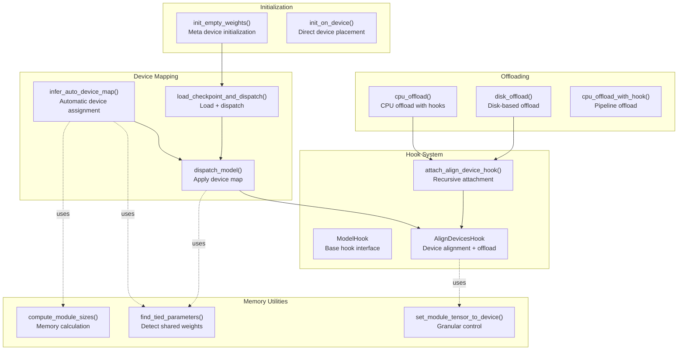
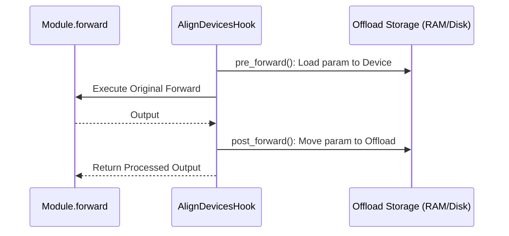

<!-- source: DeepWiki mcp.deepwiki.com · repo huggingface/accelerate · page 5 Big Model Support · fetched 2026-10-21 -->

# Big Model Support

<details>
<summary>Relevant source files</summary>

The following files were used as context for generating this wiki page:

- [docs/source/basic_tutorials/install.md](docs/source/basic_tutorials/install.md)
- [docs/source/basic_tutorials/launch.md](docs/source/basic_tutorials/launch.md)
- [docs/source/basic_tutorials/migration.md](docs/source/basic_tutorials/migration.md)
- [docs/source/basic_tutorials/notebook.md](docs/source/basic_tutorials/notebook.md)
- [docs/source/quicktour.md](docs/source/quicktour.md)
- [docs/source/usage_guides/big_modeling.md](docs/source/usage_guides/big_modeling.md)
- [docs/source/usage_guides/quantization.md](docs/source/usage_guides/quantization.md)
- [src/accelerate/big_modeling.py](src/accelerate/big_modeling.py)
- [src/accelerate/hooks.py](src/accelerate/hooks.py)
- [src/accelerate/utils/modeling.py](src/accelerate/utils/modeling.py)
- [tests/test_big_modeling.py](tests/test_big_modeling.py)
- [tests/test_hooks.py](tests/test_hooks.py)
- [tests/test_modeling_utils.py](tests/test_modeling_utils.py)

</details>


The Big Model Support system enables training and inference with models that exceed single-device memory capacity. This is achieved through memory-efficient initialization, dynamic weight loading/offloading, and intelligent device mapping. The system provides both high-level utilities for automatic device placement and low-level hooks for fine-grained control.

For distributed training configurations (FSDP, DeepSpeed), see [Distributed Training Backends](#3). For standard model preparation in distributed environments, see [The Accelerator Class](#2).

## Overview and Architecture

The big modeling system consists of three primary components working together:

**System Component Map**

Sources: [src/accelerate/big_modeling.py:61-641](), [src/accelerate/utils/modeling.py:1143-1458](), [src/accelerate/hooks.py:58-202]()

## Memory-Efficient Initialization

### Meta Device Initialization

The `init_empty_weights()` context manager creates models on the meta device, allowing instantiation of models with billions of parameters without allocating memory. It effectively patches `torch.nn.Module.register_parameter` and `torch.nn.Module.register_buffer` to redirect allocations. [src/accelerate/big_modeling.py:61-94]()

**Entity Flow: Initializing on Meta Device**
```mermaid
graph LR
    User["User Code"] --> Context["init_empty_weights()"]
    Context --> Patch["init_on_device(meta)"]
    Patch --> Reg["register_empty_parameter()"]
    Reg --> Create["nn.Module._parameters"]
    Create --> MetaParams["torch.device('meta')"]
    
    Context -.optional. --> PatchBuf["register_empty_buffer()"]
    PatchBuf --> MetaBuf["torch.device('meta')"]
```

**Basic Usage:**
```python
from accelerate import init_empty_weights
with init_empty_weights():
    model = nn.Sequential(*[nn.Linear(10000, 10000) for _ in range(1000)])
```

Sources: [src/accelerate/big_modeling.py:61-94](), [src/accelerate/big_modeling.py:97-172](), [tests/test_big_modeling.py:163-195]()

### Device-Specific Initialization

The `init_on_device()` context manager initializes models directly on a target device, avoiding CPU intermediates. This is used internally by `init_empty_weights` with `device="meta"`. [src/accelerate/big_modeling.py:97-171]()

| Parameter | Type | Description |
|-----------|------|-------------|
| `device` | `torch.device` | Target device for initialization |
| `include_buffers` | `bool` | Whether to place buffers on device (default: False) |

For details, see [Initialization and Loading](#5.1).

Sources: [src/accelerate/big_modeling.py:97-171](), [tests/test_big_modeling.py:196-203]()

## Device Mapping and Model Dispatching

### Automatic Device Map Inference

The `infer_auto_device_map()` function computes optimal device placement by analyzing model sizes and available hardware memory. It utilizes `compute_module_sizes` to estimate requirements. [src/accelerate/utils/modeling.py:1143-1458]()

**Device Map Rules:**
1. Tied parameters (found via `find_tied_parameters`) remain on the same device. [src/accelerate/utils/modeling.py:1260-1264]()
2. Modules in `no_split_module_classes` are never split across devices. [src/accelerate/utils/modeling.py:1330-1335]()
3. Memory limits provided in `max_memory` are strictly respected. [src/accelerate/utils/modeling.py:1248-1258]()

Sources: [src/accelerate/utils/modeling.py:1143-1458](), [tests/test_modeling_utils.py:554-673]()

### Dispatching Models

The `dispatch_model()` function applies a device map to a model. If the model is spread across multiple devices, it attaches `AlignDevicesHook` to the relevant submodules. [src/accelerate/big_modeling.py:310-511]()

Special device types in `device_map`:
- `"cpu"`: Offloads to RAM.
- `"disk"`: Offloads to a specified directory using `OffloadedWeightsLoader`. [src/accelerate/big_modeling.py:408-412]()

For details, see [Device Mapping and Inference](#5.2).

Sources: [src/accelerate/big_modeling.py:310-511](), [tests/test_big_modeling.py:317-353]()

### Load and Dispatch Workflow

`load_checkpoint_and_dispatch()` is the recommended high-level entry point. It handles sharded checkpoints, memory mapping, and model dispatching in one call. [src/accelerate/big_modeling.py:513-651]()

Sources: [src/accelerate/big_modeling.py:513-651](), [tests/test_big_modeling.py:820-886]()

## Memory Offloading Strategies

### CPU Offloading

The `cpu_offload()` function activates full CPU offload for a model. Only one copy of the state dict is kept in RAM. During forward, parameters are moved to the `execution_device` as needed. [src/accelerate/big_modeling.py:174-217]()

### Disk Offloading

The `disk_offload()` function stores parameters as memory-mapped arrays on disk to minimize RAM usage. It relies on `offload_state_dict` to write weights and `OffloadedWeightsLoader` to retrieve them. [src/accelerate/big_modeling.py:264-308]()

For details, see [Memory Offloading Strategies](#5.3).

Sources: [src/accelerate/big_modeling.py:174-308](), [src/accelerate/utils/offload.py:47-47]()

## Hook System Architecture

The `ModelHook` system intercepts the `forward` pass to manage weight movement.

| Class | Role |
|-------|------|
| `ModelHook` | Base interface for `pre_forward` and `post_forward`. [src/accelerate/hooks.py:58-114]() |
| `AlignDevicesHook` | Moves weights to `execution_device` before forward, offloads if requested. [src/accelerate/hooks.py:227-414]() |
| `SequentialHook` | Chains multiple hooks together. [src/accelerate/hooks.py:116-145]() |

**Hook Execution Lifecycle**


For details, see [Hook System Architecture](#5.4).

Sources: [src/accelerate/hooks.py:58-414](), [tests/test_hooks.py:55-175]()

## Tied Parameters and Memory Optimization

Accelerate provides utilities to detect and handle shared weights (e.g., embedding and LM head).

- `find_tied_parameters(model)`: Identifies parameters sharing the same storage pointer. [src/accelerate/utils/modeling.py:554-607]()
- `retie_parameters(model, tied_params)`: Re-links parameters after they have been moved to new devices or initialized. [src/accelerate/utils/modeling.py:609-638]()
- `set_module_tensor_to_device()`: Low-level utility to move specific tensors while respecting tied parameter maps. [src/accelerate/utils/modeling.py:217-425]()

For details, see [Tied Parameters and Memory Optimization](#5.5).

Sources: [src/accelerate/utils/modeling.py:217-638](), [tests/test_modeling_utils.py:256-284]()

---

