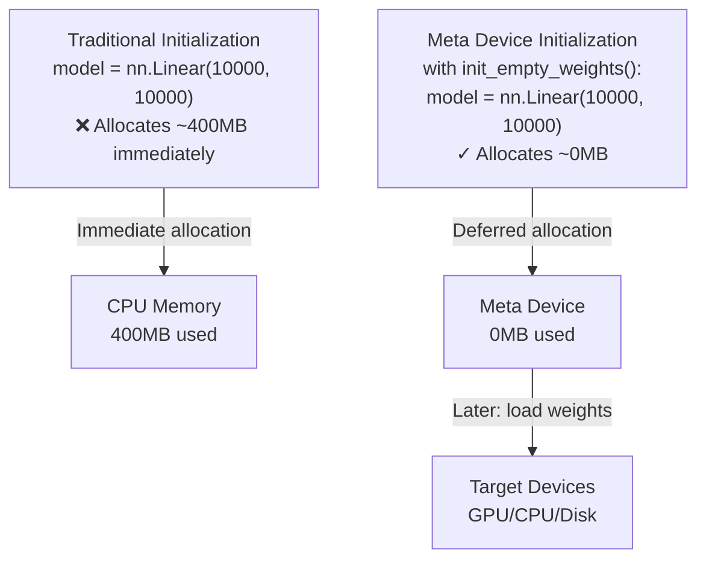
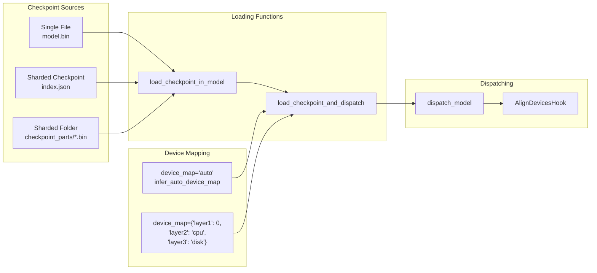
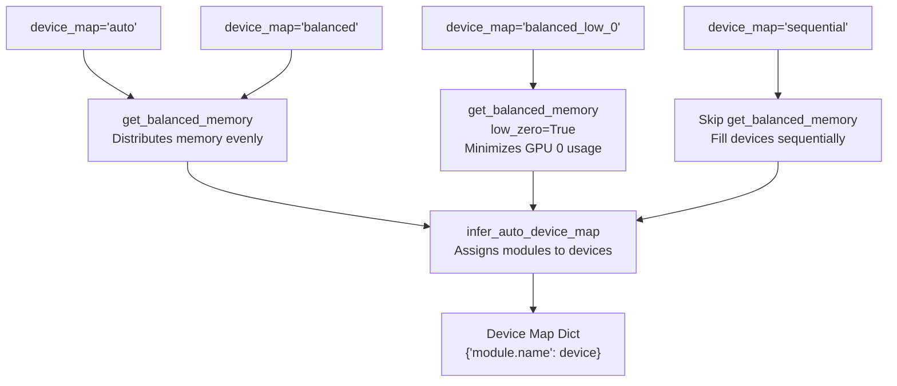
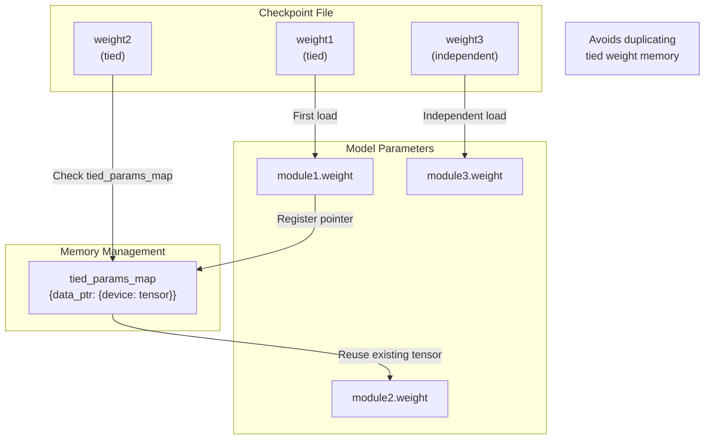
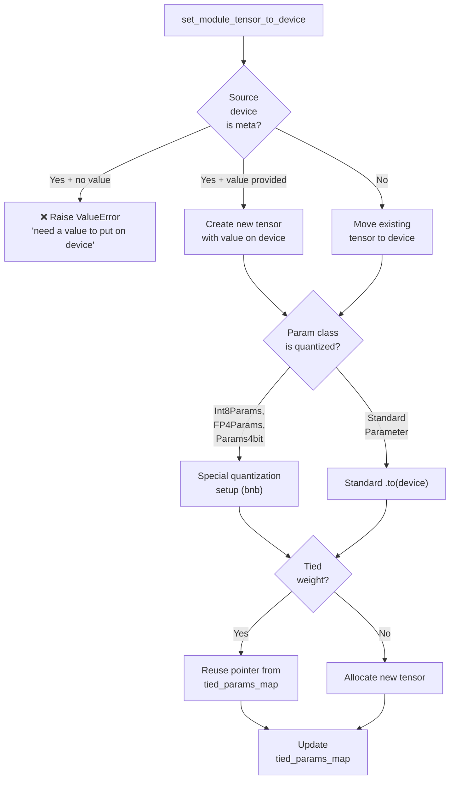
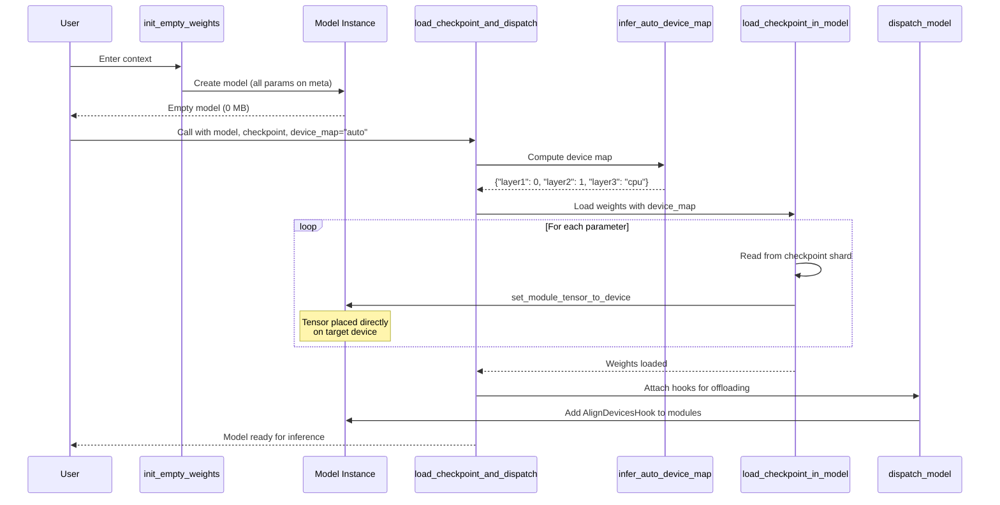

<!-- source: DeepWiki mcp.deepwiki.com · repo huggingface/accelerate · page 5.1 Initialization and Loading · fetched 2026-10-21 -->

# Initialization and Loading

<details>
<summary>Relevant source files</summary>

The following files were used as context for generating this wiki page:

- [docs/source/usage_guides/gradient_accumulation.md](docs/source/usage_guides/gradient_accumulation.md)
- [examples/by_feature/gradient_accumulation_for_autoregressive_models.py](examples/by_feature/gradient_accumulation_for_autoregressive_models.py)
- [src/accelerate/big_modeling.py](src/accelerate/big_modeling.py)
- [src/accelerate/hooks.py](src/accelerate/hooks.py)
- [src/accelerate/test_utils/scripts/external_deps/test_ds_alst_ulysses_sp.py](src/accelerate/test_utils/scripts/external_deps/test_ds_alst_ulysses_sp.py)
- [src/accelerate/test_utils/training.py](src/accelerate/test_utils/training.py)
- [src/accelerate/utils/modeling.py](src/accelerate/utils/modeling.py)
- [tests/test_big_modeling.py](tests/test_big_modeling.py)
- [tests/test_hooks.py](tests/test_hooks.py)
- [tests/test_load_checkpoint_and_dispatch_with_broadcast.py](tests/test_load_checkpoint_and_dispatch_with_broadcast.py)
- [tests/test_modeling_utils.py](tests/test_modeling_utils.py)

</details>


This document covers memory-efficient model initialization and checkpoint loading strategies for models that exceed single-device memory capacity. These utilities allow you to create and load large models without running out of memory by using meta devices, deferred initialization, and automatic device mapping.

**Scope**: This page focuses on the initialization context managers (`init_empty_weights`, `init_on_device`) and checkpoint loading functions (`load_checkpoint_and_dispatch`, `load_checkpoint_in_model`). For information about dispatching already-loaded models across devices, see [Device Mapping and Inference](#5.2). For hook-based offloading strategies, see [Hook System Architecture](#5.4).

---

## Memory-Efficient Model Initialization

### The Meta Device Problem

Creating large models directly in memory requires allocating space for all parameters immediately, which can exhaust available RAM before training begins. Accelerate provides context managers that solve this by deferring memory allocation.

Title: Memory Allocation Strategy Comparison


Sources: [src/accelerate/big_modeling.py:61-94]()

### init_empty_weights

The `init_empty_weights` context manager initializes all model parameters on the `meta` device, which is a virtual device that tracks tensor shapes and dtypes without allocating actual memory.

**Function signature**: [src/accelerate/big_modeling.py:61-94]()

| Parameter | Type | Default | Description |
|-----------|------|---------|-------------|
| `include_buffers` | `bool` | `None` | Whether to also place buffers on meta device (can be set via `ACCELERATE_INIT_INCLUDE_BUFFERS` env var) |

**Usage pattern**:

```python
with init_empty_weights():
    # This creates a model with billions of parameters instantly
    model = nn.Sequential(*[nn.Linear(10000, 10000) for _ in range(1000)])
    # model parameters are on torch.device("meta")
```

**Implementation details**: The context manager calls `init_on_device` with `torch.device("meta")` [src/accelerate/big_modeling.py:93](). It patches `nn.Module.register_parameter` to automatically move parameters to the target device during construction [src/accelerate/big_modeling.py:165](). When `include_buffers=True`, it also patches `nn.Module.register_buffer` [src/accelerate/big_modeling.py:167]() and tensor constructors like `empty`, `zeros`, `ones`, and `full` to ensure they are created on the meta device [src/accelerate/big_modeling.py:150-153]().

**Important**: Models initialized with `init_empty_weights` cannot be moved with `.to()` or used directly. You must load weights into them using `load_checkpoint_and_dispatch` or similar functions [src/accelerate/big_modeling.py:82-89]().

Sources: [src/accelerate/big_modeling.py:61-94](), [tests/test_big_modeling.py:163-195]()

### init_on_device

The `init_on_device` context manager initializes model parameters directly on a specified device, avoiding the CPU intermediary.

**Function signature**: [src/accelerate/big_modeling.py:97-177]()

| Parameter | Type | Default | Description |
|-----------|------|---------|-------------|
| `device` | `torch.device` | Required | Device to initialize parameters on (e.g., `torch.device("cuda:0")`) |
| `include_buffers` | `bool` | `None` | Whether to also initialize buffers on the device |

**Usage pattern**:

```python
device = torch.device("cuda:0")
with init_on_device(device):
    model = nn.Linear(10, 10)
    # model.weight.device == device (no CPU copy made)
```

**Implementation**: If `include_buffers` is `True`, the context manager simply uses the device as a context (via `with device:`) [src/accelerate/big_modeling.py:122-125](). Otherwise, it manually patches `register_parameter` and (optionally) tensor constructors to force the specified `device` during `nn.Module` initialization [src/accelerate/big_modeling.py:131-169]().

Sources: [src/accelerate/big_modeling.py:97-177](), [tests/test_big_modeling.py:196-203]()

---

## Loading Checkpoints with Device Mapping

### Workflow Overview

Title: Big Model Loading and Dispatching Flow


Sources: [src/accelerate/big_modeling.py:513-651](), [src/accelerate/utils/modeling.py:1345-1730]()

### load_checkpoint_and_dispatch

This is the high-level function that combines checkpoint loading with automatic device mapping and hook attachment. It handles sharded checkpoints and automatic distribution across GPUs, CPU, and disk.

**Function signature**: [src/accelerate/big_modeling.py:513-651]()

**Key parameters**:

| Parameter | Type | Description |
|-----------|------|-------------|
| `model` | `nn.Module` | Model to load weights into (typically initialized with `init_empty_weights`) |
| `checkpoint` | `str` or `os.PathLike` | Path to checkpoint file, index file, or folder |
| `device_map` | `str` or `dict` | `"auto"`, `"balanced"`, `"balanced_low_0"`, `"sequential"`, or explicit device map |
| `max_memory` | `dict` | Memory constraints per device (e.g., `{0: "10GB", "cpu": "30GB"}`) |
| `no_split_module_classes` | `list[str]` | Module class names that should never be split across devices |
| `offload_folder` | `str` or `os.PathLike` | Directory for disk offloading when `device_map` contains `"disk"` |
| `dtype` | `torch.dtype` or `str` | Convert weights to this dtype during loading |
| `broadcast_from_rank0` | `bool` | In distributed training, whether to load only on rank 0 and broadcast to others |

**Automatic device map strings**:

Title: Automatic Device Map Resolution


Sources: [src/accelerate/big_modeling.py:607-626]()

**Usage example**:

```python
from accelerate import init_empty_weights, load_checkpoint_and_dispatch

# Step 1: Initialize model on meta device
with init_empty_weights():
    model = MyLargeModel()

# Step 2: Load checkpoint and dispatch
model = load_checkpoint_and_dispatch(
    model, 
    checkpoint="path/to/checkpoint",
    device_map="auto",
    no_split_module_classes=["Block"],
    dtype=torch.float16
)
```

Sources: [src/accelerate/big_modeling.py:513-651](), [tests/test_big_modeling.py:702-855]()

### load_checkpoint_in_model

This lower-level function handles the actual loading of weights from checkpoint files into the model, with support for sharded checkpoints, device mapping, and dtype conversion.

**Function signature**: [src/accelerate/utils/modeling.py:1345-1730]()

**Key features**:

1. **Checkpoint format detection**: Automatically detects whether the checkpoint is a single file (PyTorch or SafeTensors) or a sharded checkpoint with an index [src/accelerate/utils/modeling.py:1441-1503]().
2. **Sharded checkpoint handling**: Reads the index file to identify which shard contains which parameter [src/accelerate/utils/modeling.py:1508-1564]().
3. **Device placement**: Places tensors on devices according to the `device_map` as they are loaded, avoiding unnecessary CPU RAM usage [src/accelerate/utils/modeling.py:1647-1721]().
4. **Tied weight optimization**: Uses a `tied_params_map` to ensure that parameters sharing the same storage are not duplicated in memory [src/accelerate/utils/modeling.py:1624-1639]().

Title: Tied Parameter Memory Optimization


Sources: [src/accelerate/utils/modeling.py:1624-1639](), [src/accelerate/utils/modeling.py:1345-1730]()

---

## Low-Level Tensor Management

### set_module_tensor_to_device

This function provides granular control over placing individual parameters and buffers on specific devices. It is used internally by loading and dispatching functions but can also be called directly to move weights from a `value` tensor (often loaded from a checkpoint) to a model module.

**Function signature**: [src/accelerate/utils/modeling.py:217-425]()

**Key parameters**:

| Parameter | Type | Description |
|-----------|------|-------------|
| `module` | `nn.Module` | Module containing the tensor |
| `tensor_name` | `str` | Full name of the parameter or buffer (supports dot notation) |
| `device` | `int`, `str`, or `torch.device` | Target device |
| `value` | `torch.Tensor` | New tensor value (required when moving from meta device) |
| `dtype` | `torch.dtype` | Optional dtype conversion |
| `tied_params_map` | `dict` | Maps data pointers to already-allocated tied weights |

**Special handling**:
- **Meta device**: If the parameter currently on the module is on the `meta` device, `value` must be provided to instantiate the real data [src/accelerate/utils/modeling.py:288-289]().
- **Quantization**: Supports `bitsandbytes` quantized parameters (`Int8Params`, `FP4Params`, `Params4bit`), ensuring they are moved correctly to GPU while preserving quantization metadata [src/accelerate/utils/modeling.py:353-404]().
- **Tied weights**: If `tied_params_map` contains the storage pointer for the tensor, the function reuses the existing device tensor instead of creating a new one [src/accelerate/utils/modeling.py:270-286]().

Title: set_module_tensor_to_device Decision Logic


Sources: [src/accelerate/utils/modeling.py:217-425](), [tests/test_modeling_utils.py:157-205]()

---

## Checkpoint Format Support

Accelerate supports several checkpoint formats, prioritizing `safetensors` for security and performance.

| Format | Extension | Index File | Notes |
|--------|-----------|------------|-------|
| PyTorch | `.bin`, `.pt` | `pytorch_model.bin.index.json` | Standard PyTorch serialization |
| SafeTensors | `.safetensors` | `model.safetensors.index.json` | Fast, safe serialization format |

Sources: [src/accelerate/utils/modeling.py:1441-1503](), [src/accelerate/utils/constants.py:33]()

---

## Integration Example

Title: Sequence for Loading and Dispatching


Sources: [src/accelerate/big_modeling.py:513-651](), [tests/test_big_modeling.py:702-855]()

---

