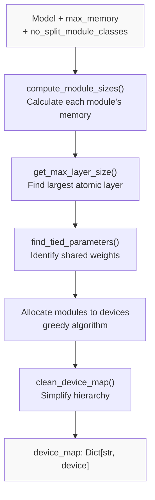
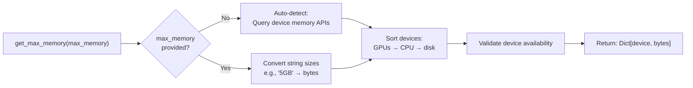
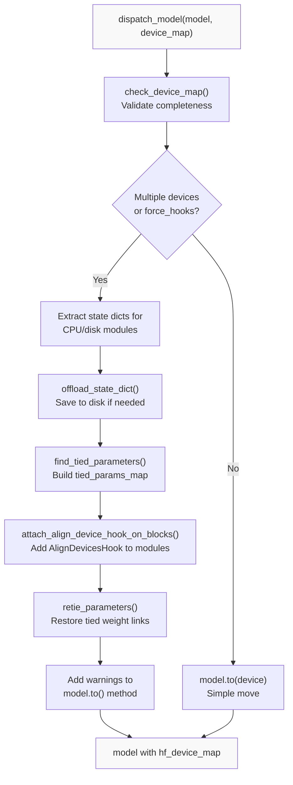
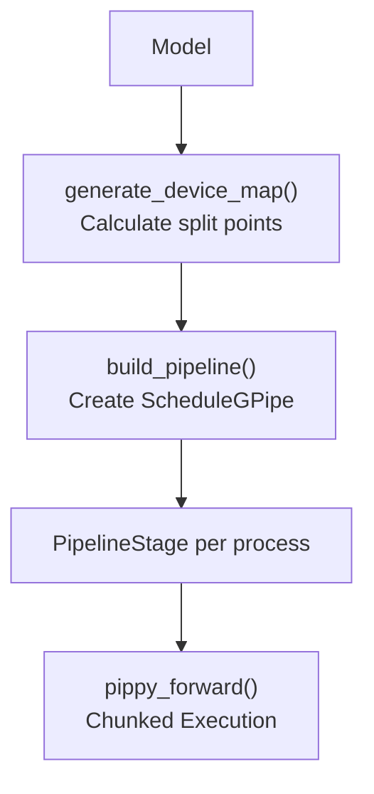
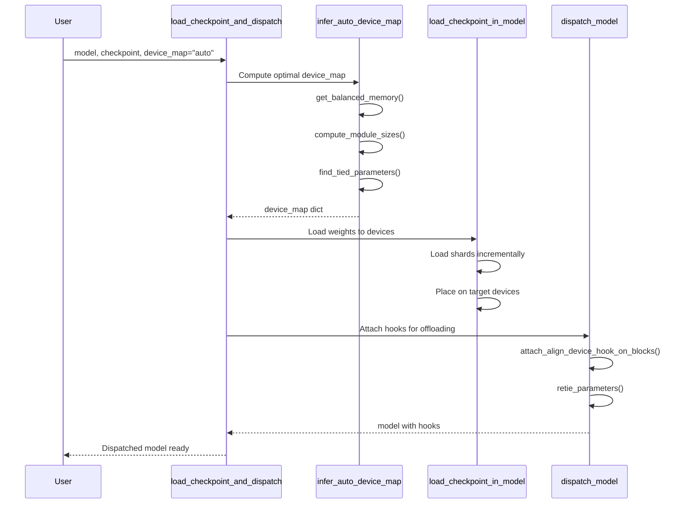

<!-- source: DeepWiki mcp.deepwiki.com · repo huggingface/accelerate · page 5.2 Device Mapping and Inference · fetched 2026-10-21 -->

# Device Mapping and Inference

<details>
<summary>Relevant source files</summary>

The following files were used as context for generating this wiki page:

- [docs/source/concept_guides/gradient_synchronization.md](docs/source/concept_guides/gradient_synchronization.md)
- [docs/source/package_reference/inference.md](docs/source/package_reference/inference.md)
- [docs/source/usage_guides/distributed_inference.md](docs/source/usage_guides/distributed_inference.md)
- [docs/source/usage_guides/explore.md](docs/source/usage_guides/explore.md)
- [src/accelerate/big_modeling.py](src/accelerate/big_modeling.py)
- [src/accelerate/hooks.py](src/accelerate/hooks.py)
- [src/accelerate/inference.py](src/accelerate/inference.py)
- [src/accelerate/utils/modeling.py](src/accelerate/utils/modeling.py)
- [tests/test_big_modeling.py](tests/test_big_modeling.py)
- [tests/test_hooks.py](tests/test_hooks.py)
- [tests/test_modeling_utils.py](tests/test_modeling_utils.py)

</details>


## Purpose and Scope

This page documents how Accelerate distributes large models across multiple devices (GPUs, CPU, disk) for inference when a model exceeds single-device memory. It covers device map creation, automatic inference, validation, and the dispatching mechanism that places model components on specified devices.

For information about initializing models and loading checkpoints with device mapping, see [Initialization and Loading](#5.1). For details on offloading strategies and the hook system, see [Memory Offloading Strategies](#5.3) and [Hook System Architecture](#5.4).

---

## Device Map Specification Formats

A device map defines where each model component should reside during inference. Accelerate supports multiple specification formats:

### String Shortcuts

Four predefined strategies are available:

| Strategy | Behavior | Use Case |
|----------|----------|----------|
| `"auto"` | Automatically balances model across available devices | General-purpose, recommended default |
| `"balanced"` | Similar to auto but ensures even distribution | When you want explicit balancing |
| `"balanced_low_0"` | Balances while minimizing device 0 usage | When device 0 has other workloads |
| `"sequential"` | Places layers sequentially without memory checks | When you know the model fits |

**Sources:** [src/accelerate/big_modeling.py:607-626]()

### Dictionary Format

A dictionary mapping module names to devices provides fine-grained control:

```python
device_map = {
    "encoder": 0,                    # GPU 0
    "decoder.layer.0": 1,            # GPU 1
    "decoder.layer.1": "cpu",        # CPU
    "decoder.layer.2": "disk",       # Disk offload
    "": 0                            # Root module fallback
}
```

**Key characteristics:**
- Module names correspond to `state_dict` keys (without weight/bias suffix) [src/accelerate/utils/modeling.py:1255-1262]()
- Hierarchical: specifying `"encoder"` places all encoder submodules there [src/accelerate/utils/modeling.py:1265-1270]()
- Device types: integer (GPU index), `"cpu"`, `"disk"`, or `torch.device` objects [src/accelerate/utils/modeling.py:99-106]()
- Special key `""` sets the main execution device for inputs/outputs [src/accelerate/big_modeling.py:329-330]()

**Sources:** [src/accelerate/big_modeling.py:329-330](), [tests/test_big_modeling.py:343-353](), [src/accelerate/utils/modeling.py:1255-1270]()

---

## Automatic Device Map Inference

### The `infer_auto_device_map` Function

`infer_auto_device_map` automatically determines optimal device placement by analyzing model architecture and available memory.



**Algorithm overview:**

1. **Size Computation**: Calculates memory requirements for each module using `dtype_byte_size` [src/accelerate/utils/modeling.py:153-189]() and `compute_module_sizes` [src/accelerate/utils/modeling.py:651-690]().
2. **Tied Parameters**: Groups parameters sharing the same underlying tensor via `find_tied_parameters` [src/accelerate/utils/modeling.py:554-606]().
3. **Device Allocation**: Greedily assigns modules to devices with sufficient memory, respecting `no_split_module_classes` [src/accelerate/utils/modeling.py:918-935]().
4. **Map Cleaning**: Consolidates sibling modules on the same device into parent entries using `clean_device_map` [src/accelerate/utils/modeling.py:855-874]().

**Sources:** [src/accelerate/utils/modeling.py:877-1152](), [tests/test_modeling_utils.py:554-673](), [src/accelerate/utils/modeling.py:153-189](), [src/accelerate/utils/modeling.py:651-690]()

### Memory Calculation

#### `get_max_memory`

Determines available memory on each device by querying specific hardware backends.



**Supported platforms:**
- CUDA: `torch.cuda.mem_get_info()` [src/accelerate/utils/modeling.py:771-772]()
- NPU: `torch.npu.mem_get_info()` [src/accelerate/utils/modeling.py:785-786]()
- XPU: `torch.xpu.mem_get_info()` [src/accelerate/utils/modeling.py:778-779]()
- MLU: `torch.mlu.mem_get_info()` [src/accelerate/utils/modeling.py:792-793]()
- CPU: `psutil.virtual_memory().available` [src/accelerate/utils/modeling.py:827-828]()
- MPS: Shares RAM with CPU [src/accelerate/utils/modeling.py:809-810]()

**Sources:** [src/accelerate/utils/modeling.py:744-852]()

#### `get_balanced_memory`

Distributes memory budgets to ensure models fit by reserving space for the largest layer on each device to handle potential execution overhead [src/accelerate/utils/modeling.py:1154-1241]().

**Sources:** [src/accelerate/utils/modeling.py:1154-1241]()

---

## Dispatching Models with `dispatch_model`

### Core Functionality

`dispatch_model` takes a model and device map, then attaches hooks to move weights between devices dynamically during inference [src/accelerate/big_modeling.py:310-510]().



**Sources:** [src/accelerate/big_modeling.py:310-510]()

### Hook Attachment Process

Hooks are attached per module based on their device assignment via `attach_align_device_hook_on_blocks` [src/accelerate/hooks.py:559-690]().

The `AlignDevicesHook` [src/accelerate/hooks.py:227-413]() attached to each module:
- **pre_forward**: Moves required weights to the `execution_device` [src/accelerate/hooks.py:330-362]().
- **post_forward**: If offloading is enabled, moves weights back to the `offload_device` (CPU or meta) [src/accelerate/hooks.py:364-394]().
- **Tied weights handling**: Uses `tied_params_map` to ensure shared tensors are not duplicated or incorrectly offloaded [src/accelerate/hooks.py:343-346]().

**Sources:** [src/accelerate/big_modeling.py:396-436](), [src/accelerate/hooks.py:227-413](), [src/accelerate/hooks.py:559-690]()

---

## Device Map Validation and Cleaning

### `check_device_map`

Validates that a device map covers all model parameters and buffers. It iterates through `named_module_tensors` to ensure every component has a destination [src/accelerate/utils/modeling.py:1243-1303]().

**Sources:** [src/accelerate/utils/modeling.py:1243-1303](), [tests/test_modeling_utils.py:345-371]()

### `clean_device_map`

Simplifies device maps by consolidating modules on the same device to reduce the number of entries and potential hook overhead [src/accelerate/utils/modeling.py:855-874]().

**Sources:** [src/accelerate/utils/modeling.py:855-874](), [tests/test_modeling_utils.py:541-552]()

---

## Pipeline Parallel Inference (Experimental)

Accelerate provides `prepare_pippy` to wrap models for pipeline parallel inference using `torch.distributed.pipelining` [src/accelerate/inference.py:126-158]().

### Workflow for PiPPy

1. **Device Map Generation**: `generate_device_map` calculates splits for PiPPy, ensuring each stage fits on its assigned GPU [src/accelerate/inference.py:31-57]().
2. **Pipeline Building**: `build_pipeline` annotates split points and creates a `PipelineStage` [src/accelerate/inference.py:75-98]().
3. **Forward Execution**: `pippy_forward` coordinates the chunked execution across processes [src/accelerate/inference.py:101-123]().



**Sources:** [src/accelerate/inference.py:31-173](), [docs/source/usage_guides/distributed_inference.md:147-154]()

---

## Complete Workflow Example

### Multi-GPU Inference with Automatic Mapping

```python
from accelerate import init_empty_weights, load_checkpoint_and_dispatch
from transformers import AutoConfig, AutoModelForCausalLM

# Step 1: Initialize empty model
config = AutoConfig.from_pretrained("bigscience/bloom-7b1")
with init_empty_weights():
    model = AutoModelForCausalLM.from_config(config)

# Step 2: Load and dispatch with automatic device mapping
model = load_checkpoint_and_dispatch(
    model,
    checkpoint="bigscience/bloom-7b1",
    device_map="auto",  # Automatically infer device placement
    no_split_module_classes=["BloomBlock"],  # Don't split transformer blocks
    offload_folder="offload",  # For disk offloading if needed
)
```

**Internal Execution Flow:**



**Sources:** [src/accelerate/big_modeling.py:513-651](), [tests/test_accelerator.py:315-332](), [src/accelerate/big_modeling.py:32-53]()

---

## Key Implementation Classes and Functions

### Function Reference

| Function | Purpose | Location |
|----------|---------|----------|
| `infer_auto_device_map` | Automatically compute device placement | [src/accelerate/utils/modeling.py:877-1152]() |
| `dispatch_model` | Apply device map to model with hooks | [src/accelerate/big_modeling.py:310-510]() |
| `load_checkpoint_and_dispatch` | Combined load + dispatch | [src/accelerate/big_modeling.py:513-651]() |
| `get_max_memory` | Query available device memory | [src/accelerate/utils/modeling.py:744-852]() |
| `get_balanced_memory` | Compute balanced memory budgets | [src/accelerate/utils/modeling.py:1154-1241]() |
| `compute_module_sizes` | Calculate memory per module | [src/accelerate/utils/modeling.py:651-690]() |
| `check_device_map` | Validate device map completeness | [src/accelerate/utils/modeling.py:1243-1303]() |
| `clean_device_map` | Simplify device map hierarchy | [src/accelerate/utils/modeling.py:855-874]() |
| `find_tied_parameters` | Identify shared weights | [src/accelerate/utils/modeling.py:554-606]() |
| `prepare_pippy` | Wrap model for pipeline parallel inference | [src/accelerate/inference.py:126-158]() |

### Hook Classes

| Class | Purpose | Key Methods |
|-------|---------|-------------|
| `AlignDevicesHook` | Moves weights to execution device | `pre_forward`, `post_forward` [src/accelerate/hooks.py:227-413]() |
| `OffloadedWeightsLoader` | Lazy-loads offloaded weights | `__getitem__` [src/accelerate/utils/offload.py:29-123]() |

**Sources:** [src/accelerate/hooks.py:227-413](), [src/accelerate/utils/offload.py:29-123](), [src/accelerate/inference.py:126-158]()

---

