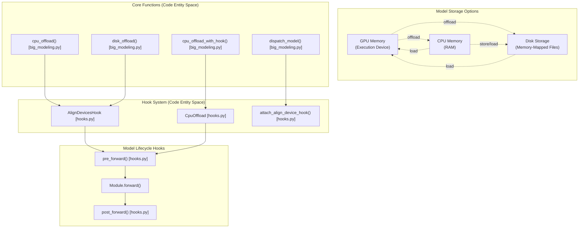
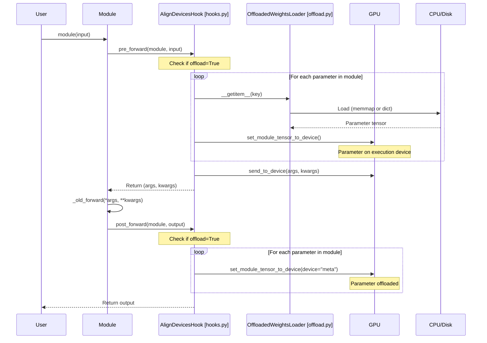

<!-- source: DeepWiki mcp.deepwiki.com · repo huggingface/accelerate · page 5.3 Memory Offloading Strategies · fetched 2026-10-21 -->

# Memory Offloading Strategies

<details>
<summary>Relevant source files</summary>

The following files were used as context for generating this wiki page:

- [src/accelerate/big_modeling.py](src/accelerate/big_modeling.py)
- [src/accelerate/hooks.py](src/accelerate/hooks.py)
- [src/accelerate/utils/modeling.py](src/accelerate/utils/modeling.py)
- [src/accelerate/utils/offload.py](src/accelerate/utils/offload.py)
- [tests/test_big_modeling.py](tests/test_big_modeling.py)
- [tests/test_hooks.py](tests/test_hooks.py)
- [tests/test_modeling_utils.py](tests/test_modeling_utils.py)
- [tests/test_offload.py](tests/test_offload.py)

</details>


This document describes the memory offloading mechanisms in Accelerate that enable loading and running models larger than available GPU memory. These strategies allow model parameters to be stored on CPU RAM or disk and dynamically loaded to GPU during computation.

For information about initializing large models efficiently, see [Initialization and Loading](#5.1). For device mapping and distributed inference setup, see [Device Mapping and Inference](#5.2). For the underlying hook architecture that powers offloading, see [Hook System Architecture](#5.4).

## Overview

Memory offloading strategies in Accelerate allow you to run models that exceed your GPU memory capacity by storing weights on CPU or disk and loading them just-in-time during forward passes. The library provides three primary offloading approaches:

| Strategy | Storage Location | Use Case | Key Function |
|----------|-----------------|----------|--------------|
| CPU Offload | CPU RAM | Model fits in RAM but not GPU | `cpu_offload()` |
| CPU Offload with Hook | CPU RAM | Pipeline models with sequential execution | `cpu_offload_with_hook()` |
| Disk Offload | Disk (memory-mapped) | Model exceeds both GPU and RAM | `disk_offload()` |

**Sources:** [src/accelerate/big_modeling.py:179-307]()

## Offloading Architecture

The offloading system bridges high-level user API calls to low-level hook attachments and weight management utilities.



**Sources:** [src/accelerate/big_modeling.py:179-510](), [src/accelerate/hooks.py:225-410]()

## CPU Offloading

### Basic CPU Offload

The `cpu_offload()` function provides full CPU offloading where all model parameters are kept in CPU RAM and loaded to GPU only during forward passes. After each forward pass, parameters are immediately offloaded back to CPU.

```python
def cpu_offload(
    model: nn.Module,
    execution_device: Optional[torch.device] = None,
    offload_buffers: bool = False,
    state_dict: Optional[dict[str, torch.Tensor]] = None,
    preload_module_classes: Optional[list[str]] = None,
)
```

**Key Parameters:**
- `execution_device`: GPU device for computation. Defaults to the device of the first parameter [src/accelerate/big_modeling.py:195-197]().
- `offload_buffers`: Whether to offload buffers (e.g., batch norm running statistics) in addition to parameters [src/accelerate/big_modeling.py:202]().
- `state_dict`: Pre-existing state dict to use instead of extracting from the model [src/accelerate/big_modeling.py:205-207]().
- `preload_module_classes`: Module classes that should load all submodule weights at forward start [src/accelerate/big_modeling.py:211]().

**Mechanism:**
1. Model state dict is extracted or provided [src/accelerate/big_modeling.py:205]().
2. Model parameters are replaced with meta tensors (no storage) [src/accelerate/big_modeling.py:213]().
3. `AlignDevicesHook` is attached to the model with `offload=True` [src/accelerate/big_modeling.py:211-216]().
4. During forward: weights loaded from CPU to execution device via `pre_forward` [src/accelerate/hooks.py:306-350]().
5. After forward: weights offloaded back to meta device via `post_forward` [src/accelerate/hooks.py:382-410]().

**Sources:** [src/accelerate/big_modeling.py:179-217](), [src/accelerate/hooks.py:225-410]()

### CPU Offload with Hook

The `cpu_offload_with_hook()` function provides a sequential offloading pattern where the model stays on GPU after the forward pass and is only offloaded when the next model's hook triggers.

```python
def cpu_offload_with_hook(
    model: torch.nn.Module,
    execution_device: Optional[Union[int, str, torch.device]] = None,
    prev_module_hook: Optional[UserCpuOffloadHook] = None,
)
```

**Key Difference from Basic CPU Offload:**
- Model remains on GPU after the forward pass until explicitly offloaded or a chained hook triggers [src/accelerate/hooks.py:709-725]().
- Manual offload is available via the `hook.offload()` method [src/accelerate/hooks.py:730]().
- Supports chaining via `prev_module_hook` for pipeline execution [src/accelerate/big_modeling.py:255]().

**Sources:** [src/accelerate/big_modeling.py:219-261](), [src/accelerate/hooks.py:689-733]()

## Disk Offloading

The `disk_offload()` function enables offloading to disk when the model exceeds both GPU and CPU memory. Weights are stored as memory-mapped files via `numpy.memmap` [src/accelerate/utils/offload.py:40]().

```python
def disk_offload(
    model: nn.Module,
    offload_dir: Union[str, os.PathLike],
    execution_device: Optional[torch.device] = None,
    offload_buffers: bool = False,
    preload_module_classes: Optional[list[str]] = None,
)
```

**Mechanism:**
1. If the `offload_dir` is empty, the model state dict is saved to disk using `offload_state_dict()` [src/accelerate/big_modeling.py:293-294]().
2. An `OffloadedWeightsLoader` is initialized to manage lazy loading from the `offload_dir` [src/accelerate/big_modeling.py:297-302]().
3. `AlignDevicesHook` is attached to the model using this loader as the `weights_map` [src/accelerate/big_modeling.py:304-307]().

**File Structure:**
- `offload_dir/index.json`: Maps parameter names to file metadata (shape, dtype) [src/accelerate/utils/offload.py:73-83]().
- `offload_dir/*.dat`: Individual weight files stored as raw binary data [src/accelerate/utils/offload.py:33]().

**Sources:** [src/accelerate/big_modeling.py:263-307](), [src/accelerate/utils/offload.py:25-103]()

## Hook-Based Offloading Mechanism

The offloading strategies rely on the `AlignDevicesHook` class, which intercepts forward passes to dynamically move weights.



**Key Methods in `AlignDevicesHook`:**

- **`init_hook(module)`**: Sets up the hook, tracks original devices, and replaces parameters with meta tensors if `offload=True` [src/accelerate/hooks.py:239-299]().
- **`pre_forward(module, *args, **kwargs)`**: Loads parameters from the `weights_map` to the execution device and moves inputs to the device [src/accelerate/hooks.py:306-350]().
- **`post_forward(module, output)`**: Offloads parameters back to the meta device and returns the processed output [src/accelerate/hooks.py:382-410]().

**Sources:** [src/accelerate/hooks.py:225-410](), [src/accelerate/utils/offload.py:127-192](), [src/accelerate/utils/modeling.py:217-425]()

## Parameter Placement and Tied Weights

When offloading models with tied weights, Accelerate uses a `tied_params_map` to ensure that parameters sharing the same storage are not duplicated in memory when moved to the execution device [src/accelerate/hooks.py:270-272]().

1. **Detection**: `find_tied_parameters()` identifies parameter groups sharing storage via `data_ptr()` [src/accelerate/utils/modeling.py:554-607]().
2. **Mapping**: The hook maintains a `tied_params_map` (a dictionary of dictionaries) where weights are cached per device: `tied_params_map[data_ptr][device]` [src/accelerate/hooks.py:270]().
3. **Reuse**: During `pre_forward`, if a tied weight is already present on the execution device, the hook reuses that tensor instead of loading a new copy [src/accelerate/hooks.py:346-350]().

**Sources:** [src/accelerate/big_modeling.py:413-434](), [src/accelerate/hooks.py:270-272](), [src/accelerate/hooks.py:346-398](), [src/accelerate/utils/modeling.py:554-607]()

## Buffer Offloading

The `offload_buffers` flag determines whether `nn.Module` buffers (like `running_mean` in BatchNorm) are offloaded alongside parameters.

- **`offload_buffers=False`**: Buffers are moved to the execution device once and stay there [src/accelerate/hooks.py:315-324]().
- **`offload_buffers=True`**: Buffers are offloaded to the meta device after every forward pass, just like parameters [src/accelerate/hooks.py:393-398]().

Accelerate identifies non-persistent buffers using `get_non_persistent_buffers()` to ensure they are handled correctly during the offloading lifecycle [src/accelerate/utils/modeling.py:1162-1181]().

**Sources:** [src/accelerate/big_modeling.py:179](), [src/accelerate/hooks.py:239-241](), [src/accelerate/hooks.py:315-324](), [src/accelerate/utils/modeling.py:1162-1181]()

## Preload Module Classes

The `preload_module_classes` parameter addresses modules that access submodule weights directly in their `forward` method rather than calling the submodule itself.

**Mechanism:**
- When a module class is in `preload_module_classes`, `attach_align_device_hook` is called with `place_submodules=True` [src/accelerate/hooks.py:510]().
- The `AlignDevicesHook` for that module will recursively load all weights of its submodules during its own `pre_forward` phase [src/accelerate/hooks.py:326-335]().

**Sources:** [src/accelerate/big_modeling.py:182-203](), [src/accelerate/hooks.py:502-525]()

## Integration with load_checkpoint_and_dispatch

The `load_checkpoint_and_dispatch()` function is the high-level entry point that automates offloading setup.

```python
def load_checkpoint_and_dispatch(
    model: nn.Module,
    checkpoint: Union[str, os.PathLike],
    device_map: Optional[Union[str, dict[str, Union[int, str, torch.device]]]] = None,
    # ...
)
```

1. **Memory Calculation**: Uses `get_balanced_memory()` to find available space on GPUs and CPU [src/accelerate/big_modeling.py:575-585]().
2. **Mapping**: Uses `infer_auto_device_map()` to assign modules to `cuda`, `cpu`, or `disk` [src/accelerate/big_modeling.py:601-615]().
3. **Dispatch**: Calls `dispatch_model()`, which attaches the necessary `AlignDevicesHook` instances to modules assigned to CPU or disk [src/accelerate/big_modeling.py:641-651]().

**Sources:** [src/accelerate/big_modeling.py:512-651](), [src/accelerate/utils/modeling.py:661-897]()

---

