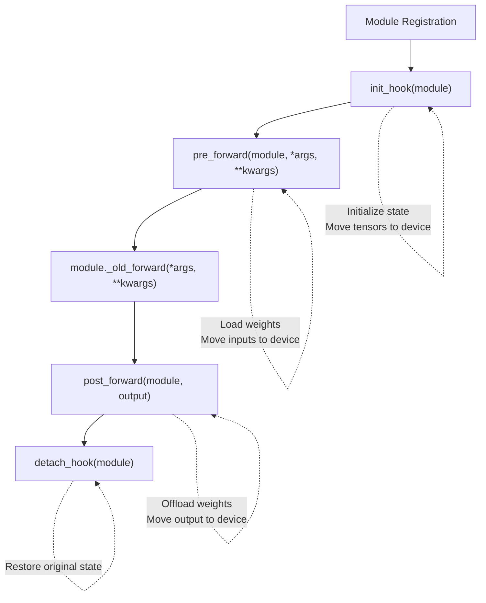
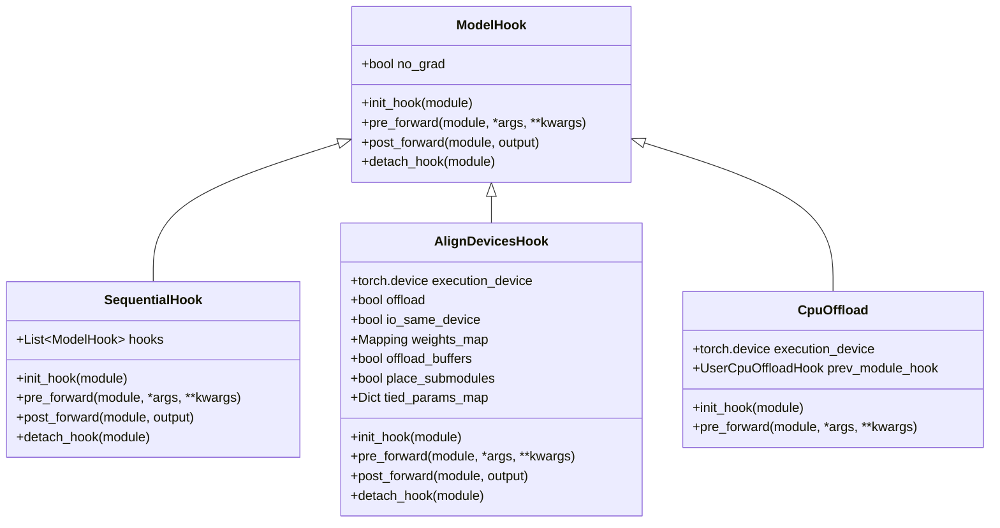
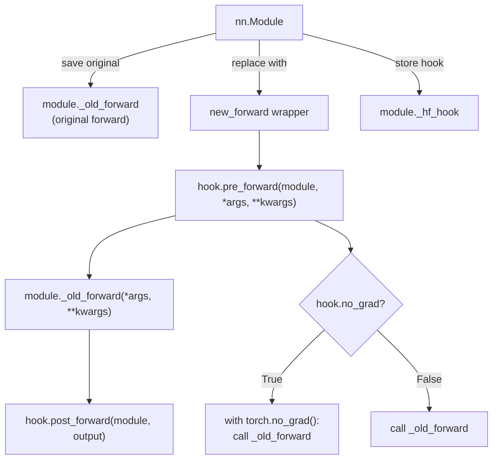
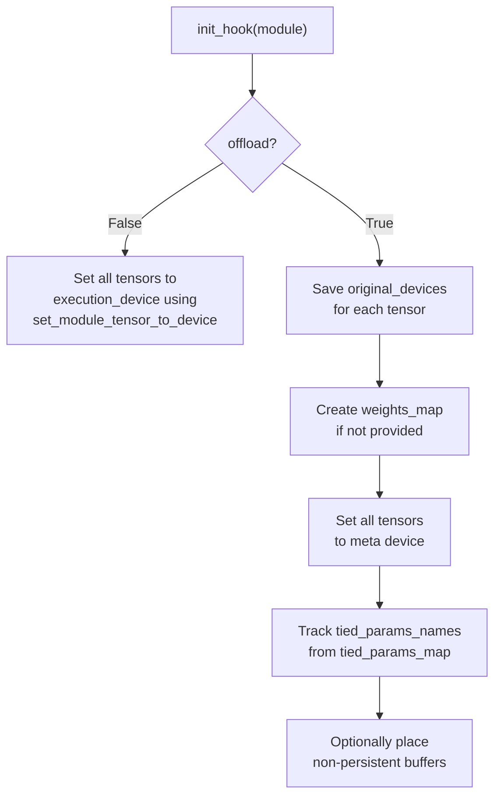
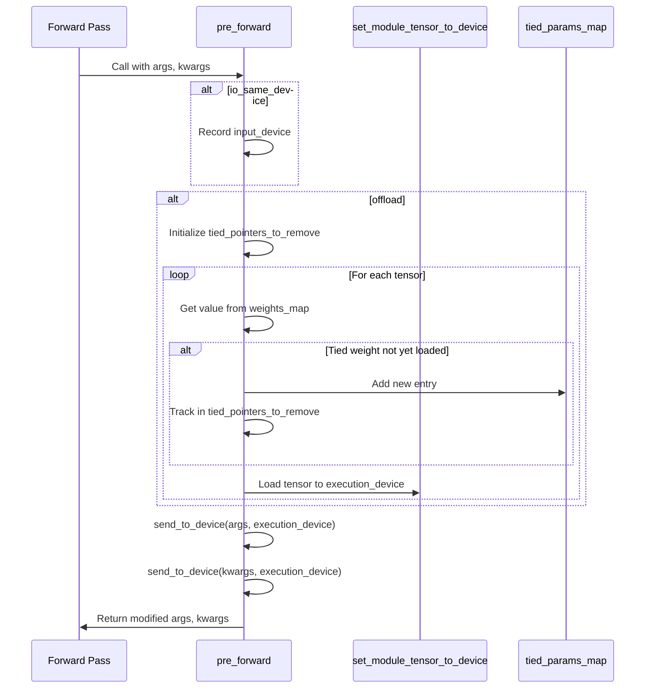
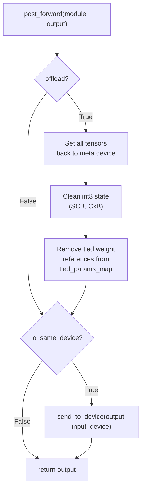
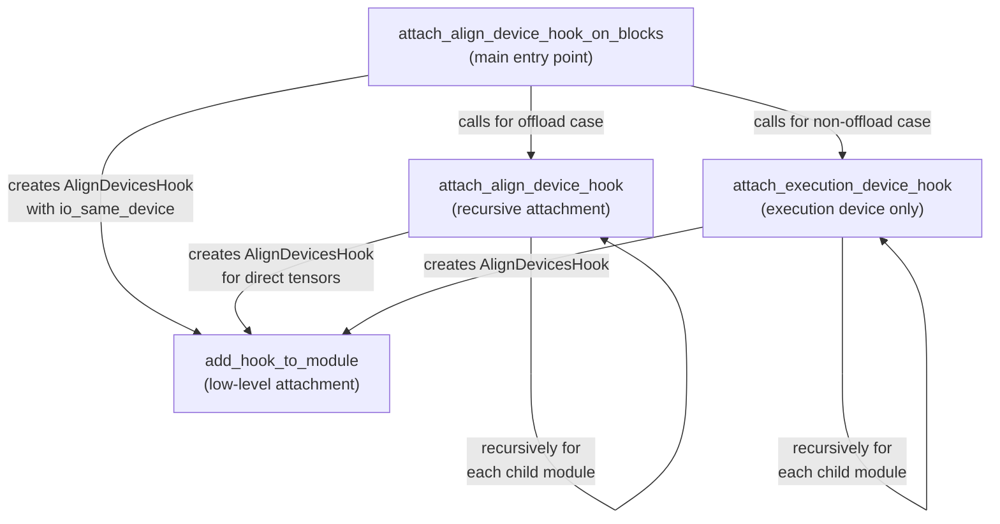
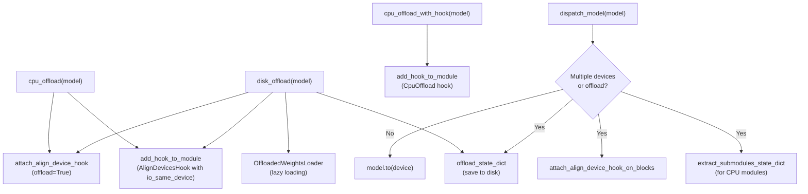
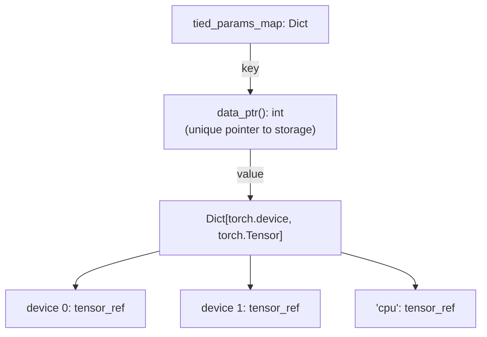
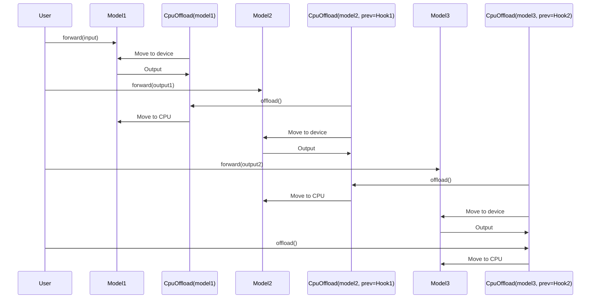

<!-- source: DeepWiki mcp.deepwiki.com · repo huggingface/accelerate · page 5.4 Hook System Architecture · fetched 2026-10-21 -->

# Hook System Architecture

<details>
<summary>Relevant source files</summary>

The following files were used as context for generating this wiki page:

- [src/accelerate/big_modeling.py](src/accelerate/big_modeling.py)
- [src/accelerate/hooks.py](src/accelerate/hooks.py)
- [src/accelerate/utils/modeling.py](src/accelerate/utils/modeling.py)
- [tests/test_big_modeling.py](tests/test_big_modeling.py)
- [tests/test_hooks.py](tests/test_hooks.py)
- [tests/test_modeling_utils.py](tests/test_modeling_utils.py)

</details>


## Purpose and Scope

The hook system provides the core mechanism for dynamically managing model weights and activations across devices during the forward pass. This architecture enables key features of Accelerate's big model support: CPU offloading, disk offloading, and model parallelism. The hooks intercept module forward calls to move parameters between devices on-demand and manage memory efficiently.

For information about initializing models and loading checkpoints, see [5.1 Initialization and Loading](). For device mapping strategies, see [5.2 Device Mapping and Inference](). For memory offloading configuration, see [5.3 Memory Offloading Strategies]().

## Core Hook Abstraction

The hook system is built around the `ModelHook` base class, which defines a lifecycle interface for intercepting and modifying module behavior.

### ModelHook Interface

`ModelHook` defines four lifecycle methods that hooks can override:



**Diagram: ModelHook Lifecycle**

The `ModelHook` class provides:
- `init_hook(module)` - Called when hook is attached, can initialize state or move tensors [src/accelerate/hooks.py:70-77]()
- `pre_forward(module, *args, **kwargs)` - Called before forward pass, can modify inputs [src/accelerate/hooks.py:79-91]()
- `post_forward(module, output)` - Called after forward pass, can modify outputs [src/accelerate/hooks.py:93-104]()
- `detach_hook(module)` - Called when hook is removed, can restore original state [src/accelerate/hooks.py:106-113]()
- `no_grad` class attribute - If `True`, forward pass executes under `torch.no_grad()` [src/accelerate/hooks.py:68]()

Sources: [src/accelerate/hooks.py:58-113]()

### Hook Class Hierarchy



**Diagram: Hook Class Hierarchy**

- `SequentialHook` - Chains multiple hooks, executing them sequentially [src/accelerate/hooks.py:116-144]()
- `AlignDevicesHook` - Main hook for device alignment and offloading [src/accelerate/hooks.py:242-428]()
- `CpuOffload` - Simplified hook for CPU offloading in pipelines [src/accelerate/hooks.py:708-753]()

Sources: [src/accelerate/hooks.py:58-753]()

## Hook Attachment Mechanism

Hooks are attached to modules by replacing the module's `forward` method with a wrapper that calls hook lifecycle methods.

### add_hook_to_module Function



**Diagram: Hook Attachment Process**

The `add_hook_to_module` function [src/accelerate/hooks.py:147-202]():
1. Saves the original `forward` method as `module._old_forward` [src/accelerate/hooks.py:181]()
2. Creates a new wrapper function `new_forward` that calls hook lifecycle methods [src/accelerate/hooks.py:186-193]()
3. Replaces `module.forward` with the wrapper using `functools.partial` [src/accelerate/hooks.py:200]()
4. Stores the hook in `module._hf_hook` [src/accelerate/hooks.py:184]()
5. Calls `hook.init_hook(module)` to initialize state [src/accelerate/hooks.py:183]()
6. Supports `append=True` to chain hooks using `SequentialHook` [src/accelerate/hooks.py:171-174]()

The wrapper function [src/accelerate/hooks.py:186-193]():
- Calls `pre_forward` to process inputs
- Executes original forward (optionally under `no_grad`)
- Calls `post_forward` to process outputs
- Uses `_compiler_disable` decorator on hook methods to prevent compilation issues [src/accelerate/hooks.py:129, 135]()

Sources: [src/accelerate/hooks.py:147-202]()

### remove_hook_from_module Function

The `remove_hook_from_module` function [src/accelerate/hooks.py:205-239]():
- Calls `hook.detach_hook(module)` to clean up state [src/accelerate/hooks.py:213]()
- Restores `module.forward` from `module._old_forward` [src/accelerate/hooks.py:214]()
- Removes hook attributes (`_hf_hook`, `_old_forward`) [src/accelerate/hooks.py:215-216]()
- Removes accelerator-added attributes like custom `to()` and `cuda()` methods [src/accelerate/hooks.py:232-233]()
- Supports `recurse=True` to remove hooks from all submodules [src/accelerate/hooks.py:237-239]()

Sources: [src/accelerate/hooks.py:205-239]()

## AlignDevicesHook

`AlignDevicesHook` is the primary hook implementation that handles device alignment, offloading, and tied parameter management.

### Configuration Parameters

| Parameter | Type | Purpose |
|-----------|------|---------|
| `execution_device` | `torch.device` | Device where forward pass executes |
| `offload` | `bool` | Whether to offload weights after forward |
| `io_same_device` | `bool` | Whether output should be on same device as input |
| `weights_map` | `Mapping` | Map from parameter names to tensor values (for offloading) |
| `offload_buffers` | `bool` | Whether to offload buffers along with parameters |
| `place_submodules` | `bool` | Whether to recursively place submodules on device |
| `skip_keys` | `List[str]` | Keys to skip when moving inputs/outputs |
| `tied_params_map` | `Dict` | Map tracking already-dispatched tied weights |

Sources: [src/accelerate/hooks.py:242-289]()

### Hook Initialization



**Diagram: AlignDevicesHook Initialization Flow**

During `init_hook` [src/accelerate/hooks.py:298-343]():

**Non-offload mode**: All module tensors are moved to `execution_device` immediately using `set_module_tensor_to_device` [src/accelerate/hooks.py:303-305]()

**Offload mode**:
1. Saves original device for each tensor [src/accelerate/hooks.py:307-309]()
2. Creates `weights_map` by copying tensors to CPU if not provided [src/accelerate/hooks.py:310-316]()
3. Sets all parameters/buffers to `meta` device [src/accelerate/hooks.py:317-330]()
4. Tracks tied parameter names for disk offload case [src/accelerate/hooks.py:323-328]()
5. Optionally places buffers on execution device or only non-persistent buffers [src/accelerate/hooks.py:332-341]()

Sources: [src/accelerate/hooks.py:298-343]()

### Pre-Forward Hook



**Diagram: AlignDevicesHook Pre-Forward Sequence**

The `pre_forward` method [src/accelerate/hooks.py:345-389]():

1. **Input device tracking**: If `io_same_device=True`, records the device of inputs [src/accelerate/hooks.py:347-348]()

2. **Weight loading** (offload mode): 
   - Iterates through all module tensors [src/accelerate/hooks.py:352-357]()
   - Retrieves tensor value from `weights_map` [src/accelerate/hooks.py:359]()
   - Handles int8 quantized weights with fp16 statistics [src/accelerate/hooks.py:360-362]()
   - For tied weights, checks if already loaded on device to avoid duplication [src/accelerate/hooks.py:367-376]()
   - Tracks tied weight pointers for later cleanup [src/accelerate/hooks.py:376]()
   - Loads tensor to `execution_device` using `set_module_tensor_to_device` [src/accelerate/hooks.py:378-385]()

3. **Input transfer**: Moves `args` and `kwargs` to `execution_device` [src/accelerate/hooks.py:387-389]()

Sources: [src/accelerate/hooks.py:345-389]()

### Post-Forward Hook



**Diagram: AlignDevicesHook Post-Forward Flow**

The `post_forward` method [src/accelerate/hooks.py:391-421]():

1. **Weight offloading** (offload mode):
   - Sets all tensors back to `meta` device [src/accelerate/hooks.py:394-400]()
   - Cleans up int8 quantization state for `Linear8bitLt` [src/accelerate/hooks.py:401-403]()
   - Removes tied weight references from `tied_params_map` to enable garbage collection [src/accelerate/hooks.py:407-417]()

2. **Output transfer**: If `io_same_device=True`, moves output to original input device [src/accelerate/hooks.py:418-419]()

Sources: [src/accelerate/hooks.py:391-421]()

### Detach Hook

The `detach_hook` method [src/accelerate/hooks.py:423-428]():
- Restores tensors to their original devices from `weights_map` when offloading was enabled
- Used when `remove_hook_from_module` is called to return model to normal state

Sources: [src/accelerate/hooks.py:423-428]()

## Hook Attachment Functions

Several utility functions provide different strategies for attaching hooks to modules.

### Function Relationships



**Diagram: Hook Attachment Function Hierarchy**

Sources: [src/accelerate/hooks.py:431-705]()

### attach_align_device_hook

This function recursively attaches `AlignDevicesHook` to modules that have direct parameters/buffers [src/accelerate/hooks.py:479-559]():

**Attachment logic**:
- Checks if module has direct tensors via `named_module_tensors(module)` [src/accelerate/hooks.py:520]()
- Determines if full offload needed based on `preload_module_classes` [src/accelerate/hooks.py:521-523]()
- Creates `PrefixedDataset` wrapper around `weights_map` for submodule access [src/accelerate/hooks.py:526-530]()
- Attaches hook with `append=True` to chain with existing hooks [src/accelerate/hooks.py:540]()
- Recurses to child modules unless full offload is active [src/accelerate/hooks.py:542-559]()

**Parameters**:
- `preload_module_classes` - List of class names that should load all submodule weights at once [src/accelerate/hooks.py:509-513]()
- `tied_params_map` - Shared dictionary for tracking tied weights across devices [src/accelerate/hooks.py:514-517]()

Sources: [src/accelerate/hooks.py:479-559]()

### attach_align_device_hook_on_blocks

This is the main entry point used by `dispatch_model` [src/accelerate/hooks.py:574-705]():

**Single device/offload mode** [src/accelerate/hooks.py:616-637]():
- If not offloading: Creates one `AlignDevicesHook` with `io_same_device=True` and `place_submodules=True` [src/accelerate/hooks.py:617-626]()
- If offloading: Calls `attach_align_device_hook` recursively [src/accelerate/hooks.py:628-637]()

**Multi-device mode** [src/accelerate/hooks.py:639-705]():
- Handles dictionary-based `execution_device` and `offload` parameters
- For each module in device map:
  - Non-offload: Attaches hook with `place_submodules=True`, then calls `attach_execution_device_hook` [src/accelerate/hooks.py:656-668]()
  - Offload: Calls `attach_align_device_hook`, then attaches IO hook and calls `attach_execution_device_hook` [src/accelerate/hooks.py:670-692]()
- Recurses to child modules with appropriate device mapping [src/accelerate/hooks.py:694-705]()

Sources: [src/accelerate/hooks.py:574-705]()

### attach_execution_device_hook

This function attaches hooks purely for moving inputs to execution device, without offloading [src/accelerate/hooks.py:431-476]():

- Only attaches if module has state dict and no existing hook [src/accelerate/hooks.py:459-463]()
- Stops recursion at `preload_module_classes` [src/accelerate/hooks.py:465-467]()
- Recurses to all children [src/accelerate/hooks.py:469-476]()

Sources: [src/accelerate/hooks.py:431-476]()

## Offloading Integration

The hook system integrates with higher-level offloading functions in `big_modeling.py`.

### Offloading Functions



**Diagram: Offloading Function Integration**

Sources: [src/accelerate/big_modeling.py:179-510]()

### cpu_offload

The `cpu_offload` function [src/accelerate/big_modeling.py:179-217]():

1. Determines execution device (defaults to first parameter device) [src/accelerate/big_modeling.py:202-203]()
2. Creates state dict on CPU if not provided [src/accelerate/big_modeling.py:204-205]()
3. Adds initial hook with `io_same_device=True` for output device handling [src/accelerate/big_modeling.py:207]()
4. Calls `attach_align_device_hook` with `offload=True` to set up weight loading/offloading [src/accelerate/big_modeling.py:208-215]()

Sources: [src/accelerate/big_modeling.py:179-217]()

### disk_offload

The `disk_offload` function [src/accelerate/big_modeling.py:264-307]():

1. Saves model state dict to disk using `offload_state_dict` if not already done [src/accelerate/big_modeling.py:291-292]()
2. Creates `OffloadedWeightsLoader` for lazy loading from disk [src/accelerate/big_modeling.py:295]()
3. Same hook attachment as `cpu_offload` but with disk-backed `weights_map` [src/accelerate/big_modeling.py:297-305]()

Sources: [src/accelerate/big_modeling.py:264-307]()

### dispatch_model

The `dispatch_model` function uses hooks for mixed device placement [src/accelerate/big_modeling.py:310-510]():

**Device map validation**: Calls `check_device_map` to ensure all modules are mapped [src/accelerate/big_modeling.py:356]()

**Multi-device setup** [src/accelerate/big_modeling.py:370-449]():
1. Extracts CPU module state dict [src/accelerate/big_modeling.py:378-380]()
2. Extracts and offloads disk module state dict [src/accelerate/big_modeling.py:382-394]()
3. Creates execution device map (CPU/disk modules execute on main device) [src/accelerate/big_modeling.py:396-399]()
4. Creates offload boolean map [src/accelerate/big_modeling.py:400-401]()
5. Creates `OffloadedWeightsLoader` combining CPU state dict and disk folder [src/accelerate/big_modeling.py:403-409]()
6. Finds tied parameters and creates `tied_params_map` [src/accelerate/big_modeling.py:414-422]()
7. Calls `attach_align_device_hook_on_blocks` with device/offload maps [src/accelerate/big_modeling.py:427-436]()
8. Reties parameters after hook attachment [src/accelerate/big_modeling.py:448]()

**Single device**: Just calls `model.to(device)` [src/accelerate/big_modeling.py:491-503]()

Sources: [src/accelerate/big_modeling.py:310-510]()

## Tied Parameters Handling

The hook system includes special logic to avoid duplicating tied (shared) weights across devices.

### Tied Parameters Map Structure



**Diagram: Tied Parameters Map Structure**

The `tied_params_map` is structured as:
- Outer key: `int` - Data pointer from `tensor.data_ptr()` [src/accelerate/big_modeling.py:421]()
- Inner key: `torch.device` - Execution device
- Value: `torch.Tensor` - Already loaded tensor reference on that device

This allows reusing the first loaded copy of a tied weight on each device instead of duplicating memory.

Sources: [src/accelerate/big_modeling.py:414-422](), [src/accelerate/hooks.py:271]()

### Usage in set_module_tensor_to_device

The `set_module_tensor_to_device` function checks `tied_params_map` before loading [src/accelerate/utils/modeling.py:322-331]() in `src/accelerate/utils/modeling.py`:

```python
# If a tied weight is already on the target device, reuse it
if (
    value is not None
    and tied_params_map is not None
    and value.data_ptr() in tied_params_map
    and device in tied_params_map[value.data_ptr()]
):
    module._parameters[tensor_name] = tied_params_map[value.data_ptr()][device]
    return
```

After loading a new tensor, it updates the map [src/accelerate/utils/modeling.py:412-424]():

```python
if (
    tied_params_map is not None
    and old_value.data_ptr() in tied_params_map
    and device not in tied_params_map[old_value.data_ptr()]
):
    tied_params_map[old_value.data_ptr()][device] = new_value
```

Sources: [src/accelerate/utils/modeling.py:269-425]()

### Usage in AlignDevicesHook

**Initialization**: Sets `tied_params_map` to `None` for meta device [src/accelerate/hooks.py:299-301]()

**Pre-forward**: 
- For disk offload, tracks tied parameter names [src/accelerate/hooks.py:323-328]()
- When loading weights, adds new entries to map for tied weights [src/accelerate/hooks.py:367-368]()
- Tracks pointers to remove after forward [src/accelerate/hooks.py:370-376]()
- Passes `tied_params_map` to `set_module_tensor_to_device` [src/accelerate/hooks.py:378-385]()

**Post-forward**: Removes tied weight references for garbage collection [src/accelerate/hooks.py:407-417]():

```python
for value_pointer, device in self.tied_pointers_to_remove:
    if device in self.tied_params_map[value_pointer]:
        del self.tied_params_map[value_pointer][device]
```

Sources: [src/accelerate/hooks.py:299-417]()

## CpuOffload Hook

`CpuOffload` is a simpler hook for sequential pipeline offloading, used by `cpu_offload_with_hook`.

### Pipeline Offloading Pattern



**Diagram: Pipeline Offloading with CpuOffload**

Sources: [src/accelerate/big_modeling.py:220-261](), [src/accelerate/hooks.py:708-786]()

### CpuOffload Implementation

The `CpuOffload` hook [src/accelerate/hooks.py:708-753]():

**Initialization**: 
- Stores `prev_module_hook` reference [src/accelerate/hooks.py:728]()
- Defaults `execution_device` to `PartialState().default_device` [src/accelerate/hooks.py:730]()

**init_hook**: Moves module to CPU [src/accelerate/hooks.py:732-733]()

**pre_forward** [src/accelerate/hooks.py:735-752]():
1. If previous hook exists and previous module not on CPU, calls `prev_module_hook.offload()` [src/accelerate/hooks.py:737-743]()
2. Clears device cache [src/accelerate/hooks.py:744]()
3. Skips device transfer if already on execution device [src/accelerate/hooks.py:746-749]()
4. Moves current module to execution device [src/accelerate/hooks.py:751]()
5. Moves inputs to execution device [src/accelerate/hooks.py:752]()

**UserCpuOffloadHook wrapper** [src/accelerate/hooks.py:755-786]():
- Wraps model and hook for user-facing API
- Provides `offload()` method to manually move model to CPU [src/accelerate/hooks.py:780-784]()

Sources: [src/accelerate/hooks.py:708-786]()

## Special Cases

### preload_module_classes

This parameter handles modules that have registered submodules not called directly in forward [src/accelerate/hooks.py:449-453](), [src/accelerate/hooks.py:509-513]():

**Problem**: If a module's forward uses `self.linear.weight` instead of calling `self.linear()`, the submodule hook won't be triggered, causing the weight to be on meta device.

**Solution**: When a module class is in `preload_module_classes`:
- Hook is attached with `place_submodules=True` [src/accelerate/hooks.py:522]()
- All submodule weights are loaded in `pre_forward` [src/accelerate/hooks.py:352-357]()
- Recursion stops at these modules [src/accelerate/hooks.py:465-467](), [src/accelerate/hooks.py:542-544]()

Sources: [src/accelerate/hooks.py:449-544]()

### skip_keys

The `skip_keys` parameter prevents moving certain dictionary keys between devices [src/accelerate/hooks.py:270](), [src/accelerate/hooks.py:387-389]():

```python
return (
    send_to_device(args, self.execution_device),
    send_to_device(kwargs, self.execution_device, skip_keys=self.skip_keys),
)
```

This is useful when certain inputs should remain on their original device (e.g., attention masks or position IDs).

Sources: [src/accelerate/hooks.py:270](), [src/accelerate/hooks.py:387-389]()

### GraphModule Handling

Special handling for FX GraphModules to avoid freezing the graph [src/accelerate/hooks.py:197-202](), [src/accelerate/hooks.py:225-230]():

```python
if "GraphModuleImpl" in str(type(module)):
    module.__class__.forward = functools.update_wrapper(functools.partial(new_forward, module), old_forward)
else:
    module.forward = functools.update_wrapper(functools.partial(new_forward, module), old_forward)
```

This ensures the graph remains modifiable after hook attachment.

Sources: [src/accelerate/hooks.py:197-230]()

### Quantization Handling

Special cleanup for quantized models [src/accelerate/hooks.py:401-403]():

```python
if type(module).__name__ == "Linear8bitLt":
    module.state.SCB = None
    module.state.CxB = None
```

This releases quantization state after offloading to free memory.

Sources: [src/accelerate/hooks.py:401-403]()

## Summary

The hook system provides a flexible, composable architecture for intercepting module forward passes to manage weights and activations dynamically. Key design principles:

- **Lifecycle interface**: Hooks define `init_hook`, `pre_forward`, `post_forward`, `detach_hook` methods.
- **Transparent wrapper**: `add_hook_to_module` replaces `forward` with a wrapper that preserves signature and behavior.
- **Memory efficiency**: `AlignDevicesHook` moves weights on-demand and tracks tied parameters to avoid duplication.
- **Recursive attachment**: Helper functions attach hooks throughout model hierarchy based on device maps.
- **Offloading strategies**: Supports CPU offload (in-memory), disk offload (memory-mapped), and pipeline offload (sequential).

The system enables training and inference of models larger than device memory by dynamically loading only the active layers while offloading inactive ones.

Sources: [src/accelerate/hooks.py](), [src/accelerate/big_modeling.py:179-510](), [src/accelerate/utils/modeling.py:269-425]()

---

