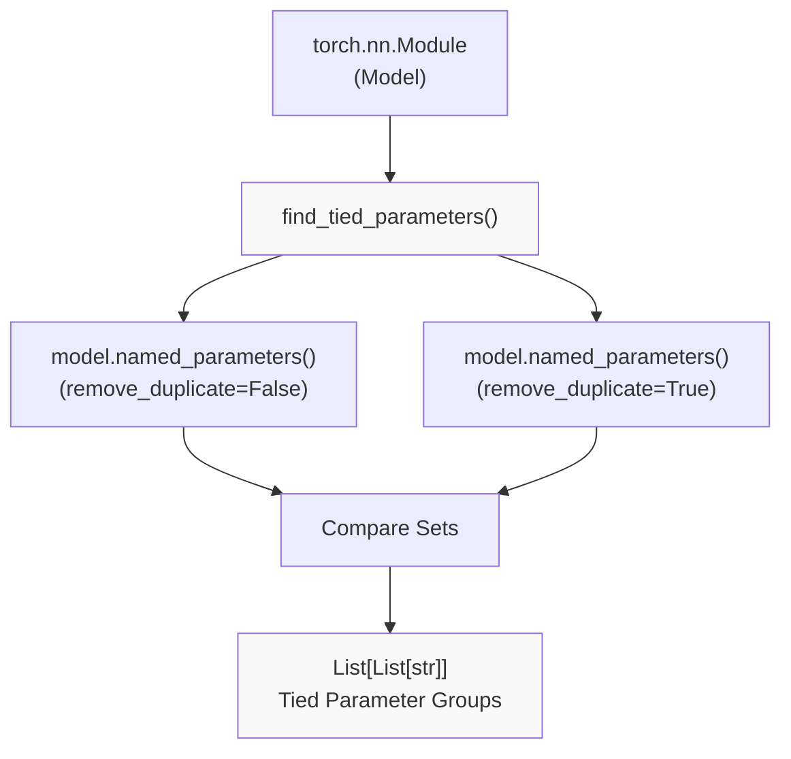
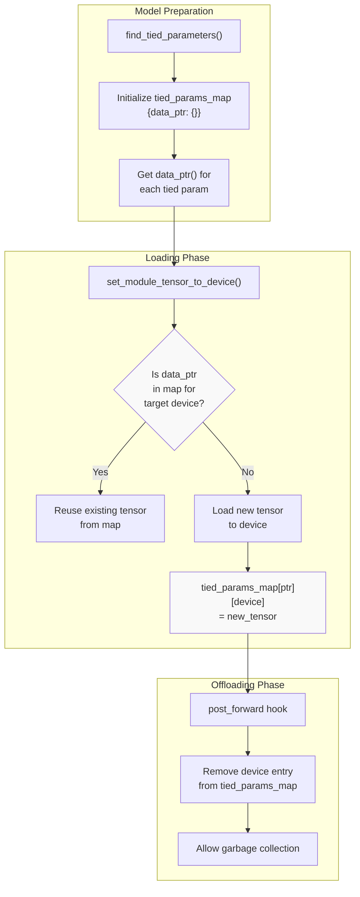
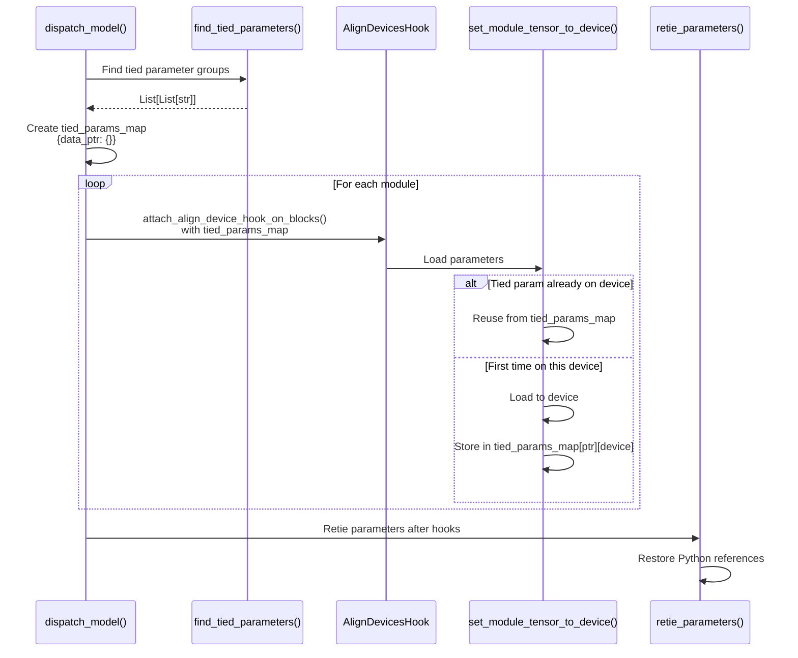
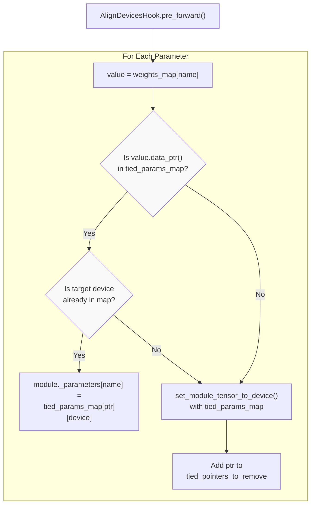
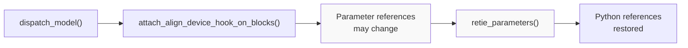

<!-- source: DeepWiki mcp.deepwiki.com · repo huggingface/accelerate · page 5.5 Tied Parameters and Memory Optimization · fetched 2026-10-21 -->

# Tied Parameters and Memory Optimization

<details>
<summary>Relevant source files</summary>

The following files were used as context for generating this wiki page:

- [src/accelerate/big_modeling.py](src/accelerate/big_modeling.py)
- [src/accelerate/hooks.py](src/accelerate/hooks.py)
- [src/accelerate/memory_utils.py](src/accelerate/memory_utils.py)
- [src/accelerate/utils/modeling.py](src/accelerate/utils/modeling.py)
- [tests/test_big_modeling.py](tests/test_big_modeling.py)
- [tests/test_hooks.py](tests/test_hooks.py)
- [tests/test_memory_utils.py](tests/test_memory_utils.py)
- [tests/test_modeling_utils.py](tests/test_modeling_utils.py)

</details>


This page explains how Accelerate handles **tied parameters** (weights shared across multiple layers) to optimize memory usage when dispatching large models across devices. This is a critical component of the big model support system that prevents unnecessary memory duplication.

For information about model dispatching and device placement, see [Device Mapping and Inference](#5.2). For the hook system that uses these optimizations, see [Hook System Architecture](#5.4).

## Purpose and Overview

**Tied parameters** occur when multiple layers in a model share the same underlying weight tensor. Common examples include:
- Shared embeddings between encoder and decoder (e.g., input and output embeddings)
- Parameter sharing in recursive architectures
- Weight tying for regularization or model compression

When dispatching a model with tied parameters across multiple devices or between GPU and CPU/disk, naively loading each parameter reference would duplicate memory. Accelerate's tied parameter system tracks these relationships and reuses already-loaded tensors, significantly reducing memory consumption.

## Identifying Tied Parameters

Accelerate provides utilities to detect which parameters in a model are tied together.

### Finding Tied Parameters

The `find_tied_parameters()` function identifies all groups of parameters that share the same underlying storage by comparing their memory addresses.



**Diagram: Tied Parameter Detection Process**

The function works by:
1. Getting all parameter names (including duplicates from tied weights) [src/accelerate/utils/modeling.py:591-592]()
2. Getting unique parameter names (tied parameters appear only once) [src/accelerate/utils/modeling.py:593-594]()
3. Computing the difference to identify tied parameter names [src/accelerate/utils/modeling.py:596-597]()
4. Grouping tied names by their actual parameter object [src/accelerate/utils/modeling.py:599-606]()

Sources: [src/accelerate/utils/modeling.py:554-607]()

### Example Usage

```python
from accelerate.utils import find_tied_parameters

model = MyModel()
tied_params = find_tied_parameters(model)
# Returns: [['encoder.embed.weight', 'decoder.embed.weight']]
```

Sources: [src/accelerate/utils/modeling.py:571-581](), [tests/test_modeling_utils.py:255-283]()

## The Tied Parameters Map System

The core of memory optimization for tied parameters is the `tied_params_map` data structure.

### Data Structure

```
tied_params_map: Dict[int, Dict[torch.device, torch.Tensor]]
```

- **Outer key** (`int`): The `data_ptr()` of the original parameter tensor.
- **Inner dict**: Maps each device to the tensor instance on that device.
- **Purpose**: Reuse already-loaded tensors instead of loading duplicates.

### How It Works



**Diagram: Tied Parameters Map Lifecycle**

Sources: [src/accelerate/big_modeling.py:413-425](), [src/accelerate/utils/modeling.py:224-225](), [src/accelerate/hooks.py:254](), [src/accelerate/hooks.py:373-403]()

## Integration with Model Dispatching

When dispatching a model with `dispatch_model()`, the tied parameters system is automatically initialized and used.

### Dispatch Model Flow

| Step | Function | Tied Parameters Handling |
|------|----------|-------------------------|
| 1. Find Ties | `find_tied_parameters(model)` | Identify all tied parameter groups [src/accelerate/big_modeling.py:413]() |
| 2. Initialize Map | Create `tied_params_map` | Create empty dict for each tied param `data_ptr()` [src/accelerate/big_modeling.py:417-425]() |
| 3. Attach Hooks | `attach_align_device_hook_on_blocks()` | Pass `tied_params_map` to each hook [src/accelerate/big_modeling.py:431]() |
| 4. Load Weights | `set_module_tensor_to_device()` | Check map before loading, reuse if available [src/accelerate/utils/modeling.py:338-349]() |
| 5. Retie | `retie_parameters()` | Re-establish Python references after hooking [src/accelerate/big_modeling.py:447]() |

Sources: [src/accelerate/big_modeling.py:413-447](), [src/accelerate/utils/modeling.py:338-349]()

### Code Flow in dispatch_model



**Diagram: Tied Parameters in dispatch_model Sequence**

Sources: [src/accelerate/big_modeling.py:309-509](), [src/accelerate/utils/modeling.py:338-349]()

## AlignDevicesHook Integration

The `AlignDevicesHook` uses `tied_params_map` to avoid memory duplication during offloading.

### Hook Initialization

When a hook is created for offloading, it receives the `tied_params_map` reference [src/accelerate/hooks.py:254]().

```python
hook = AlignDevicesHook(
    execution_device=device,
    offload=True,
    tied_params_map=tied_params_map  # Shared across all hooks
)
```

Sources: [src/accelerate/hooks.py:245-272]()

### Pre-Forward: Loading Tied Parameters



**Diagram: Pre-Forward Hook Tied Parameter Logic**

The hook checks if a tied parameter is already loaded on the target device. If so, it reuses the existing tensor pointer instead of loading it again [src/accelerate/hooks.py:338-349]().

Sources: [src/accelerate/hooks.py:328-371]()

### Post-Forward: Cleanup

After the forward pass, the hook removes device entries from `tied_params_map` to allow garbage collection [src/accelerate/hooks.py:399-403]():

```python
for value_pointer, device in self.tied_pointers_to_remove:
    if device in self.tied_params_map[value_pointer]:
        del self.tied_params_map[value_pointer][device]
```

This cleanup is critical for memory efficiency - it ensures that tensors loaded during forward are freed after use.

Sources: [src/accelerate/hooks.py:373-403]()

### Tied Parameters with Disk Offloading

For disk offloading, tracking is more complex because `safetensors` file loading may not return consistent pointers. The hook maintains `tied_params_names` (a set of parameter name strings) in addition to pointer-based tracking [src/accelerate/hooks.py:302-312]().

Sources: [src/accelerate/hooks.py:302-312](), [src/accelerate/hooks.py:349-351]()

## Re-tying Parameters After Hook Attachment

Adding hooks can break tied parameter relationships because hooks may replace parameter references. The `retie_parameters()` function restores these relationships [src/accelerate/utils/modeling.py:609-638]().

### When to Retie



**Diagram: Re-tying Flow in Model Dispatch**

Sources: [src/accelerate/big_modeling.py:446-447]()

### Retie Implementation

The `retie_parameters()` function:
1. Takes the tied parameter groups from `find_tied_parameters()`.
2. Finds the first non-meta parameter in each group (the "anchor") [src/accelerate/utils/modeling.py:623-628]().
3. Sets all other parameters in the group to reference the anchor [src/accelerate/utils/modeling.py:631-638]().

Sources: [src/accelerate/utils/modeling.py:609-638]()

## Granular Control with set_module_tensor_to_device

The `set_module_tensor_to_device` utility is the low-level engine for moving parameters while maintaining ties.

Key features include:
- **Device Placement**: Moves tensors to the specified device, handling "meta" devices by requiring a `value` [src/accelerate/utils/modeling.py:274-278]().
- **Tied Awareness**: If `tied_params_map` is provided, it checks for existing storage on the target device before creating a new tensor [src/accelerate/utils/modeling.py:338-349]().
- **Buffer Handling**: Corrects the device of non-persistent buffers which are often initialized on CPU [src/accelerate/utils/modeling.py:365-373]().

Sources: [src/accelerate/utils/modeling.py:217-425]()

## Summary

The tied parameters system in Accelerate provides automatic memory optimization by:

1. **Detection**: Identifying parameters that share storage using `find_tied_parameters()`.
2. **Tracking**: Maintaining a `tied_params_map` that tracks loaded tensors by device.
3. **Reuse**: Checking the map before loading to avoid duplication.
4. **Cleanup**: Removing map entries after use to allow garbage collection.
5. **Restoration**: Re-tying parameters after operations that might break ties.

This system is transparent to users but provides significant memory savings for models with weight sharing, enabling larger models to fit in available memory.

Sources: [src/accelerate/big_modeling.py:309-509](), [src/accelerate/utils/modeling.py:217-638](), [src/accelerate/hooks.py:225-410](), [tests/test_big_modeling.py:162-646]()

---

