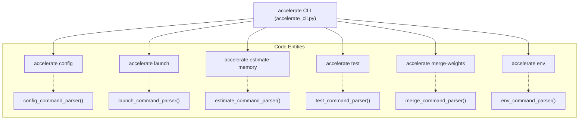
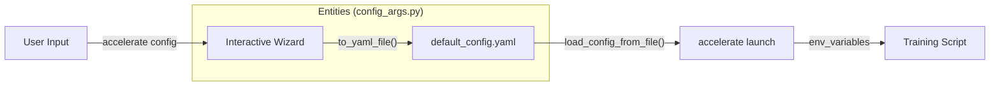

<!-- source: DeepWiki mcp.deepwiki.com · repo huggingface/accelerate · page 6 Command Line Interface · fetched 2026-10-21 -->

# Command Line Interface

Relevant source files

The following files were used as context for generating this wiki page:

- [src/accelerate/commands/__init__.py](src/accelerate/commands/__init__.py)
- [src/accelerate/commands/accelerate_cli.py](src/accelerate/commands/accelerate_cli.py)
- [src/accelerate/commands/config/__init__.py](src/accelerate/commands/config/__init__.py)
- [src/accelerate/commands/config/cluster.py](src/accelerate/commands/config/cluster.py)
- [src/accelerate/commands/config/config.py](src/accelerate/commands/config/config.py)
- [src/accelerate/commands/config/config_args.py](src/accelerate/commands/config/config_args.py)
- [src/accelerate/commands/config/sagemaker.py](src/accelerate/commands/config/sagemaker.py)
- [src/accelerate/commands/launch.py](src/accelerate/commands/launch.py)
- [src/accelerate/utils/constants.py](src/accelerate/utils/constants.py)
- [src/accelerate/utils/launch.py](src/accelerate/utils/launch.py)

The Accelerate library provides a powerful command line interface (CLI) that enables easy configuration and launching of distributed training across various hardware setups without requiring manual `torch.distributed.run` commands. This document serves as a complete reference for the CLI tools available in Accelerate.

## Overview of the CLI

Accelerate's command line interface, defined in `accelerate.commands.accelerate_cli`, offers several commands to help with distributed training and environment management.

### CLI Command Map
The following diagram maps CLI commands to their respective entry points and parsers in the codebase.

Sources: [src/accelerate/commands/accelerate_cli.py:28-40](), [src/accelerate/commands/launch.py:141-154](), [src/accelerate/commands/config/config.py:44-63]()

## Sub-Pages and Detailed Documentation

This page serves as a high-level entry point. For deep technical details on specific CLI features, please refer to the following child pages:

### [accelerate launch](#6.1)
The primary command for launching scripts. It routes to various launchers based on the environment (e.g., `prepare_simple_launcher_cmd_env`, `prepare_multi_gpu_env`). It supports a wide range of arguments including `--multi_gpu`, `--num_processes`, `--mixed_precision`, and backend-specific flags for DeepSpeed and FSDP.
For details, see [accelerate launch](#6.1).
Sources: [src/accelerate/commands/launch.py:158-300](), [src/accelerate/utils/launch.py:100-182]()

### [accelerate config](#6.2)
Explains the interactive configuration wizard that generates YAML/JSON files. It covers functions like `get_cluster_input` for local/multi-node setups and `get_sagemaker_input` for AWS environments. It also details the `write_basic_config` utility for auto-detecting hardware.
For details, see [accelerate config](#6.2).
Sources: [src/accelerate/commands/config/cluster.py:59-76](), [src/accelerate/commands/config/sagemaker.py:97-173]()

### [Other CLI Commands](#6.3)
Covers utility commands including:
*   `accelerate estimate-memory`: For calculating model sizes and training memory requirements.
*   `accelerate merge-weights`: Specifically for merging sharded FSDP weights into a single checkpoint.
*   `accelerate test`: For verifying the installation and configuration.
For details, see [Other CLI Commands](#6.3).
Sources: [src/accelerate/commands/accelerate_cli.py:34-40]()

### [Environment Preparation and Launcher Types](#6.4)
Details the underlying logic that `accelerate launch` uses to set up process groups and environment variables. This includes hardware-specific preparation like `prepare_tpu`, `prepare_deepspeed_cmd_env`, and how simple vs. multi-gpu launchers differ in their `MASTER_ADDR` and `MASTER_PORT` handling.
For details, see [Environment Preparation and Launcher Types](#6.4).
Sources: [src/accelerate/utils/launch.py:100-163](), [src/accelerate/commands/launch.py:31-58]()

## Configuration Management

Accelerate uses a structured configuration system to persist hardware and distributed training settings. The `BaseConfig` class and its subclasses (`ClusterConfig`, `SageMakerConfig`) handle the serialization to YAML or JSON.

### Config Data Flow

Sources: [src/accelerate/commands/config/config_args.py:43-72](), [src/accelerate/commands/config/config_args.py:149-160](), [src/accelerate/commands/config/config.py:66-79]()

### Default Storage Locations
Configurations are typically stored in the Hugging Face cache directory, determined by `HF_HOME` or `XDG_CACHE_HOME`.
*   **Default Path**: `~/.cache/huggingface/accelerate/default_config.yaml`
*   **Format**: Primarily YAML, but JSON is supported for backward compatibility.

Sources: [src/accelerate/commands/config/config_args.py:29-40]()

## Launching Mechanics

When `accelerate launch` is executed, it performs the following high-level steps:
1.  **Parse Arguments**: Uses `CustomArgumentParser` to handle both hyphens and underscores.
2.  **Load Config**: Merges CLI arguments with values from the `--config_file`.
3.  **Environment Setup**: Calls preparation functions (e.g., `setup_fp8_env`) to set required `ACCELERATE_*` environment variables.
4.  **Subprocess Execution**: Launches the training script using `subprocess.run` or backend-specific launchers like `mpirun`.

Sources: [src/accelerate/commands/launch.py:141-154](), [src/accelerate/utils/launch.py:82-97](), [src/accelerate/utils/launch.py:100-130]()

---

