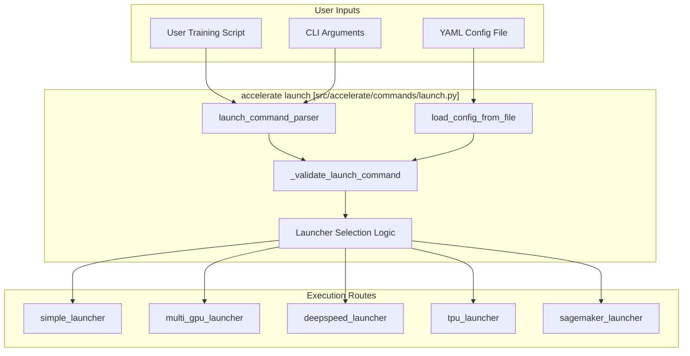
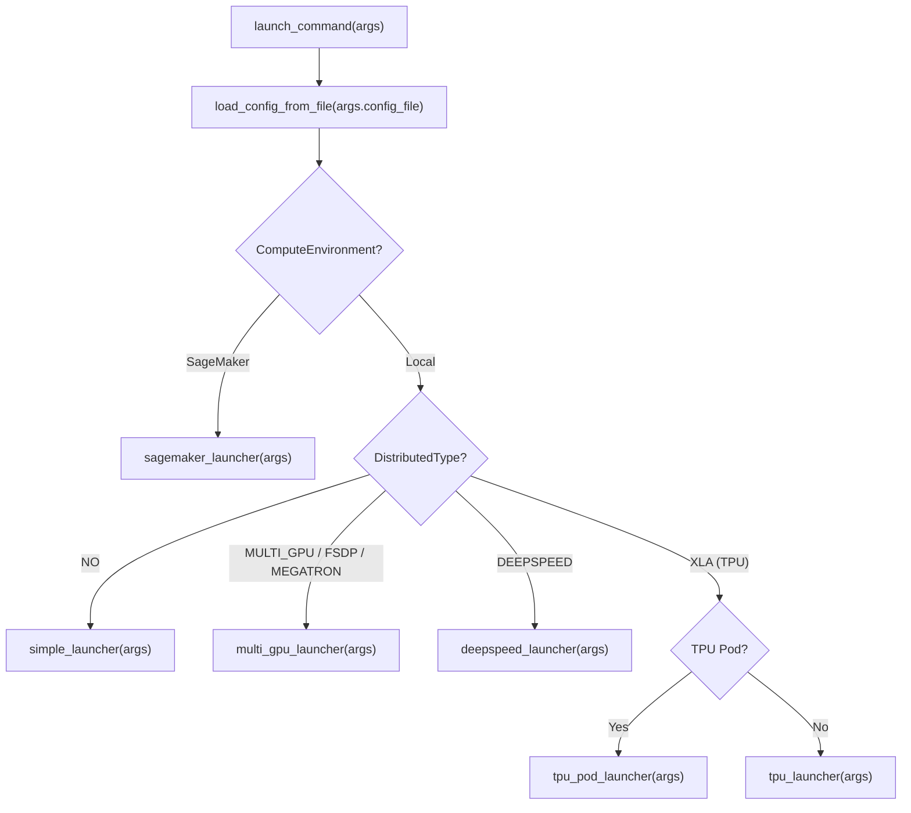

<!-- source: DeepWiki mcp.deepwiki.com · repo huggingface/accelerate · page 6.1 accelerate launch · fetched 2026-10-21 -->

# accelerate launch

<details>
<summary>Relevant source files</summary>

The following files were used as context for generating this wiki page:

- [docs/source/usage_guides/model_size_estimator.md](docs/source/usage_guides/model_size_estimator.md)
- [src/accelerate/commands/config/cluster.py](src/accelerate/commands/config/cluster.py)
- [src/accelerate/commands/config/config_args.py](src/accelerate/commands/config/config_args.py)
- [src/accelerate/commands/config/sagemaker.py](src/accelerate/commands/config/sagemaker.py)
- [src/accelerate/commands/estimate.py](src/accelerate/commands/estimate.py)
- [src/accelerate/commands/launch.py](src/accelerate/commands/launch.py)
- [src/accelerate/utils/constants.py](src/accelerate/utils/constants.py)
- [src/accelerate/utils/launch.py](src/accelerate/utils/launch.py)
- [tests/test_cli.py](tests/test_cli.py)

</details>


The `accelerate launch` command is the primary entry point for running machine learning training scripts across different hardware configurations using Hugging Face's Accelerate library. It provides a unified interface for executing the same code on diverse computing environments, including single GPUs, multiple GPUs, TPUs, and various distributed training setups.

For information about configuring Accelerate before launching, see [accelerate config](#6.2).

## Overview

`accelerate launch` abstracts away the complexity of setting up distributed training environments, allowing you to focus on your model code rather than platform-specific setup. The command handles:

- Environment variable configuration for distributed training.
- Process spawning and coordination.
- Integration with various distributed training frameworks (DeepSpeed, FSDP, Megatron-LM).
- Mixed precision training setup (FP16, BF16, FP8).
- Hardware-specific optimizations.

### Logic Flow and Architecture

The command routes to different backend launchers based on detected hardware or provided arguments.



**Sources:** [src/accelerate/commands/launch.py:141-154](), [src/accelerate/commands/launch.py:987-1066](), [src/accelerate/commands/config/config_args.py:43-73]()

## Basic Usage

The simplest form of the command is:

```bash
accelerate launch training_script.py
```

This will run the script according to the default configuration found at `~/.cache/huggingface/accelerate/default_config.yaml` [src/accelerate/commands/config/config_args.py:29-40]().

To specify a specific configuration file:

```bash
accelerate launch --config_file my_config.yaml training_script.py
```

Any arguments after your training script are captured as `training_script_args` and passed directly to the script [src/accelerate/commands/launch.py:765-766]().

## Command-Line Arguments

The `accelerate launch` command supports numerous arguments organized into categories. These arguments can override values from the configuration file via `_validate_launch_command` [src/accelerate/commands/launch.py:772-881]().

### Core and Hardware Arguments

| Argument | Description | File Source |
|----------|-------------|-------------|
| `--config_file` | Path to configuration YAML file. | [src/accelerate/commands/launch.py:159-162]() |
| `--cpu` | Force training on CPU only. | [src/accelerate/commands/launch.py:173-175]() |
| `--multi_gpu` | Enable multi-GPU distributed training. | [src/accelerate/commands/launch.py:177-181]() |
| `--tpu` | Enable TPU training. | [src/accelerate/commands/launch.py:182-184]() |
| `--mixed_precision` | Choice of `no`, `fp16`, `bf16`, `fp8`. | [src/accelerate/commands/launch.py:190-199]() |
| `--num_processes` | Total number of processes to launch. | [src/accelerate/commands/launch.py:200-202]() |
| `--module` | Run training script as a Python module. | [src/accelerate/commands/launch.py:353-355]() |

### DeepSpeed Arguments
When `--use_deepspeed` is active, these arguments configure the `DeepSpeedPlugin` behavior [src/accelerate/commands/launch.py:409-509]().

*   `--deepspeed_config_file`: Path to the DeepSpeed JSON config.
*   `--zero_stage`: ZeRO optimization stage (0, 1, 2, 3).
*   `--offload_optimizer_device`: Device for optimizer offloading (`cpu`, `nvme`).
*   `--deepspeed_multinode_launcher`: Selection from `DEEPSPEED_MULTINODE_LAUNCHERS` (e.g., `pdsh`, `slurm`) [src/accelerate/utils/constants.py:49]().

### FSDP Arguments
When `--use_fsdp` is active, these control the `FullyShardedDataParallelPlugin` [src/accelerate/commands/launch.py:512-604]().

*   `--fsdp_version`: Choice of `1` or `2`.
*   `--fsdp_sharding_strategy`: Sharding method (e.g., `FULL_SHARD`, `HYBRID_SHARD`) [src/accelerate/utils/constants.py:38]().
*   `--fsdp_auto_wrap_policy`: Policy for wrapping layers [src/accelerate/utils/constants.py:39]().

### FP8 Arguments
FP8 support requires specific backends and environment setup [src/accelerate/commands/launch.py:782-853]().

*   `--fp8_backend`: Selection from `te` (Transformer Engine), `ao` (torchao), or `msamp`.
*   Implementation: `setup_fp8_env` maps these CLI args to environment variables prefixed with `ACCELERATE_FP8_` [src/accelerate/utils/launch.py:82-97]().

## Launcher Implementation Details

### Launcher Selection Logic

The CLI entry point `launch_command` performs hardware detection and configuration loading to decide which sub-launcher to invoke.


**Sources:** [src/accelerate/commands/launch.py:987-1066]()

### Simple Launcher
The `simple_launcher` is used for single-process execution (CPU or single GPU). It uses `prepare_simple_launcher_cmd_env` to build the command list and set environment variables like `ACCELERATE_USE_CPU` and `CUDA_VISIBLE_DEVICES` [src/accelerate/utils/launch.py:100-194]().

### Multi-GPU Launcher
The `multi_gpu_launcher` relies on `torch.distributed.run` (or `torch.distributed.launch` for older versions). It calls `prepare_multi_gpu_env` to set up variables for FSDP, Megatron-LM, and general distributed orchestration [src/accelerate/utils/launch.py:197-393]().

Key logic in `prepare_multi_gpu_env`:
1.  **Port Selection**: Uses `get_free_port()` if `main_process_port` is 0 [src/accelerate/utils/launch.py:214-215]().
2.  **Environment Mapping**: Maps `DistributedType` specific configs (FSDP, Megatron) to environment variables [src/accelerate/utils/launch.py:298-384]().
3.  **Argument Filtering**: Uses `_filter_args` to extract only valid `TORCH_LAUNCH_PARAMS` for the underlying PyTorch launcher [src/accelerate/utils/launch.py:47-55](), [src/accelerate/utils/constants.py:63-87]().

### DeepSpeed Launcher
The `deepspeed_launcher` handles multi-node coordination. If using a specific multinode launcher like `pdsh` or `slurm`, it constructs a `deepspeed` command directly [src/accelerate/utils/launch.py:444-500](). Otherwise, it falls back to `torch.distributed.run` while setting `ACCELERATE_USE_DEEPSPEED="true"` [src/accelerate/utils/launch.py:534-596]().

### TPU Launcher
The `tpu_launcher` uses `torch_xla.distributed.xla_multiprocessing.spawn` (aliased as `xmp.spawn`) to launch the `main_training_function` across TPU cores [src/accelerate/commands/launch.py:872-905]().

## Environment Variable Mapping

The `Accelerator` class in training scripts relies on environment variables set by the launcher.

| Code Entity | Environment Variable | Purpose |
|-------------|----------------------|---------|
| `PrecisionType` | `ACCELERATE_MIXED_PRECISION` | Communicates FP16/BF16/FP8 intent [src/accelerate/utils/launch.py:175]() |
| `DistributedType.FSDP` | `ACCELERATE_USE_FSDP` | Triggers FSDP plugin initialization [src/accelerate/utils/launch.py:299]() |
| `DistributedType.DEEPSPEED` | `ACCELERATE_USE_DEEPSPEED` | Triggers DeepSpeed plugin initialization [src/accelerate/utils/launch.py:535]() |
| `DistributedType.MULTI_GPU` | `MASTER_ADDR` / `MASTER_PORT` | Standard PyTorch DDP coordination [src/accelerate/utils/launch.py:162-163]() |
| `DistributedType.MULTI_XPU` | `ZE_AFFINITY_MASK` | Intel XPU device visibility [src/accelerate/utils/launch.py:138]() |

**Sources:** [src/accelerate/utils/launch.py:82-181](), [src/accelerate/utils/launch.py:253-393](), [src/accelerate/utils/launch.py:534-585]()

## Integration with Job Schedulers (SLURM)

For SLURM environments, `accelerate launch` can be used within a sbatch script. The launcher detects the `node_rank` and `master_addr` if provided, or allows the DeepSpeed/MPI backends to handle it.

Example SLURM logic for multi-node:
```bash
# Obtain head node IP
head_node_ip=$(scontrol show hostnames $SLURM_JOB_NODELIST | head -n 1)

accelerate launch \
    --num_processes $((SLURM_NNODES * 4)) \
    --num_machines $SLURM_NNODES \
    --main_process_ip $head_node_ip \
    --main_process_port 29500 \
    train.py
```
**Sources:** [src/accelerate/commands/launch.py:297-313](), [src/accelerate/utils/launch.py:153-163]()

---

