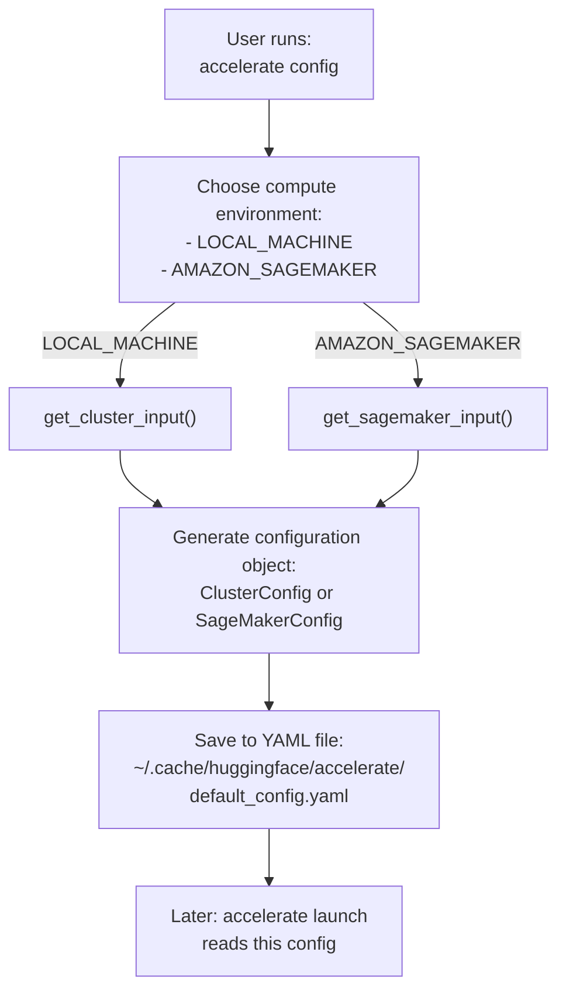
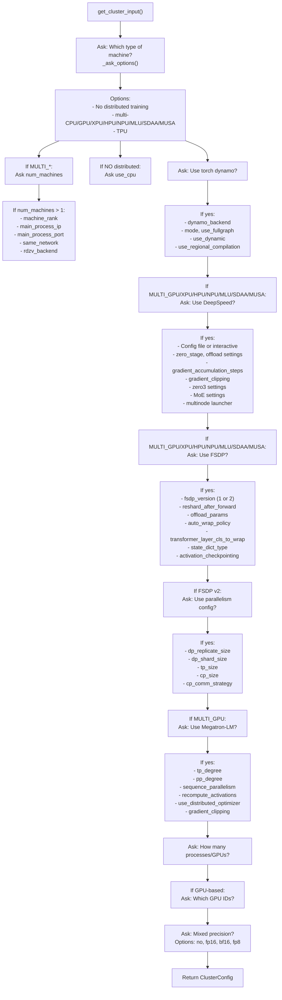
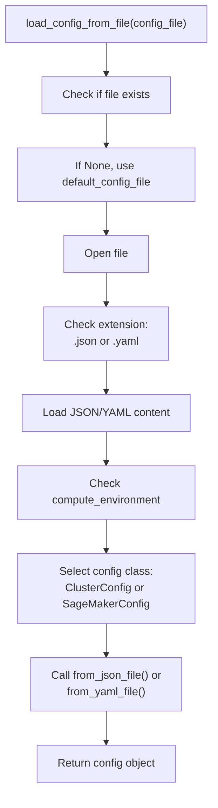
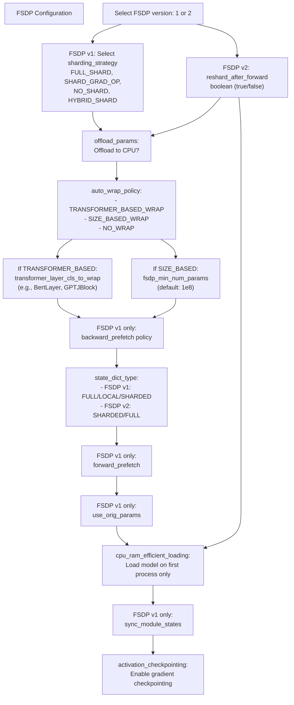
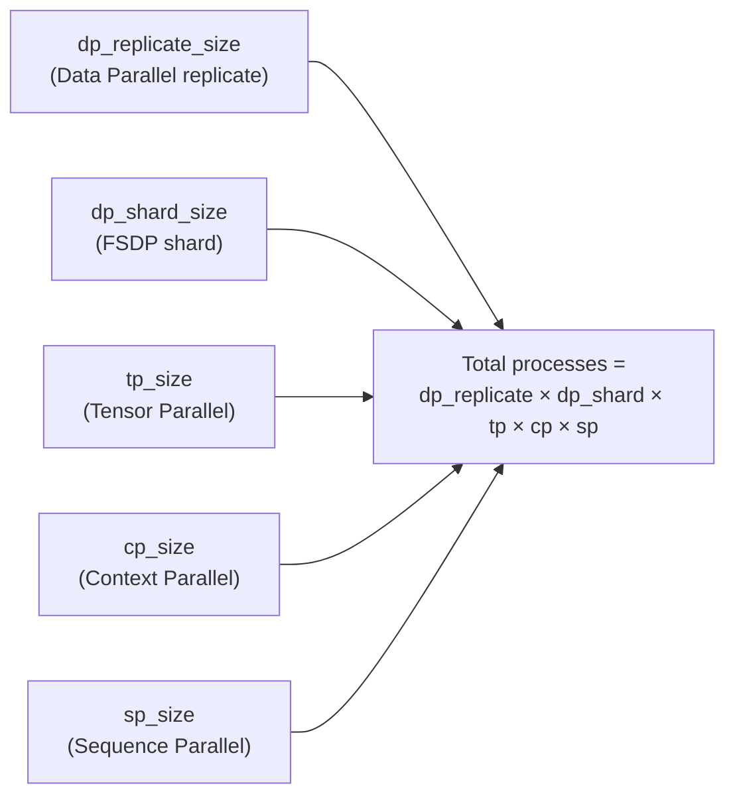
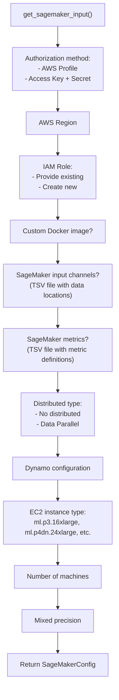

<!-- source: DeepWiki mcp.deepwiki.com · repo huggingface/accelerate · page 6.2 accelerate config · fetched 2026-10-21 -->

# accelerate config

<details>
<summary>Relevant source files</summary>

The following files were used as context for generating this wiki page:

- [src/accelerate/commands/config/cluster.py](src/accelerate/commands/config/cluster.py)
- [src/accelerate/commands/config/config_args.py](src/accelerate/commands/config/config_args.py)
- [src/accelerate/commands/config/config_utils.py](src/accelerate/commands/config/config_utils.py)
- [src/accelerate/commands/config/default.py](src/accelerate/commands/config/default.py)
- [src/accelerate/commands/config/sagemaker.py](src/accelerate/commands/config/sagemaker.py)
- [src/accelerate/commands/launch.py](src/accelerate/commands/launch.py)
- [src/accelerate/utils/constants.py](src/accelerate/utils/constants.py)
- [src/accelerate/utils/launch.py](src/accelerate/utils/launch.py)

</details>


## Overview

The `accelerate config` command creates a configuration file that defines the training environment settings for distributed training. This file is subsequently used by [accelerate launch](#6.1) to properly initialize the training environment without requiring command-line arguments on every launch.

The configuration system separates environment setup from script execution: users configure once and launch many times. The command runs an interactive questionnaire that prompts for hardware type, distributed training settings, mixed precision options, and framework-specific configurations (DeepSpeed, FSDP, Megatron-LM).

The generated configuration file is stored by default at `~/.cache/huggingface/accelerate/default_config.yaml` and contains all settings needed to launch distributed training jobs.

Sources: [src/accelerate/commands/config/config_args.py:29-40]()

## Configuration Workflow



**Figure 1: Configuration Command Workflow**

The command follows a two-phase flow: first determining the compute environment, then collecting environment-specific settings through an interactive questionnaire. The result is a structured configuration object serialized to YAML or JSON.

Sources: [src/accelerate/commands/config/cluster.py:58-74](), [src/accelerate/commands/config/sagemaker.py:97-120](), [src/accelerate/commands/config/config_args.py:43-72]()

## Configuration Types

The system supports two primary configuration classes, both inheriting from `BaseConfig`:

### ClusterConfig

Used for local machine and cluster training scenarios. This is the most common configuration type for standard distributed training setups.

| Field | Type | Description |
|-------|------|-------------|
| `compute_environment` | `ComputeEnvironment` | Always `LOCAL_MACHINE` |
| `distributed_type` | `DistributedType` | NO, MULTI_GPU, MULTI_CPU, MULTI_XPU, MULTI_HPU, MULTI_NPU, MULTI_MLU, MULTI_SDAA, MULTI_MUSA, DEEPSPEED, FSDP, MEGATRON_LM, XLA |
| `num_processes` | `int` | Total number of processes for distributed training |
| `num_machines` | `int` | Number of nodes in multi-node setup |
| `machine_rank` | `int` | Rank of current machine (0 for main process) |
| `main_process_ip` | `str` | IP address of rank 0 machine |
| `main_process_port` | `int` | Port for distributed communication |
| `mixed_precision` | `str` | "no", "fp16", "bf16", or "fp8" |
| `gpu_ids` | `str` | Comma-separated GPU IDs or "all" |
| `deepspeed_config` | `dict` | DeepSpeed-specific settings |
| `fsdp_config` | `dict` | FSDP-specific settings |
| `megatron_lm_config` | `dict` | Megatron-LM-specific settings |
| `parallelism_config` | `dict` | N-dimensional parallelism settings |
| `dynamo_config` | `dict` | Torch Dynamo compilation settings |

Sources: [src/accelerate/commands/config/config_args.py:75-101](), [src/accelerate/commands/config/config_args.py:178-233]()

### SageMakerConfig

Used for Amazon SageMaker training jobs with different field requirements.

| Field | Type | Description |
|-------|------|-------------|
| `compute_environment` | `ComputeEnvironment` | Always `AMAZON_SAGEMAKER` |
| `distributed_type` | `SageMakerDistributedType` | NO, DATA_PARALLEL, MODEL_PARALLEL |
| `ec2_instance_type` | `str` | AWS instance type (e.g., "ml.p3.16xlarge") |
| `iam_role_name` | `str` | IAM role for SageMaker execution |
| `image_uri` | `str` | Custom Docker image URI (optional) |
| `region` | `str` | AWS region |
| `num_machines` | `int` | Number of training instances |
| `mixed_precision` | `str` | "no", "fp16", "bf16", or "fp8" |

Sources: [src/accelerate/commands/config/config_args.py:235-252]()

## Interactive Configuration Flow for Local/Cluster Training

The `get_cluster_input()` function in [src/accelerate/commands/config/cluster.py:59]() orchestrates the interactive questionnaire for local and cluster configurations.



**Figure 2: Interactive Configuration Flow for ClusterConfig**

The questionnaire uses helper functions from `config_utils.py` to prompt users and convert responses:

| Function | Purpose | Source |
|----------|---------|--------|
| `_ask_field()` | Prompt for text input with optional conversion and default | [src/accelerate/commands/config/config_utils.py:47-58]() |
| `_ask_options()` | Display menu of options using `BulletMenu` | [src/accelerate/commands/config/config_utils.py:60-63]() |
| `_convert_yes_no_to_bool()` | Convert "yes"/"no" to boolean | [src/accelerate/commands/config/config_utils.py:110-111]() |
| `_convert_distributed_mode()` | Convert selection index to `DistributedType` enum | [src/accelerate/commands/config/config_utils.py:71-88]() |
| `_convert_dynamo_backend()` | Convert selection to `DynamoBackend` enum | [src/accelerate/commands/config/config_utils.py:90-92]() |

Sources: [src/accelerate/commands/config/cluster.py:59-606](), [src/accelerate/commands/config/config_utils.py:47-111]()

## Configuration File Format

Configuration files are saved in YAML format (JSON also supported for backward compatibility). The structure matches the dataclass fields.

### Example ClusterConfig YAML

```yaml
compute_environment: LOCAL_MACHINE
distributed_type: MULTI_GPU
num_processes: 4
num_machines: 1
machine_rank: 0
main_process_ip: null
main_process_port: null
gpu_ids: all
mixed_precision: fp16
use_cpu: false
debug: false
enable_cpu_affinity: false
downcast_bf16: false

deepspeed_config:
  zero_stage: 2
  offload_optimizer_device: none
  offload_param_device: none
  gradient_accumulation_steps: 1
  gradient_clipping: 1.0
  zero3_init_flag: false
  zero3_save_16bit_model: false

fsdp_config: {}
megatron_lm_config: {}
parallelism_config: {}

dynamo_config:
  dynamo_backend: INDUCTOR
  dynamo_mode: default
  dynamo_use_fullgraph: false
  dynamo_use_dynamic: false
  dynamo_use_regional_compilation: false
```

### Configuration File Location

The default configuration file location is determined by:

```
HF_HOME (env var) or ~/.cache/huggingface
    └── accelerate/
        └── default_config.yaml
```

The path resolution logic:

```python
hf_cache_home = os.path.expanduser(
    os.environ.get("HF_HOME", os.path.join(os.environ.get("XDG_CACHE_HOME", "~/.cache"), "huggingface"))
)
cache_dir = os.path.join(hf_cache_home, "accelerate")
default_json_config_file = os.path.join(cache_dir, "default_config.yaml")
default_yaml_config_file = os.path.join(cache_dir, "default_config.yaml")
```

Sources: [src/accelerate/commands/config/config_args.py:29-40]()

## Loading and Saving Configuration

### Saving Configuration

Configuration objects provide serialization methods:

```python
# Save as YAML (preferred)
config.to_yaml_file(yaml_file)

# Save as JSON (legacy)
config.to_json_file(json_file)
```

The `to_dict()` method converts the dataclass to a dictionary, handling enum serialization:

Sources: [src/accelerate/commands/config/config_args.py:83-100](), [src/accelerate/commands/config/config_args.py:143-146](), [src/accelerate/commands/config/config_args.py:162-164]()

### Loading Configuration

The `load_config_from_file()` function automatically detects file format and config type:



**Figure 3: Configuration Loading Process**

Key functions:

| Function | Purpose | Source |
|----------|---------|--------|
| `load_config_from_file()` | Main entry point for loading config | [src/accelerate/commands/config/config_args.py:43-72]() |
| `ClusterConfig.from_yaml_file()` | Load ClusterConfig from YAML | [src/accelerate/commands/config/config_args.py:149-160]() |
| `ClusterConfig.from_json_file()` | Load ClusterConfig from JSON | [src/accelerate/commands/config/config_args.py:129-141]() |
| `BaseConfig.process_config()` | Validate and set defaults | [src/accelerate/commands/config/config_args.py:103-126]() |

Sources: [src/accelerate/commands/config/config_args.py:43-72](), [src/accelerate/commands/config/config_args.py:103-160]()

## DeepSpeed Configuration Options

When DeepSpeed is selected, the interactive flow collects specific settings stored in the `deepspeed_config` dictionary:

| Setting | Description | Interactive Prompt |
|---------|-------------|-------------------|
| `deepspeed_config_file` | Path to existing DeepSpeed JSON config | "Do you want to specify a json file to a DeepSpeed config?" |
| `zero_stage` | ZeRO optimization stage (0, 1, 2, 3) | "What should be your DeepSpeed's ZeRO optimization stage?" |
| `offload_optimizer_device` | Where to offload optimizer states (none/cpu/nvme) | "Where to offload optimizer states?" |
| `offload_param_device` | Where to offload parameters (none/cpu/nvme) | "Where to offload parameters?" |
| `gradient_accumulation_steps` | Number of gradient accumulation steps | "How many gradient accumulation steps you're passing in your script?" |
| `gradient_clipping` | Gradient clipping value | "What is the gradient clipping value?" |
| `zero3_init_flag` | Enable `deepspeed.zero.Init` for ZeRO Stage-3 | "Do you want to enable `deepspeed.zero.Init`?" |
| `zero3_save_16bit_model` | Save 16-bit weights with ZeRO Stage-3 | "Do you want to save 16-bit model weights when using ZeRO Stage-3?" |
| `deepspeed_multinode_launcher` | Multi-node launcher type | "Which Type of launcher do you want to use?" (pdsh, standard, openmpi, etc.) |

Sources: [src/accelerate/commands/config/cluster.py:224-368](), [src/accelerate/utils/constants.py:49]()

## FSDP Configuration Options

When FSDP is selected, the configuration flow differs based on FSDP version (1 or 2):



**Figure 4: FSDP Configuration Decision Tree**

Key FSDP settings:

| Setting | FSDP v1 | FSDP v2 | Description |
|---------|---------|---------|-------------|
| `fsdp_version` | ✓ | ✓ | Version selection (1 or 2) |
| `fsdp_reshard_after_forward` | Enum | Boolean | v1: sharding strategy; v2: boolean reshard flag |
| `fsdp_offload_params` | ✓ | ✓ | Offload params/gradients to CPU |
| `fsdp_auto_wrap_policy` | ✓ | ✓ | How to wrap layers |
| `fsdp_transformer_layer_cls_to_wrap` | ✓ | ✓ | Layer classes to wrap |
| `fsdp_min_num_params` | ✓ | ✓ | Minimum params for SIZE_BASED wrapping |
| `fsdp_backward_prefetch` | ✓ | ✗ | Prefetch policy for backward pass |
| `fsdp_state_dict_type` | ✓ | ✓ | State dict format for checkpointing |
| `fsdp_forward_prefetch` | ✓ | ✗ | Enable forward prefetch |
| `fsdp_use_orig_params` | ✓ | ✗ | Use original parameter references |
| `fsdp_cpu_ram_efficient_loading` | ✓ | ✓ | RAM-efficient model loading |
| `fsdp_sync_module_states` | ✓ | ✗ | Broadcast params from rank 0 |
| `fsdp_activation_checkpointing` | ✓ | ✓ | Enable activation checkpointing |

Sources: [src/accelerate/commands/config/cluster.py:369-499](), [src/accelerate/utils/constants.py:38-46]()

## Parallelism Configuration (N-dimensional Parallelism)

When FSDP v2 is selected, users can optionally configure N-dimensional parallelism:



**Figure 5: N-dimensional Parallelism Configuration**

Configuration options include `dp_replicate_size`, `dp_shard_size`, `tp_size`, `cp_size`, and `sp_size`. These allow sharding across multiple dimensions of a device mesh.

Sources: [src/accelerate/commands/config/cluster.py:500-546]()

## Megatron-LM Configuration Options

When Megatron-LM is selected (only available for `MULTI_GPU`), the following settings are collected:

| Setting | Description | Interactive Prompt |
|---------|-------------|-------------------|
| `megatron_lm_tp_degree` | Tensor Parallelism degree | "What is the Tensor Parallelism degree/size?" |
| `megatron_lm_sequence_parallelism` | Enable sequence parallelism | "Do you want to enable Sequence Parallelism?" |
| `megatron_lm_pp_degree` | Pipeline Parallelism degree | "What is the Pipeline Parallelism degree/size?" |
| `megatron_lm_num_micro_batches` | Number of micro-batches | "What is the number of micro-batches?" |
| `megatron_lm_recompute_activations` | Enable selective activation recomputation | "Do you want to enable selective activation recomputation?" |
| `megatron_lm_use_distributed_optimizer` | Shard optimizer state across DP ranks | "Do you want to use distributed optimizer?" |
| `megatron_lm_gradient_clipping` | Gradient clipping based on global L2 norm | "What is the gradient clipping value based on global L2 Norm?" |

Sources: [src/accelerate/commands/config/cluster.py:547-606]()

## Dynamo Configuration Options

Torch Dynamo compilation settings can be configured for any training type:

| Setting | Description | Options |
|---------|-------------|---------|
| `dynamo_backend` | Compilation backend | EAGER, INDUCTOR, CUDAGRAPHS, etc. |
| `dynamo_mode` | Compilation mode | default, reduce-overhead, max-autotune |
| `dynamo_use_fullgraph` | Force full graph mode (no subgraphs) | true/false |
| `dynamo_use_dynamic` | Enable dynamic shape tracing | true/false |
| `dynamo_use_regional_compilation` | Enable regional compilation | true/false |

Sources: [src/accelerate/commands/config/cluster.py:161-208](), [src/accelerate/commands/config/config_utils.py:30-44](), [src/accelerate/utils/constants.py:50]()

## Quick Default Configuration

The `accelerate config default` command creates a minimal configuration file without the interactive questionnaire:

```bash
accelerate config default --mixed_precision fp16
```

This command:
1. Detects available hardware (GPUs, CPUs, XPUs, NPUs, etc.)
2. Sets appropriate `distributed_type` based on device count
3. Creates a basic configuration with minimal settings
4. Saves to the default location

The `write_basic_config()` function handles this detection and file generation.

Sources: [src/accelerate/commands/config/default.py:37-139]()

## Configuration for Different Hardware

The interactive flow adapts based on selected hardware type:

| Hardware Type | Distributed Type | Key Configuration Differences |
|---------------|------------------|------------------------------|
| No distributed training | `NO` | Single process, optional CPU-only mode |
| multi-CPU | `MULTI_CPU` | Optional MPI launch with hostfile |
| multi-GPU | `MULTI_GPU` | GPU ID selection, supports DeepSpeed/FSDP/Megatron-LM |
| multi-XPU (Intel) | `MULTI_XPU` | Uses `ZE_AFFINITY_MASK` for device selection |
| multi-HPU (Habana) | `MULTI_HPU` | Uses `HABANA_VISIBLE_MODULES` for device selection |
| multi-NPU (Ascend) | `MULTI_NPU` | Uses `ASCEND_RT_VISIBLE_DEVICES` for device selection |
| multi-MLU (Cambricon) | `MULTI_MLU` | Uses `MLU_VISIBLE_DEVICES` for device selection |
| multi-SDAA | `MULTI_SDAA` | Uses `SDAA_VISIBLE_DEVICES` for device selection |
| multi-MUSA | `MULTI_MUSA` | Uses `MUSA_VISIBLE_DEVICES` for device selection |
| TPU | `XLA` | TPU-specific settings |

Sources: [src/accelerate/commands/config/cluster.py:59-156](), [src/accelerate/utils/launch.py:136-152]()

## SageMaker Configuration Flow

The SageMaker configuration flow focuses on AWS-specific settings:



**Figure 6: SageMaker Configuration Flow**

Notable SageMaker-specific prompts include AWS authentication, IAM role management (using `boto3`), EC2 instance type selection (checked against `SAGEMAKER_PARALLEL_EC2_INSTANCES`), and input/metric TSV file paths.

Sources: [src/accelerate/commands/config/sagemaker.py:97-274](), [src/accelerate/utils/constants.py:37]()

## Configuration Validation

The `BaseConfig.process_config()` method validates and sets default values:

1. **Required fields check**: Ensures `distributed_type` is specified.
2. **Default values**: Sets defaults for missing fields (e.g., `num_processes=1` for NO distributed).
3. **Legacy conversion**: Converts old `fp16` field to `mixed_precision`.
4. **Dynamo config migration**: Converts old `dynamo_backend` to nested `dynamo_config`.
5. **Extra keys detection**: Raises error if unknown configuration keys are present.

Sources: [src/accelerate/commands/config/config_args.py:103-126]()

## Summary

The `accelerate config` command provides a comprehensive interactive questionnaire that generates structured configuration files for distributed training. The system supports multiple compute environments, distributed types covering various hardware, and framework-specific configurations (DeepSpeed, FSDP v1/v2, Megatron-LM), while also providing a `default` command for automated detection.

Sources: [src/accelerate/commands/config/cluster.py:59-606](), [src/accelerate/commands/config/default.py:37-139](), [src/accelerate/commands/config/config_args.py:75-252]()

---

