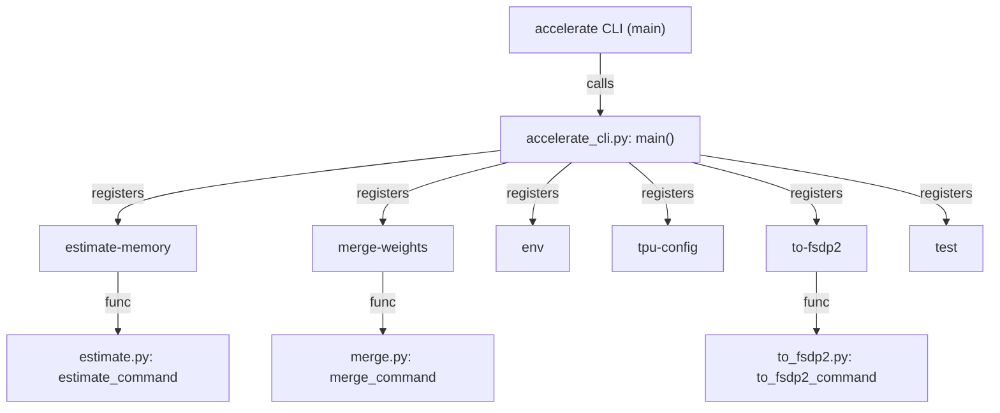
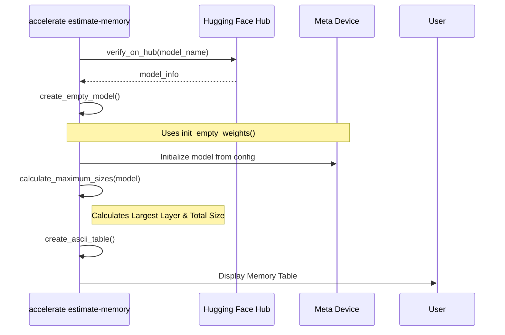

<!-- source: DeepWiki mcp.deepwiki.com · repo huggingface/accelerate · page 6.3 Other CLI Commands · fetched 2026-10-21 -->

# Other CLI Commands

Relevant source files

The following files were used as context for generating this wiki page:

- [docs/source/usage_guides/model_size_estimator.md](docs/source/usage_guides/model_size_estimator.md)
- [src/accelerate/commands/__init__.py](src/accelerate/commands/__init__.py)
- [src/accelerate/commands/accelerate_cli.py](src/accelerate/commands/accelerate_cli.py)
- [src/accelerate/commands/config/__init__.py](src/accelerate/commands/config/__init__.py)
- [src/accelerate/commands/config/config.py](src/accelerate/commands/config/config.py)
- [src/accelerate/commands/estimate.py](src/accelerate/commands/estimate.py)
- [src/accelerate/commands/merge.py](src/accelerate/commands/merge.py)
- [tests/test_cli.py](tests/test_cli.py)

This page documents the additional command-line interface (CLI) tools provided by the Accelerate library beyond the core `accelerate launch` and `accelerate config` commands. These supplementary commands assist with memory estimation, FSDP weight merging, environment testing, TPU configuration, and FSDP version migration.

## Command Registration and Entry Point

The `accelerate` CLI is managed via `CustomArgumentParser` in `src/accelerate/commands/accelerate_cli.py`. Subcommands are registered to the main parser, routing to specific command functions.

Sources: [src/accelerate/commands/accelerate_cli.py:28-54](), [src/accelerate/commands/merge.py:58-58](), [src/accelerate/commands/estimate.py:306-306]()

## accelerate estimate-memory

The `estimate-memory` command calculates the memory footprint for loading and training models from the Hugging Face Hub. It utilizes the `meta` device to avoid downloading full weights.

### Usage and Logic
The command downloads only the `config.json` (for `transformers`) or metadata (for `timm`), initializes the model using `init_empty_weights`, and calculates sizes based on parameter counts and dtypes [src/accelerate/commands/estimate.py:66-143]().

| Argument | Description |
|----------|-------------|
| `model_name` | The model identifier on the Hub [src/accelerate/commands/estimate.py:311-311](). |
| `--library_name` | Manually specify `transformers` or `timm` [src/accelerate/commands/estimate.py:315-315](). |
| `--dtypes` | Space-separated list of dtypes (e.g., `float32 float16 int8 int4`) [src/accelerate/commands/estimate.py:316-316](). |
| `--trust_remote_code` | Required for models with custom modeling files [src/accelerate/commands/estimate.py:317-317](). |

### Memory Estimation Workflow

Sources: [src/accelerate/commands/estimate.py:40-48](), [src/accelerate/commands/estimate.py:118-130](), [src/accelerate/commands/estimate.py:217-258]()

## accelerate merge-weights

This utility merges sharded weights from FSDP checkpoints into a single consolidated file. It is specifically used when `SHARDED_STATE_DICT` was employed during training [src/accelerate/commands/merge.py:20-23]().

### Implementation
The command invokes `merge_fsdp_weights`, which is a CPU-bound process requiring enough system RAM to hold the full model state dict [src/accelerate/commands/merge.py:26-29]().

| Argument | Description |
|----------|-------------|
| `checkpoint_directory` | Directory containing FSDP sharded shards [src/accelerate/commands/merge.py:38-38](). |
| `output_path` | Target path for the merged checkpoint [src/accelerate/commands/merge.py:39-43](). |
| `--unsafe_serialization` | If set, saves as `.bin` instead of `.safetensors` [src/accelerate/commands/merge.py:44-49](). |
| `--remove_checkpoint_dir` | Deletes the sharded source after successful merge [src/accelerate/commands/merge.py:50-55](). |

Sources: [src/accelerate/commands/merge.py:32-59]()

## accelerate test

The `test` command verifies the current Accelerate environment configuration by running a standard internal test script [src/accelerate/commands/test.py:45-50]().

- **Purpose**: Confirms that `accelerate launch` will work with the current hardware and software stack.
- **Execution**: It determines the path to `test_script.py` within the package and executes it using the launch logic [tests/test_cli.py:105-108]().

Sources: [src/accelerate/commands/test.py:30-52]()

## accelerate to-fsdp2

This command automates the migration of configuration files from FSDP v1 (legacy) to FSDP v2 (modern PyTorch FSDP) [src/accelerate/commands/to_fsdp2.py:73-100]().

### Conversion Logic
1. Loads the YAML configuration using `load_config_from_file` [src/accelerate/commands/to_fsdp2.py:34-34]().
2. Maps legacy keys (e.g., `fsdp_offload_params`) to the new FSDP v2 structure [src/accelerate/commands/to_fsdp2.py:39-65]().
3. Validates that the configuration isn't already v2 to prevent double-conversion [src/accelerate/commands/to_fsdp2.py:80-83]().

Sources: [src/accelerate/commands/to_fsdp2.py:33-66](), [tests/test_cli.py:26-30]()

## accelerate tpu-config

A utility for managing TPU VM instances on Google Cloud. It wraps `gcloud` commands to facilitate setup and remote execution [src/accelerate/commands/tpu.py:100-140]().

### Key Features
- **Remote Execution**: Runs commands on TPU VMs via SSH [src/accelerate/commands/tpu.py:157]().
- **Automated Setup**: Can automatically install `accelerate` on the target TPU VM using the `--install_accelerate` flag [src/accelerate/commands/tpu.py:157]().
- **Configuration Management**: Supports reading TPU details from a local `config_file` [src/accelerate/commands/tpu.py:155-155]().

Sources: [src/accelerate/commands/tpu.py:143-157](), [tests/test_cli.py:31-31]()

---

