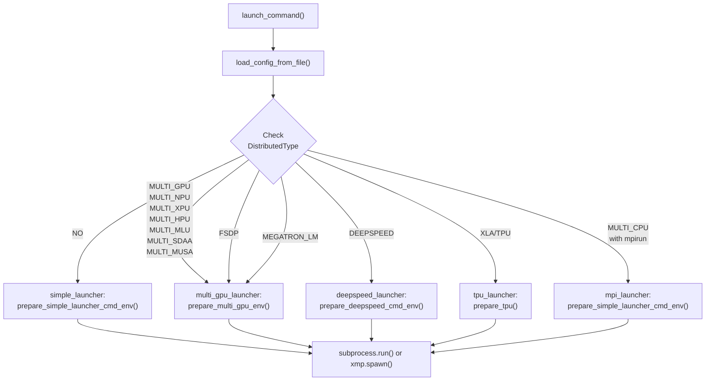
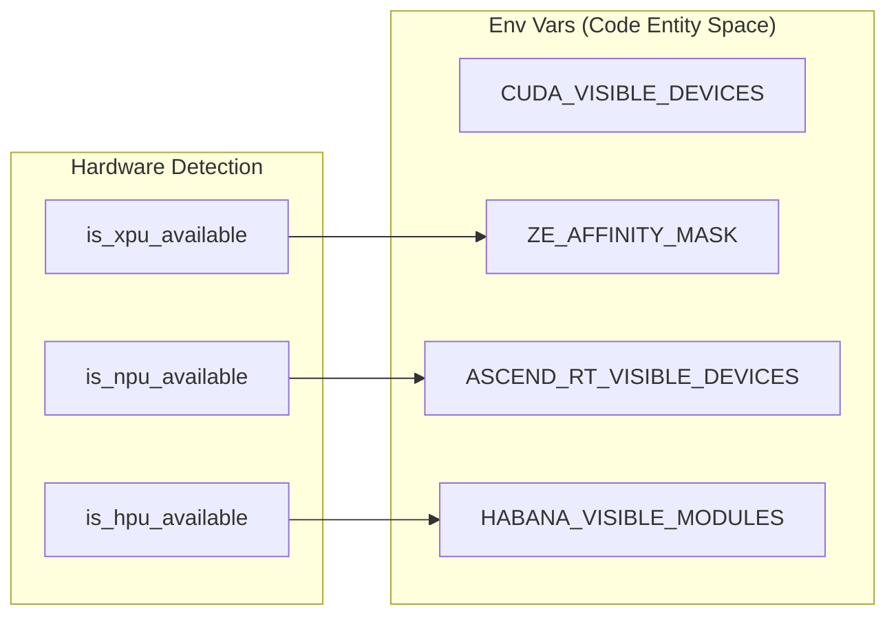

<!-- source: DeepWiki mcp.deepwiki.com · repo huggingface/accelerate · page 6.4 Environment Preparation and Launcher Types · fetched 2026-10-21 -->

# Environment Preparation and Launcher Types

Relevant source files

The following files were used as context for generating this wiki page:

- [src/accelerate/commands/config/cluster.py](src/accelerate/commands/config/cluster.py)
- [src/accelerate/commands/config/config_args.py](src/accelerate/commands/config/config_args.py)
- [src/accelerate/commands/config/sagemaker.py](src/accelerate/commands/config/sagemaker.py)
- [src/accelerate/commands/launch.py](src/accelerate/commands/launch.py)
- [src/accelerate/launchers.py](src/accelerate/launchers.py)
- [src/accelerate/test_utils/scripts/test_notebook.py](src/accelerate/test_utils/scripts/test_notebook.py)
- [src/accelerate/utils/constants.py](src/accelerate/utils/constants.py)
- [src/accelerate/utils/environment.py](src/accelerate/utils/environment.py)
- [src/accelerate/utils/launch.py](src/accelerate/utils/launch.py)

This page documents how the `accelerate launch` command prepares the environment and selects the appropriate launcher type for distributed training. This covers the internal mechanics of setting environment variables and dispatching to different distributed launchers (simple, multi-GPU, DeepSpeed, TPU, MPI).

For information about using the `accelerate launch` command itself, see [accelerate launch](#6.1). For configuration file creation, see [accelerate config](#6.2).

## Overview

When `accelerate launch` executes a training script, it performs three critical steps:

1. **Configuration Loading**: Reads settings from config file or CLI arguments.
2. **Environment Preparation**: Sets environment variables that the `Accelerator` will read during initialization.
3. **Launcher Selection**: Dispatches to the appropriate distributed launcher based on `distributed_type`.

The environment preparation step is crucial because the `Accelerator` class reads environment variables during initialization to determine hardware configuration, distributed backend, and training parameters. This architecture allows the same training script to work across different hardware and distributed configurations without code changes.

**Sources**: [src/accelerate/commands/launch.py:1-70](), [src/accelerate/utils/launch.py:1-45]()

## Launcher Selection Logic

The following diagram maps the high-level launcher selection process to the specific internal functions responsible for environment setup.

**Natural Language to Code Entity Mapping: Launcher Selection**

**Sources**: [src/accelerate/commands/launch.py:141-185](), [src/accelerate/utils/launch.py:47-55](), [src/accelerate/utils/dataclasses.py:25-45]()

## Launcher Types

### Simple Launcher

The simple launcher handles single-process execution and optionally multi-CPU training with MPI.

**Function**: `prepare_simple_launcher_cmd_env()` at [src/accelerate/utils/launch.py:100-194]()

**Command Construction**:
- If `mpirun_hostfile` is provided: Constructs MPI command with `mpirun`/`mpiexec` using `_get_mpirun_args()` [src/accelerate/utils/launch.py:58-80]().
- Otherwise: Executes Python directly via `sys.executable` [src/accelerate/utils/launch.py:126]().

**Key Environment Variables Set**:

| Variable | Description | Source |
|----------|-------------|--------|
| `ACCELERATE_USE_CPU` | Whether to force CPU usage | [src/accelerate/utils/launch.py:133]() |
| `ACCELERATE_MIXED_PRECISION` | Mixed precision setting (no/fp16/bf16/fp8) | [src/accelerate/utils/launch.py:175]() |
| `ACCELERATE_DEBUG_MODE` | Enable debug mode | [src/accelerate/utils/launch.py:135]() |
| `MASTER_ADDR`, `MASTER_PORT` | For multi-machine setups | [src/accelerate/utils/launch.py:162-163]() |
| `CUDA_VISIBLE_DEVICES` | GPU visibility control (and hardware-specific variants) | [src/accelerate/utils/launch.py:136-152]() |

### Multi-GPU Launcher

The multi-GPU launcher prepares arguments for PyTorch's distributed run API.

**Function**: `prepare_multi_gpu_env()` at [src/accelerate/utils/launch.py:197-393]()

**Natural Language to Code Entity Mapping: Environment Variables**

**Port Management**:
- If `main_process_port == 0`: Automatically finds free port via `get_free_port()` [src/accelerate/utils/other.py:41]().
- Default port: 29500 [src/accelerate/utils/launch.py:163]().

**Sources**: [src/accelerate/utils/launch.py:197-393](), [src/accelerate/utils/other.py:41]()

### DeepSpeed Launcher

The DeepSpeed launcher supports various multi-node backends.

**Function**: `prepare_deepspeed_cmd_env()` at [src/accelerate/utils/launch.py:423-608]()

**Multi-Node Launcher Options** (from `DEEPSPEED_MULTINODE_LAUNCHERS` at [src/accelerate/utils/constants.py:49]()):
- `pdsh`: Parallel distributed shell (default).
- `standard`: Uses `torch.distributed.run`.
- `slurm`: SLURM launcher.
- `nossh`: No-SSH launcher.

**Sources**: [src/accelerate/utils/launch.py:423-608](), [src/accelerate/utils/constants.py:49]()

### TPU Launcher

The TPU launcher uses `torch_xla`'s spawning mechanism for TPU training.

**Function**: `prepare_tpu()` at [src/accelerate/utils/launch.py:610-735]()

**Environment Variables Set**:

| Variable | Description | Source |
|----------|-------------|--------|
| `ACCELERATE_USE_TPU` | Enable TPU usage | [src/accelerate/utils/launch.py:617]() |
| `ACCELERATE_TPU_NAME` | Name of the TPU | [src/accelerate/utils/launch.py:623]() |
| `ACCELERATE_TPU_ZONE` | Zone of the TPU | [src/accelerate/utils/launch.py:624]() |

**Sources**: [src/accelerate/utils/launch.py:610-735]()

### MPI Launcher

The MPI launcher is used for multi-CPU training and supports multiple MPI implementations.

**MPI Implementation Detection** at [src/accelerate/utils/launch.py:58-80]():

The `_get_mpirun_args()` function detects the installed MPI implementation:

| Implementation | Detection | Arguments |
|----------------|-----------|-----------|
| Open MPI | Check `--version` for "Open MPI" | `--hostfile`, `-n`, `--npernode`, `--bind-to` |
| Intel MPI | Default if not Open MPI | `-f`, `-n`, `-ppn` |

**Sources**: [src/accelerate/utils/launch.py:58-80](), [src/accelerate/utils/launch.py:111-124]()

## Environment Variable Categories

### FP8 Variables

Set when `mixed_precision="fp8"` by `setup_fp8_env()` at [src/accelerate/utils/launch.py:82-97]().

| Variable | Description |
|----------|-------------|
| `ACCELERATE_FP8_BACKEND` | FP8 backend (ao/te/msamp) |
| `ACCELERATE_FP8_OVERRIDE_FPROP` | Override fprop precision |
| `ACCELERATE_FP8_OVERRIDE_DGRAD` | Override dgrad precision |
| `ACCELERATE_FP8_OVERRIDE_WGRAD` | Override wgrad precision |

**Sources**: [src/accelerate/utils/launch.py:82-97]()

### FSDP Variables

Set when `use_fsdp=True` by `prepare_multi_gpu_env()`:

| Variable | Description |
|----------|-------------|
| `ACCELERATE_USE_FSDP` | Enable FSDP mode |
| `FSDP_SHARDING_STRATEGY` | Sharding strategy (e.g., FULL_SHARD) |
| `FSDP_OFFLOAD_PARAMS` | Parameter offloading to CPU |
| `FSDP_AUTO_WRAP_POLICY` | Auto-wrap policy |

**Sources**: [src/accelerate/utils/launch.py:298-327](), [src/accelerate/utils/constants.py:38-42]()

## Summary Table: Launcher Characteristics

| Launcher Type | Primary Use Case | Command Builder | Execution Method |
|---------------|------------------|-----------------|------------------|
| Simple | Single process, CPU | `prepare_simple_launcher_cmd_env()` | Direct Python |
| Multi-GPU | Multi-GPU, FSDP, Megatron | `prepare_multi_gpu_env()` | `torch.distributed.run` |
| DeepSpeed | DeepSpeed training | `prepare_deepspeed_cmd_env()` | `deepspeed` CLI or `torch.distributed.run` |
| TPU | TPU/XLA training | `prepare_tpu()` | `xmp.spawn()` or gcloud SSH |
| MPI | Multi-CPU | `prepare_simple_launcher_cmd_env()` | `mpirun`/`mpiexec` |

**Sources**: [src/accelerate/utils/launch.py:1-735](), [src/accelerate/commands/launch.py:141-996]()

---

