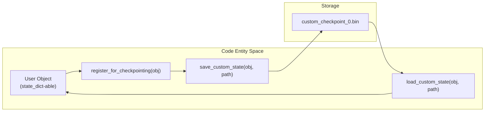

<!-- source: DeepWiki mcp.deepwiki.com · repo huggingface/accelerate · page 7 Checkpointing and State Management · fetched 2026-10-21 -->

# Checkpointing and State Management

Relevant source files

The following files were used as context for generating this wiki page:

- [src/accelerate/checkpointing.py](src/accelerate/checkpointing.py)
- [src/accelerate/commands/env.py](src/accelerate/commands/env.py)
- [src/accelerate/utils/memory.py](src/accelerate/utils/memory.py)
- [src/accelerate/utils/random.py](src/accelerate/utils/random.py)
- [tests/test_state_checkpointing.py](tests/test_state_checkpointing.py)

This document describes the checkpointing and state management system in Accelerate, which enables saving and loading complete training state for resumption and model persistence. For information about preparing models and optimizers for training, see [The Accelerator Class](#2). For details on DataLoader state persistence specifically, see [Stateful DataLoaders and Resumption](#4.4).

## Overview

Accelerate's checkpointing system provides a unified interface for saving and loading all components of a training run, including models, optimizers, schedulers, random number generator (RNG) states, gradient scalers, and dataloader positions. This allows training to be paused and resumed exactly where it left off, which is critical for long-running jobs, fault tolerance on preemptible instances, and iterative experimentation.

The system handles complexities such as:
- Different distributed training backends (DDP, FSDP, DeepSpeed, Megatron-LM).
- Sharded checkpoints for large models [src/accelerate/checkpointing.py:109-115]().
- Multiple checkpoint formats (PyTorch `.bin` and SafeTensors `.safetensors`) [src/accelerate/checkpointing.py:73]().
- Per-process RNG state synchronization [src/accelerate/checkpointing.py:154-177]().

For details on the core saving and loading functions, see [Saving and Loading State](#7.1).

**Sources:** [src/accelerate/checkpointing.py:63-106](), [src/accelerate/checkpointing.py:180-222]()

## State Components and File Structure

When `Accelerator.save_state()` is called, it creates a checkpoint directory containing separate files for each training component. The state is persisted using `save_accelerator_state` [src/accelerate/checkpointing.py:63]().

| Component | File Pattern | Content |
|-----------|--------------|---------|
| Model(s) | `pytorch_model*.bin` or `model*.safetensors` | Model weights and buffers [src/accelerate/checkpointing.py:110-113]() |
| Optimizer(s) | `optimizer*.bin` | Optimizer state (momentum, variance, etc.) [src/accelerate/checkpointing.py:117-122]() |
| Scheduler(s) | `scheduler*.bin` | Learning rate scheduler state [src/accelerate/checkpointing.py:124-129]() |
| RNG States | `random_states_*.pkl` | PyTorch, CUDA, XLA, NumPy, and Python random states per process [src/accelerate/checkpointing.py:156-177]() |
| Gradient Scaler | `scaler.pt` | `GradScaler` state for mixed precision [src/accelerate/checkpointing.py:149-153]() |
| DataLoader | `sampler*.bin` or `dl_state_dict*.bin` | Iteration position and sampler state [src/accelerate/checkpointing.py:131-146]() |

**Sources:** [src/accelerate/checkpointing.py:63-177](), [src/accelerate/utils/constants.py:18-32]()

## Save and Load Operations

The primary interface for state management is through the `Accelerator` class, which orchestrates the saving and loading of all prepared objects.

### Saving and Loading State

The system provides `save_accelerator_state` and `load_accelerator_state` to handle the bulk of the work. These functions support `safe_serialization` (using `safetensors`) for models while using `pickle` for optimizers and other metadata [src/accelerate/checkpointing.py:78-83]().

```mermaid
graph TB
    subgraph "save_accelerator_state"
        SaveEntry["save_accelerator_state(output_dir, ...)"]
        SaveModel["Save Models<br/>(safetensors if enabled)"]
        SaveOpt["Save Optimizers"]
        SaveSched["Save Schedulers"]
        SaveDL["Save DataLoader Samplers"]
        SaveRNG["Save RNG States<br/>(random_states_idx.pkl)"]
    end
    
    subgraph "load_accelerator_state"
        LoadEntry["load_accelerator_state(input_dir, ...)"]
        LoadModel["Load Models<br/>(load_model / torch.load)"]
        LoadOpt["Load Optimizers"]
        LoadSched["Load Schedulers"]
        LoadDL["Load DataLoader Samplers"]
        LoadRNG["Load RNG States<br/>(set_rng_state)"]
    end
    
    SaveEntry --> SaveModel
    SaveModel --> SaveOpt
    SaveOpt --> SaveSched
    SaveSched --> SaveDL
    SaveDL --> SaveRNG
    
    LoadEntry --> LoadModel
    LoadModel --> LoadOpt
    LoadOpt --> LoadSched
    LoadSched --> LoadDL
    LoadDL --> LoadRNG
```

For details on these functions and their parameters, see [Saving and Loading State](#7.1).

**Sources:** [src/accelerate/checkpointing.py:63-106](), [src/accelerate/checkpointing.py:180-222]()

## Custom Checkpoint Hooks

Accelerate allows users to register custom objects for checkpointing that aren't part of the standard `prepare()` flow. This is achieved through `save_custom_state` and `load_custom_state` [src/accelerate/checkpointing.py:255]().

### Custom State Management

For a guide on persisting user-defined objects, see [Custom Checkpoint Hooks](#7.2).

**Sources:** [src/accelerate/checkpointing.py:255-279](), [src/accelerate/checkpointing.py:282-303]()

## Project Configuration and Directory Management

Checkpointing behavior is heavily influenced by the `ProjectConfiguration` passed to the `Accelerator`. This includes managing the total number of checkpoints kept on disk and automatic directory naming [src/accelerate/utils/dataclasses.py:1030-1044]().

| Feature | Code Entity | Description |
|---------|-------------|-------------|
| **Checkpoint Rotation** | `total_limit` | Deletes older checkpoints when the limit is reached [src/accelerate/utils/dataclasses.py:1040]() |
| **Auto Naming** | `automatic_checkpoint_naming` | Automatically names folders `checkpoint_<N>` [src/accelerate/utils/dataclasses.py:1042]() |
| **Directory Root** | `project_dir` | The base directory where checkpoints are stored [src/accelerate/utils/dataclasses.py:1032]() |

For details on configuring these management features, see [Project Configuration and Checkpoint Management](#7.3).

**Sources:** [src/accelerate/utils/dataclasses.py:1030-1044](), [tests/test_state_checkpointing.py:114-125]()

## RNG State Synchronization

A critical part of fault tolerance is ensuring that random number generators (RNG) are consistent across the cluster after a resume. Accelerate captures states for:
- Python `random` [src/accelerate/checkpointing.py:158]()
- `numpy.random` [src/accelerate/checkpointing.py:159]()
- `torch` (CPU and device-specific like CUDA, XPU, XLA) [src/accelerate/checkpointing.py:160-177]()

The `synchronize_rng_states` utility can also be used to broadcast a seed from the main process to all others [src/accelerate/utils/random.py:163-165]().

**Sources:** [src/accelerate/checkpointing.py:154-177](), [src/accelerate/utils/random.py:81-161]()

---

