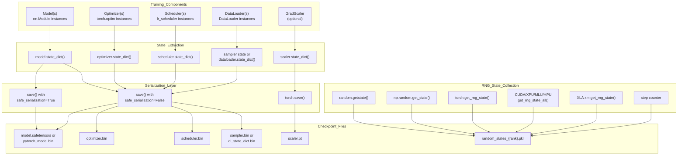
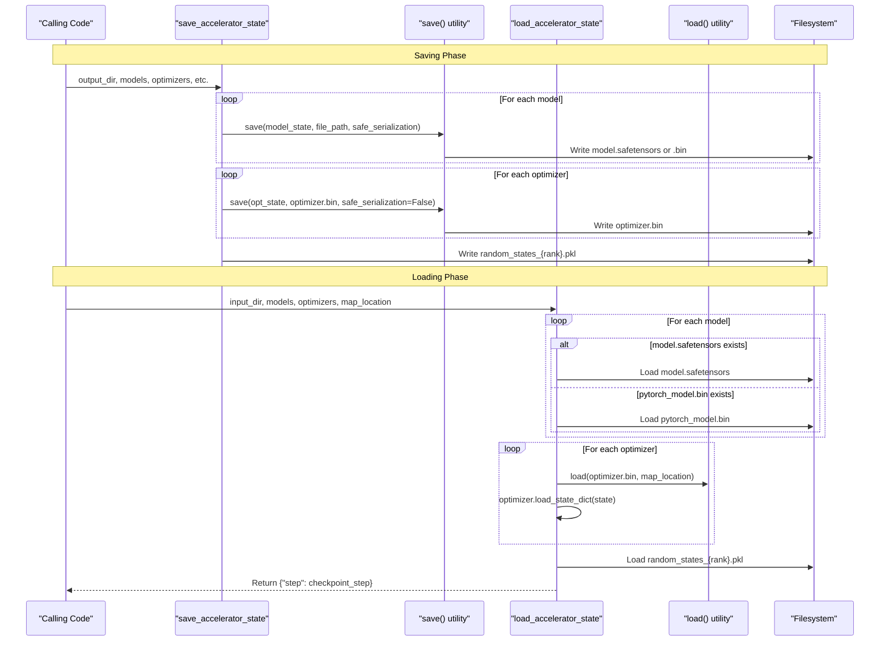

<!-- source: DeepWiki mcp.deepwiki.com · repo huggingface/accelerate · page 7.1 Saving and Loading State · fetched 2026-10-21 -->

# Saving and Loading State

<details>
<summary>Relevant source files</summary>

The following files were used as context for generating this wiki page:

- [src/accelerate/checkpointing.py](src/accelerate/checkpointing.py)
- [src/accelerate/commands/config/update.py](src/accelerate/commands/config/update.py)
- [src/accelerate/commands/env.py](src/accelerate/commands/env.py)
- [src/accelerate/commands/to_fsdp2.py](src/accelerate/commands/to_fsdp2.py)
- [src/accelerate/test_utils/scripts/test_ops.py](src/accelerate/test_utils/scripts/test_ops.py)
- [src/accelerate/utils/memory.py](src/accelerate/utils/memory.py)
- [src/accelerate/utils/operations.py](src/accelerate/utils/operations.py)
- [src/accelerate/utils/other.py](src/accelerate/utils/other.py)
- [src/accelerate/utils/random.py](src/accelerate/utils/random.py)
- [tests/test_state_checkpointing.py](tests/test_state_checkpointing.py)
- [tests/test_utils.py](tests/test_utils.py)

</details>


## Purpose and Scope

This page documents the core checkpointing system in Accelerate, which saves and loads complete training state for fault tolerance and training resumption. The functions `save_accelerator_state` and `load_accelerator_state` provide the low-level primitives that persist models, optimizers, schedulers, dataloaders, RNG states, and gradient scalers to disk.

For information about custom checkpoint hooks for user-defined objects, see [Custom Checkpoint Hooks](#7.2). For checkpoint directory management and rotation policies, see [Project Configuration and Checkpoint Management](#7.3). This page focuses exclusively on the standard state saving and loading mechanisms.

---

## Overview

The checkpointing system enables training interruption and resumption by persisting all stateful components of a training run. This includes not only trainable parameters but also optimizer momentum buffers, learning rate scheduler counters, dataloader iteration positions, and random number generator states. When loaded, these states restore the exact training configuration, allowing training to continue as if it had never been interrupted.

The system operates through two primary functions defined in [src/accelerate/checkpointing.py](). These functions handle serialization format selection (safetensors vs pickle), distributed coordination, device placement, and per-process state isolation.

Sources: [src/accelerate/checkpointing.py:1-332]()

---

## State Components

The checkpointing system persists seven categories of state:

| Component | Saved State | File Pattern | Serialization |
|-----------|-------------|--------------|---------------|
| **Models** | `state_dict()` containing parameters and buffers | `pytorch_model.bin` or `model.safetensors` | Safetensors (default) or pickle |
| **Optimizers** | `state_dict()` with parameter-specific state (momentum, etc.) | `optimizer.bin` | Pickle only |
| **Schedulers** | `state_dict()` containing step counters and configuration | `scheduler.bin` | Pickle only |
| **Dataloaders** | Sampler state and iteration position | `sampler.bin` or `dl_state_dict.bin` | Pickle only |
| **Gradient Scaler** | Loss scale value and growth tracking | `scaler.pt` | Pickle only |
| **RNG States** | Python, NumPy, PyTorch, CUDA, XLA random states | `random_states_{process_index}.pkl` | Pickle only |
| **Step Counter** | Current training step from internal tracker | Embedded in RNG state file | Pickle only |

Multiple models, optimizers, schedulers, and dataloaders are supported through numeric suffixes (e.g., `optimizer_1.bin`, `optimizer_2.bin`). RNG state files are process-specific to maintain independent random streams across distributed ranks.

Sources: [src/accelerate/checkpointing.py:63-177](), [src/accelerate/utils/constants.py:46-54]() (Inferred from usage in checkpointing.py)

---

## Saving State: `save_accelerator_state`

### Function Signature

```python
def save_accelerator_state(
    output_dir: str,
    model_states: list[dict],
    optimizers: list,
    schedulers: list,
    dataloaders: list,
    process_index: int,
    step: int,
    scaler: Optional[GradScaler] = None,
    save_on_each_node: bool = False,
    safe_serialization: bool = True,
):
```

Sources: [src/accelerate/checkpointing.py:63-74]()

### Parameters

**`output_dir`**: Directory path where checkpoint files will be written. Created if it doesn't exist. [src/accelerate/checkpointing.py:107]()

**`model_states`**: List of model `state_dict()` dictionaries. Each dictionary contains parameters and buffers. For multiple models, provide multiple dictionaries in the list. [src/accelerate/checkpointing.py:109]()

**`optimizers`**: List of optimizer instances (e.g., `torch.optim.Adam`). The function calls `state_dict()` on each to extract momentum buffers, learning rates, and other optimizer-specific state. [src/accelerate/checkpointing.py:117-118]()

**`schedulers`**: List of learning rate scheduler instances. Step counters and configuration are extracted via `state_dict()`. [src/accelerate/checkpointing.py:124-125]()

**`dataloaders`**: List of dataloader instances. For dataloaders with `SeedableRandomSampler` or stateful dataloader support, iteration state is persisted to enable mid-epoch resumption. [src/accelerate/checkpointing.py:131-145]()

**`process_index`**: Current process rank in distributed training. Used to generate process-specific RNG state files. [src/accelerate/checkpointing.py:156]()

**`step`**: Current step count from the training loop. Stored in the RNG state file for tracking progress. [src/accelerate/checkpointing.py:157]()

**`scaler`** (optional): `torch.amp.GradScaler` instance for mixed precision training. If provided, gradient scale factors are saved. [src/accelerate/checkpointing.py:149-153]()

**`save_on_each_node`** (optional, default `False`): Whether to save checkpoints on every node in multi-node distributed training. When `False`, only the main process on the main node saves. [src/accelerate/checkpointing.py:102-103]()

**`safe_serialization`** (optional, default `True`): Whether to use `safetensors` format for models. When `True`, model weights are saved as `.safetensors` files. [src/accelerate/checkpointing.py:104-105]()

Sources: [src/accelerate/checkpointing.py:63-177]()

### Behavior Details

#### Model Serialization

Models are saved with filenames determined by `safe_serialization` and model index:
- Single model with safetensors: `model.safetensors`
- Single model without safetensors: `pytorch_model.bin`
- Multiple models: `model_1.safetensors` or `pytorch_model_1.bin`, etc.

The `save` utility handles distributed coordination and format conversion.

Sources: [src/accelerate/checkpointing.py:109-116]()

#### Optimizer and Scheduler Serialization

Optimizers and schedulers are always saved using pickle format with `.bin` extension:
- `optimizer.bin`, `optimizer_1.bin`, `optimizer_2.bin`, ...
- `scheduler.bin`, `scheduler_1.bin`, `scheduler_2.bin`, ...

Sources: [src/accelerate/checkpointing.py:117-129]()

#### Dataloader State Persistence

Two mechanisms exist for dataloader state:

1. **Sampler State**: For `IterableDatasetShard` with `SeedableRandomSampler`, the sampler object itself is pickled to `sampler.bin`. [src/accelerate/checkpointing.py:137-140]()

2. **Stateful DataLoader**: For dataloaders with `use_stateful_dataloader=True`, the entire `state_dict()` is saved to `dl_state_dict.bin`. [src/accelerate/checkpointing.py:141-145]()

Sources: [src/accelerate/checkpointing.py:131-147]()

#### RNG State Preservation

All random number generator states are saved to ensure reproducibility:

```python
states = {
    "step": step,
    "random_state": random.getstate(),
    "numpy_random_seed": np.random.get_state(),
    "torch_manual_seed": torch.get_rng_state(),
}
```

Platform-specific states (CUDA, XPU, MLU, SDAA, MUSA, HPU, Neuron, XLA) are included when available. The file is named `random_states_{process_index}.pkl`.

Sources: [src/accelerate/checkpointing.py:154-177]()

---

## Loading State: `load_accelerator_state`

### Function Signature

```python
def load_accelerator_state(
    input_dir,
    models,
    optimizers,
    schedulers,
    dataloaders,
    process_index,
    scaler=None,
    map_location=None,
    load_kwargs=None,
    **load_model_func_kwargs,
):
```

Sources: [src/accelerate/checkpointing.py:180-191]()

### Parameters

**`input_dir`**: Directory path containing checkpoint files to load. [src/accelerate/checkpointing.py:195]()

**`models`**: List of model instances. States are loaded into these models via `load_state_dict()`. [src/accelerate/checkpointing.py:197]()

**`optimizers`**: List of optimizer instances. States are loaded to restore momentum buffers and configuration. [src/accelerate/checkpointing.py:199]()

**`schedulers`**: List of scheduler instances. States are loaded to restore step counters. [src/accelerate/checkpointing.py:201]()

**`dataloaders`**: List of dataloader instances. Sampler states are restored if present. [src/accelerate/checkpointing.py:203]()

**`process_index`**: Current process rank, used to load the correct RNG state file. [src/accelerate/checkpointing.py:205]()

**`map_location`** (optional): Controls where optimizer states are loaded:
- `None` or `"cpu"`: Load optimizer states to CPU.
- `"on_device"`: Load optimizer states to the current accelerator device. [src/accelerate/checkpointing.py:224-227]()

Sources: [src/accelerate/checkpointing.py:195-214]()

### Return Value

Returns a dictionary of attributes to override in the `Accelerator` instance. Currently contains:
- `"step"`: The training step counter from the checkpoint. [src/accelerate/checkpointing.py:290-291]()

Sources: [src/accelerate/checkpointing.py:218-219]()

### Behavior Details

#### Model Loading

The function attempts to load safetensors format first, falling back to pickle format:

1. Check for `model.safetensors` or `model_{i}.safetensors`. [src/accelerate/checkpointing.py:234]()
2. If found, use `safetensors.torch.load_model()` with specified device. [src/accelerate/checkpointing.py:237]()
3. If not found, load `pytorch_model.bin` or `pytorch_model_{i}.bin` with `torch.load()`. [src/accelerate/checkpointing.py:240-244]()

Sources: [src/accelerate/checkpointing.py:233-244]()

#### Optimizer State Loading

Optimizer states are loaded according to `map_location`. Loading to CPU (default) reduces peak memory usage during checkpoint restoration. Loading to device (`"on_device"`) is faster but requires sufficient device memory for both the model and optimizer states simultaneously. [src/accelerate/checkpointing.py:220-227](), [src/accelerate/checkpointing.py:246-252]()

#### RNG State Restoration

Random states are restored to their exact checkpoint values:

```python
random.setstate(states["random_state"])
np.random.set_state(states["numpy_random_seed"])
torch.set_rng_state(states["torch_manual_seed"])
```

Platform-specific states (CUDA, XPU, MLU, etc.) are restored using the corresponding `set_rng_state_all()` functions. If RNG state loading fails, a warning is logged but loading continues. [src/accelerate/checkpointing.py:287-310]()

Sources: [src/accelerate/checkpointing.py:287-310]()

---

## File Organization and Naming Conventions

### Constants Definition

File naming is controlled by constants:

- `WEIGHTS_NAME = "pytorch_model.bin"`
- `SAFE_WEIGHTS_NAME = "model.safetensors"`
- `OPTIMIZER_NAME = "optimizer"`
- `SCHEDULER_NAME = "scheduler"`
- `SCALER_NAME = "scaler.pt"`
- `SAMPLER_NAME = "sampler"`
- `RNG_STATE_NAME = "random_states"`

Sources: [src/accelerate/checkpointing.py:23-45]() (Imports from utils)

### Checkpoint Directory Structure

A typical checkpoint directory contains:

```
checkpoint_dir/
├── model.safetensors          # Primary model (safetensors format)
├── optimizer.bin              # Primary optimizer state
├── scheduler.bin              # Primary scheduler state
├── sampler.bin                # Primary dataloader sampler (if applicable)
├── scaler.pt                  # Gradient scaler (if using mixed precision)
├── random_states_0.pkl        # RNG states for process 0
└── random_states_1.pkl        # RNG states for process 1
```

Sources: [src/accelerate/checkpointing.py:107-176]()

---

## State Checkpoint Architecture



**Diagram: State Checkpoint Architecture** - Shows the flow from training components through state extraction and serialization to checkpoint files. Models support both safetensors and pickle formats, while other components use pickle exclusively.

Sources: [src/accelerate/checkpointing.py:63-177]()

---

## Save and Load Process Flow



**Diagram: Save and Load Process Flow** - Illustrates the sequential operations during checkpoint save and load, including iteration over multiple components and fallback logic for model format detection.

Sources: [src/accelerate/checkpointing.py:63-311]()

---

## Integration with Accelerator Class

The `save_accelerator_state` and `load_accelerator_state` functions are low-level primitives called by the `Accelerator` class methods `save_state()` and `load_state()`. These high-level methods handle:

1. **Automatic Path Resolution**: Based on `ProjectConfiguration` settings. [tests/test_state_checkpointing.py:114-121]()
2. **Component Collection**: The `Accelerator` tracks all prepared models, optimizers, schedulers, and dataloaders. [tests/test_state_checkpointing.py:135-140]()
3. **Process Coordination**: Handles distributed synchronization through `wait_for_everyone()`.
4. **Step Tracking**: The `Accelerator` maintains an internal `step` counter that is saved and restored. [src/accelerate/checkpointing.py:157](), [src/accelerate/checkpointing.py:290-291]()

Example high-level usage:

```python
accelerator = Accelerator()
model, optimizer, scheduler = accelerator.prepare(model, optimizer, scheduler)

# During training
accelerator.save_state("checkpoint_dir")

# For resumption
accelerator.load_state("checkpoint_dir")
```

Sources: [src/accelerate/checkpointing.py:63-311](), [tests/test_state_checkpointing.py:127-179]()

---

## RNG State Management for Reproducibility

The checkpoint system captures random states from all relevant sources to ensure deterministic resumption:

1. **Python `random` module**: `random.getstate()`. [src/accelerate/checkpointing.py:158]()
2. **NumPy**: `np.random.get_state()`. [src/accelerate/checkpointing.py:159]()
3. **PyTorch CPU**: `torch.get_rng_state()`. [src/accelerate/checkpointing.py:160]()
4. **Device-specific**: `torch.cuda.get_rng_state_all()`, `torch.xpu.get_rng_state_all()`, etc. [src/accelerate/checkpointing.py:161-174]()
5. **XLA**: `xm.get_rng_state()` for TPU random state. [src/accelerate/checkpointing.py:176]()

Each distributed process saves its RNG states independently to `random_states_{process_index}.pkl`. [src/accelerate/checkpointing.py:156]()

Sources: [src/accelerate/checkpointing.py:154-177]()

---

## Testing and Validation

The test suite in [tests/test_state_checkpointing.py]() validates:

- **State Consistency**: Models, optimizers, and schedulers restore to identical states. [tests/test_state_checkpointing.py:159-163]()
- **Training Resumption**: Training produces identical results whether continuous or interrupted. [tests/test_state_checkpointing.py:173-179]()
- **Safe Serialization**: Both `safetensors` and `pickle` formats work correctly via parameterized tests. [tests/test_state_checkpointing.py:97-106]()
- **Map Location Handling**: Optimizer states load correctly to CPU or device as specified. [tests/test_state_checkpointing.py:382-440]()

Sources: [tests/test_state_checkpointing.py:1-444]()

---

## Error Handling and Edge Cases

### RNG State Loading Failures
RNG state restoration is wrapped in a try-except block. If RNG state loading fails, a warning is logged but the load operation continues. [src/accelerate/checkpointing.py:288-309]()

### Map Location Type Checking
Invalid `map_location` values are detected early, raising a `TypeError`. [src/accelerate/checkpointing.py:220-223]()

### XLA Tuple to List Conversion
On TPU with XLA, tuple values (like optimizer `betas`) are converted to lists when saving. Validation logic must convert these back to tuples for comparison. [tests/test_state_checkpointing.py:103-106]()

Sources: [src/accelerate/checkpointing.py:220-309](), [tests/test_state_checkpointing.py:103-106]()

---

