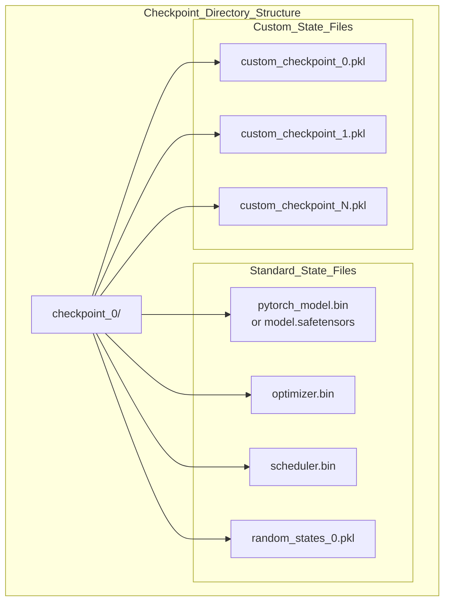
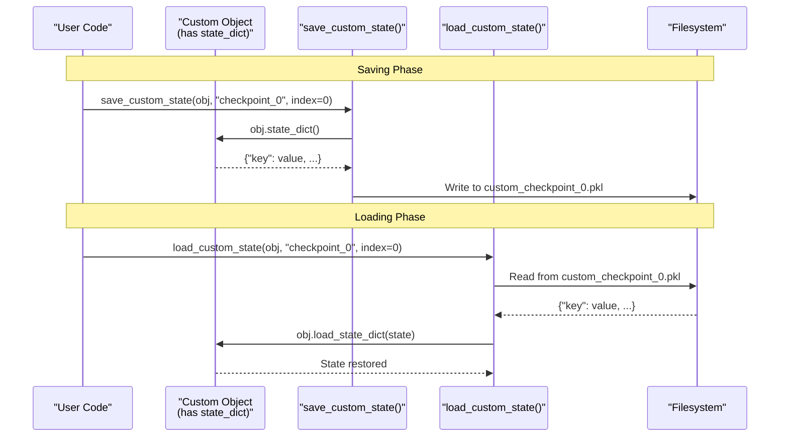
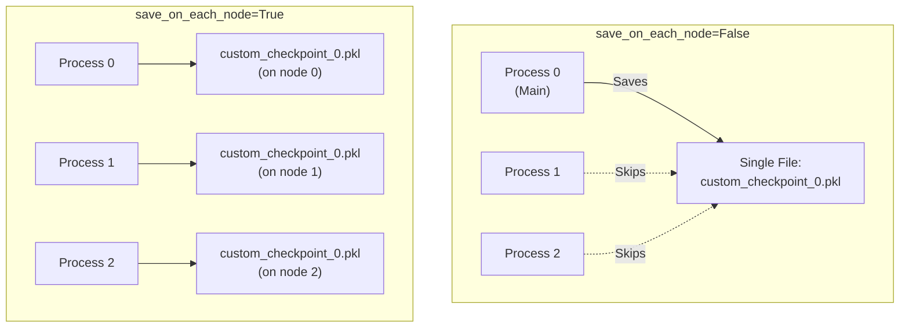
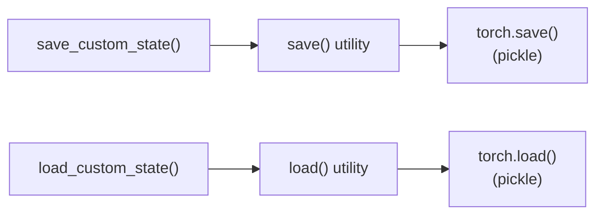

<!-- source: DeepWiki mcp.deepwiki.com · repo huggingface/accelerate · page 7.2 Custom Checkpoint Hooks · fetched 2026-10-21 -->

# Custom Checkpoint Hooks

<details>
<summary>Relevant source files</summary>

The following files were used as context for generating this wiki page:

- [src/accelerate/checkpointing.py](src/accelerate/checkpointing.py)
- [src/accelerate/commands/env.py](src/accelerate/commands/env.py)
- [src/accelerate/utils/memory.py](src/accelerate/utils/memory.py)
- [src/accelerate/utils/random.py](src/accelerate/utils/random.py)
- [tests/test_state_checkpointing.py](tests/test_state_checkpointing.py)

</details>


## Purpose and Scope

This document covers the custom checkpoint hook functions that enable saving and loading user-defined objects alongside standard training state in Accelerate checkpoints. These utilities allow persistence of any stateful object that implements the `state_dict()` and `load_state_dict()` interface.

For general checkpoint management including models, optimizers, and schedulers, see [7.1 Saving and Loading State](). For checkpoint directory configuration and rotation policies, see [7.3 Project Configuration and Checkpoint Management]().

---

## Overview

Accelerate provides two utility functions—`save_custom_state()` and `load_custom_state()`—that extend the standard checkpointing system to handle arbitrary user-defined objects. These functions integrate with the checkpoint directory structure created by `save_accelerator_state()` [src/accelerate/checkpointing.py:63-74]() but operate independently, allowing fine-grained control over what additional state gets persisted.

The custom checkpoint system stores objects in standardized pickle files within the checkpoint directory, using sequential indexing to support multiple custom objects per checkpoint.

### Checkpoint Directory Layout with Custom State Files

Sources: [src/accelerate/checkpointing.py:314-332]()

---

## Function Specifications

### save_custom_state

Persists the state dictionary of a user-defined object to a checkpoint directory.

**Function Signature:**
[src/accelerate/checkpointing.py:314-321]()
```python
def save_custom_state(obj, path, index: int = 0, save_on_each_node: bool = False):
    ...
```

**Parameters:**

| Parameter | Type | Default | Description |
|-----------|------|---------|-------------|
| `obj` | Any | Required | Object with a `state_dict()` method that returns a serializable dictionary |
| `path` | str or Path | Required | Directory path where the checkpoint file will be saved |
| `index` | int | 0 | Sequential index for multiple custom objects; determines filename |
| `save_on_each_node` | bool | False | Whether to save on every node in multi-node setups or only the main node |

**Behavior:**

1. Calls `obj.state_dict()` to obtain the object's state [src/accelerate/checkpointing.py:320]().
2. Constructs filename as `custom_checkpoint_{index}.pkl` [src/accelerate/checkpointing.py:319]().
3. Saves state using the `save()` utility [src/accelerate/checkpointing.py:44]() with pickle serialization [src/accelerate/checkpointing.py:320]().
4. Logs the save operation with object name from `get_pretty_name(obj)` [src/accelerate/checkpointing.py:320]().

**File Location:**
The function saves to: `{path}/custom_checkpoint_{index}.pkl`

Sources: [src/accelerate/checkpointing.py:314-321]()

### load_custom_state

Restores the state dictionary of a user-defined object from a checkpoint directory.

**Function Signature:**
[src/accelerate/checkpointing.py:324-331]()
```python
def load_custom_state(obj, path, index: int = 0):
    ...
```

**Parameters:**

| Parameter | Type | Default | Description |
|-----------|------|---------|-------------|
| `obj` | Any | Required | Object with a `load_state_dict()` method |
| `path` | str or Path | Required | Directory path containing the checkpoint file |
| `index` | int | 0 | Sequential index matching the saved custom object |

**Behavior:**

1. Constructs filename as `custom_checkpoint_{index}.pkl` [src/accelerate/checkpointing.py:329]().
2. Loads state using the `load()` utility [src/accelerate/checkpointing.py:43]() with `weights_only=False` and `map_location="cpu"` [src/accelerate/checkpointing.py:331]().
3. Calls `obj.load_state_dict(state)` to restore the object's state [src/accelerate/checkpointing.py:331]().
4. Logs the load operation with object name from `get_pretty_name(obj)` [src/accelerate/checkpointing.py:330]().

**File Location:**
The function loads from: `{path}/custom_checkpoint_{index}.pkl`

**Note:** The function always loads with `weights_only=False` [src/accelerate/checkpointing.py:331]() to support arbitrary Python objects, which has security implications when loading untrusted checkpoints.

Sources: [src/accelerate/checkpointing.py:324-331]()

---

## Usage Patterns

### Custom State Save/Load Sequence


The typical workflow involves:
1. **During Training:** Call `save_custom_state()` after `accelerator.save_state()` to persist custom objects.
2. **During Resumption:** Call `load_custom_state()` after `accelerator.load_state()` to restore custom objects.

Sources: [src/accelerate/checkpointing.py:314-331]()

### Multiple Custom Objects

When persisting multiple custom objects, use sequential indices to prevent filename collisions:

```python
# Example logic
save_custom_state(custom_tracker, checkpoint_dir, index=0)
save_custom_state(custom_metric, checkpoint_dir, index=1)
```

This creates files:
- `custom_checkpoint_0.pkl`
- `custom_checkpoint_1.pkl`

Sources: [src/accelerate/checkpointing.py:314-331]()

---

## Multi-Node Considerations

### save_on_each_node Parameter

The `save_on_each_node` parameter [src/accelerate/checkpointing.py:318]() controls distributed saving behavior:

| Value | Behavior | Use Case |
|-------|----------|----------|
| `False` (default) | Only main process (rank 0) saves | Standard: one copy per checkpoint |
| `True` | Every process saves independently | Distributed: process-local state |

### Multi-Node Save Behavior


When `save_on_each_node=True`, the `save()` utility function delegates to the backend-specific implementation that handles distributed saving [src/accelerate/checkpointing.py:320]().

Sources: [src/accelerate/checkpointing.py:314-321]()

---

## Implementation Details

### Serialization Pipeline


The functions use the `save` and `load` utilities defined in `accelerate.utils` [src/accelerate/checkpointing.py:43-44](). `load_custom_state` explicitly forces `map_location="cpu"` and `weights_only=False` [src/accelerate/checkpointing.py:331]().

### Logging and Debugging

Both functions emit log messages using the `get_logger(__name__)` logger [src/accelerate/checkpointing.py:60]():

- **Save Operation:** `INFO: Saving the state of <ObjectName> to {path}/custom_checkpoint_{index}.pkl` [src/accelerate/checkpointing.py:320]().
- **Load Operation:** `INFO: Loading the state of <ObjectName> from {path}/custom_checkpoint_{index}.pkl` [src/accelerate/checkpointing.py:330]().

The object name is obtained via `get_pretty_name(obj)` [src/accelerate/checkpointing.py:33]().

Sources: [src/accelerate/checkpointing.py:314-332]()

---

## Best Practices and Limitations

### Security Considerations

The `load_custom_state()` function explicitly sets `weights_only=False` when calling `torch.load()` [src/accelerate/checkpointing.py:331](). This allows loading arbitrary Python objects but introduces security risks as pickle can execute code during deserialization. Only load checkpoints from trusted sources.

### Integration with Standard Checkpointing

Custom state files are co-located with standard state files such as `pytorch_model.bin` [src/accelerate/checkpointing.py:110-113](), `optimizer.bin` [src/accelerate/checkpointing.py:119-121](), and `random_states_{process_index}.pkl` [src/accelerate/checkpointing.py:156-174]().

While `save_accelerator_state` handles the core training components, `save_custom_state` must be called explicitly for any additional objects not passed to the `Accelerator` during initialization or `prepare()`.

Sources: [src/accelerate/checkpointing.py:63-177](), [src/accelerate/checkpointing.py:314-332]()

---

