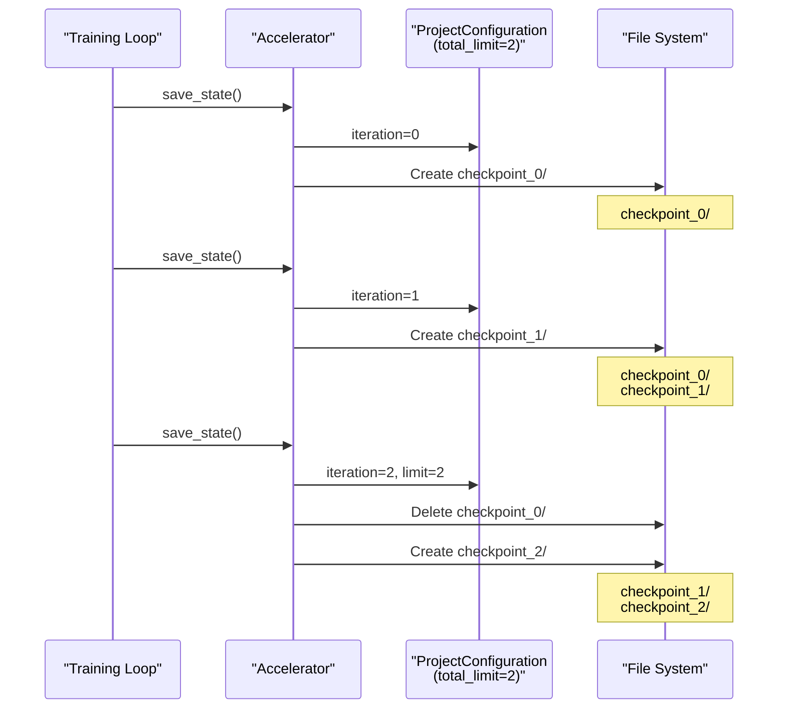
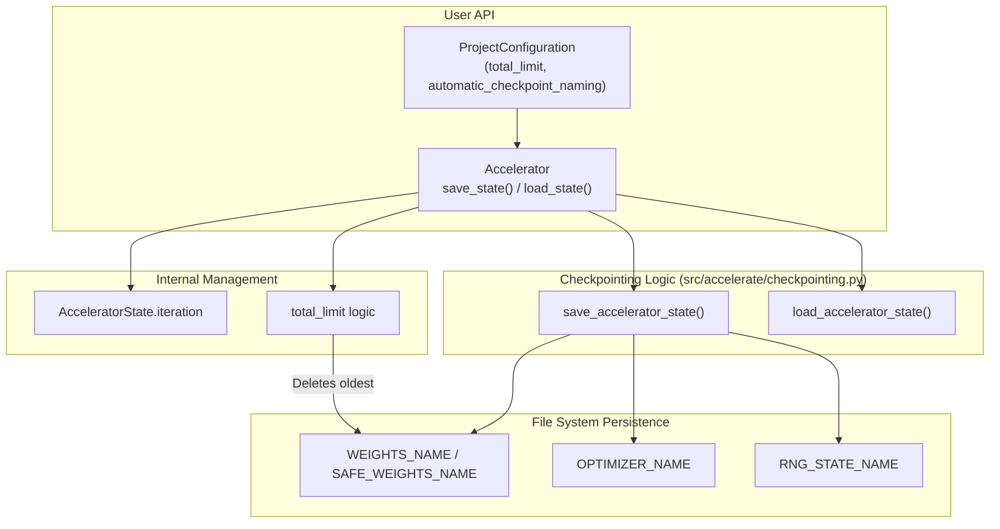
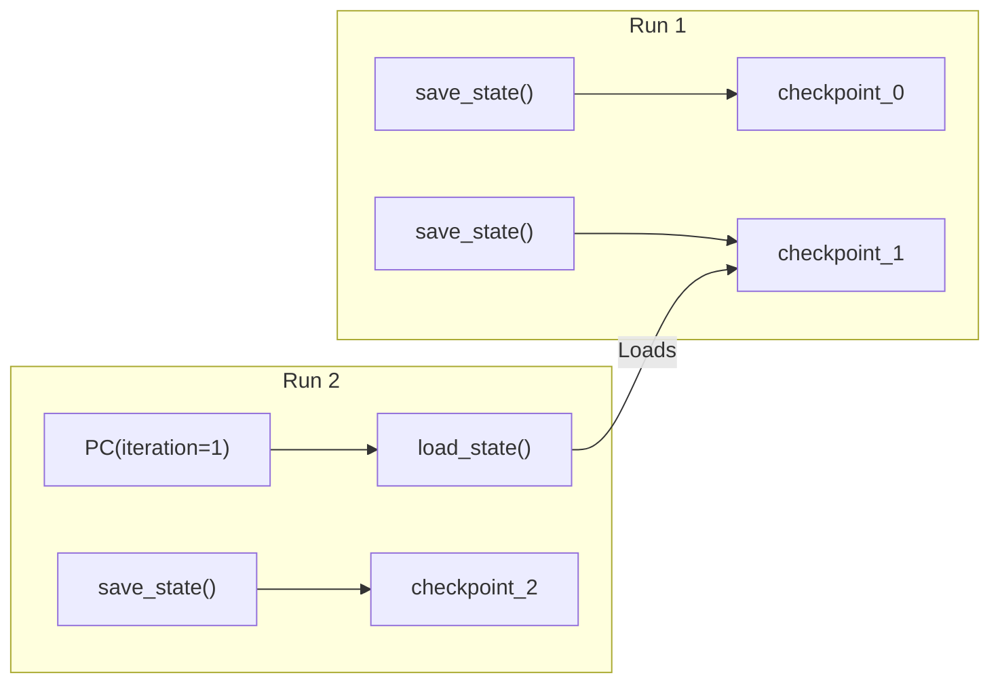

<!-- source: DeepWiki mcp.deepwiki.com · repo huggingface/accelerate · page 7.3 Project Configuration and Checkpoint Management · fetched 2026-10-21 -->

# Project Configuration and Checkpoint Management

<details>
<summary>Relevant source files</summary>

The following files were used as context for generating this wiki page:

- [src/accelerate/checkpointing.py](src/accelerate/checkpointing.py)
- [src/accelerate/commands/env.py](src/accelerate/commands/env.py)
- [src/accelerate/utils/__init__.py](src/accelerate/utils/__init__.py)
- [src/accelerate/utils/imports.py](src/accelerate/utils/imports.py)
- [src/accelerate/utils/memory.py](src/accelerate/utils/memory.py)
- [src/accelerate/utils/random.py](src/accelerate/utils/random.py)
- [tests/test_state_checkpointing.py](tests/test_state_checkpointing.py)

</details>


This document covers the `ProjectConfiguration` class and related utilities for managing checkpoint directories, automatic checkpoint naming, and checkpoint rotation in Accelerate. These features enable organized checkpoint storage and automatic cleanup of old checkpoints during long training runs.

For information about the low-level save/load functions that persist training state to disk, see [Saving and Loading State](#7.1). For custom state persistence beyond standard training components, see [Custom Checkpoint Hooks](#7.2).

## Overview

The `ProjectConfiguration` class provides structured management of checkpoint directories during training. It handles:
- Automatic generation of checkpoint directory names.
- Tracking checkpoint iterations.
- Rotation (deletion) of old checkpoints based on a maximum limit.
- Consistent organization of checkpoint files within a project directory.

This system integrates with the `Accelerator.save_state()` and `Accelerator.load_state()` methods to provide a higher-level abstraction over checkpoint management.

Sources: [tests/test_state_checkpointing.py:114-125](), [tests/test_state_checkpointing.py:186-194]()

## The ProjectConfiguration Class

`ProjectConfiguration` is a dataclass defined in `src/accelerate/utils/dataclasses.py` [src/accelerate/utils/dataclasses.py:1-70]() (imported via `src/accelerate/utils/__init__.py` [src/accelerate/utils/__init__.py:60-60]()) that stores configuration for checkpoint management. It is passed to the `Accelerator` constructor to configure checkpoint behavior.

### Key Parameters

| Parameter | Type | Default | Description |
|-----------|------|---------|-------------|
| `project_dir` | `str` or `Path` | `None` | Base directory where checkpoints will be saved. If using automatic naming, checkpoints are saved to `{project_dir}/checkpoints/` |
| `automatic_checkpoint_naming` | `bool` | `False` | When `True`, automatically generates checkpoint names like `checkpoint_0`, `checkpoint_1`, etc. |
| `total_limit` | `int` | `None` | Maximum number of checkpoints to keep. When exceeded, oldest checkpoints are deleted |
| `iteration` | `int` | `0` | Current iteration number for checkpoint naming. Can be set to resume from a specific checkpoint |
| `save_on_each_node` | `bool` | `False` | Whether to save checkpoints on each node in multi-node training |

Sources: [src/accelerate/utils/dataclasses.py:60-60](), [tests/test_state_checkpointing.py:114-114](), [tests/test_state_checkpointing.py:186-186]()

## Automatic Checkpoint Naming

When `automatic_checkpoint_naming=True`, the `Accelerator` manages checkpoint directory names automatically. Each call to `save_state()` without an explicit path argument creates a new checkpoint with an incrementing counter.

### Naming Convention

The standard directory structure when using automatic naming:

```
{project_dir}/
└── checkpoints/
    ├── checkpoint_0/
    │   ├── pytorch_model.bin (or model.safetensors)
    │   ├── optimizer.bin
    │   ├── scheduler.bin
    │   └── random_states_0.pkl
    ├── checkpoint_1/
    │   └── ...
```

Sources: [src/accelerate/checkpointing.py:107-177](), [tests/test_state_checkpointing.py:125-125]()

### Iteration Tracking

The `iteration` parameter tracks the current checkpoint number. It increments automatically on each `save_state()` call. To resume from a specific checkpoint iteration, the `iteration` parameter can be manually set in `ProjectConfiguration` [tests/test_state_checkpointing.py:171-172]().

Sources: [tests/test_state_checkpointing.py:186-230](), [tests/test_state_checkpointing.py:271-271]()

## Checkpoint Rotation with total_limit

The `total_limit` parameter implements checkpoint rotation by automatically deleting old checkpoints when the limit is exceeded.

### Rotation Logic Diagram



Sources: [tests/test_state_checkpointing.py:108-125](), [tests/test_state_checkpointing.py:364-377]()

## Directory Structure Details

The low-level persistence is handled by `save_accelerator_state` [src/accelerate/checkpointing.py:63-106]().

### File Contents within Checkpoints

| Component | Filename Pattern | Implementation Detail |
|-----------|------------------|-----------------------|
| Models | `pytorch_model.bin` or `model.safetensors` | Controlled by `safe_serialization` [src/accelerate/checkpointing.py:110-114]() |
| Optimizers | `optimizer.bin` | Uses `OPTIMIZER_NAME` constant [src/accelerate/checkpointing.py:117-122]() |
| Schedulers | `scheduler.bin` | Uses `SCHEDULER_NAME` constant [src/accelerate/checkpointing.py:124-129]() |
| RNG States | `random_states_{process_index}.pkl` | Uses `RNG_STATE_NAME` constant [src/accelerate/checkpointing.py:155-177]() |
| GradScaler | `scaler.bin` | Uses `SCALER_NAME` constant [src/accelerate/checkpointing.py:149-153]() |

Sources: [src/accelerate/checkpointing.py:106-177](), [src/accelerate/utils/constants.py:16-35]()

## Complete Workflow Diagram

This diagram associates natural language concepts with specific code entities and data flow.



Sources: [src/accelerate/checkpointing.py:63-177](), [src/accelerate/utils/constants.py:16-35](), [tests/test_state_checkpointing.py:108-125]()

## Multi-Node Considerations

In distributed environments, the `save_on_each_node` flag in `ProjectConfiguration` determines if only the main process (rank 0) saves the model weights and optimizer states, or if every node performs the save operation.

- If `save_on_each_node=False` (default), Accelerate uses `save()` which internally coordinates to ensure only the main process writes to disk [src/accelerate/checkpointing.py:114]().
- RNG states are always saved per-process as `random_states_{process_index}.pkl` to ensure exact resumption of stochastic operations [src/accelerate/checkpointing.py:155-156]().

Sources: [src/accelerate/checkpointing.py:72-72](), [src/accelerate/checkpointing.py:114-114](), [src/accelerate/checkpointing.py:155-156]()

## Practical Resumption Example

The following sequence illustrates how `ProjectConfiguration` facilitates resuming training:



Sources: [tests/test_state_checkpointing.py:156-172](), [tests/test_state_checkpointing.py:271-285]()

---

