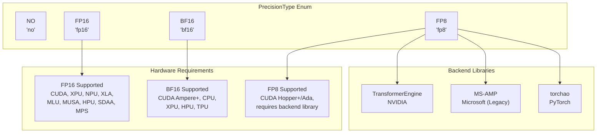
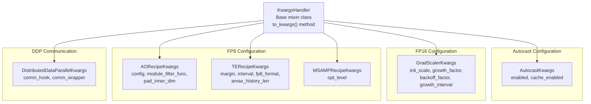
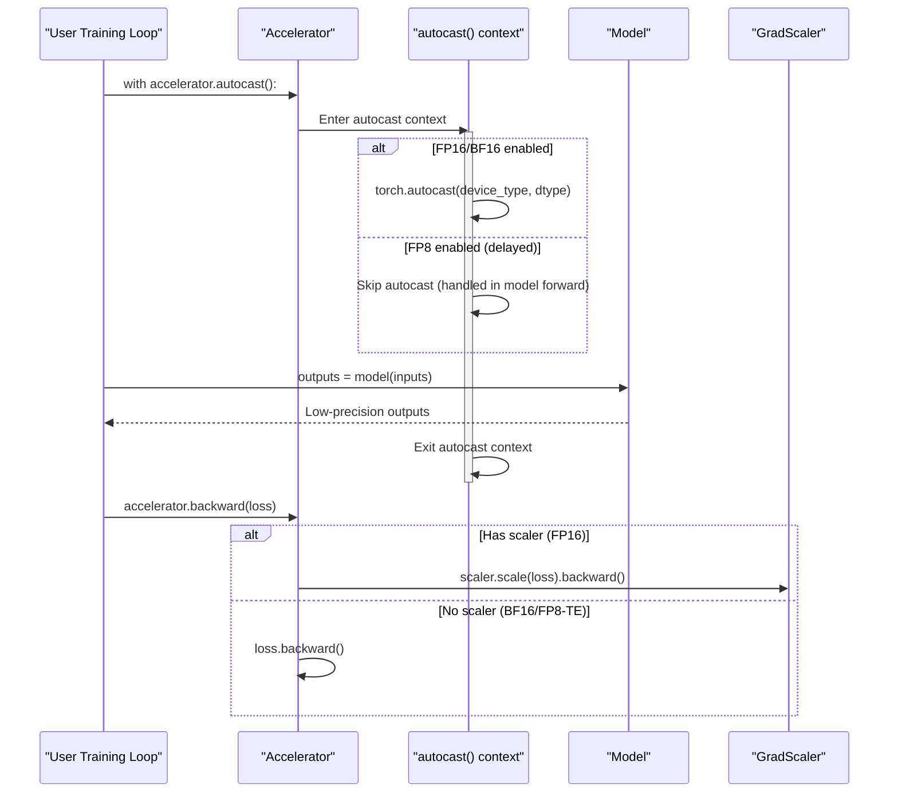

<!-- source: DeepWiki mcp.deepwiki.com · repo huggingface/accelerate · page 8 Mixed Precision Training · fetched 2026-10-21 -->

# Mixed Precision Training

<details>
<summary>Relevant source files</summary>

The following files were used as context for generating this wiki page:

- [docs/source/concept_guides/fsdp1_vs_fsdp2.md](docs/source/concept_guides/fsdp1_vs_fsdp2.md)
- [docs/source/concept_guides/low_precision_training.md](docs/source/concept_guides/low_precision_training.md)
- [docs/source/usage_guides/deepspeed.md](docs/source/usage_guides/deepspeed.md)
- [docs/source/usage_guides/fsdp.md](docs/source/usage_guides/fsdp.md)
- [docs/source/usage_guides/local_sgd.md](docs/source/usage_guides/local_sgd.md)
- [docs/source/usage_guides/low_precision_training.md](docs/source/usage_guides/low_precision_training.md)
- [src/accelerate/utils/transformer_engine.py](src/accelerate/utils/transformer_engine.py)
- [tests/test_fp8.py](tests/test_fp8.py)
- [tests/test_imports.py](tests/test_imports.py)

</details>


## Purpose and Scope

This document describes Accelerate's mixed precision training system, which enables training with reduced precision (FP16, BF16, or FP8) to accelerate computation and reduce memory usage. The system provides a unified interface for configuring precision across different hardware accelerators and distributed training backends.

For details on specific precision implementations, see the child pages:
- [FP16 and BF16 Training](#8.1) — Detailed setup for standard 16-bit mixed precision.
- [FP8 Training](#8.2) — Advanced 8-bit training using specialized backends.
- [DDP Communication Hooks](#8.3) — Precision-based gradient compression for distributed communication.

## Overview

Mixed precision training reduces the numerical precision of model computations from FP32 to lower precision formats. Accelerate supports three reduced precision modes:

- **FP16 (16-bit floating point)**: Requires gradient scaling to prevent underflow.
- **BF16 (bfloat16)**: Wider dynamic range than FP16, no gradient scaling needed.
- **FP8 (8-bit floating point)**: Requires specialized hardware and backend libraries.

The system abstracts hardware-specific implementations and integrates with PyTorch's automatic mixed precision (AMP) APIs, gradient scalers, and third-party FP8 libraries like `TransformersEngine`, `MS-AMP`, and `torchao`.

**Sources**: [src/accelerate/accelerator.py:192-196](), [src/accelerate/utils/dataclasses.py:112-132](), [docs/source/usage_guides/low_precision_training.md:16-30]()

## Precision Types and Hardware Support

### Precision Type Enumeration



### Hardware Compatibility Matrix

| Precision | CUDA | TPU | CPU | XPU | NPU | MLU | HPU | MUSA | SDAA | MPS |
|-----------|------|-----|-----|-----|-----|-----|-----|------|------|-----|
| FP16      | ✓    | ✓   | ✗   | ✓   | ✓   | ✓   | ✓   | ✓    | ✓    | ✓*  |
| BF16      | ✓**  | ✓   | ✓   | ✓   | ✗   | ✓   | ✓   | ✗    | ✗    | ✓*** |
| FP8       | ✓****| ✗   | ✗   | ✗   | ✗   | ✗   | ✗   | ✗    | ✗    | ✗    |

\* Requires PyTorch >= 2.5.0  
\*\* Requires Ampere or newer GPU, PyTorch >= 1.10  
\*\*\* Requires macOS 14.0+, PyTorch >= 2.6.0  
\*\*\*\* Requires Hopper/Ada GPU (e.g., H100, 4090), specialized backend library

**Sources**: [src/accelerate/accelerator.py:564-596](), [src/accelerate/utils/imports.py:156-182](), [docs/source/usage_guides/low_precision_training.md:24-27]()

## Configuration System

### Configuration Classes Hierarchy



### Accelerator Initialization

The `Accelerator` class accepts mixed precision configuration through the `mixed_precision` parameter and `kwarg_handlers`:

```python
from accelerate import Accelerator
from accelerate.utils import GradScalerKwargs, AutocastKwargs, TERecipeKwargs

# From user code
accelerator = Accelerator(
    mixed_precision='fp16',  # or 'bf16', 'fp8', 'no'
    kwargs_handlers=[
        GradScalerKwargs(init_scale=2**10),
        AutocastKwargs(cache_enabled=True)
    ]
)
```

For detailed configuration of 16-bit modes, see [FP16 and BF16 Training](#8.1).

**Sources**: [src/accelerate/accelerator.py:279-636](), [src/accelerate/utils/dataclasses.py:112-476](), [docs/source/usage_guides/low_precision_training.md:38-52]()

## FP16 and BF16 Training

FP16 and BF16 are the most common low-precision formats. FP16 requires a `GradScaler` to manage numerical stability, while BF16 relies on its native dynamic range.

- **FP16**: Uses `torch.amp.GradScaler` to scale losses and prevent gradient underflow. Configurable via `GradScalerKwargs`.
- **BF16**: Enabled via `mixed_precision="bf16"`. Supported on NVIDIA Ampere+, CPUs, and TPUs.

For implementation details, hardware compatibility, and autocast usage, see [FP16 and BF16 Training](#8.1).

**Sources**: [src/accelerate/accelerator.py:562-596](), [docs/source/usage_guides/fsdp.md:59]()

## FP8 Training

FP8 training is a high-performance method available on NVIDIA Hopper and Ada architectures. Accelerate supports multiple backends:

- **TransformerEngine (TE)**: The NVIDIA-optimized backend for `Linear` and `LayerNorm` layers.
- **torchao**: A PyTorch-native, hackable FP8 backend using `DTensor`.
- **MS-AMP (Legacy)**: A deprecated backend providing O1/O2 optimization levels.

Accelerate automatically handles layer conversion (e.g., replacing `nn.Linear` with `te.Linear`) when `prepare()` is called.

For backend selection, recipe configuration, and hardware requirements, see [FP8 Training](#8.2).

**Sources**: [docs/source/usage_guides/low_precision_training.md:31-66](), [src/accelerate/utils/transformer_engine.py:26-92](), [docs/source/concept_guides/fsdp1_vs_fsdp2.md:57]()

## DDP Communication Hooks

When training in distributed environments using `DistributedDataParallel`, communication overhead can be a bottleneck. Accelerate allows users to specify communication hooks that compress gradients before synchronization:

- **FP16_COMPRESS**: Casts gradients to FP16 for all-reduce.
- **BF16_COMPRESS**: Casts gradients to BF16 for all-reduce.
- **POWER_SGD**: Uses low-rank compression for gradients.

For a full list of supported hooks and how to register them via `DistributedDataParallelKwargs`, see [DDP Communication Hooks](#8.3).

**Sources**: [src/accelerate/utils/dataclasses.py:134-238](), [docs/source/usage_guides/local_sgd.md:18]()

## Implementation Flow

### Mixed Precision Context Manager Flow



**Sources**: [src/accelerate/accelerator.py:1086-1135](), [src/accelerate/accelerator.py:1933-1993](), [src/accelerate/utils/transformer_engine.py:118-139]()

---

