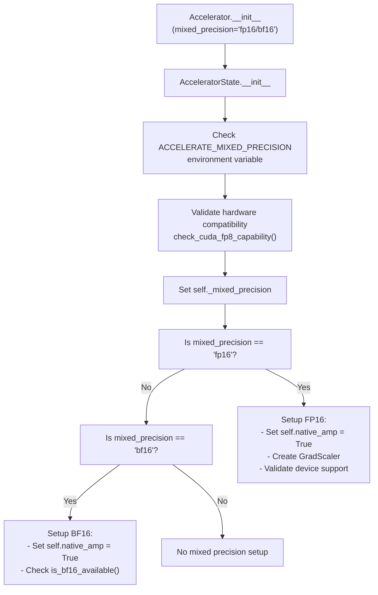
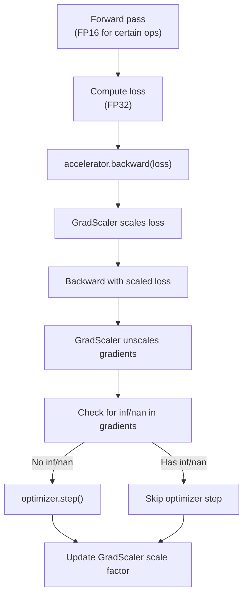
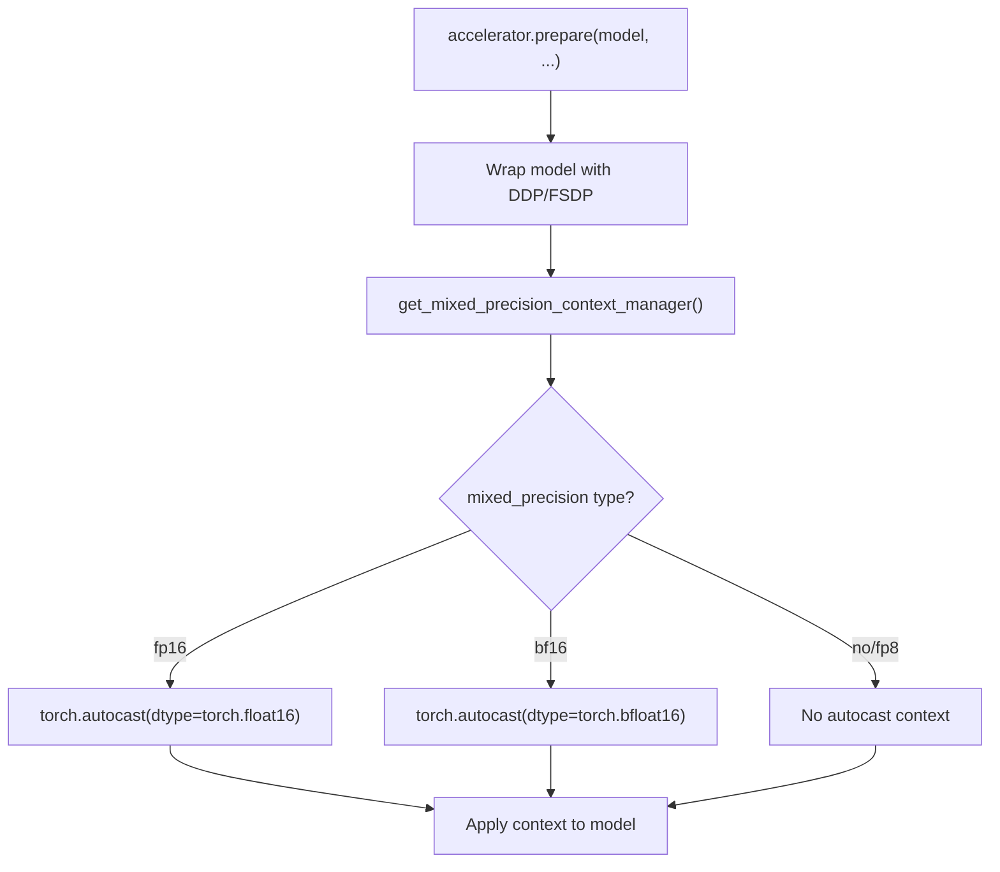
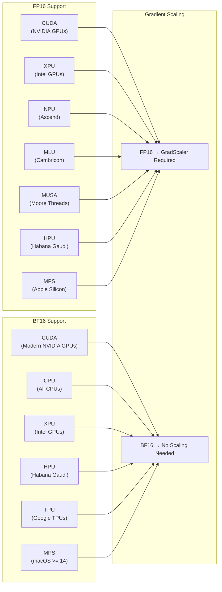

<!-- source: DeepWiki mcp.deepwiki.com · repo huggingface/accelerate · page 8.1 FP16 and BF16 Training · fetched 2026-10-21 -->

# FP16 and BF16 Training

<details>
<summary>Relevant source files</summary>

The following files were used as context for generating this wiki page:

- [docs/source/concept_guides/fsdp1_vs_fsdp2.md](docs/source/concept_guides/fsdp1_vs_fsdp2.md)
- [docs/source/concept_guides/low_precision_training.md](docs/source/concept_guides/low_precision_training.md)
- [docs/source/usage_guides/deepspeed.md](docs/source/usage_guides/deepspeed.md)
- [docs/source/usage_guides/fsdp.md](docs/source/usage_guides/fsdp.md)
- [docs/source/usage_guides/local_sgd.md](docs/source/usage_guides/local_sgd.md)
- [docs/source/usage_guides/low_precision_training.md](docs/source/usage_guides/low_precision_training.md)
- [src/accelerate/accelerator.py](src/accelerate/accelerator.py)
- [src/accelerate/state.py](src/accelerate/state.py)
- [src/accelerate/utils/dataclasses.py](src/accelerate/utils/dataclasses.py)

</details>


## Purpose and Scope

This document explains how Accelerate handles FP16 (half precision) and BF16 (brain floating point) mixed precision training. Mixed precision training uses lower-precision floating-point formats for certain operations to reduce memory usage and increase training speed while maintaining model accuracy.

For FP8 mixed precision training, see [FP8 Training](#8.2). For gradient compression during distributed training, see [DDP Communication Hooks](#8.3).

## Overview

Mixed precision training combines different numerical precisions during training:
- **FP16 (Half Precision)**: 16-bit floating point with 5 exponent bits and 10 mantissa bits. Requires gradient scaling to prevent underflow. [src/accelerate/accelerator.py:562-583]()
- **BF16 (Brain Float 16)**: 16-bit floating point with 8 exponent bits and 7 mantissa bits. Same dynamic range as FP32, no gradient scaling needed. [src/accelerate/accelerator.py:585-596]()

**Key Differences:**

| Feature | FP16 | BF16 |
|---------|------|------|
| Gradient Scaling Required | Yes | No |
| Dynamic Range | Limited | Same as FP32 |
| Hardware Support | Broader | Requires specific hardware |
| Numerical Stability | More prone to overflow/underflow | More stable |

Sources: [src/accelerate/accelerator.py:562-596](), [src/accelerate/state.py:143-145](), [src/accelerate/state.py:919-942]()

## Enabling Mixed Precision

### Basic Configuration

Enable mixed precision by passing the `mixed_precision` parameter to the `Accelerator` constructor:

```python
from accelerate import Accelerator

# Enable FP16
accelerator = Accelerator(mixed_precision="fp16")

# Enable BF16
accelerator = Accelerator(mixed_precision="bf16")

# No mixed precision (default)
accelerator = Accelerator(mixed_precision="no")
```

The `mixed_precision` parameter can also be set via the `ACCELERATE_MIXED_PRECISION` environment variable or through the `accelerate config` command. [src/accelerate/accelerator.py:192-196](), [src/accelerate/state.py:919-923]()

Sources: [src/accelerate/accelerator.py:192-196](), [src/accelerate/state.py:919-923]()

### Mixed Precision Initialization Flow



Sources: [src/accelerate/accelerator.py:462-472](), [src/accelerate/accelerator.py:562-596]()

## FP16 Training

### Gradient Scaling

FP16 training requires gradient scaling to prevent numerical underflow. Accelerate automatically manages this using `torch.cuda.amp.GradScaler` or platform-specific scalers. [src/accelerate/accelerator.py:562-583]()



Sources: [src/accelerate/accelerator.py:562-583](), [src/accelerate/accelerator.py:2196-2244]()

### GradScaler Configuration

Customize gradient scaler behavior using `GradScalerKwargs`: [src/accelerate/utils/dataclasses.py:240-270]()

```python
from accelerate import Accelerator
from accelerate.utils import GradScalerKwargs

kwargs = GradScalerKwargs(
    init_scale=65536.0,      # Initial scale factor
    growth_factor=2.0,        # Scale increase factor
    backoff_factor=0.5,       # Scale decrease factor
    growth_interval=2000,     # Steps before increasing scale
    enabled=True              # Enable/disable scaler
)

accelerator = Accelerator(
    mixed_precision="fp16",
    kwargs_handlers=[kwargs]
)
```

The scaler is accessed via `accelerator.scaler` and is automatically applied during `backward()`. [src/accelerate/accelerator.py:577-583]()

Sources: [src/accelerate/utils/dataclasses.py:240-270](), [src/accelerate/accelerator.py:577-583]()

### Supported Devices for FP16

FP16 mixed precision is supported on:
- NVIDIA GPUs (CUDA)
- Intel GPUs (XPU)
- NPUs (Ascend)
- MLUs (Cambricon)
- MUSAs (Moore Threads)
- HPUs (Habana Gaudi)
- SDAA
- MPS (Apple Silicon, PyTorch >= 2.5.0) [src/accelerate/accelerator.py:564-576]()

Sources: [src/accelerate/accelerator.py:564-576]()

### FSDP2 and FP16

For FSDP2 (Fully Sharded Data Parallel v2), Accelerate uses a specialized gradient scaler via `get_fsdp2_grad_scaler`: [src/accelerate/accelerator.py:580-583]()

```python
if self.is_fsdp2:
    self.scaler = get_fsdp2_grad_scaler(device=self.device.type, **kwargs)
else:
    self.scaler = get_grad_scaler(self.distributed_type, **kwargs)
```

Sources: [src/accelerate/accelerator.py:580-583](), [src/accelerate/utils/imports.py:106-110]()

## BF16 Training

### Advantages of BF16

BF16 does not require gradient scaling because it maintains the same dynamic range as FP32. Accelerate skips scaler initialization for BF16 unless using specific backends like DeepSpeed or Megatron-LM that manage it internally. [src/accelerate/accelerator.py:585-596]()

Sources: [src/accelerate/accelerator.py:585-596]()

### Hardware Compatibility for BF16

BF16 availability varies by platform: [src/accelerate/utils/imports.py:156-168]()

| Platform | Support Check | Requirements |
|----------|--------------|--------------|
| CUDA | `torch.cuda.is_bf16_supported()` | PyTorch >= 1.10 |
| CPU | Always available | PyTorch >= 1.10 |
| XPU | `torch.xpu.is_bf16_supported()` | Intel GPUs |
| HPU | Always available | Habana Gaudi |
| MLU | `torch.mlu.is_bf16_supported()` | Cambricon MLU |
| TPU | Always available | TPU v2/v3/v4 |
| MPS | `torch.backends.mps.is_macos_or_newer(14, 0)` | macOS >= 14.0, PyTorch >= 2.6.0 |

Sources: [src/accelerate/utils/imports.py:156-168](), [src/accelerate/accelerator.py:589-596]()

### TPU-Specific BF16 Handling

On TPU (XLA), BF16 can be configured in two modes: standard native usage or downcast mode. [src/accelerate/state.py:957-966]()

```python
if self.distributed_type == DistributedType.XLA and is_torch_xla_available(check_is_tpu=True):
    if mixed_precision == "bf16":
        if os.environ.get("ACCELERATE_DOWNCAST_BF16"):
            # Downcast mode: convert FP32 to BF16 after computation
            os.environ["XLA_USE_BF16"] = str(0)
            os.environ["XLA_DOWNCAST_BF16"] = str(1)
            self.downcast_bfloat = True
        else:
            # Native mode: compute directly in BF16
            os.environ["XLA_USE_BF16"] = str(1)
            os.environ["XLA_DOWNCAST_BF16"] = str(0)
            self.downcast_bfloat = False
```

Sources: [src/accelerate/state.py:957-966]()

## Autocast Context Manager

### AutocastKwargs Configuration

Customize how `torch.autocast` behaves during mixed precision training using `AutocastKwargs`. [src/accelerate/utils/dataclasses.py:112-132]()

```python
from accelerate import Accelerator
from accelerate.utils import AutocastKwargs

kwargs = AutocastKwargs(
    enabled=True,          # Enable/disable autocast
    cache_enabled=None     # Control autocast caching (PyTorch default if None)
)

accelerator = Accelerator(
    mixed_precision="fp16",
    kwargs_handlers=[kwargs]
)
```

Sources: [src/accelerate/utils/dataclasses.py:112-132]()

### Mixed Precision Context Manager Flow



The context manager is obtained via the `get_mixed_precision_context_manager()` function, which returns the appropriate autocast context based on the mixed precision mode and device. [src/accelerate/accelerator.py:1398-1415]()

Sources: [src/accelerate/accelerator.py:1398-1415]()

## DDP Communication Hooks

When using DistributedDataParallel (DDP), you can use `DistributedDataParallelKwargs` to compress gradients during all-reduce operations. [src/accelerate/utils/dataclasses.py:157-181]()

```python
from accelerate import Accelerator
from accelerate.utils import DistributedDataParallelKwargs

ddp_kwargs = DistributedDataParallelKwargs(
    comm_hook="fp16"  # or "bf16"
)

accelerator = Accelerator(
    mixed_precision="fp16",
    kwargs_handlers=[ddp_kwargs]
)
```

### Available Communication Hooks

| Hook Type | Description |
|-----------|-------------|
| `NO` | No communication hook (default) |
| `FP16` | DDP communication hook to compress gradients in FP16 |
| `BF16` | DDP communication hook to compress gradients in BF16 |
| `POWER_SGD` | DDP communication hook to use PowerSGD |
| `BATCHED_POWER_SGD` | DDP communication hook to use batched PowerSGD |

Sources: [src/accelerate/utils/dataclasses.py:134-154](), [src/accelerate/utils/dataclasses.py:202-237]()

## Device and Backend Compatibility Matrix



Sources: [src/accelerate/accelerator.py:564-596](), [src/accelerate/utils/imports.py:156-168]()

## Integration with Distributed Training

### DeepSpeed and Megatron-LM

When using DeepSpeed or Megatron-LM, mixed precision configuration is partially delegated to the underlying engine. [src/accelerate/state.py:952-955]()

```python
# For DeepSpeed, mixed_precision is ignored in favor of deepspeed_config
if self.distributed_type == DistributedType.DEEPSPEED and mixed_precision != "fp8":
    self._mixed_precision = "no"  # DeepSpeed handles it
else:
    self._mixed_precision = mixed_precision
```

Sources: [src/accelerate/state.py:952-955]()

### FSDP Mixed Precision

For FSDP (Fully Sharded Data Parallel), mixed precision is often configured through the `FullyShardedDataParallelPlugin`. Accelerate detects this and adjusts initialization. [src/accelerate/accelerator.py:585-596]()

Sources: [src/accelerate/accelerator.py:585-596](), [docs/source/usage_guides/fsdp.md:59-61]()

## Training Loop Integration

### Backward Pass with Mixed Precision

The `accelerator.backward()` method handles gradient scaling automatically for FP16 training. [src/accelerate/accelerator.py:2196-2244]()

```python
# Training loop
for batch in dataloader:
    outputs = model(batch)
    loss = compute_loss(outputs)
    
    # Automatically handles gradient scaling for FP16
    accelerator.backward(loss)
    
    optimizer.step()
    optimizer.zero_grad()
```

Sources: [src/accelerate/accelerator.py:2196-2244]()

### Mixed Precision State Properties

The `Accelerator` provides properties to inspect current precision status:

```python
# Get mixed precision type
precision = accelerator.mixed_precision  # "no", "fp16", "bf16", or "fp8"

# Check if native AMP is enabled
uses_amp = accelerator.native_amp  # True for fp16/bf16, False for no/fp8

# Access the gradient scaler (FP16 only)
if accelerator.scaler is not None:
    scale = accelerator.scaler.get_scale()
```

Sources: [src/accelerate/accelerator.py:746-747](), [src/accelerate/accelerator.py:562-596]()

## Best Practices

1. **Choose FP16 for maximum memory savings** when your hardware and model support it. Ensure gradient scaling is enabled.
2. **Choose BF16 for numerical stability** when available (e.g., Ampere+ GPUs, TPUs). It eliminates gradient scaling overhead.
3. **Monitor gradient scaling** with FP16. If the scale frequently decreases to zero, check your model for instability or consider BF16.
4. **Use communication hooks** with DDP to reduce bandwidth during gradient synchronization by compressing tensors. [src/accelerate/utils/dataclasses.py:134-154]()
5. **Test both precisions** on your specific model and hardware to determine the best speed/accuracy tradeoff.

Sources: [src/accelerate/accelerator.py:562-596](), [src/accelerate/utils/dataclasses.py:240-270](), [docs/source/usage_guides/low_precision_training.md:20-29]()

---

