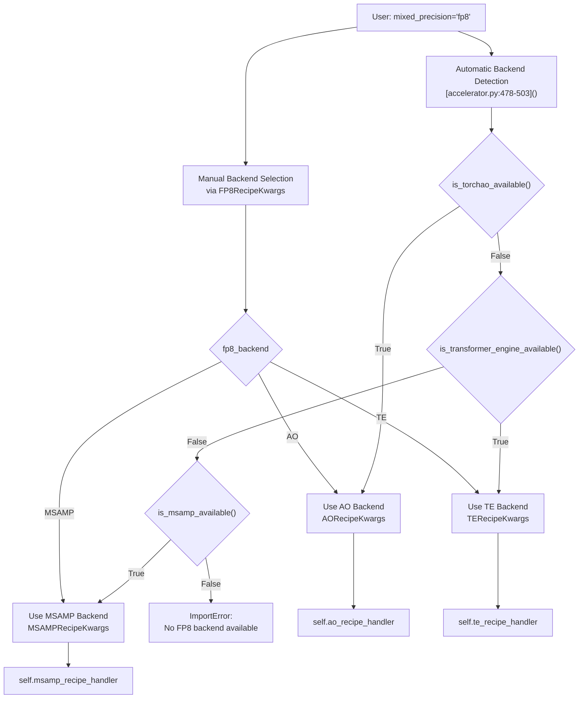
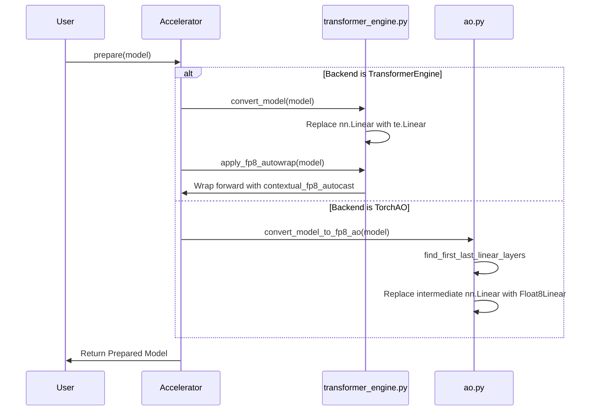
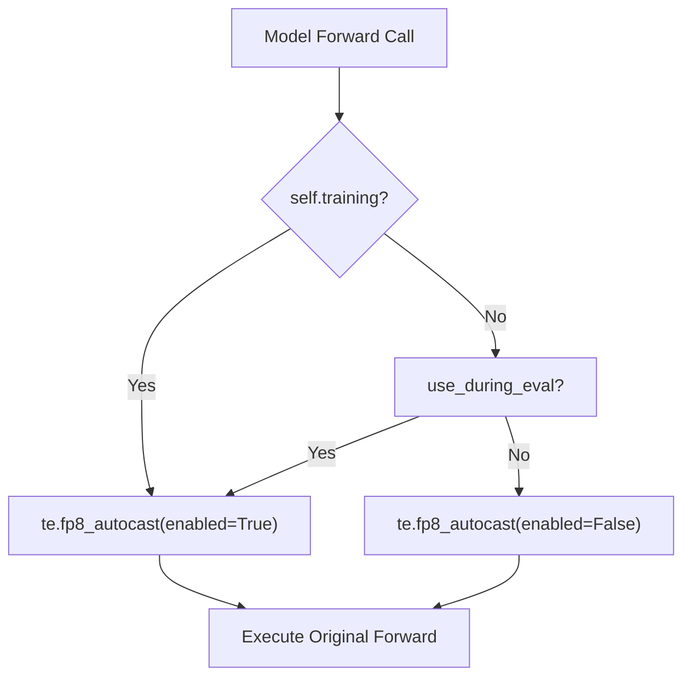

<!-- source: DeepWiki mcp.deepwiki.com · repo huggingface/accelerate · page 8.2 FP8 Training · fetched 2026-10-21 -->

# FP8 Training

Relevant source files

The following files were used as context for generating this wiki page:

- [benchmarks/fp8/ms_amp/ddp.py](benchmarks/fp8/ms_amp/ddp.py)
- [benchmarks/fp8/ms_amp/distrib_deepspeed.py](benchmarks/fp8/ms_amp/distrib_deepspeed.py)
- [benchmarks/fp8/ms_amp/non_distributed.py](benchmarks/fp8/ms_amp/non_distributed.py)
- [benchmarks/fp8/torchao/ddp.py](benchmarks/fp8/torchao/ddp.py)
- [benchmarks/fp8/torchao/fsdp.py](benchmarks/fp8/torchao/fsdp.py)
- [benchmarks/fp8/torchao/non_distributed.py](benchmarks/fp8/torchao/non_distributed.py)
- [benchmarks/fp8/transformer_engine/ddp.py](benchmarks/fp8/transformer_engine/ddp.py)
- [benchmarks/fp8/transformer_engine/fsdp.py](benchmarks/fp8/transformer_engine/fsdp.py)
- [benchmarks/fp8/transformer_engine/non_distributed.py](benchmarks/fp8/transformer_engine/non_distributed.py)
- [src/accelerate/utils/ao.py](src/accelerate/utils/ao.py)
- [src/accelerate/utils/transformer_engine.py](src/accelerate/utils/transformer_engine.py)
- [tests/test_fp8.py](tests/test_fp8.py)
- [tests/test_imports.py](tests/test_imports.py)

## Overview

FP8 (8-bit floating point) training provides memory-efficient mixed precision training using reduced precision arithmetic while maintaining model quality. Accelerate supports FP8 training through three backend implementations: **TorchAO**, **TransformerEngine**, and **MS-AMP**. This page documents the implementation details, backend selection logic, and configuration requirements for hardware with Hopper or Ada Lovelace architectures.

For general mixed precision training with FP16/BF16, see [FP16 and BF16 Training](#8.1). For distributed training strategies that work with FP8, see [FSDP Integration](#3.1) and [DeepSpeed Integration](#3.2).

## Backend Architecture

Accelerate provides a unified interface for three FP8 backends, each with different optimization strategies and hardware requirements.

### Backend Types and Selection

**Sources:** [src/accelerate/accelerator.py:478-503](), [src/accelerate/utils/imports.py:84-86](), [src/accelerate/utils/imports.py:92-104](), [src/accelerate/utils/imports.py:140-145](), [src/accelerate/utils/imports.py:179-181]()

### Backend Comparison

| Backend | Package | GPU Requirements | Key Features |
|---------|---------|------------------|--------------|
| **TorchAO** | `torchao>=0.6.1` | Hopper/Ada (compute capability ≥8.9) | Native PyTorch integration, FSDP2 support, `pad_inner_dim` for `torch._scaled_mm` |
| **TransformerEngine** | `transformer-engine` | Hopper/Ada GPUs | NVIDIA-optimized, delayed autocast for DDP, extensive tuning parameters |
| **MS-AMP** | `ms-amp` | Hopper/Ada GPUs | Microsoft implementation, optimization levels (O1, O2), GradScaler required |

**Sources:** [src/accelerate/utils/ao.py:15-24](), [src/accelerate/utils/transformer_engine.py:26-93](), [benchmarks/fp8/ms_amp/non_distributed.py:69-72]()

## Configuration Classes

### TorchAO Configuration (AORecipeKwargs)

The `AORecipeKwargs` class configures TorchAO FP8 training. A critical stability feature in the TorchAO implementation is skipping the first and last linear layers of the model, as these often lead to convergence issues if quantized to FP8 `[src/accelerate/utils/ao.py:72-90]()`.

- **`config`**: `Float8LinearConfig` instance. If `None`, automatically created with `pad_inner_dim=True` (required for `torch._scaled_mm`) and `enable_fsdp_float8_all_gather=True`.
- **`module_filter_func`**: Optional filter function. Defaults to `filter_first_and_last_linear_layers` `[src/accelerate/utils/ao.py:72-82]()`.
- **Conversion**: Linear layers must have `in_features` and `out_features` divisible by 16 for conversion to `Float8Linear` `[src/accelerate/utils/ao.py:49-69]()`.

**Sources:** [src/accelerate/utils/ao.py:32-46](), [src/accelerate/utils/ao.py:103-143](), [tests/test_fp8.py:70-86]()

### TransformerEngine Configuration (TERecipeKwargs)

Key parameters for TransformerEngine FP8 include:
- **`use_autocast_during_eval`**: (default: `False`). Generally better metrics when disabled `[src/accelerate/utils/transformer_engine.py:132-134]()`.
- **`fp8_format`**: (default: "HYBRID"). Formats include `HYBRID`, `E4M3`, or `E5M2` `[src/accelerate/utils/transformer_engine.py:162-163]()`.
- **`use_mxfp8_block_scaling`**: Enables Microscaling (MX) formats, though not available on HPU `[src/accelerate/utils/transformer_engine.py:152-160]()`.
- **Conversion**: The `convert_model` function recursively replaces `nn.Linear` and `nn.LayerNorm` with `te.Linear` and `te.LayerNorm` `[src/accelerate/utils/transformer_engine.py:26-93]()`.

**Sources:** [src/accelerate/utils/transformer_engine.py:118-140](), [src/accelerate/utils/transformer_engine.py:142-176](), [tests/test_fp8.py:46-62]()

### MS-AMP Configuration (FP8RecipeKwargs)

The MS-AMP backend is configured via `FP8RecipeKwargs` with `backend="msamp"`.
- **`opt_level`**: Supports "O1" or "O2" `[benchmarks/fp8/ms_amp/non_distributed.py:70]()`.
- **Initialization**: Internally calls `msamp.initialize(model, optimizer)` `[benchmarks/fp8/ms_amp/non_distributed.py:39]()`.
- **Distributed**: MS-AMP is compatible with DeepSpeed and DDP but not FSDP `[benchmarks/fp8/ms_amp/ddp.py:75-84]()`.

**Sources:** [benchmarks/fp8/ms_amp/non_distributed.py:69-72](), [benchmarks/fp8/ms_amp/ddp.py:75-78]()

## Accelerator Integration

### Initialization and Preparation Flow

**Sources:** [src/accelerate/utils/transformer_engine.py:26-59](), [src/accelerate/utils/transformer_engine.py:142-150](), [src/accelerate/utils/ao.py:103-143]()

### Data Flow and Autocast

For TransformerEngine, Accelerate uses a `contextual_fp8_autocast` wrapper to ensure FP8 is applied correctly during the forward pass. This wrapper is context-aware and respects the `training` vs `eval` mode of the model `[src/accelerate/utils/transformer_engine.py:118-140]()`.

**Sources:** [src/accelerate/utils/transformer_engine.py:131-134](), [benchmarks/fp8/transformer_engine/non_distributed.py:61-64]()

## Distributed Training Details

### FSDP and DDP Compatibility

1.  **TransformerEngine**: Compatible with FSDP and DDP. In FSDP setups, it typically uses `MixedPrecision(param_dtype=torch.bfloat16)` alongside the FP8 autocast `[benchmarks/fp8/transformer_engine/fsdp.py:66-71]()`.
2.  **TorchAO**: Highly optimized for FSDP2. It uses `convert_to_float8_training` with a module filter to avoid sharding issues on the first/last layers `[benchmarks/fp8/torchao/fsdp.py:84-92]()`.
3.  **MS-AMP**: Supports DDP and DeepSpeed. During DDP initialization, it requires `msamp.initialize` before wrapping the model in `DistributedDataParallel` `[benchmarks/fp8/ms_amp/ddp.py:43-49]()`.

**Sources:** [benchmarks/fp8/transformer_engine/fsdp.py:108-113](), [benchmarks/fp8/torchao/fsdp.py:126-132](), [benchmarks/fp8/ms_amp/ddp.py:75-84]()

### Testing and Validation

Accelerate includes extensive benchmarks to ensure that the integrated FP8 logic matches the performance and accuracy of the "raw" backend implementations:
- **MS-AMP Verification**: Compares `msamp.initialize` baseline against `Accelerator(mixed_precision="fp8")` `[benchmarks/fp8/ms_amp/non_distributed.py:103-118]()`.
- **TorchAO Verification**: Validates that `convert_to_float8_training` matches the Accelerator's automated conversion `[benchmarks/fp8/torchao/non_distributed.py:132-147]()`.
- **TransformerEngine Verification**: Checks accuracy and F1 scores against the `te.fp8_autocast` baseline `[benchmarks/fp8/transformer_engine/non_distributed.py:117-132]()`.

**Sources:** [tests/test_fp8.py:46-86](), [benchmarks/fp8/ms_amp/non_distributed.py:103-118](), [benchmarks/fp8/torchao/non_distributed.py:132-147]()

---

