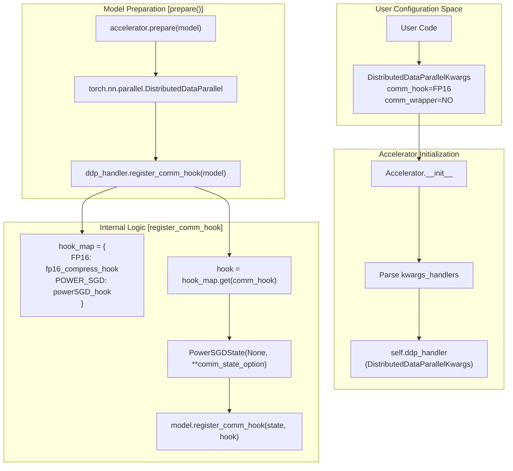
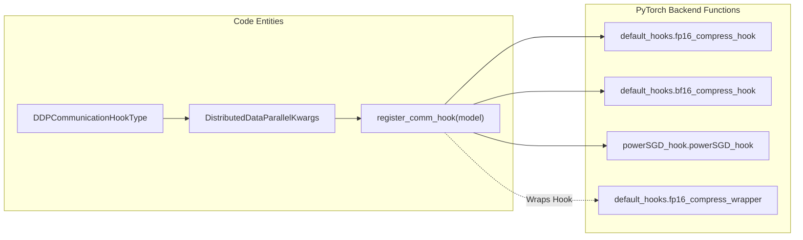

<!-- source: DeepWiki mcp.deepwiki.com · repo huggingface/accelerate · page 8.3 DDP Communication Hooks · fetched 2026-10-21 -->

# DDP Communication Hooks

<details>
<summary>Relevant source files</summary>

The following files were used as context for generating this wiki page:

- [docs/source/usage_guides/ddp_comm_hook.md](docs/source/usage_guides/ddp_comm_hook.md)
- [examples/by_feature/ddp_comm_hook.py](examples/by_feature/ddp_comm_hook.py)
- [examples/by_feature/profiler.py](examples/by_feature/profiler.py)
- [src/accelerate/test_utils/scripts/test_ddp_comm_hook.py](src/accelerate/test_utils/scripts/test_ddp_comm_hook.py)
- [src/accelerate/utils/deepspeed.py](src/accelerate/utils/deepspeed.py)
- [tests/deepspeed/test_deepspeed_gradient_accumulation.py](tests/deepspeed/test_deepspeed_gradient_accumulation.py)

</details>


## Purpose and Scope

Distributed Data Parallel (DDP) communication hooks provide a generic interface to control how gradients are communicated across workers by overriding the vanilla all-reduce operation in `DistributedDataParallel` [docs/source/usage_guides/ddp_comm_hook.md:19](). These hooks intercept the gradient all-reduce operation in DDP and apply transformations—such as half-precision casting or low-rank approximation—before communication, significantly reducing bandwidth requirements and improving training throughput [docs/source/usage_guides/ddp_comm_hook.md:22-26]().

This page covers the configuration and usage of communication hooks in Accelerate's DDP implementation.

## Communication Hook Types

Accelerate supports several types of DDP communication hooks through the `DDPCommunicationHookType` enum [src/accelerate/utils/dataclasses.py:134-151]():

| Hook Type | Description | Implementation Source |
|-----------|-------------|-----------------------|
| `NO` | No communication hook applied | N/A |
| `FP16` | Compresses gradients to `torch.float16` | `default_hooks.fp16_compress_hook` |
| `BF16` | Compresses gradients to `torch.bfloat16` | `default_hooks.bf16_compress_hook` |
| `POWER_SGD` | PowerSGD low-rank gradient compression | `powerSGD_hook.powerSGD_hook` |
| `BATCHED_POWER_SGD` | Batched PowerSGD for improved efficiency | `powerSGD_hook.batched_powerSGD_hook` |

Sources: [src/accelerate/utils/dataclasses.py:134-151](), [src/accelerate/utils/dataclasses.py:206-216](), [docs/source/usage_guides/ddp_comm_hook.md:22-24]()

## Configuration via DistributedDataParallelKwargs

Communication hooks are configured through the `DistributedDataParallelKwargs` class, which is passed to the `Accelerator` via the `kwargs_handlers` parameter [src/accelerate/accelerator.py:279-302]().

```python
from accelerate import Accelerator, DDPCommunicationHookType, DistributedDataParallelKwargs

# Example: PowerSGD with custom rank
ddp_kwargs = DistributedDataParallelKwargs(
    comm_hook=DDPCommunicationHookType.POWER_SGD,
    comm_state_option={"matrix_approximation_rank": 2}
)
accelerator = Accelerator(kwargs_handlers=[ddp_kwargs])
```

The `DistributedDataParallelKwargs` class provides fields for granular control [src/accelerate/utils/dataclasses.py:189-196]():

- **`comm_hook`**: The primary compression hook.
- **`comm_wrapper`**: An optional wrapper (e.g., applying `FP16` compression on top of `POWER_SGD`).
- **`comm_state_option`**: A dictionary of options for the hook's state object (e.g., `matrix_approximation_rank`).

Sources: [src/accelerate/utils/dataclasses.py:189-196](), [src/accelerate/test_utils/scripts/test_ddp_comm_hook.py:40-45](), [examples/by_feature/ddp_comm_hook.py:124-128]()

## Hook Registration Architecture

The registration of hooks occurs during the `accelerator.prepare()` call. When a model is wrapped in DDP, Accelerate automatically applies the requested hooks [src/accelerate/accelerator.py:1282-1286]().


**Figure 1: Association of Configuration to DDP Hook Registration**

Sources: [src/accelerate/accelerator.py:1282-1286](), [src/accelerate/utils/dataclasses.py:200-237]()

## Hook and Wrapper Implementation

The `register_comm_hook` method in `DistributedDataParallelKwargs` maps the enum types to specific PyTorch functions from `torch.distributed.algorithms.ddp_comm_hooks` [src/accelerate/utils/dataclasses.py:200-222]().

### Hook Mapping Logic
The implementation distinguishes between primary hooks and wrappers. If a `comm_wrapper` is provided, it wraps the base `comm_hook` [src/accelerate/utils/dataclasses.py:218-222]().


**Figure 2: Mapping DDPCommunicationHookType to PyTorch Backend Hooks**

Sources: [src/accelerate/utils/dataclasses.py:206-222](), [src/accelerate/test_utils/scripts/test_ddp_comm_hook.py:61-72]()

## PowerSGD State Configuration

PowerSGD requires a `PowerSGDState` object to maintain error feedback and matrix approximations [docs/source/usage_guides/ddp_comm_hook.md:180-184](). Accelerate handles this initialization automatically if `POWER_SGD` or `BATCHED_POWER_SGD` is selected [src/accelerate/utils/dataclasses.py:224-237]().

| Option | Type | Description |
|--------|------|-------------|
| `matrix_approximation_rank` | `int` | Rank of the low-rank approximation (default: 4) |
| `start_powerSGD_iter` | `int` | Iteration to start compression (default: 1000) |
| `use_error_feedback` | `bool` | Compensate for biased compressed communication |
| `warm_start` | `bool` | Reuse previous approximations for efficiency |

Sources: [src/accelerate/utils/dataclasses.py:224-237](), [docs/source/usage_guides/ddp_comm_hook.md:182](), [src/accelerate/test_utils/scripts/test_ddp_comm_hook.py:68]()

## Usage Examples

### Example 1: FP16 Compression
Reduces bandwidth by 50% by casting gradients to half-precision [docs/source/usage_guides/ddp_comm_hook.md:22]().

```python
from accelerate import Accelerator, DDPCommunicationHookType, DistributedDataParallelKwargs

ddp_kwargs = DistributedDataParallelKwargs(comm_hook=DDPCommunicationHookType.FP16)
accelerator = Accelerator(kwargs_handlers=[ddp_kwargs])

model, optimizer, train_dataloader = accelerator.prepare(model, optimizer, train_dataloader)
```
Sources: [docs/source/usage_guides/ddp_comm_hook.md:79-80](), [examples/by_feature/ddp_comm_hook.py:126-128]()

### Example 2: PowerSGD with BF16 Wrapper
Combines low-rank approximation with `bfloat16` precision for extreme bandwidth reduction [src/accelerate/test_utils/scripts/test_ddp_comm_hook.py:67]().

```python
ddp_kwargs = DistributedDataParallelKwargs(
    comm_hook=DDPCommunicationHookType.POWER_SGD,
    comm_wrapper=DDPCommunicationHookType.BF16,
    comm_state_option={"matrix_approximation_rank": 2}
)
accelerator = Accelerator(kwargs_handlers=[ddp_kwargs])
```
Sources: [src/accelerate/test_utils/scripts/test_ddp_comm_hook.py:67-68](), [examples/by_feature/ddp_comm_hook.py:124-126]()

## Limitations and Compatibility

- **Backend Support**: `BF16` compression requires NCCL version > 2.9.6 [docs/source/usage_guides/ddp_comm_hook.md:104]().
- **Hardware Compatibility**: On Intel HPU, `FP16` and `BF16` communication hooks are currently unsupported [src/accelerate/test_utils/scripts/test_ddp_comm_hook.py:73-77]().
- **Framework Integration**: Communication hooks are specific to DDP and are not used when `DistributedType.DEEPSPEED` or `DistributedType.FSDP` is active, as those backends manage their own communication protocols [src/accelerate/utils/dataclasses.py:197-198]().

Sources: [docs/source/usage_guides/ddp_comm_hook.md:104](), [src/accelerate/test_utils/scripts/test_ddp_comm_hook.py:73-77](), [src/accelerate/utils/dataclasses.py:197-198]()

---

