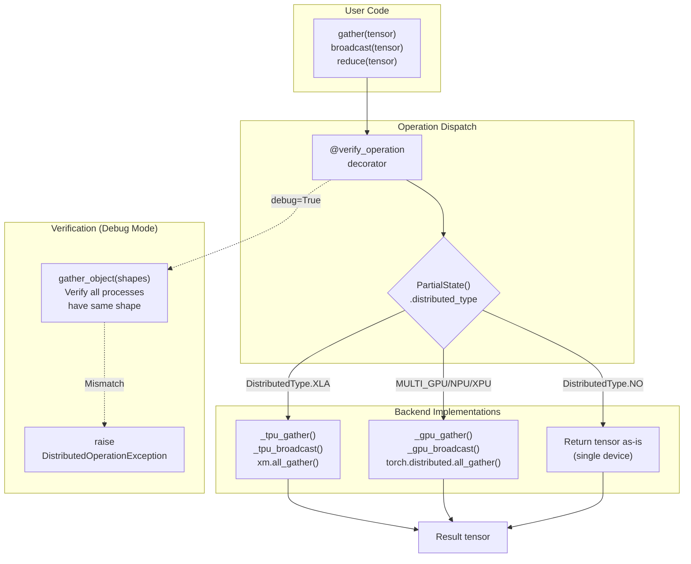
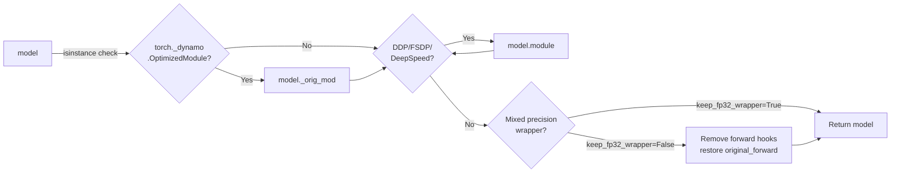

<!-- source: DeepWiki mcp.deepwiki.com · repo huggingface/accelerate · page 9 Distributed Operations and Utilities · fetched 2026-10-21 -->

# Distributed Operations and Utilities

<details>
<summary>Relevant source files</summary>

The following files were used as context for generating this wiki page:

- [src/accelerate/commands/config/update.py](src/accelerate/commands/config/update.py)
- [src/accelerate/commands/to_fsdp2.py](src/accelerate/commands/to_fsdp2.py)
- [src/accelerate/test_utils/scripts/test_ops.py](src/accelerate/test_utils/scripts/test_ops.py)
- [src/accelerate/utils/operations.py](src/accelerate/utils/operations.py)
- [src/accelerate/utils/other.py](src/accelerate/utils/other.py)
- [tests/test_utils.py](tests/test_utils.py)

</details>


This document provides a reference for collective operations, tensor manipulation utilities, and model handling functions used in distributed training. These low-level utilities power the `Accelerator` class and enable communication across processes, device management, and state synchronization.

**Scope**: This page covers operations in [src/accelerate/utils/operations.py]() and model extraction utilities from [src/accelerate/utils/other.py](). For information about the high-level `Accelerator` API, see [The Accelerator Class](#2). For distributed training backends (FSDP, DeepSpeed, etc.), see [Distributed Training Backends](#3).

---

## Overview

The distributed operations system provides three categories of functionality:

| Category | Functions | Purpose |
|----------|-----------|---------|
| **Collective Operations** | `gather`, `broadcast`, `reduce`, `pad_across_processes` | Synchronize tensors across processes |
| **Tensor Operations** | `send_to_device`, `recursively_apply`, `find_device` | Manipulate nested tensor structures |
| **Model Utilities** | `extract_model_from_parallel`, `save`, `load` | Unwrap models and manage checkpoints |

All operations automatically detect the distributed backend (CPU, GPU, TPU/XLA) and route to the appropriate implementation.

**Sources**: [src/accelerate/utils/operations.py:1-872]()

---

## Architecture: Operation Dispatch System

The following diagram shows how operations are dispatched based on the detected distributed type:



**Key Design**: Operations use the `@verify_operation` decorator [src/accelerate/utils/operations.py:364-397]() to optionally validate tensor shapes across processes when `PartialState().debug` is enabled, catching common distributed training errors early.

**Sources**: [src/accelerate/utils/operations.py:364-397](), [src/accelerate/utils/operations.py:418-436](), [src/accelerate/utils/operations.py:538-558]()

---

## Collective Operations

### gather

Collects tensors from all processes and concatenates them into a single tensor on each process.

```python
from accelerate.utils import gather

# Each process has a local tensor
local_predictions = model(batch)  # Shape: [local_batch_size, num_classes]

# Gather predictions from all processes
all_predictions = gather(local_predictions)  # Shape: [total_batch_size, num_classes]
```

**Implementation Details**:
- **GPU/NPU/XPU**: Uses `torch.distributed.all_gather_into_tensor` for efficient gathering [src/accelerate/utils/operations.py:318-352]()
- **TPU/XLA**: Uses `xm.all_gather` with contiguity checks [src/accelerate/utils/operations.py:301-313]()
- **Non-contiguous tensors**: Automatically converted to contiguous before gathering [src/accelerate/utils/operations.py:307-309]()
- **Scalar tensors**: Automatically cloned and unsqueezed to shape `[1]` [src/accelerate/utils/operations.py:303-304]()

**Nested Structure Support**: `gather` recursively applies to nested lists, tuples, and dictionaries:

```python
data = {
    "predictions": tensor1,  # [2, 10]
    "labels": [tensor2, tensor3],  # [2, 5] each
}
gathered = gather(data)
# {"predictions": [8, 10], "labels": [[8, 5], [8, 5]]} for 4 processes
```

For details, see [Collective Operations](#9.1).

**Sources**: [src/accelerate/utils/operations.py:418-436](), [src/accelerate/utils/operations.py:301-352]()

### gather_object

Gathers arbitrary Python objects (not just tensors) from all processes using pickle serialization.

```python
from accelerate.utils import gather_object

# Gather lists of strings, dicts, or custom objects
local_metrics = [{"loss": 0.5, "step": i}]
all_metrics = gather_object(local_metrics)
# Returns flattened list from all processes
```

**Limitations**:
- **Not supported on TPU/XLA**: Raises `NotImplementedError` [src/accelerate/utils/operations.py:456-457]()
- **Pickle requirement**: Objects must be picklable
- **Output format**: Returns a flattened list of all objects from all processes [src/accelerate/utils/operations.py:441-442]()

**Sources**: [src/accelerate/utils/operations.py:445-462]()

### broadcast

Sends a tensor from one process (default: process 0) to all other processes.

```python
from accelerate.utils import broadcast

# Only process 0 has the loaded data
if accelerator.is_main_process:
    config = load_config("config.yaml")
else:
    config = None

# Broadcast config to all processes
config = broadcast(config, from_process=0)
```

**Implementation**:
- **GPU**: Uses `torch.distributed.broadcast` [src/accelerate/utils/operations.py:464-469]()
- **TPU**: Uses `xm.mesh_reduce` with lambda selecting source process [src/accelerate/utils/operations.py:472-477]()

**Sources**: [src/accelerate/utils/operations.py:538-558](), [src/accelerate/utils/operations.py:464-477]()

### broadcast_object_list

Broadcasts a list of objects from one process to all others. **Modifies the list in-place**.

```python
from accelerate.utils import broadcast_object_list

# Process 0 has the data
object_list = [model_config, dataset_info] if accelerator.is_main_process else [None, None]

# Broadcast in-place
broadcast_object_list(object_list, from_process=0)
# Now all processes have the same [model_config, dataset_info]
```

**Sources**: [src/accelerate/utils/operations.py:560-579]()

### reduce

Aggregates tensors across processes using a reduction operation.

```python
from accelerate.utils import reduce

# Average loss across all processes
local_loss = compute_loss(batch)
avg_loss = reduce(local_loss, reduction="mean")

# Sum gradients across all processes
gradient_sum = reduce(gradients, reduction="sum")
```

**Reduction Types**:
- `"mean"`: Divide sum by `num_processes` [src/accelerate/utils/operations.py:760-761]()
- `"sum"`: Sum all values [src/accelerate/utils/operations.py:756-759]()
- `"none"`: Perform all-reduce without additional processing

**TPU-Specific**: Includes `mark_step()` calls before and after reduction to synchronize HLO graphs across processes [src/accelerate/utils/operations.py:754-757]()

**Sources**: [src/accelerate/utils/operations.py:727-767]()

### pad_across_processes

Pads tensors to the same size across all processes, enabling gathering of variable-length data.

```python
from accelerate.utils import pad_across_processes

# Process 0 has 5 samples, Process 1 has 3 samples
local_outputs = model(batch)  # Shape: [5, 128] or [3, 128]

# Pad to match the largest size
padded_outputs = pad_across_processes(local_outputs, dim=0, pad_index=0)
# All processes now have shape [5, 128]

# Now safe to gather
all_outputs = gather(padded_outputs)
```

**Parameters**:
- `dim`: Dimension to pad along
- `pad_index`: Value to use for padding (default: 0)
- `pad_first`: Whether to pad at the beginning (True) or end (False) of the dimension

**Special Cases**:
- **Nested tensors**: Emits `CannotPadNestedTensorWarning` and returns unprocessed [src/accelerate/utils/operations.py:649-654]()
- **Out-of-bounds dim**: Returns tensor unchanged [src/accelerate/utils/operations.py:655-656]()

**Sources**: [src/accelerate/utils/operations.py:631-684]()

---

## Tensor and Data Operations

### recursively_apply

Core utility that applies a function to all tensors in a nested structure (lists, tuples, dicts).

```python
from accelerate.utils import recursively_apply

def normalize(tensor):
    return (tensor - tensor.mean()) / tensor.std()

data = {
    "inputs": [tensor1, tensor2],
    "labels": tensor3,
    "metadata": "string"  # Non-tensor, ignored
}

normalized_data = recursively_apply(normalize, data)
```

**Function Signature**:
```python
recursively_apply(
    func,                    # Function to apply to each tensor
    data,                    # Nested data structure
    *args,                   # Positional args passed to func
    test_type=is_torch_tensor,  # Predicate to identify target objects
    error_on_other_type=False,  # Whether to raise error on non-matching types
    **kwargs                 # Keyword args passed to func
)
```

**Preservation of Structure**: Maintains the exact type of collections (list, tuple, namedtuple, dict, OrderedDict) using `honor_type` [src/accelerate/utils/operations.py:74-83](). For details, see [Tensor and Data Operations](#9.2).

**Sources**: [src/accelerate/utils/operations.py:85-134]()

### send_to_device

Moves tensors or nested structures of tensors to a target device.

```python
from accelerate.utils import send_to_device

batch = {"input_ids": tensor1, "attention_mask": tensor2}
batch = send_to_device(batch, device=accelerator.device)
```

**Features**:
- **Nested structures**: Recursively processes lists, tuples, dicts
- **Skip keys**: Optionally skip certain dictionary keys [src/accelerate/utils/operations.py:174-182]()
- **Non-blocking transfer**: Supports `non_blocking=True` for async GPU transfers
- **NPU special handling**: Converts device string/int to proper NPU format [src/accelerate/utils/operations.py:151-168]()

**Sources**: [src/accelerate/utils/operations.py:136-186]()

### find_device

Recursively searches a nested structure to find which device the tensors are on.

```python
from accelerate.utils import find_device

data = {"a": tensor_on_cuda, "b": [tensor_on_cuda, "metadata"]}
device = find_device(data)  # Returns torch.device("cuda:0")
```

Returns `None` if no tensors are found in the structure.

**Sources**: [src/accelerate/utils/operations.py:831-850]()

### Data Structure Analysis

These utilities extract metadata from nested tensor structures:

| Function | Purpose | Return Type |
|----------|---------|-------------|
| `get_data_structure(data)` | Extract shape and dtype info | Nested `TensorInformation` objects |
| `get_shape(data)` | Extract tensor shapes | Nested lists of shapes |
| `initialize_tensors(data_structure)` | Create empty tensors from metadata | Nested tensors |
| `find_batch_size(data)` | Find batch dimension size | `int` |

**Sources**: [src/accelerate/utils/operations.py:188-276]()

---

## Model and State Utilities

### extract_model_from_parallel

Unwraps a model from distributed wrappers (DDP, FSDP, DeepSpeed) to access the original model.

```python
from accelerate.utils import extract_model_from_parallel

# After prepare()
prepared_model = accelerator.prepare(model)

# Extract original model
original_model = extract_model_from_parallel(prepared_model)
```

**Wrapper Removal Order**:
1. `torch.compile()` wrapper (if `keep_torch_compile=True`)
2. `DistributedDataParallel`
3. `DataParallel`
4. `DeepSpeedEngine`
5. `FullyShardedDataParallel` (FSDP)
6. Nested `module.module` wrappers (if `recursive=True`)

For details, see [Model and State Utilities](#9.3).

**Sources**: [src/accelerate/utils/other.py:218-301]()

### Distributed Wrapper Detection



**Sources**: [src/accelerate/utils/other.py:238-298]()

### save and load

Accelerate-compatible versions of `torch.save` and `torch.load` that handle distributed saving and safe tensor loading.

**save Function**:
```python
from accelerate.utils import save

# Only saves on main process (or local main process if save_on_each_node=True)
save(model.state_dict(), "checkpoint.pt", safe_serialization=True)
```

**Features**:
- **Process filtering**: Only main process saves by default [src/accelerate/utils/other.py:379-382]()
- **SafeTensors support**: Can save using safetensors format [src/accelerate/utils/other.py:372-375]()
- **XLA compatibility**: Automatically moves tensors to CPU before saving [src/accelerate/utils/other.py:369-370]()

**Sources**: [src/accelerate/utils/other.py:351-431]()

---

## Verification and Debugging

### verify_operation Decorator

Validates that tensors have the same shape across all processes when debug mode is enabled.

**Activation**:
```python
from accelerate import PartialState

# Enable debug mode
state = PartialState()
state.debug = True

# Now all collective operations will validate shapes
gathered = gather(tensor)  # Will raise exception if shapes mismatch
```

For details, see [Verification and Debugging](#9.4).

**Sources**: [src/accelerate/utils/operations.py:364-397]()

### DistributedOperationException

Custom exception raised when distributed operations fail validation.

```python
from accelerate.utils.operations import DistributedOperationException

try:
    result = gather(tensor)
except DistributedOperationException as e:
    print(f"Operation failed: {e}")
```

**Sources**: [src/accelerate/utils/operations.py:355-362]()

### chained_operation Decorator

Wraps functions that call multiple operations to provide clearer error messages.

**Sources**: [src/accelerate/utils/operations.py:399-416]()

---

## Special Utilities

### GatheredParameters Context Manager

Provides safe access to DeepSpeed ZeRO-3 parameters that are normally partitioned across devices.

**Sources**: [src/accelerate/utils/operations.py:852-872]()

### copy_tensor_to_devices

Broadcasts a tensor that only exists on one process to all processes, without requiring other processes to know its shape in advance.

**Sources**: [src/accelerate/utils/operations.py:521-536]()

### convert_to_fp32

Converts FP16/BF16 tensors to FP32 for accumulation or logging.

**Sources**: [src/accelerate/utils/operations.py:769-791]()

---

