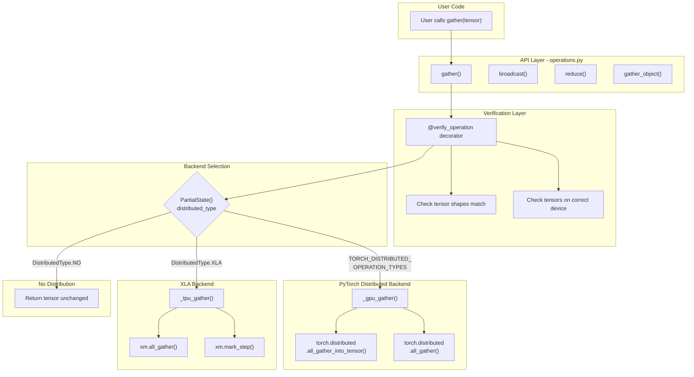
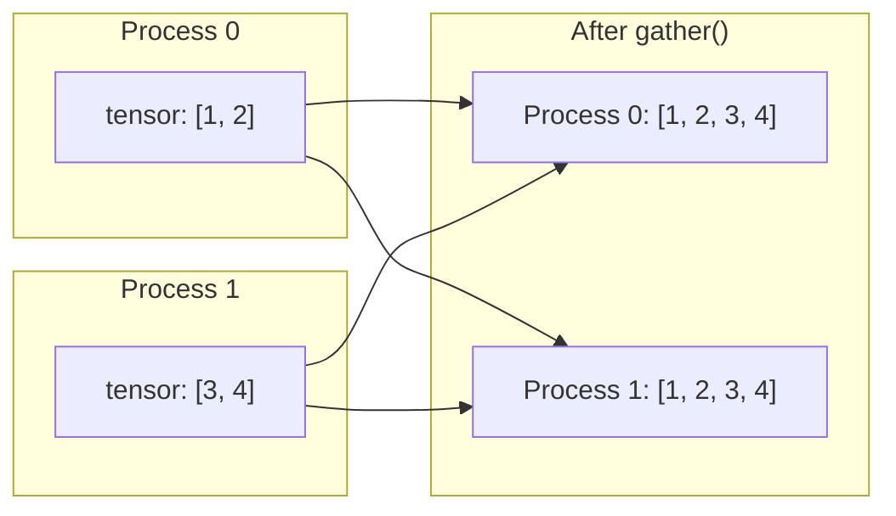
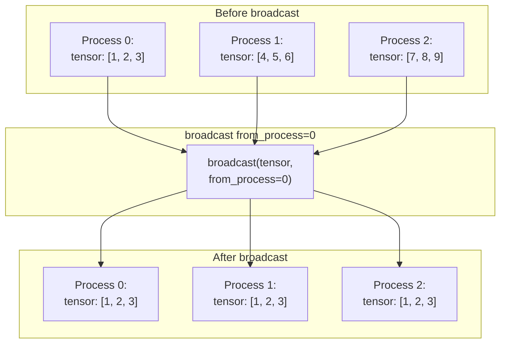
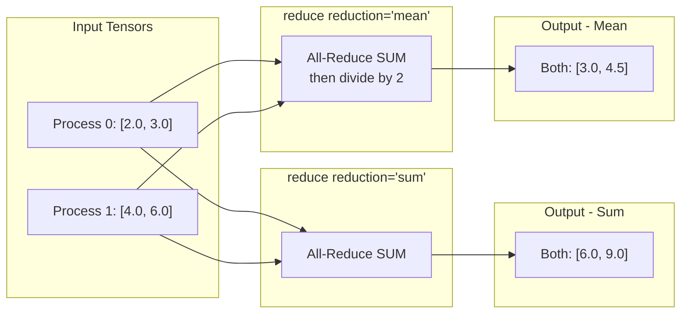
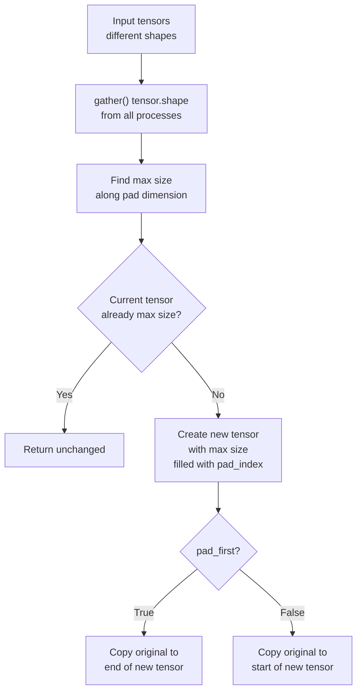
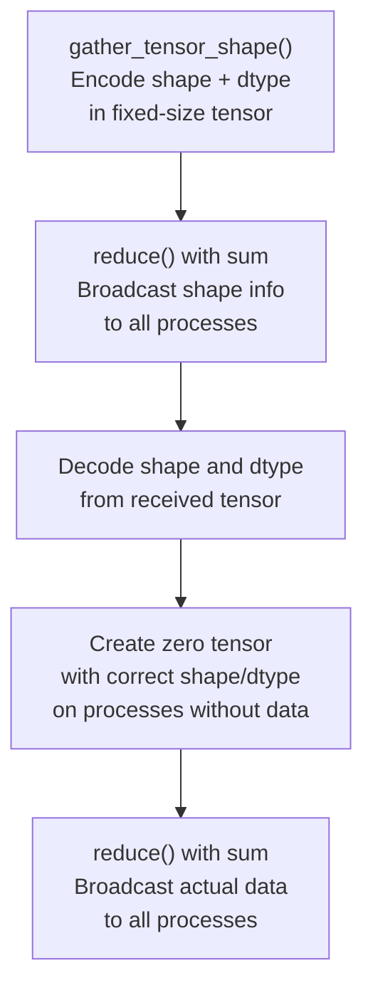
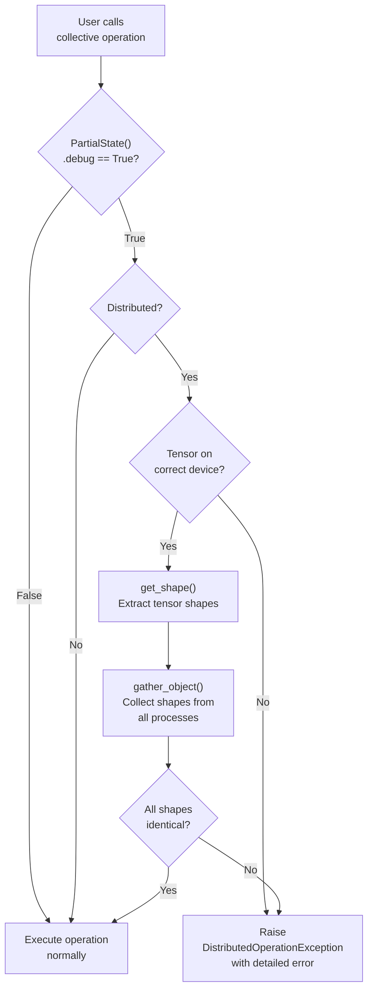
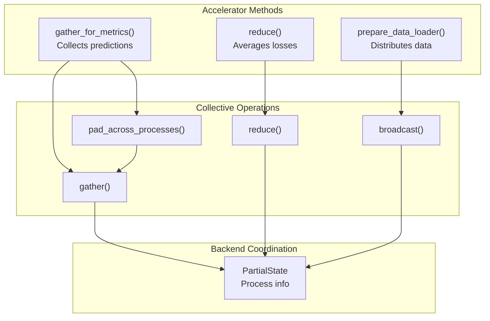

<!-- source: DeepWiki mcp.deepwiki.com · repo huggingface/accelerate · page 9.1 Collective Operations · fetched 2026-10-21 -->

# Collective Operations

<details>
<summary>Relevant source files</summary>

The following files were used as context for generating this wiki page:

- [src/accelerate/commands/config/update.py](src/accelerate/commands/config/update.py)
- [src/accelerate/commands/to_fsdp2.py](src/accelerate/commands/to_fsdp2.py)
- [src/accelerate/test_utils/scripts/test_ops.py](src/accelerate/test_utils/scripts/test_ops.py)
- [src/accelerate/utils/operations.py](src/accelerate/utils/operations.py)
- [src/accelerate/utils/other.py](src/accelerate/utils/other.py)
- [tests/test_utils.py](tests/test_utils.py)

</details>


## Purpose and Scope

This page documents the collective operations provided by Accelerate for communication and synchronization across distributed processes. Collective operations are fundamental primitives that enable data exchange between processes in multi-GPU, multi-node, and TPU training environments.

These operations handle tensor communication (gather, broadcast, reduce) and work transparently across different distributed backends including PyTorch Distributed, XLA (TPU), and single-process configurations. For information about other distributed utilities like device management and process synchronization, see page 9.2. For model and state utilities, see page 9.3.

Sources: [src/accelerate/utils/operations.py:14-16]()

## Overview

Collective operations in Accelerate provide a unified API for distributed communication that automatically adapts to the active backend. All operations support nested data structures (lists, tuples, dictionaries) and recursively apply transformations to tensors within these structures.

The operations are designed to:
- Work seamlessly across PyTorch Distributed, XLA, and single-process environments.
- Handle non-contiguous tensors automatically.
- Support arbitrary nesting of data structures.
- Provide verification and debugging capabilities via the `verify_operation` decorator.

### Distributed Backend Architecture



Sources: [src/accelerate/utils/operations.py:418-436](), [src/accelerate/utils/operations.py:301-313](), [src/accelerate/utils/operations.py:316-352](), [src/accelerate/utils/operations.py:27-28]()

## Core Collective Operations

### gather

The `gather` function collects tensors from all processes and concatenates them. Each process receives the complete gathered result.

**Function Signature:**
- Location: [src/accelerate/utils/operations.py:418-436]()
- Decorator: `@verify_operation`
- Returns: Gathered tensor with first dimension equal to `num_processes * original_first_dim`.

**Behavior:**
- For 0-dimensional tensors, automatically expands to 1D before gathering [src/accelerate/utils/operations.py:321-322]().
- Automatically makes tensors contiguous if needed [src/accelerate/utils/operations.py:320]().
- Recursively applies to nested data structures using `recursively_apply`.

**Backend Implementations:**

| Backend | Function | Implementation Details |
|---------|----------|----------------------|
| XLA/TPU | `_tpu_gather` [src/accelerate/utils/operations.py:301-313]() | Uses `xm.all_gather()`, includes `xm.mark_step()` for synchronization. |
| PyTorch Distributed | `_gpu_gather` [src/accelerate/utils/operations.py:316-352]() | Uses `torch.distributed.all_gather_into_tensor()` for efficiency, falls back to `torch.distributed.all_gather()` for gloo backend. |
| Single Process | N/A | Returns tensor unchanged. |



**Example from tests:**
The test in [src/accelerate/test_utils/scripts/test_ops.py:37-40]() demonstrates expected behavior:
```python
# Creates tensor [1, 2] on process 0 and [3, 4] on process 1
tensor = create_tensor(state)
gathered_tensor = gather(tensor)
# Result: [1, 2, 3, 4] on both processes
```

Sources: [src/accelerate/utils/operations.py:418-436](), [src/accelerate/utils/operations.py:301-313](), [src/accelerate/utils/operations.py:316-352](), [src/accelerate/test_utils/scripts/test_ops.py:37-40]()

### broadcast

The `broadcast` function sends a tensor from one process (by default process 0) to all other processes. All processes receive an identical copy.

**Function Signature:**
- Location: [src/accelerate/utils/operations.py:538-558]()
- Decorator: `@verify_operation`
- Parameter: `from_process` (int, default=0) - source process rank.

**Backend Implementations:**



**Backend Implementations:**

| Backend | Implementation | Details |
|---------|---------------|---------|
| XLA/TPU | `_tpu_broadcast` [src/accelerate/utils/operations.py:472-477]() | Uses `xm.mesh_reduce()` with lambda `lambda x: x[src]` to select source process. |
| PyTorch Distributed | `_gpu_broadcast` [src/accelerate/utils/operations.py:464-469]() | Uses `torch.distributed.broadcast()` directly. |
| Single Process | N/A | Returns tensor unchanged. |

Sources: [src/accelerate/utils/operations.py:538-558](), [src/accelerate/utils/operations.py:464-469](), [src/accelerate/utils/operations.py:472-477]()

### reduce

The `reduce` function aggregates tensors across all processes using a specified reduction operation (sum or mean).

**Function Signature:**
- Location: [src/accelerate/utils/operations.py:723-762]()
- Decorator: `@verify_operation`
- Parameters:
  - `reduction` (str): "sum", "mean", or "none".
  - `scale` (float): Scaling factor (XLA only).

**Reduction Operations:**

| Reduction Type | Behavior | Example (2 processes) |
|----------------|----------|----------------------|
| "sum" | Adds all tensors | P0:[2,3] + P1:[4,5] = [6,8] |
| "mean" | Averages all tensors | P0:[2,3] + P1:[4,5] = [3,4] |
| "none" | Sum without normalization | Same as "sum" |

**Backend Implementations:**

| Backend | Implementation | Details |
|---------|---------------|---------|
| XLA/TPU [src/accelerate/utils/operations.py:746-753]() | `xm.all_reduce(xm.REDUCE_SUM, [tensor], scale)` | Includes `xm.mark_step()` before and after for HLO synchronization. |
| PyTorch Distributed [src/accelerate/utils/operations.py:754-755]() | `torch.distributed.all_reduce(tensor, ReduceOp.SUM)` | Standard PyTorch collective. |
| Mean Normalization [src/accelerate/utils/operations.py:756-757]() | Division by `state.num_processes` | Applied after sum reduction when `reduction="mean"`. |



Sources: [src/accelerate/utils/operations.py:723-762](), [src/accelerate/test_utils/scripts/test_ops.py:85-103]()

### gather_object

The `gather_object` function collects arbitrary Python objects (not just tensors) from all processes. Objects must be picklable.

**Function Signature:**
- Location: [src/accelerate/utils/operations.py:445-461]()
- Input: Nested list/tuple/dictionary of picklable objects.
- Output: Flattened list containing objects from all processes.
- **Note:** Not supported on XLA/TPU - raises `NotImplementedError`.

**Implementation:**
Uses `torch.distributed.all_gather_object()` which requires objects to be serializable via pickle [src/accelerate/utils/operations.py:438-442](). The underlying PyTorch function returns a list of lists (one per process), which `gather_object` automatically flattens into a single list.

**XLA Limitation:**
Raises `NotImplementedError` with message "gather objects in TPU is not supported" [src/accelerate/utils/operations.py:456-457]().

**Example from tests:**
```python
# Each process has: obj = [process_index]
# Process 0: [0], Process 1: [1], Process 2: [2]
obj = [state.process_index]
gathered_obj = gather_object(obj)
# Result: [0, 1, 2] on all processes
```

Sources: [src/accelerate/utils/operations.py:445-461](), [src/accelerate/utils/operations.py:438-442](), [src/accelerate/test_utils/scripts/test_ops.py:43-50]()

### broadcast_object_list

The `broadcast_object_list` function sends a list of picklable objects from one process to all others. Unlike `gather_object`, it modifies the input list in-place.

**Function Signature:**
- Location: [src/accelerate/utils/operations.py:560-578]()
- Parameter: `from_process` (int, default=0).
- **Important:** Modifies `object_list` in-place.

**Backend Behavior:**
- XLA: Uses `xm.mesh_reduce()` for each object in the list [src/accelerate/utils/operations.py:573-575]().
- PyTorch Distributed: Uses `torch.distributed.broadcast_object_list()` [src/accelerate/utils/operations.py:576-577]().

Sources: [src/accelerate/utils/operations.py:560-578]()

## Advanced Operations

### pad_across_processes

The `pad_across_processes` function pads tensors to the maximum size across all processes, enabling safe gathering of tensors with different shapes.

**Function Signature:**
- Location: [src/accelerate/utils/operations.py:627-680]()
- Decorator: `@chained_operation` (chains verification errors).
- Parameters:
  - `dim` (int, default=0): Dimension to pad.
  - `pad_index` (int, default=0): Value to use for padding.
  - `pad_first` (bool, default=False): Whether to pad at the beginning.

**Algorithm:**



**Special Cases:**
- Nested tensors: Issues a `CannotPadNestedTensorWarning` and returns unchanged [src/accelerate/utils/operations.py:645-650]().
- Out-of-bounds dimension: Returns tensor unchanged [src/accelerate/utils/operations.py:651-652]().

**Example from tests:**
```python
# Process 0: tensor of size [num_processes + 1]
# Process 1: tensor of size [num_processes]
# After pad_across_processes:
# Both have size [num_processes + 1]
# Process 1's tensor is padded with zeros at the end
```

Sources: [src/accelerate/utils/operations.py:627-680](), [src/accelerate/utils/operations.py:645-650](), [src/accelerate/test_utils/scripts/test_ops.py:72-82]()

### copy_tensor_to_devices

The `copy_tensor_to_devices` function broadcasts a tensor that exists only on one process to all other processes, without requiring other processes to know the tensor's shape in advance.

**Function Signature:**
- Location: [src/accelerate/utils/operations.py:521-535]()
- Input: `tensor` (can be `None` on non-source processes).
- Output: The tensor on all devices.

**Implementation Strategy:**



**Key Implementation Details:**
- Allocates a fixed-size buffer (2^20 ints) for shape encoding [src/accelerate/utils/operations.py:501-503]().
- Encodes dtype as integer using `TENSOR_TYPE_TO_INT` mapping [src/accelerate/utils/operations.py:480-493]().
- Uses two reduce operations: first for shape/dtype, then for actual data.

Sources: [src/accelerate/utils/operations.py:521-535](), [src/accelerate/utils/operations.py:496-518](), [src/accelerate/test_utils/scripts/test_ops.py:150-159]()

## Verification and Debugging

### Operation Verification System

Accelerate provides a verification decorator that validates tensor shapes and device placement across processes before executing collective operations.



**The `verify_operation` Decorator:**
- Location: [src/accelerate/utils/operations.py:364-396]()
- Activated only when `PartialState().debug == True`.
- Checks tensor device matches `PartialState().device`.
- Gathers tensor shapes from all processes and compares them.
- Provides detailed error messages with per-process shape information.

**Example Error Output:**
```
DistributedOperationException: Cannot apply desired operation due to shape mismatches.
All shapes across devices must be valid.

Operation: `accelerate.utils.operations.gather`
Input shapes:
  - Process 0: [[5]]
  - Process 1: [[[6]]]
```

**The `chained_operation` Decorator:**
- Location: [src/accelerate/utils/operations.py:399-415]()
- Wraps operations that call other verified operations.
- Re-raises `DistributedOperationException` with additional context.
- Used by `pad_across_processes` which calls `gather` internally.

Sources: [src/accelerate/utils/operations.py:364-396](), [src/accelerate/utils/operations.py:399-415](), [src/accelerate/test_utils/scripts/test_ops.py:115-148]()

### DistributedOperationException

Custom exception class for reporting collective operation errors.

**Definition:**
- Location: [src/accelerate/utils/operations.py:355-361]()
- Inherits from `Exception`.
- Raised when operations cannot be performed due to tensor shape mismatches or device placement errors.

Sources: [src/accelerate/utils/operations.py:355-361]()

## Supporting Utilities

### recursively_apply

Core utility function that applies a transformation function to tensors nested within complex data structures.

**Function Signature:**
- Location: [src/accelerate/utils/operations.py:85-133]()
- Parameters:
  - `func`: Callable to apply to each tensor.
  - `data`: Nested list/tuple/dict of tensors.
  - `test_type`: Function to test if element should be processed.
  - `error_on_other_type`: Whether to raise error on non-tensor types.

**Supported Structures:**

| Structure Type | Preservation | Notes |
|---------------|--------------|-------|
| `list` | Yes | Returns list with transformed elements. |
| `tuple` | Yes | Returns tuple with transformed elements. |
| `namedtuple` | Yes | Preserves namedtuple type [src/accelerate/utils/operations.py:79-82](). |
| `dict` | Yes | Returns same dict type with transformed values. |
| `Mapping` | Yes | Works with any mapping subclass. |

Sources: [src/accelerate/utils/operations.py:85-133](), [src/accelerate/utils/operations.py:66-82]()

### send_to_device

Moves tensors to a specified device, handling nested structures recursively.

**Function Signature:**
- Location: [src/accelerate/utils/operations.py:136-185]()
- Parameters:
  - `tensor`: Data to move (supports nested structures).
  - `device`: Target device.
  - `non_blocking`: Whether to use non-blocking transfer.
  - `skip_keys`: Keys to skip in dictionaries.

**Special Device Handling:**
- **NPU device string**: Converts `"npu"` to `"npu:0"` to establish context [src/accelerate/utils/operations.py:157-158]().
- **NPU integer device IDs**: Converts integer device to `f"npu:{device}"` format [src/accelerate/utils/operations.py:166-168]().
- **Non-blocking parameter**: Falls back to blocking transfer if `.to()` doesn't accept `non_blocking` kwarg [src/accelerate/utils/operations.py:161-162]().

Sources: [src/accelerate/utils/operations.py:136-185](), [tests/test_utils.py:78-115]()

### Data Structure Utilities

Several helper functions for analyzing and transforming tensor data structures:

| Function | Purpose | Location |
|----------|---------|----------|
| `get_data_structure()` | Extracts shape and dtype info | [src/accelerate/utils/operations.py:188-203]() |
| `get_shape()` | Extracts tensor shapes as lists | [src/accelerate/utils/operations.py:206-221]() |
| `initialize_tensors()` | Creates empty tensors from TensorInformation | [src/accelerate/utils/operations.py:224-235]() |
| `find_batch_size()` | Finds batch size in nested structures | [src/accelerate/utils/operations.py:238-258]() |
| `listify()` | Converts tensors to Python lists | [src/accelerate/utils/operations.py:278-298]() |

Sources: [src/accelerate/utils/operations.py:188-298]()

## Integration with Accelerator

Collective operations are used throughout the Accelerator class for distributed training coordination:



Sources: [src/accelerate/utils/operations.py:27-28]()

## Backend Constants

The module defines constants that determine which operations support PyTorch Distributed:

**TORCH_DISTRIBUTED_OPERATION_TYPES:**
- Location: [src/accelerate/utils/constants.py]() (referenced at [src/accelerate/utils/operations.py:28]())
- Contains `DistributedType` values that use the `torch.distributed` backend.
- Used to select between `_gpu_*` and `_tpu_*` implementations.

**Backend Selection Logic:**
```python
if PartialState().distributed_type == DistributedType.XLA:
    return _tpu_gather(tensor)
elif PartialState().distributed_type in TORCH_DISTRIBUTED_OPERATION_TYPES:
    return _gpu_gather(tensor)
else:
    return tensor  # No distribution
```

Sources: [src/accelerate/utils/operations.py:28-29](), [src/accelerate/utils/operations.py:430-435]()

---

